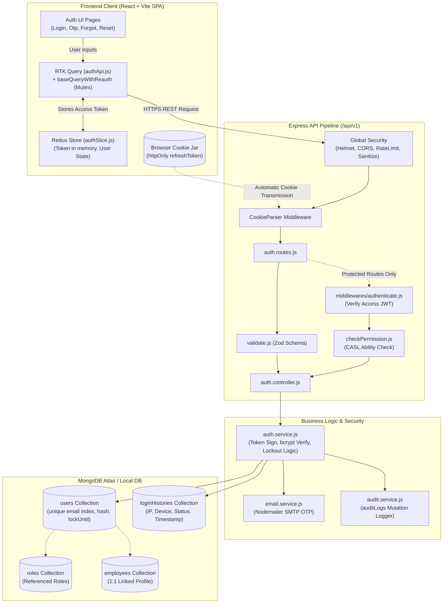
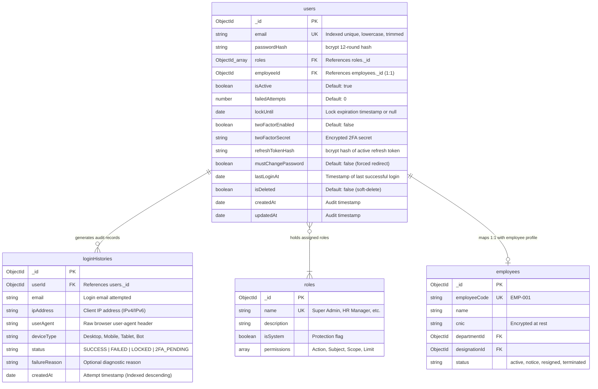
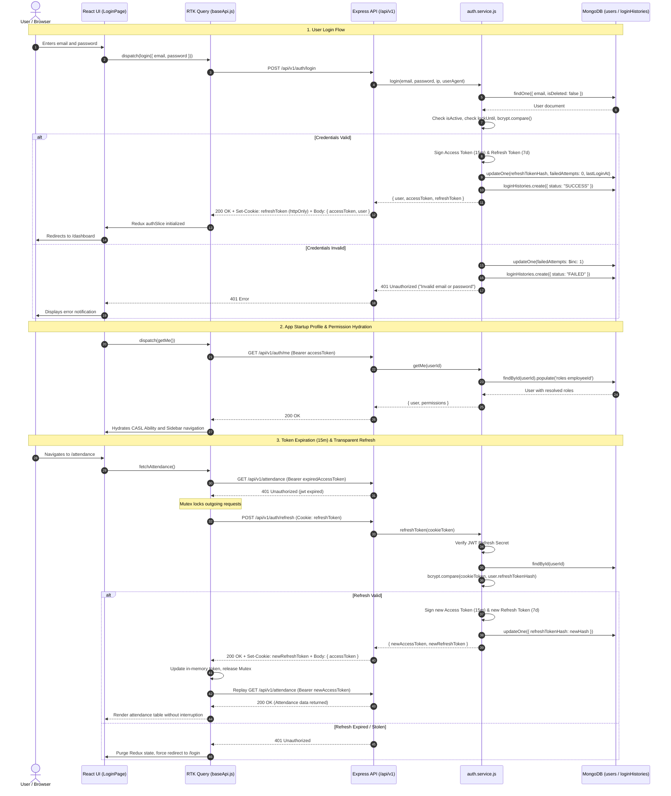

# Architecture Implementation Plan: M1 Authentication & Access Control

**Feature Identifier**: `02-auth`  
**Feature Branch**: `feature/02-auth`  
**Target Module**: Module M1 (Core HR Group · Priority P1)  
**Status**: Ready for Implementation  
**Governing Documents**: [`docs/TECH-SPEC.md`](file:///c:/Users/hamih/OneDrive/Desktop/AtoZ%20Coder/Advanced%20MERN/HRM/docs/TECH-SPEC.md) (Sections 3, 4, 5, 6, 8), [`docs/MODULES.md`](file:///c:/Users/hamih/OneDrive/Desktop/AtoZ%20Coder/Advanced%20MERN/HRM/docs/MODULES.md) (Section 4, M1), [`docs/BUILD-GUIDE.md`](file:///c:/Users/hamih/OneDrive/Desktop/AtoZ%20Coder/Advanced%20MERN/HRM/docs/BUILD-GUIDE.md) (Section 4)

---

## 1. Architectural Summary & Scope

Module M1 establishes the identity, session, and boundary protection layer for the entire HRM application. Designed under the **senior-architect** paradigm, it enforces:
1. **Stateless + Stateful Dual-Token Architecture:** 15-minute stateless JWT access token in memory + 7-day single-use rotating refresh token in an `httpOnly`, `secure`, `sameSite: strict` cookie.
2. **Brute-Force & Credential Defense:** 5 failed consecutive attempts trigger a 15-minute lock (`lockUntil`); rate-limiting throttles login attempts per IP.
3. **Password Lifecycle Control:** 12-round bcrypt hashing, self-service email OTP recovery (10-minute window), optional two-factor authentication (2FA), and mandatory password change on first login (`mustChangePassword: true`).
4. **Client-Side Session Automation:** RTK Query `baseQueryWithReauth` with Mutex locking seamlessly handles token rotation on 401 responses; 30-minute idle timer (`useIdleTimer`) terminates unattended sessions.
5. **Auditing & Traceability:** Immutable login attempt audit records (`loginHistory`) tracking IP, device type, browser user agent, and status.

---

## 2. Archify Visual Architecture & Technical Diagrams

### Diagram 1: High-Level Authentication & Request Pipeline Architecture


---

### Diagram 2: Entity Relationship Diagram (ERD)


---

### Diagram 3: Sequence Diagram — Complete Auth & Auto-Refresh Flow


---

## 3. MongoDB Schema & Index Verification (via `mongodb` MCP)

### Investigation Findings
Direct inspection of the local running MongoDB instance (`mongodb://localhost:27017`) via `mongodb` MCP tools revealed:
- Database `UserAuth` currently contains a placeholder `users` collection with **only the default index**:
  ```json
  { "_id": 1 }
  ```
- **Finding:** Currently, there is **NO unique index on `email`** at the database layer. Without an explicit unique index, concurrent user creation or duplicate registration could cause catastrophic data integrity violations.

### Required Database Schema & Index Specifications
In our HRM System database (`hrm` / `hrm_development`), Mongoose schemas must explicitly declare and enforce the following compound and unique indexes:

#### 1. `models/user.model.js` Indexes
```javascript
// Unique, case-insensitive index on email
userSchema.index({ email: 1 }, { unique: true, background: true });

// Performance index for status and lockout evaluations
userSchema.index({ isActive: 1, isDeleted: 1 });
userSchema.index({ lockUntil: 1 });

// Fast 1:1 join lookups
userSchema.index({ employeeId: 1 });
```

#### 2. `models/loginHistory.model.js` Indexes
```javascript
// Chronological user audit lookups (Profile -> Login History tab)
loginHistorySchema.index({ userId: 1, createdAt: -1 });

// Security and threat analytics queries
loginHistorySchema.index({ ipAddress: 1, createdAt: -1 });
loginHistorySchema.index({ status: 1, createdAt: -1 });

// TTL Index for automatic compliance pruning (retain records for 90 days)
loginHistorySchema.index({ createdAt: 1 }, { expireAfterSeconds: 90 * 24 * 60 * 60 });
```

---

## 4. Exact File Inventory & Responsibilities

The implementation strictly respects the folder structure laid out in `docs/TECH-SPEC.md` Section 3 and `docs/MODULES.md` Section 4:

```text
hrm-system/
├── backend/
│   └── src/
│       ├── models/
│       │   ├── user.model.js                  # User Mongoose schema, bcrypt hooks, indexes
│       │   └── loginHistory.model.js          # Login audit Mongoose schema & TTL index
│       ├── middlewares/
│       │   └── authenticate.js                # JWT verification, req.user & req.userId hydration
│       └── modules/
│           └── auth/
│               ├── auth.validation.js         # Zod schemas (login, reset, change, otp)
│               ├── auth.service.js            # Business logic, token generation, lockout, audit
│               ├── auth.controller.js         # HTTP handler, cookie setters, response envelopes
│               └── auth.routes.js             # Express router connecting middleware & controllers
└── frontend/
    └── src/
        ├── components/
        │   └── ProtectedRoute.jsx             # Route guard with mustChangePassword redirection
        ├── hooks/
        │   ├── useAuth.js                     # Hook exposing user, isAuthenticated, roles, logout
        │   └── useIdleTimer.js                # 30-minute client inactivity session terminator
        └── features/
            └── auth/
                ├── authApi.js                 # RTK Query API endpoints with re-auth Mutex
                ├── authSlice.js               # Redux slice managing token & user profile
                └── pages/
                    ├── LoginPage.jsx          # Email/password form with lockout alert
                    ├── OtpPage.jsx            # 2FA 6-digit passcode submission
                    ├── ForgotPasswordPage.jsx # Email input triggering OTP dispatch
                    ├── ResetPasswordPage.jsx  # OTP verification and new password entry
                    ├── ChangePasswordPage.jsx # Password update (forced on first login)
                    └── LoginHistoryPage.jsx   # Tabular audit log of user login events
```

---

## 5. Complete API Route Contract, Permissions & Scopes

All routes are mounted under `/api/v1`. Standard response shape: `{ success, data, message, meta }`.

| HTTP Method | Endpoint | Handler | Access Level | Permission Required | Data Scope | Notes / Invariants |
| :--- | :--- | :--- | :---: | :---: | :---: | :--- |
| **POST** | `/auth/login` | `authController.login` | Public | None | None | Rate limited (10/15m). Checks lockout (5 attempts $\rightarrow$ 15m). Returns access token + sets `refreshToken` cookie. |
| **POST** | `/auth/verify-otp` | `authController.verifyOtp` | Public | None | None | Verifies 6-digit 2FA code using short-lived session token. Returns access token + sets refresh cookie. |
| **POST** | `/auth/refresh` | `authController.refreshToken` | Cookie Auth | None | `own` | Reads `refreshToken` cookie. Rotates token, updates DB hash, sets new cookie. |
| **POST** | `/auth/logout` | `authController.logout` | Authenticated | None | `own` | Clears `refreshToken` cookie, nullifies DB hash, revokes session. |
| **POST** | `/auth/forgot-password` | `authController.forgotPassword` | Public | None | None | Rate limited. Generates 6-digit numeric OTP (10m expiry) and sends HTML email via Nodemailer. |
| **POST** | `/auth/reset-password` | `authController.resetPassword` | Public | None | `own` | Validates unexpired OTP, updates password with bcrypt (12 rounds), clears OTP. |
| **PATCH** | `/auth/change-password` | `authController.changePassword` | Authenticated | None | `own` | Requires valid current password. Updates password hash, sets `mustChangePassword: false`. |
| **POST** | `/auth/2fa/enable` | `authController.enable2FA` | Authenticated | None | `own` | Sends verification OTP to user email before flipping `twoFactorEnabled: true`. |
| **GET** | `/auth/me` | `authController.getMe` | Authenticated | None | `own` | Returns user info, employee profile, and compiled effective permissions for CASL. |
| **GET** | `/auth/login-history` | `authController.getLoginHistory` | Authenticated | `auth.history` (or self) | `own` or `all` | Employee/Manager sees `own` records only. Super Admin / HR sees `all` company records. |
| **PATCH** | `/users/:id/status` | `authController.updateUserStatus` | Authenticated | `user.manage` | `all` | Super Admin / HR only. Toggles `isActive`. If deactivated, immediately revokes refresh token. |
| **POST** | `/users/:id/reset-password` | `authController.adminResetPassword` | Authenticated | `user.manage` | `all` | Super Admin / HR only. Generates secure temp password, sets `mustChangePassword: true`, emails user. |

---

## 6. Implementation Checklist & Verification Gates

### Step 1: Backend Foundation & Persistence
- [ ] Create `backend/src/models/user.model.js` with schema validations, bcrypt hooks, and unique indexes.
- [ ] Create `backend/src/models/loginHistory.model.js` with IP/agent tracking and 90-day TTL index.
- [ ] Implement `backend/src/middlewares/authenticate.js` to verify JWT access tokens and attach `req.user`.
- [ ] Define comprehensive Zod validation schemas in `backend/src/modules/auth/auth.validation.js`.

### Step 2: Backend Logic & Routing
- [ ] Implement `backend/src/modules/auth/auth.service.js` with token generation, rotation, lockout counter, and email dispatch.
- [ ] Implement `backend/src/modules/auth/auth.controller.js` with standard `{ success, data, message, meta }` response envelopes.
- [ ] Configure `backend/src/modules/auth/auth.routes.js` with `validate` and `authenticate` middlewares.

### Step 3: Frontend State & Integration
- [ ] Build `frontend/src/features/auth/authSlice.js` to store access token and user metadata in Redux.
- [ ] Configure `frontend/src/features/auth/authApi.js` with RTK Query and `baseQueryWithReauth` Mutex handling.
- [ ] Implement `frontend/src/components/ProtectedRoute.jsx` with authentication checking and `mustChangePassword` force-redirect.
- [ ] Create `frontend/src/hooks/useAuth.js` and `frontend/src/hooks/useIdleTimer.js` (30m auto-logout).

### Step 4: Frontend UI Pages (Linear/Stripe Craft Aesthetics)
- [ ] `LoginPage.jsx` — Form with react-hook-form + Zod, lockout warning alert, remember me.
- [ ] `OtpPage.jsx` — 6-box segmented OTP input with countdown resend timer.
- [ ] `ForgotPasswordPage.jsx` — Clean email submission with success state.
- [ ] `ResetPasswordPage.jsx` — OTP verification and password strength meter.
- [ ] `ChangePasswordPage.jsx` — Current and new password inputs with confirmation.
- [ ] `LoginHistoryPage.jsx` — Data-dense table showing IP, browser, device, status, and time in `Asia/Karachi`.

---

## 7. Next Recommended Step

Run **/speckit-tasks** to decompose this architecture blueprint into prioritized, actionable, and sequential micro-tasks for implementation.
