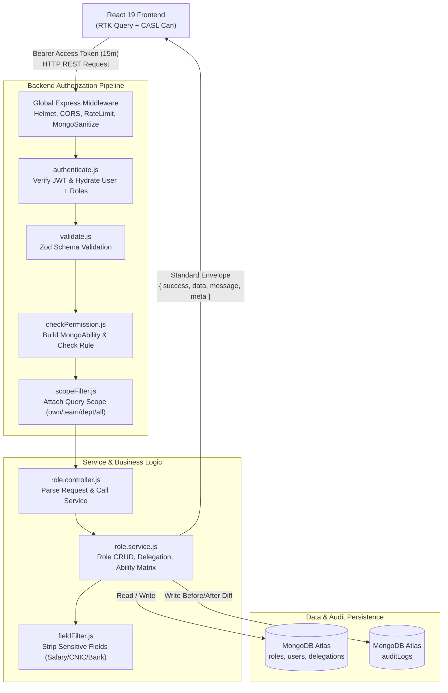
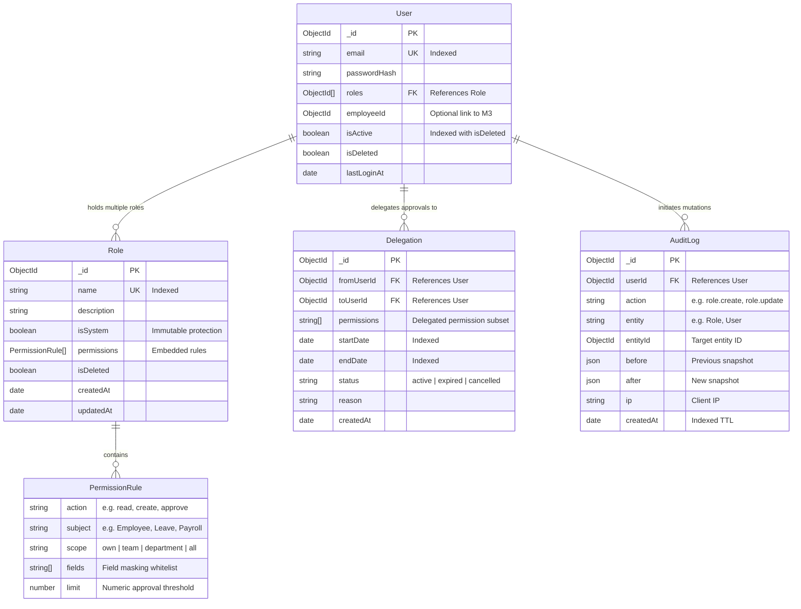
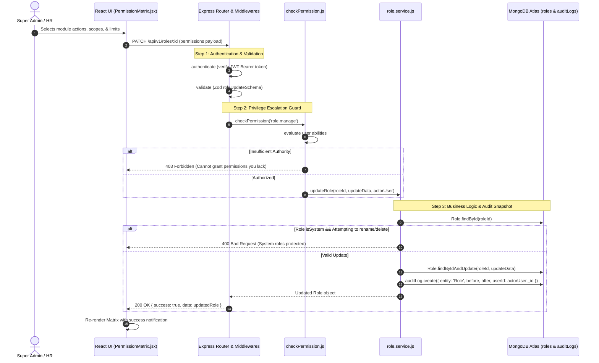

# Technical Architecture & Implementation Plan: Module M26 — Roles & Permissions (RBAC & CASL)

**Branch**: `feature/03-roles-permissions`  
**Date**: 2026-10-12  
**Spec Document**: [`spec.md`](file:///c:/Users/hamih/OneDrive/Desktop/AtoZ%20Coder/Advanced%20MERN/HRM/.specify/specs/03-roles-permissions/spec.md)  
**Governing Documents**:
- [`docs/TECH-SPEC.md`](file:///c:/Users/hamih/OneDrive/Desktop/AtoZ%20Coder/Advanced%20MERN/HRM/docs/TECH-SPEC.md) (Sections 3, 4, 5, 6, 8)
- [`docs/MODULES.md`](file:///c:/Users/hamih/OneDrive/Desktop/AtoZ%20Coder/Advanced%20MERN/HRM/docs/MODULES.md) (Section 4, M26)
- [`docs/FRD.md`](file:///c:/Users/hamih/OneDrive/Desktop/AtoZ%20Coder/Advanced%20MERN/HRM/docs/FRD.md) (Section 5, Section 11)
- [`docs/BUILD-GUIDE.md`](file:///c:/Users/hamih/OneDrive/Desktop/AtoZ%20Coder/Advanced%20MERN/HRM/docs/BUILD-GUIDE.md) (Section 5, Rows 26.1 – 26.17)

---

## 1. Architecture Summary

Module M26 establishes the foundational access control engine for the entire HRM application. Instead of role-string checks, every operational route across all 26 modules is guarded by granular permissions (action + subject), horizontal data scoping (`own`, `team`, `department`, `all`), and field-level masking.

### Core Architectural Decisions
1. **Decoupled Rules & Ability Builder**: CASL (`@casl/ability` v6.7+) creates a runtime `MongoAbility` per request on the backend and in React context on the frontend (`@casl/react`).
2. **Layer Invariant**:
   `routes` $\rightarrow$ `validate` (Zod) $\rightarrow$ `checkPermission` (CASL) $\rightarrow$ `controller` $\rightarrow$ `service` $\rightarrow$ `model`.
   Controllers never interact directly with Mongoose.
3. **Additive Multi-Role Merging**: When a user holds multiple roles, permissions merge into an additive union where the most permissive scope takes precedence.
4. **Time-Bounded Delegations**: Approvals delegation injects temporary abilities into the delegate's effective permissions based on active calendar windows (`startDate <= now <= endDate`).
5. **Zero TypeScript Guarantee**: Plain JavaScript ES modules (`.js`, `.jsx`) across all backend modules and frontend features.

---

## 2. Technical Context & Database Verification

### MongoDB State Verification (via MongoDB MCP)
- **Active Database**: `hrm_development` (MongoDB Atlas Cluster)
- **Verified Collections**:
  - `users`: Indexed on `email` (unique), `{ isActive: 1, isDeleted: 1 }`, `lockUntil`, `employeeId`.
- **New Collections to Bootstrap**:
  - `roles`: Unique index on `name`, indexed on `isSystem`.
  - `delegations`: Indexed on `{ fromUserId: 1, toUserId: 1, status: 1 }`, `{ startDate: 1, endDate: 1 }`.
  - `auditlogs`: Indexed on `{ entity: 1, entityId: 1 }`, `{ createdAt: -1 }`.

---

## 3. Visual System Architecture & Data Flow (Archify Mermaid Engine)

### Diagram 1: Request & Authorization Flow Architecture


---

### Diagram 2: Entity Relationship Diagram (ERD)


---

### Diagram 3: Main Authorization & Permission Matrix Mutation Lifecycle


---

## 4. Exact File Blueprint & Deliverables

All deliverables use plain JavaScript (`.js` and `.jsx`).

### Backend Architecture (`backend/src/`)
```text
backend/src/
├── shared/
│   └── permissions.js                    # Comprehensive permission catalogue constant
├── models/
│   ├── role.model.js                     # Role Mongoose schema (name, isSystem, permissions[])
│   └── delegation.model.js               # Approval delegation schema (from, to, dates, status)
├── modules/
│   └── roles/
│       ├── role.validation.js            # Zod validation schemas for roles and delegations
│       ├── role.service.js               # Business logic: CRUD, clone, assignments, effective permissions
│       ├── role.controller.js           # Request parsing and standard envelope formatting
│       └── role.routes.js               # Route declarations with authenticate & checkPermission
├── middlewares/
│   └── checkPermission.js               # Refactored dynamic CASL Ability verification middleware
├── utils/
│   ├── scopeFilter.js                   # Mongoose query condition generator (own, team, department, all)
│   └── fieldFilter.js                   # Field stripping/masking utility for sensitive data
├── seed/
│   └── roles.seed.js                    # Seeder script for 4 default roles & Super Admin user
└── tests/
    ├── role.model.test.js               # Unit tests for Role model validation & uniqueness
    ├── role.service.test.js             # Service tests for cloning, privilege escalation guard, limits
    ├── checkPermission.test.js         # Middleware authorization and 403 rejection tests
    ├── scopeFilter.test.js              # Unit tests for data scoping query construction
    └── roles.api.test.js                # Supertest integration tests for all /roles endpoints
```

### Frontend Architecture (`frontend/src/`)
```text
frontend/src/
├── lib/
│   └── ability.js                       # CASL createMongoAbility client factory
├── hooks/
│   └── usePermission.js                 # Custom React hook for imperative permission checks
├── components/
│   └── common/
│       └── Can.jsx                      # Declarative <Can I="action" a="Subject" /> component
└── features/
    └── roles/
        ├── rolesApi.js                  # RTK Query API endpoints for roles, permissions & delegations
        ├── pages/
        │   ├── RolesListPage.jsx        # Roles register, clone, and management table
        │   ├── RoleFormPage.jsx         # Create/Edit role container wrapping metadata & matrix
        │   └── DelegationPage.jsx       # Approvals delegation scheduling and active list
        └── components/
            ├── PermissionMatrix.jsx     # Visual module × action grid with scope dropdowns & limits
            ├── EffectivePermissionsModal.jsx # Diagnostics dialog inspecting combined abilities
            └── MyAccessTab.jsx          # Self-service tab in user profile showing active capabilities
```

---

## 5. Endpoints, Permissions & Scope Contract

| Method | Endpoint | Required Permission | Required Scope | Description |
| :--- | :--- | :--- | :--- | :--- |
| `GET` | `/api/v1/permissions` | `role.view` | `all` | Retrieve complete permission catalogue |
| `GET` | `/api/v1/roles` | `role.view` | `all` | Retrieve paginated list of system & custom roles |
| `POST` | `/api/v1/roles` | `role.manage` | `all` | Create a new custom role |
| `GET` | `/api/v1/roles/:id` | `role.view` | `all` | Retrieve single role detail with permissions array |
| `PATCH` | `/api/v1/roles/:id` | `role.manage` | `all` | Update role name, description, or permissions matrix |
| `DELETE` | `/api/v1/roles/:id` | `role.manage` | `all` | Delete custom role (fails if assigned to users or system) |
| `POST` | `/api/v1/roles/:id/clone` | `role.manage` | `all` | Clone existing role with all permissions |
| `PATCH` | `/api/v1/users/:id/roles` | `role.assign` | `all` | Assign one or more roles to a target user |
| `GET` | `/api/v1/users/:id/effective-permissions` | `role.view` | `own` / `all` | Inspect resolved effective ability rules for a user |
| `POST` | `/api/v1/delegations` | `delegation.create` | `own` / `all` | Create scheduled approval delegation |
| `GET` | `/api/v1/delegations` | `delegation.view` | `own` / `all` | List active, scheduled, and past delegations |
| `DELETE` | `/api/v1/delegations/:id` | `delegation.cancel` | `own` / `all` | Cancel or revoke an active delegation |

---

## 6. Shared Permission Catalogue Injection (`shared/permissions.js`)

A master constant will be defined in `backend/src/shared/permissions.js` and imported by seeds, validation schemas, and frontend selectors:

```javascript
/**
 * @file permissions.js
 * @description Master catalogue of system permissions organized by domain module.
 */

export const PERMISSIONS_CATALOGUE = [
  {
    module: 'auth',
    label: 'Authentication & Access',
    actions: [
      { action: 'login.history', label: 'View Login History', scopes: ['own', 'all'] },
      { action: 'user.manage', label: 'Manage User Accounts', scopes: ['all'] }
    ]
  },
  {
    module: 'roles',
    label: 'Roles & Permissions',
    actions: [
      { action: 'role.view', label: 'View Roles & Catalogue', scopes: ['all'] },
      { action: 'role.manage', label: 'Create, Edit & Delete Roles', scopes: ['all'] },
      { action: 'role.assign', label: 'Assign Roles to Users', scopes: ['all'] },
      { action: 'delegation.create', label: 'Create Approval Delegation', scopes: ['own', 'all'] },
      { action: 'delegation.view', label: 'View Delegations', scopes: ['own', 'all'] },
      { action: 'delegation.cancel', label: 'Cancel Delegation', scopes: ['own', 'all'] }
    ]
  },
  {
    module: 'employees',
    label: 'Employee Management',
    actions: [
      { action: 'employee.view', label: 'View Profiles', scopes: ['own', 'team', 'department', 'all'] },
      { action: 'employee.create', label: 'Onboard Employee', scopes: ['all'] },
      { action: 'employee.edit', label: 'Edit Profiles', scopes: ['own', 'team', 'all'] },
      { action: 'employee.delete', label: 'Archive Employee', scopes: ['all'] },
      { action: 'employee.salary.view', label: 'View Salary & Bank Details', scopes: ['own', 'all'], sensitive: true }
    ]
  },
  {
    module: 'attendance',
    label: 'Attendance & Shifts',
    actions: [
      { action: 'attendance.mark', label: 'Punch In/Out', scopes: ['own'] },
      { action: 'attendance.view', label: 'View Attendance Records', scopes: ['own', 'team', 'department', 'all'] },
      { action: 'attendance.approve', label: 'Approve Corrections & WFH', scopes: ['team', 'department', 'all'] },
      { action: 'attendance.lock', label: 'Lock Monthly Attendance', scopes: ['all'] }
    ]
  },
  {
    module: 'leaves',
    label: 'Leave Management',
    actions: [
      { action: 'leave.apply', label: 'Apply for Leave', scopes: ['own'] },
      { action: 'leave.view', label: 'View Leave Balances & History', scopes: ['own', 'team', 'department', 'all'] },
      { action: 'leave.approve', label: 'Approve Leaves', scopes: ['team', 'department', 'all'], hasLimit: true }
    ]
  },
  {
    module: 'payroll',
    label: 'Payroll & Finance',
    actions: [
      { action: 'payroll.view', label: 'View Salary Slips', scopes: ['own', 'all'] },
      { action: 'payroll.manage', label: 'Configure Salary Structures', scopes: ['all'] },
      { action: 'payroll.run', label: 'Generate Monthly Payroll', scopes: ['all'] },
      { action: 'payroll.approve', label: 'Approve & Release Payroll', scopes: ['all'] },
      { action: 'payroll.export', label: 'Export Bank Transfer Sheet', scopes: ['all'] }
    ]
  }
];
```

---

## 7. Next Steps & Task Breakdown
Architectural blueprint is locked. Proceed to generate task execution breakdown via:
```bash
/speckit-tasks
```
