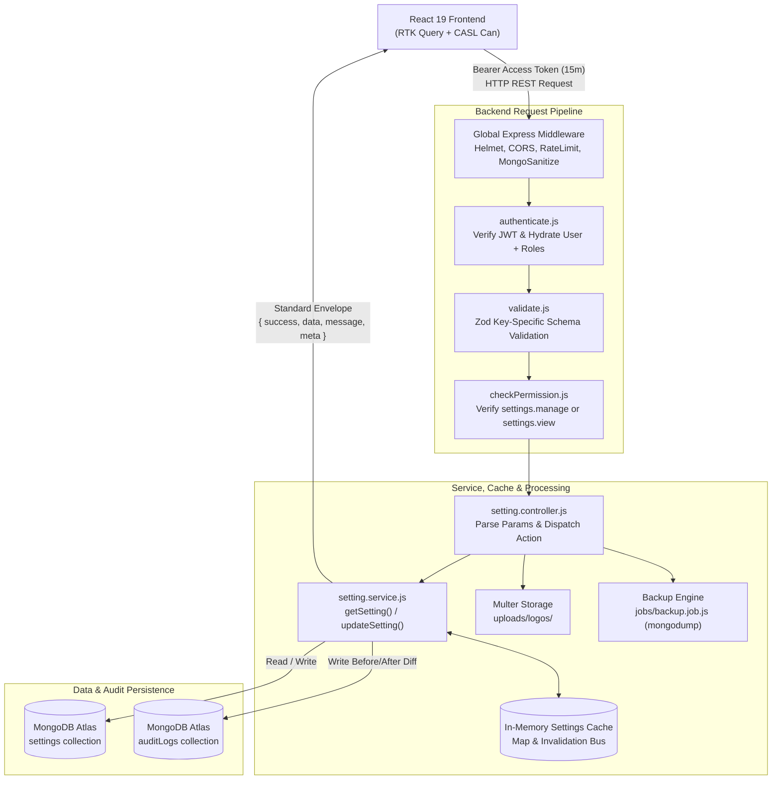
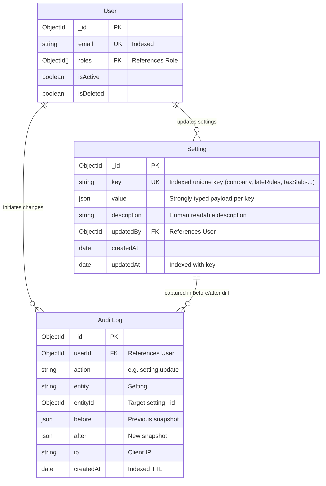
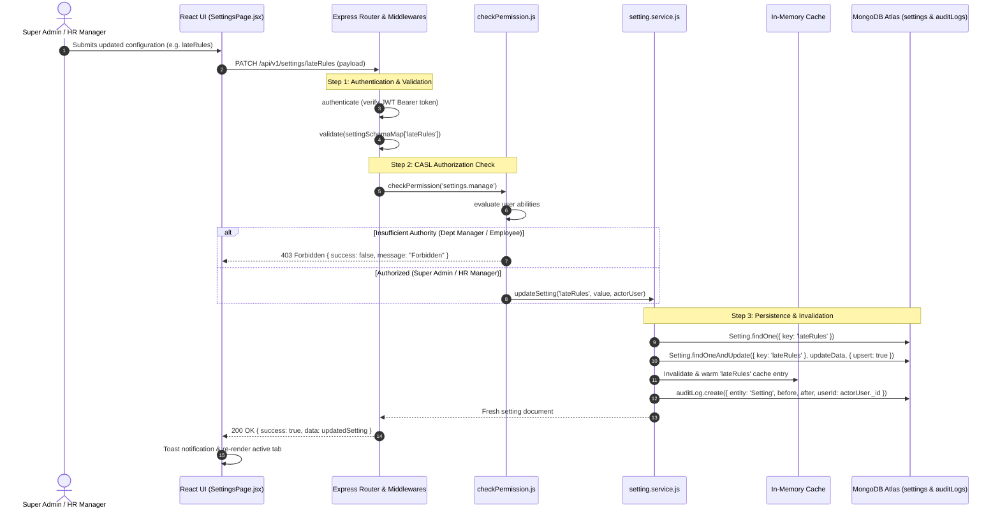

# Technical Architecture & Implementation Plan: Module M2 — Company Settings

**Feature Branch**: `feature/04-company-settings`  
**Date**: 2026-10-13  
**Spec Document**: [`spec.md`](file:///c:/Users/hamih/OneDrive/Desktop/AtoZ%20Coder/Advanced%20MERN/HRM/.specify/specs/04-company-settings/spec.md)  
**Governing Documents**:
- [`docs/TECH-SPEC.md`](file:///c:/Users/hamih/OneDrive/Desktop/AtoZ%20Coder/Advanced%20MERN/HRM/docs/TECH-SPEC.md) (Sections 3, 4, 5, 6, 8)
- [`docs/MODULES.md`](file:///c:/Users/hamih/OneDrive/Desktop/AtoZ%20Coder/Advanced%20MERN/HRM/docs/MODULES.md) (Section 2 Step 3, Section 6 M2)
- [`docs/FRD.md`](file:///c:/Users/hamih/OneDrive/Desktop/AtoZ%20Coder/Advanced%20MERN/HRM/docs/FRD.md) (Section 5 M2, Section 11 M2 Row)
- [`docs/BUILD-GUIDE.md`](file:///c:/Users/hamih/OneDrive/Desktop/AtoZ%20Coder/Advanced%20MERN/HRM/docs/BUILD-GUIDE.md) (Section 6, Rows 2.1 to 2.11)

---

## 1. Architecture Summary

Module M2 centralizes the runtime configuration, statutory compliance parameters, work schedules, spatial geo-fences, and communication templates for the single software house deployment. All system rules are stored as extensible documents in the MongoDB `settings` collection rather than hardcoded in source code.

### Architectural Decisions (Senior Architect Pattern)
1. **Dynamic Key-Value Datastore**: The `Setting` collection stores configuration indexed by a unique `key` string. Values are schema-enforced per key using modular Zod schemas.
2. **In-Memory Cache with Automatic Invalidation**: Since settings (working hours, late grace periods, tax slabs) are read frequently across attendance and payroll requests, an in-memory TTL/invalidation cache in `setting.service.js` prevents redundant database lookups. Any mutation (`PATCH /settings/:key`) immediately invalidates and warms the cache.
3. **Layer Invariant Compliance**:
   `routes` $\rightarrow$ `validate` (Zod) $\rightarrow$ `checkPermission` (CASL) $\rightarrow$ `controller` $\rightarrow$ `service` $\rightarrow$ `model` (`Setting`).
   Controllers never interact directly with Mongoose.
4. **Integer Paisa Currency Storage**: All statutory monetary values (tax brackets, EOBI minimum wage, fixed deductions) are stored and computed in integer paisa (1 PKR = 100 paisa) to eliminate floating-point drift.
5. **Disaster Recovery Isolation**: Database backup creation (`POST /settings/backup-now`) is strictly guarded: only users with the Super Admin system role can execute backup jobs, preventing server CPU/IO exhaustion by non-executive users.
6. **Zero TypeScript Guarantee**: Plain JavaScript ES modules (`.js`, `.jsx`) across all backend modules and frontend features.

---

## 2. Technical Context & Database Verification

### MongoDB State Verification (via MongoDB MCP)
- **Active Database**: `hrm_development`
- **Verified Collections**:
  - `users`: Indexed on `{ email: 1 }` (unique), `{ isActive: 1, isDeleted: 1 }`, `lockUntil`, `employeeId`.
  - `roles`: Seeded with 4 default roles (`Super Admin`, `HR Manager`, `Department Manager`, `Employee`).
- **New Collection to Bootstrap**:
  - `settings`:
    - Unique index on `key`: `{ key: 1 }` (unique: true)
    - Compound index on `{ key: 1, updatedAt: -1 }`

---

## 3. Visual System Architecture & Data Flow (Archify Mermaid Engine)

### Diagram 1: Request & Architecture Flow Architecture


---

### Diagram 2: Entity Relationship Diagram (ERD)


---

### Diagram 3: Main Settings Mutation & Cache Invalidation Lifecycle


---

## 4. Exact File Blueprint & Deliverables

All source files are strictly JavaScript (`.js` and `.jsx`).

### Backend Architecture (`backend/src/`)
```text
backend/src/
├── models/
│   └── setting.model.js                  # Setting Mongoose schema (key, value, description, updatedBy)
├── modules/
│   └── settings/
│       ├── setting.validation.js         # Zod schemas for all 11 settings keys (company, lateRules, taxSlabs...)
│       ├── setting.service.js            # Business logic: getSetting, updateSetting, publicPolicies, backup trigger
│       ├── setting.controller.js         # Request parsing, multipart logo upload handler, standard envelope
│       └── setting.routes.js             # Route declarations with authenticate, checkPermission, upload
├── jobs/
│   └── backup.job.js                     # Scheduled daily mongodump backup worker & manual backup executor
└── tests/
    ├── setting.model.test.js             # Unit tests for Setting model validation & uniqueness
    ├── setting.service.test.js           # Unit tests for caching, tax slab validation, and public policy filtering
    └── settings.api.test.js              # Integration tests for all /settings endpoints across all 4 roles
```

### Frontend Architecture (`frontend/src/`)
```text
frontend/src/
├── features/
│   └── settings/
│       ├── settingsApi.js                # RTK Query API endpoints (getSetting, updateSetting, uploadLogo, backupNow)
│       ├── pages/
│       │   ├── SettingsPage.jsx          # Tabbed configuration dashboard for Super Admin & HR Manager
│       │   └── PoliciesPage.jsx          # Public handbook & policies reader for Department Manager & Employee
│       └── components/
│           ├── CompanyForm.jsx           # Company profile details & logo file upload with preview
│           ├── WorkingHoursForm.jsx      # Active days toggle & standard office hours picker
│           ├── AttendanceRulesForm.jsx   # Grace minutes, late count threshold, and deduction rules
│           ├── LeavePolicyForm.jsx       # Fiscal cycle, approval chains, and carry forward limit
│           ├── PayrollSettingsForm.jsx   # Cutoff day, disbursement day, and cycle type
│           ├── TaxSlabsForm.jsx          # Progressive FBR tax slabs editor & EOBI/PESSI/PF settings (paisa precision)
│           ├── GeoFenceMapEditor.jsx     # Interactive Leaflet map, draggable marker & circle radius editor
│           ├── TemplatesForm.jsx         # Email & WhatsApp template editor with placeholder tags
│           └── BackupTab.jsx             # Backup health status, last backup timestamp & "Backup Now" trigger
├── components/
│   └── layout/
│       ├── Sidebar.jsx                   # Navigation update: link to Settings (admin) and Policies (all staff)
│       └── Topbar.jsx                    # Topbar update: render company logo dynamically from company setting
```

---

## 5. Endpoints, Permissions & Scope Contract

| Method | Endpoint | Required Permission | Allowed Roles | Description |
| :--- | :--- | :--- | :--- | :--- |
| `GET` | `/api/v1/settings` | `settings.manage` | Super Admin, HR Manager | Retrieve all settings keys in a single administrative payload |
| `GET` | `/api/v1/settings/:key` | `settings.manage` | Super Admin, HR Manager | Retrieve single setting key configuration object |
| `PATCH` | `/api/v1/settings/:key` | `settings.manage` | Super Admin, HR Manager | Update setting key value with key-specific Zod validation |
| `POST` | `/api/v1/settings/company/logo` | `settings.manage` | Super Admin, HR Manager | Upload company logo image (Multer max 2MB, PNG/JPEG/WEBP/SVG) |
| `POST` | `/api/v1/settings/backup-now` | `settings.manage` (Super Admin Only) | Super Admin | Trigger immediate database mongodump archive |
| `GET` | `/api/v1/settings/backup-status` | `settings.manage` | Super Admin, HR Manager | Check last backup timestamp, size, and system health |
| `GET` | `/api/v1/settings/public-policies` | `settings.view` | All Authenticated Roles (Super Admin, HR, Manager, Employee) | Retrieve sanitized, non-sensitive public employee policies |

### Permission Catalogue Synchronization
The permissions `settings.view` and `settings.manage` are already registered in `backend/src/shared/permissions.js` and seeded across the 4 core roles in `backend/src/seed/roles.seed.js`:
- **Super Admin**: holds `settings.manage` and `settings.view` with scope `all`.
- **HR Manager**: holds `settings.manage` and `settings.view` with scope `all`.
- **Department Manager**: holds `settings.view` with scope `all`.
- **Employee**: holds `settings.view` with scope `all`.

To ensure strict disaster recovery governance, `POST /api/v1/settings/backup-now` applies an additional defense-in-depth guard verifying that `req.user.roles` includes the `Super Admin` role, blocking non-executive roles from triggering heavy file system and database export dumps.

---

## 6. Implementation Stages & Build Sequence

1. **Phase 1: Backend Foundation (Slices 2.1 – 2.7)**
   - Create `setting.model.js` with unique key index.
   - Author comprehensive Zod validators in `setting.validation.js`.
   - Implement `setting.service.js` with in-memory caching and audit logging.
   - Implement `setting.controller.js` and mount `setting.routes.js` into Express `app.js`.
   - Implement automated unit and API integration tests in `backend/tests/settings.api.test.js`.

2. **Phase 2: Advanced Capabilities & Backup (Slices 2.8 – 2.11)**
   - Implement Multer logo upload endpoint and static asset serving in `server.js`.
   - Implement `jobs/backup.job.js` with mongodump runner and manual trigger handler.
   - Implement `GET /settings/public-policies` endpoint filtering sensitive data.

3. **Phase 3: Frontend Feature Development**
   - Create `settingsApi.js` RTK Query API slice with cache tagging.
   - Build form components: `CompanyForm`, `WorkingHoursForm`, `AttendanceRulesForm`, `LeavePolicyForm`, `PayrollSettingsForm`, `TaxSlabsForm`, `TemplatesForm`, `BackupTab`.
   - Implement `GeoFenceMapEditor.jsx` with Leaflet OpenStreetMap tiles, draggable pin, and dynamic circle radius.
   - Assemble tabbed `SettingsPage.jsx` and read-only `PoliciesPage.jsx`.
   - Update `Sidebar.jsx` and `Topbar.jsx` for navigation and dynamic company branding.

4. **Phase 4: Full Multi-Role Verification & Quality Gate**
   - Run Vitest backend test suite (`npm test`).
   - Run Vite frontend build (`npm run build`).
   - Validate live browser experience across all 4 default roles.
