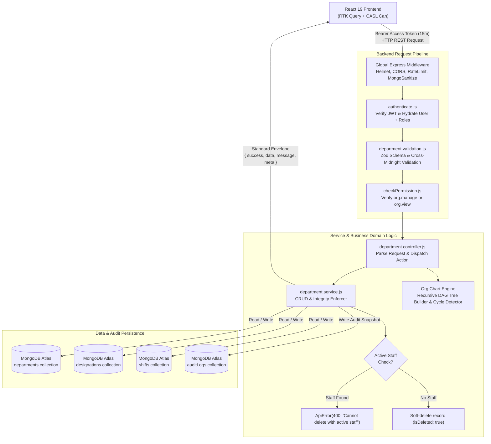
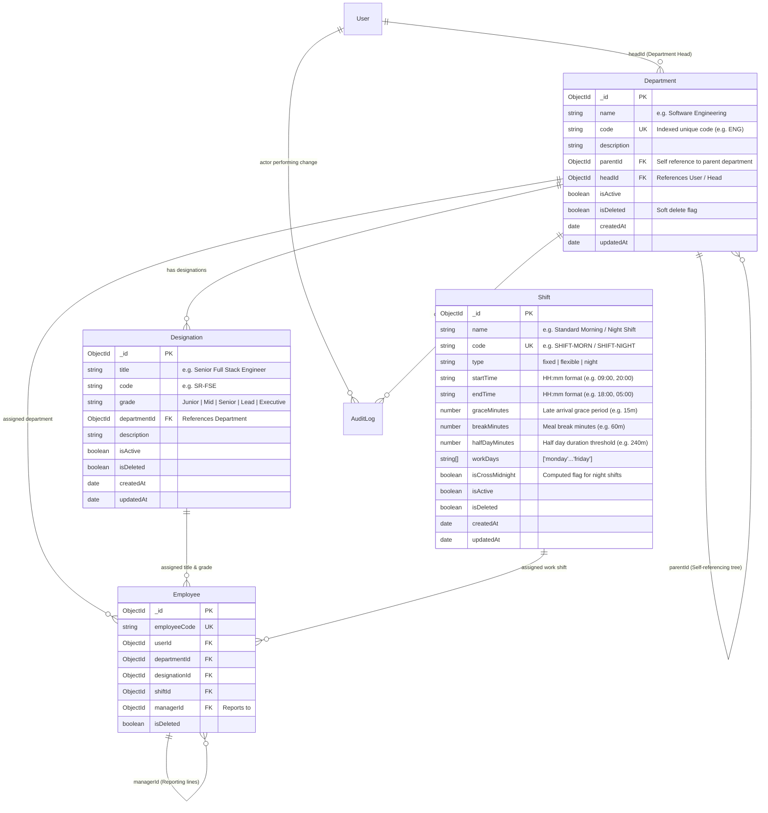
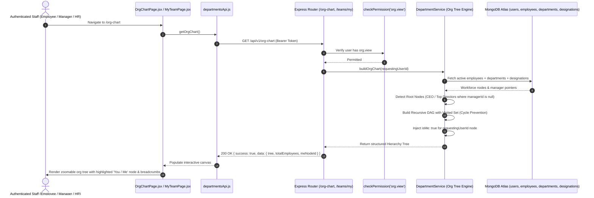

# Technical Architecture & Implementation Plan: Module M4 — Departments, Designations, Shifts & Org Chart

**Feature Branch**: `feature/05-departments-orgchart`  
**Date**: 2026-10-14  
**Spec Document**: [`spec.md`](file:///c:/Users/hamih/OneDrive/Desktop/AtoZ%20Coder/Advanced%20MERN/HRM/.specify/specs/05-departments-orgchart/spec.md)  
**Governing Documents**:
- [`docs/TECH-SPEC.md`](file:///c:/Users/hamih/OneDrive/Desktop/AtoZ%20Coder/Advanced%20MERN/HRM/docs/TECH-SPEC.md) (Sections 3, 4, 5, 6, 8)
- [`docs/MODULES.md`](file:///c:/Users/hamih/OneDrive/Desktop/AtoZ%20Coder/Advanced%20MERN/HRM/docs/MODULES.md) (Section 2 Step 4, Section 7 M4)
- [`docs/FRD.md`](file:///c:/Users/hamih/OneDrive/Desktop/AtoZ%20Coder/Advanced%20MERN/HRM/docs/FRD.md) (Section 5 M4, Section 11 M4 Row)
- [`docs/BUILD-GUIDE.md`](file:///c:/Users/hamih/OneDrive/Desktop/AtoZ%20Coder/Advanced%20MERN/HRM/docs/BUILD-GUIDE.md) (Section 7, Rows 4.1 to 4.7)

---

## 1. Architecture Summary

Module M4 structures the enterprise hierarchy, workplace taxonomy, and scheduling mechanics for the single software house deployment. It establishes the organizational backbone through four coordinated sub-domains:
1. **Departments Master**: Hierarchical self-referencing business units (`parentId` tree) with designated Department Heads (`headId`) and active staff deletion protection.
2. **Designations Master & Grade Tiers**: Official role titles bound to departments, standardized across structured grade tiers (`Junior`, `Mid`, `Senior`, `Lead`, `Executive`).
3. **Shifts Master & Cross-Midnight Calculation**: Scheduling templates supporting `fixed`, `flexible`, and overnight `night` shifts crossing 00:00 midnight with grace periods, meal breaks, and working days rosters.
4. **Interactive Org Chart & Team Views**: Recursive Directed Acyclic Graph (DAG) construction with cycle detection, dedicated Manager "My Team" scope (`GET /teams/my`), and Employee self-service "Me" indicator.

### Architectural Decisions (Senior Architect Pattern)
1. **Relational Integrity & Orphan Prevention**: A department or designation cannot be soft-deleted or removed if active personnel are assigned (`Employee.countDocuments({ departmentId/designationId, isDeleted: false }) > 0`). This invariant guarantees zero orphaned records in downstream modules (M3, M5, M9).
2. **Cross-Midnight Shift Computation Engine**: Night shifts (e.g. `20:00` to `05:00` next morning) are recognized via start/end time comparisons. Total daily duration is computed as `(1440 - startTimeMinutes) + endTimeMinutes - breakMinutes`, setting a persisted flag `isCrossMidnight: true` for Module M5 attendance ingestion.
3. **Graph Cycle Prevention in Org Chart**: When computing hierarchical reporting chains (`GET /org-chart`), the engine maintains a visited set of `ObjectId` strings. If an edge creates a closed loop, the recursive traversal gracefully truncates, preventing stack overflow or runaway loops.
4. **Layer Invariant Enforcement**:
   `routes` $\rightarrow$ `validate` (Zod) $\rightarrow$ `checkPermission` (CASL) $\rightarrow$ `controller` $\rightarrow$ `service` $\rightarrow$ `model` (`Department`, `Designation`, `Shift`).
   Controllers remain pure HTTP translators and never execute Mongoose queries directly.
5. **Zero TypeScript Guarantee**: Plain JavaScript ES modules (`.js`, `.jsx`) across all backend modules and frontend features.

---

## 2. Technical Context & Database Verification

### MongoDB State Verification (via MongoDB MCP)
- **Active Database**: `hrm_development`
- **Existing Verified Collections**:
  - `users`: Indexed on `{ email: 1 }` (unique), `{ isActive: 1, isDeleted: 1 }`, `roles`, `employeeId`.
  - `roles`: Seeded with 4 default roles (`Super Admin`, `HR Manager`, `Department Manager`, `Employee`).
  - `settings`: Configured with runtime company settings, work hours, and late rules.
  - `auditlogs`: Immutable audit trail for all organizational mutations.
- **New Collections to Bootstrap for M4**:
  1. `departments`:
     - Compound unique index: `{ code: 1, isDeleted: 1 }` (where `isDeleted: false`)
     - Indexes on `headId`, `parentId`, `isActive`, `isDeleted`
  2. `designations`:
     - Compound unique index: `{ code: 1, departmentId: 1, isDeleted: 1 }`
     - Index on `grade`, `departmentId`, `isDeleted`
  3. `shifts`:
     - Unique index on `code` or `{ name: 1, isDeleted: 1 }`
     - Index on `type`, `isActive`, `isDeleted`

---

## 3. Visual System Architecture & Data Flow (Archify Mermaid Engine)

### Diagram 1: Request & Architecture Flow Architecture


---

### Diagram 2: Entity Relationship Diagram (ERD)


---

### Diagram 3: Main Sequence Diagram (Interactive Org Chart & Team Resolution)


---

## 4. Exact File Artifacts to Implement

### 4.1 Backend Architecture Artifacts (`backend/src/`)
1. **Models**:
   - `backend/src/models/department.model.js`: Mongoose schema with `name`, `code`, `parentId`, `headId`, and compound unique index `{ code: 1, isDeleted: 1 }`.
   - `backend/src/models/designation.model.js`: Mongoose schema with `title`, `code`, `grade`, `departmentId`, and compound index `{ code: 1, departmentId: 1, isDeleted: 1 }`.
   - `backend/src/models/shift.model.js`: Mongoose schema with `name`, `code`, `type`, `startTime`, `endTime`, `graceMinutes`, `breakMinutes`, `halfDayMinutes`, `workDays`, and `isCrossMidnight`.
2. **Module Directory (`backend/src/modules/departments/`)**:
   - `department.validation.js`: Zod schemas for department create/update, designation create/update with grade enums, and shift creation with cross-midnight refinement.
   - `department.service.js`: Core domain services:
     - `createDepartment`, `getDepartments`, `updateDepartment`, `deleteDepartment` (with employee count dependency guard).
     - `createDesignation`, `getDesignations`, `updateDesignation`, `deleteDesignation`.
     - `createShift`, `getShifts`, `updateShift`, `deleteShift`.
     - `getOrgChart`: Recursive tree generator with cycle prevention and `"Me"` tagging.
     - `getMyTeam`: Direct and indirect subordinates view for managers.
   - `department.controller.js`: Request translation, status handling, and standard `{ success, data, message, meta }` response packaging.
   - `department.routes.js`: Route definitions bound with `authenticate`, `checkPermission('org.manage' | 'org.view')`, and validation schemas. Mounted at `/api/v1/departments`, `/api/v1/designations`, `/api/v1/shifts`, `/api/v1/org-chart`, and `/api/v1/teams/my`.
3. **App Integration**:
   - Update `backend/src/app.js` to mount the organizational router.
4. **Automated Test Suites**:
   - `backend/tests/departments.api.test.js`: Comprehensive integration tests covering Slices 4.1 to 4.7.
   - `backend/tests/m4.orgchart.e2e.test.js`: Multi-role E2E tests across Super Admin, HR Manager, Department Manager, and Employee.

### 4.2 Frontend Architecture Artifacts (`frontend/src/`)
1. **API Client**:
   - `frontend/src/features/departments/departmentsApi.js`: RTK Query endpoints (`getDepartments`, `createDepartment`, `updateDepartment`, `deleteDepartment`, `getDesignations`, `getShifts`, `getOrgChart`, `getMyTeam`).
2. **Pages**:
   - `frontend/src/features/departments/pages/DepartmentsPage.jsx`: Departments data table, head assignment cards, headcount metrics, and add/edit modal.
   - `frontend/src/features/departments/pages/DesignationsPage.jsx`: Designation list grouped by department and grade tier badge.
   - `frontend/src/features/departments/pages/ShiftsPage.jsx`: Shift cards displaying timings, cross-midnight badges, grace periods, and schedule rosters.
   - `frontend/src/features/departments/pages/OrgChartPage.jsx`: Interactive visual org tree with pan/zoom controls, search bar, and "Find My Position" indicator.
   - `frontend/src/features/departments/pages/MyTeamPage.jsx`: Dedicated team roster for Department Managers.
3. **Components**:
   - `frontend/src/features/departments/components/DepartmentModal.jsx`: Modal for department authoring and parent/head selection.
   - `frontend/src/features/departments/components/DesignationModal.jsx`: Modal for designation authoring and grade dropdown.
   - `frontend/src/features/departments/components/ShiftModal.jsx`: Modal for shift creation with interactive time pickers and day pills.
   - `frontend/src/features/departments/components/OrgChartNode.jsx`: Visual tree node card with avatar, role, expandable sub-tree toggle, and "Me" highlight.
   - `frontend/src/features/departments/components/TeamMemberCard.jsx`: Card representing a direct report.
4. **Layout & Routing**:
   - Update `frontend/src/App.jsx` to register `/departments`, `/designations`, `/shifts`, `/org-chart`, and `/teams/my`.
   - Update `frontend/src/components/layout/Sidebar.jsx` with navigation links.

---

## 5. API Contracts, Permissions & Scopes Specification

### 5.1 Endpoint Authorization Matrix

| Method | Endpoint | Description | Permission Action | Required Scope | Allowed Roles |
| :--- | :--- | :--- | :--- | :---: | :--- |
| `GET` | `/api/v1/departments` | List all departments with headcount | `org.view` | `all` | Super Admin, HR, Manager, Employee |
| `POST` | `/api/v1/departments` | Create new department | `org.manage` | `all` | Super Admin, HR Manager |
| `PATCH` | `/api/v1/departments/:id` | Update department details / head | `org.manage` | `all` | Super Admin, HR Manager |
| `DELETE` | `/api/v1/departments/:id` | Soft delete department (guarded) | `org.manage` | `all` | Super Admin, HR Manager |
| `GET` | `/api/v1/designations` | List designations with filters | `org.view` | `all` | Super Admin, HR, Manager, Employee |
| `POST` | `/api/v1/designations` | Create designation with grade | `org.manage` | `all` | Super Admin, HR Manager |
| `PATCH` | `/api/v1/designations/:id`| Update designation | `org.manage` | `all` | Super Admin, HR Manager |
| `DELETE` | `/api/v1/designations/:id`| Soft delete designation (guarded) | `org.manage` | `all` | Super Admin, HR Manager |
| `GET` | `/api/v1/shifts` | List active shifts and timings | `org.view` | `all` | Super Admin, HR, Manager, Employee |
| `POST` | `/api/v1/shifts` | Create work shift template | `org.manage` | `all` | Super Admin, HR Manager |
| `PATCH` | `/api/v1/shifts/:id` | Update shift parameters | `org.manage` | `all` | Super Admin, HR Manager |
| `DELETE` | `/api/v1/shifts/:id` | Soft delete shift | `org.manage` | `all` | Super Admin, HR Manager |
| `GET` | `/api/v1/org-chart` | Recursive visual org tree | `org.view` | `all` | Super Admin, HR, Manager, Employee |
| `GET` | `/api/v1/teams/my` | Manager direct & indirect team | `org.view` | `team` | Dept Manager, Super Admin, HR |

---

### 5.2 Permission Catalogue Registration Step
To integrate M4 with the CASL authorization system, add the `organization` module to `backend/src/shared/permissions.js`:

```javascript
// Addition to PERMISSIONS_CATALOGUE in backend/src/shared/permissions.js:
{
  module: 'organization',
  label: 'Department, Designation & Org Chart',
  subject: 'Organization',
  description: 'Organizational hierarchy, departments, job titles, and shift rosters.',
  actions: [
    {
      action: 'org.view',
      label: 'View Organization & Team Structure',
      description: 'Access company departments, designations, shifts, org chart, and team views.',
      allowedScopes: ['own', 'team', 'department', 'all'],
      defaultScope: 'all'
    },
    {
      action: 'org.manage',
      label: 'Manage Organization Structures',
      description: 'Create, modify, and delete departments, designations, shifts, and assign heads.',
      allowedScopes: ['all'],
      defaultScope: 'all'
    }
  ]
}
```

And in `backend/src/seed/roles.seed.js`:
- **Super Admin**: Wildcard `{ action: 'manage', subject: 'all', scope: 'all' }` automatically grants both.
- **HR Manager**: Assign `{ action: 'org.view', subject: 'Organization', scope: 'all' }` and `{ action: 'org.manage', subject: 'Organization', scope: 'all' }`.
- **Department Manager**: Assign `{ action: 'org.view', subject: 'Organization', scope: 'all' }`.
- **Employee**: Assign `{ action: 'org.view', subject: 'Organization', scope: 'all' }`.

---

## 6. Implementation Phasing Strategy

- **Phase 1: Core Organization Master (Priority P1)**
  - Slice 4.1: Departments Master & Active Employee Deletion Guard
  - Slice 4.2: Department Head & Manager Assignment
  - Slice 4.3: Designations & Grade Tiers Master
  - Slice 4.4: Shifts Master & Cross-Midnight Calculation Engine
- **Phase 2: Visual Hierarchy & Team Views (Priority P1 / P2)**
  - Slice 4.5: Interactive Visual Organizational Chart
  - Slice 4.6: Manager "My Team" View (`GET /teams/my`)
  - Slice 4.7: Employee Self-Service Reporting Line Highlight ("Me" Indicator)
- **Phase 3: Multi-Role Verification & Quality Gate**
  - Slice E2E-M4: Multi-Role Live End-to-End Test (`m4.orgchart.e2e.test.js`)
