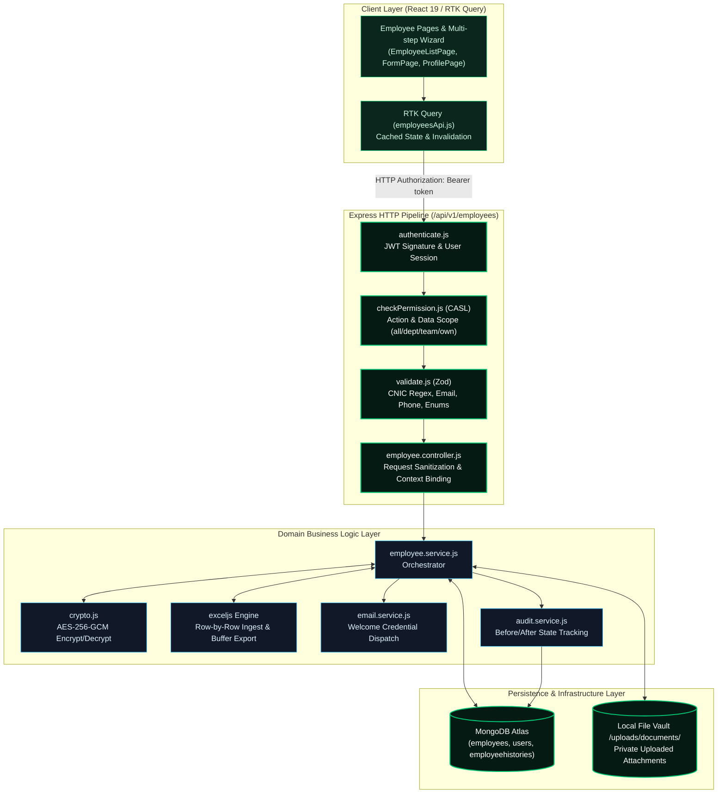
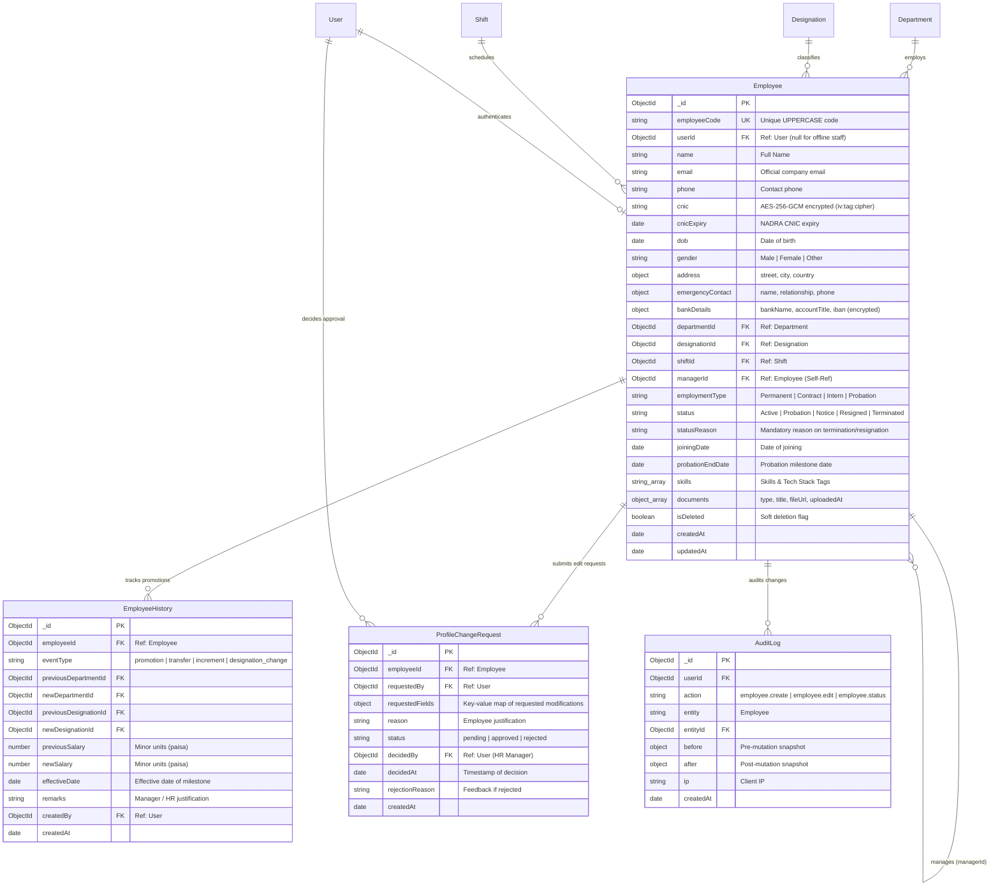
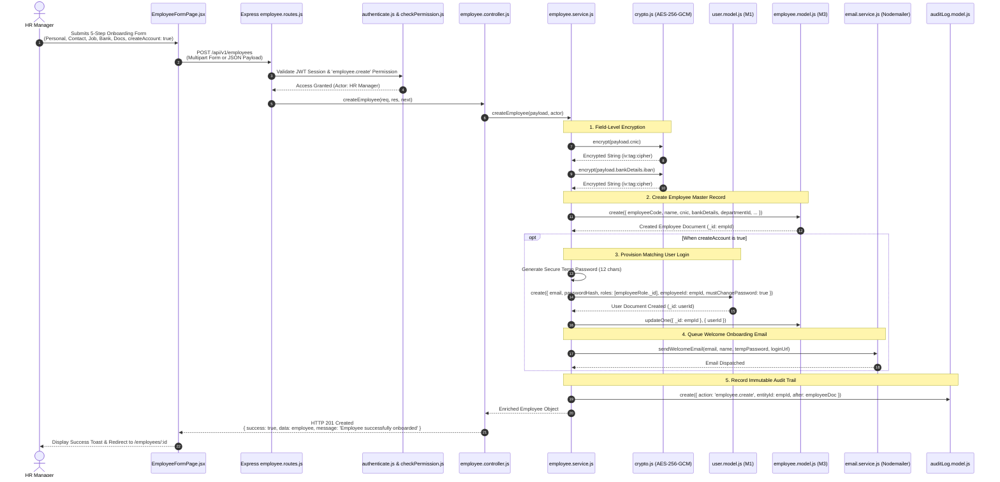

# Architectural Plan: Module M3 — Employee Management

**Feature Identifier**: `06-employees`  
**Target Module**: Module M3 (Employee Management · Core HR Group)  
**Governing Guide**: [`docs/BUILD-GUIDE.md`](file:///c:/Users/hamih/OneDrive/Desktop/AtoZ%20Coder/Advanced%20MERN/HRM/docs/BUILD-GUIDE.md) Section 8 (Rows 3.1–3.17)  
**Architecture Rules**: [`docs/TECH-SPEC.md`](file:///c:/Users/hamih/OneDrive/Desktop/AtoZ%20Coder/Advanced%20MERN/HRM/docs/TECH-SPEC.md) Sections 3, 4, 5, 6, 8 & 9  
**Specification Reference**: [`.specify/specs/06-employees/spec.md`](file:///c:/Users/hamih/OneDrive/Desktop/AtoZ%20Coder/Advanced%20MERN/HRM/.specify/specs/06-employees/spec.md)  
**Language Mandate**: Plain JavaScript (`.js` / `.jsx`) exclusively — strictly **zero TypeScript**.

---

## 1. Architectural Blueprint & Request Flow

Module M3 operates as the single source of truth for workforce profiles. It enforces a strict layered processing pipeline conforming to TECH-SPEC Section 8:
$$\text{HTTP Request} \longrightarrow \text{authenticate} \longrightarrow \text{checkPermission (CASL)} \longrightarrow \text{validate (Zod)} \longrightarrow \text{Controller} \longrightarrow \text{Service} \longrightarrow \text{Model (MongoDB / Crypto)}$$

### 1.1 Invariants & Security Guardrails
1. **Controllers are Thin Gateways**: `employee.controller.js` only parses `req.body`, `req.query`, and `req.params`, passes context (`actor = req.user`, `permissionScope = req.permissionScope`) to `employee.service.js`, and formats responses using the standardized envelope:
   ```json
   {
     "success": true,
     "data": { ... },
     "message": "Human-readable status",
     "meta": { "page": 1, "limit": 10, "total": 100, "totalPages": 10 }
   }
   ```
2. **Horizontal Data Scoping (`scopeFilter`)**:
   - `all` (Super Admin, HR Manager): Returns all company employees across all departments.
   - `department` (Department Manager): Returns only employees where `departmentId == req.user.departmentId`.
   - `team` (Team Lead / PM): Returns only employees where `managerId == req.user.employeeId`.
   - `own` (Employee): Restricts view to `userId == req.user._id` or `employeeId == req.user.employeeId`.
3. **Field-Level Protection (`fieldFilter`)**:
   - Sensitive fields (`salary`, `bankDetails`, complete unmasked `cnic`) are stripped or masked (`35202-*******-1`, `PK**MEZN****5678`) unless actor holds `employee.salary.view` or `manage:all`.
4. **Data at Rest Encryption (`utils/crypto.js`)**:
   - AES-256-GCM authenticated cipher with 16-byte random IV and 16-byte authentication tag per encrypted field.
   - Decrypted in memory only when queried by permitted roles.
5. **Session & Deactivation Integration**:
   - Changing status to `Terminated` automatically sets `User.isActive = false` on linked login account and logs out user immediately.

---

## 2. Exact Files Manifest

### 2.1 Backend Files (`backend/src/`)
```
backend/
├── src/
│   ├── config/
│   │   └── env.js                              # Add ENCRYPTION_KEY validation
│   ├── utils/
│   │   └── crypto.js                           # AES-256-GCM encrypt / decrypt utilities (Row 3.1)
│   ├── models/
│   │   ├── employee.model.js                   # Extended Employee schema with encrypted CNIC/Bank, documents, skills
│   │   ├── employeeHistory.model.js            # Career promotional & transfer timeline model (Row 3.10)
│   │   └── profileChangeRequest.model.js       # Employee self-service sensitive field edit approval model (Row 3.16)
│   ├── modules/
│   │   └── employees/
│   │       ├── employee.validation.js          # Zod schemas (create, update, status, change-request, CNIC regex)
│   │       ├── employee.service.js             # Core domain logic, Excel parsing/export, user provisioning, crypto
│   │       ├── employee.controller.js          # Express request/response gateway
│   │       └── employee.routes.js              # Scoped Express router with Multer and CASL guards
│   ├── jobs/
│   │   └── probation.job.js                    # Daily 09:00 PKT scheduled cron checking 7-day probation expiries (Row 3.17)
│   ├── shared/
│   │   └── permissions.js                      # Register report.export and profile.change_request
│   └── app.js                                  # Mount /api/v1/employees, /api/v1/change-requests
└── tests/
    ├── employees.api.test.js                   # Integration test suite for Slices 3.1 - 3.8
    ├── employee-vault.api.test.js              # Integration test suite for Documents Vault (Slice 3.9)
    ├── employee-excel.api.test.js              # Integration test suite for Excel import/export (Slices 3.13, 3.14)
    ├── employee-change-requests.api.test.js    # Integration test suite for Change Requests (Slice 3.16)
    └── m3.employees.e2e.test.js                # Multi-role complete journey end-to-end verification suite
```

### 2.2 Frontend Files (`frontend/src/`)
```
frontend/
├── src/
│   ├── features/
│   │   └── employees/
│   │       ├── employeesApi.js                 # RTK Query endpoints (getEmployees, createEmployee, import, export, etc.)
│   │       ├── pages/
│   │       │   ├── EmployeeListPage.jsx        # Data table with faceted search, department pills, status badges, export action
│   │       │   ├── EmployeeFormPage.jsx        # Multi-step wizard (Personal, Contact, Job, Bank, Documents)
│   │       │   ├── EmployeeProfilePage.jsx     # Master profile with modular tabs (Overview, Docs, Attendance, History, Salary)
│   │       │   ├── MyProfilePage.jsx           # Employee self-service portal (/me) with Request Change button
│   │       │   ├── EmployeeImportPage.jsx      # Drag-and-drop Excel file upload, preview, and row-wise error table
│   │       │   └── ChangeRequestsPage.jsx      # HR Manager approval dashboard for pending profile edits
│   │       └── components/
│   │           ├── EmployeeTable.jsx           # Reusable data table wrapper
│   │           ├── ProfileOverviewTab.jsx      # Personal, contact, emergency & job metadata cards
│   │           ├── ProfileDocumentsTab.jsx     # Document vault cards with upload dialog and preview actions
│   │           ├── ProfileHistoryTab.jsx       # Vertical timeline of promotions, transfers, and designations
│   │           ├── ProfileSalaryTab.jsx        # Historical increments and compensation revisions (permission-guarded)
│   │           ├── DocumentUploadModal.jsx     # Modal for uploading CNIC copies, degrees, contracts, NDAs
│   │           ├── StatusChangeModal.jsx       # Modal to transition status (Active, Notice, Resigned, Terminated) with reason
│   │           └── ChangeRequestModal.jsx      # Self-service modal for employees to submit sensitive field updates
│   ├── App.jsx                                 # Register /employees, /employees/new, /employees/:id, /me, /employees/import, /change-requests
│   └── components/
│       └── layout/Sidebar.jsx                  # Add navigation links for Employees, My Profile, Change Requests
```

---

## 3. System Architecture & Request Lifecycle Diagrams

### 3.1 Diagram 1: System Component Flow (Client $\rightarrow$ Middleware $\rightarrow$ Service $\rightarrow$ Storage / Infra)



---

### 3.2 Diagram 2: Entity Relationship Diagram (ERD & Indexes)



---

### 3.3 Diagram 3: Main Sequence Diagram (Employee Onboarding & Account Provisioning Flow)



---

## 4. API Endpoints, Permissions & Scopes Matrix

All employee endpoints require active authenticated session (`authenticate`).

| Method | Endpoint | Description | Permission Action | Subject | Data Scope Applied |
| :--- | :--- | :--- | :--- | :--- | :--- |
| `GET` | `/api/v1/employees` | List employees with pagination, search, & filters | `employee.view` | `Employee` | `all`, `department`, `team`, `own` |
| `POST` | `/api/v1/employees` | Onboard new employee + provision user account | `employee.create` | `Employee` | `all` |
| `GET` | `/api/v1/employees/me` | Self-service profile for authenticated user | `employee.view` | `Employee` | `own` (enforced via `req.user.employeeId`) |
| `GET` | `/api/v1/employees/export` | Stream directory export as Excel workbook | `report.export` | `Report` | `all` |
| `POST` | `/api/v1/employees/import` | Bulk ingest employees from Excel spreadsheet | `employee.create` | `Employee` | `all` |
| `GET` | `/api/v1/employees/:id` | Fetch unified profile with modular tabs | `employee.view` | `Employee` | `all`, `department`, `team`, `own` |
| `PATCH` | `/api/v1/employees/:id` | Edit general employee details | `employee.edit` | `Employee` | `all`, `department` |
| `DELETE` | `/api/v1/employees/:id` | Soft delete / archive employee record | `employee.delete` | `Employee` | `all` |
| `PATCH` | `/api/v1/employees/:id/status` | Update employment status (terminates user account) | `employee.edit` | `Employee` | `all` |
| `POST` | `/api/v1/employees/:id/documents` | Upload credential to employee document vault | `employee.edit` | `Employee` | `all`, `own` |
| `DELETE` | `/api/v1/employees/:id/documents/:docId` | Delete document attachment from vault | `employee.edit` | `Employee` | `all` |
| `POST` | `/api/v1/employees/:id/history` | Record promotion, transfer, or designation change | `employee.edit` | `Employee` | `all` |
| `GET` | `/api/v1/employees/:id/salary-history` | View historical compensation adjustments | `employee.salary.view` | `Employee` | `all`, `own` (sensitive guard) |
| `PATCH` | `/api/v1/employees/me/skills` | Self-service update of technical competencies | `employee.view` | `Employee` | `own` |
| `POST` | `/api/v1/employees/me/change-request` | Submit edit request for sensitive personal fields | `employee.view` | `Employee` | `own` |
| `GET` | `/api/v1/change-requests` | List pending profile change requests for HR review | `employee.edit` | `Employee` | `all` |
| `PATCH` | `/api/v1/change-requests/:id/decide` | Approve or reject profile change request | `employee.edit` | `Employee` | `all` |

---

## 5. Security & Permission Updates Required in `shared/permissions.js`

Add the following missing permission actions to `PERMISSIONS_CATALOGUE` in `backend/src/shared/permissions.js`:
1. **`report.export`**: Under `reports` or `employees` module allowing Excel exports (`allowedScopes: ['all']`).
2. **`profile.change_request`**: Under `employees` module for reviewing change requests (`allowedScopes: ['all']`).

---

## 6. Implementation Phasing Strategy (Preview for `tasks.md`)

- **Slice 3.1 & 3.3 (P1)**: `utils/crypto.js` (AES-256-GCM), CNIC Zod regex validation, model extensions.
- **Slice 3.2 (P1)**: Employee creation service, user login account provisioning, welcome email dispatch, `EmployeeFormPage.jsx`.
- **Slice 3.4 (P1)**: Scoped employee directory list API with search/filters, `EmployeeListPage.jsx` with DataTable.
- **Slice 3.5 & 3.6 (P1)**: Profile unified view with modular tabs, field-level filtering, profile updating with audit logging.
- **Slice 3.7 & 3.8 (P1)**: Status lifecycle (`PATCH /:id/status`), automated user account lockout on termination, archival soft delete (`DELETE /:id`).
- **Slice 3.9 (P1)**: Multer file handling, document vault upload/delete, private document access.
- **Slice 3.13 & 3.14 (P1)**: ExcelJS bulk ingestion with row-level validation reports, directory export stream.
- **Slice 3.15 (P1)**: Self-service "My Profile" portal (`GET /api/v1/employees/me`), `MyProfilePage.jsx`.
- **Slice 3.10, 3.11 & 3.12 (P2)**: Career history timeline (`EmployeeHistory`), compensation history tab, skills taxonomy tagging.
- **Slice 3.16 & 3.17 (P2)**: Sensitive field profile change request workflow (`ProfileChangeRequest`), scheduled probation expiry alert job (`jobs/probation.job.js`).
- **Slice E2E-M3**: Multi-role live end-to-end integration tests verifying complete employee lifecycle across all 4 system roles.
