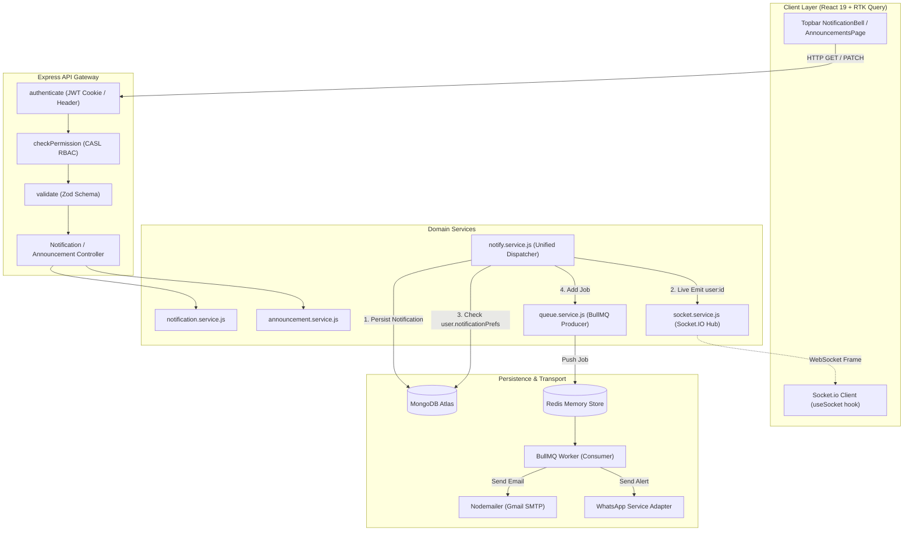
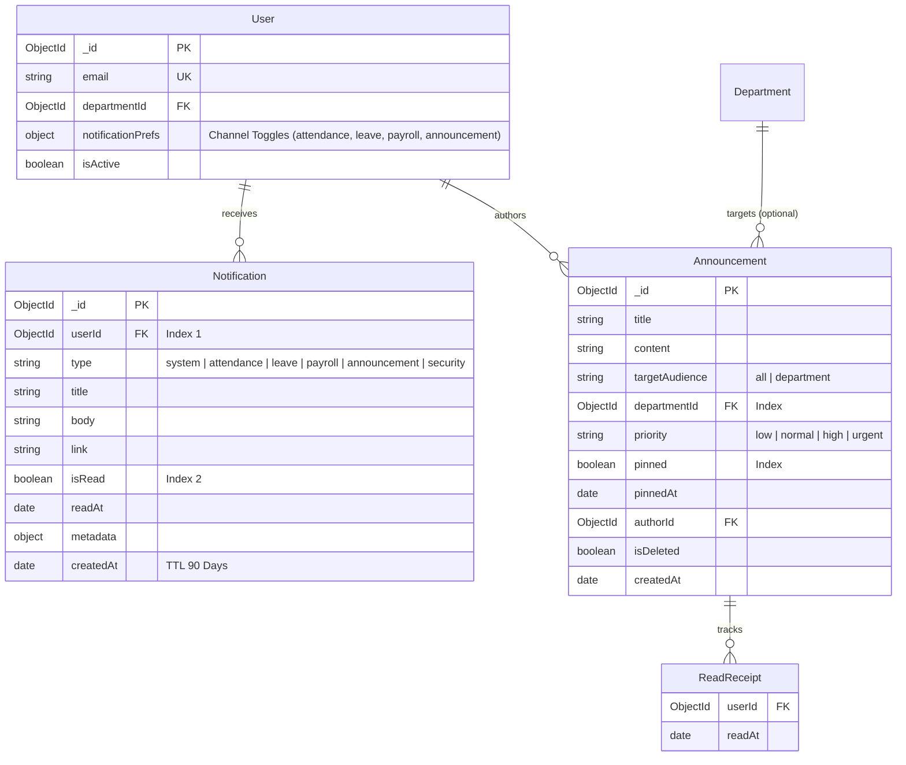
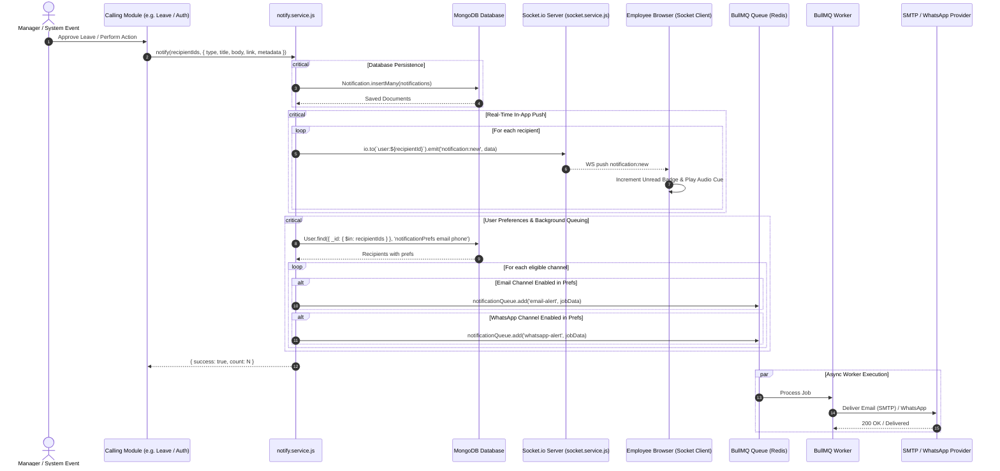

# Architectural Plan: Module M8 — Notifications & Announcements

**Feature Identifier**: `07-notifications`  
**Target Module**: Module M8 (Notifications & Announcements · Core HR Group)  
**Governing Guide**: [`docs/BUILD-GUIDE.md`](file:///c:/Users/hamih/OneDrive/Desktop/AtoZ%20Coder/Advanced%20MERN/HRM/docs/BUILD-GUIDE.md) Section 9 (Rows 8.1–8.8)  
**Architecture Rules**: [`docs/TECH-SPEC.md`](file:///c:/Users/hamih/OneDrive/Desktop/AtoZ%20Coder/Advanced%20MERN/HRM/docs/TECH-SPEC.md) Sections 3, 4, 5, 6 & 8; [`docs/MODULES.md`](file:///c:/Users/hamih/OneDrive/Desktop/AtoZ%20Coder/Advanced%20MERN/HRM/docs/MODULES.md) Section M8  
**Specification Reference**: [`.specify/specs/07-notifications/spec.md`](file:///c:/Users/hamih/OneDrive/Desktop/AtoZ%20Coder/Advanced%20MERN/HRM/.specify/specs/07-notifications/spec.md)  
**Language Mandate**: Plain JavaScript (`.js` / `.jsx`) exclusively — strictly **zero TypeScript**.

---

## 1. Architectural Blueprint & Request Flow

Module M8 operates as the centralized communication nervous system for the HRM suite. It decouples event emission from business logic by establishing a single canonical service: `notify(userIds, payload)`.

```
[Business Modules (M1, M3, M4, M5, M6, M9)]
                  │
                  ▼
       notify(userIds, payload)
                  │
        ┌─────────┴─────────┐
        ▼                   ▼
1. MongoDB Insert    2. Socket.io Emit
   (Audit / Fetch)      (Live Room Push)
                            │
                            ▼
                     3. User Preferences Check
                            │
                   ┌────────┴────────┐
                   ▼                 ▼
             Email Enabled?   WhatsApp Enabled?
                   │                 │
                   └────────┬────────┘
                            ▼
                 4. BullMQ Notification Queue
                            │
                            ▼
                 5. Worker Async Processing
                    ├── Nodemailer (SMTP)
                    └── WhatsApp Adapter
```

### 1.1 Invariants & Security Guardrails
1. **Thin Gateways**: Controllers (`notification.controller.js`, `announcement.controller.js`) only extract input, invoke services, and respond via the standardized response envelope:
   ```json
   {
     "success": true,
     "statusCode": 200,
     "data": { ... },
     "message": "Human-readable status",
     "meta": { "page": 1, "limit": 20, "total": 45, "unreadCount": 3 }
   }
   ```
2. **One `notify()` Service Invariant**: No other module or route shall directly create notification documents or trigger raw emails. They must invoke `notify(userIds, payload)`.
3. **Audience & Data Scoping**:
   - **Notifications**: Always strictly scoped to `own` user (`userId: req.user._id`).
   - **Announcements**:
     - `all` (Super Admin, HR Manager): Post/view company-wide and department notices.
     - `department` (Department Manager): Post/view notices for own department.
     - `own` (Employee): View company notices + own department notices.
4. **Resilience & Non-Blocking Execution**: If Redis, SMTP, or WhatsApp fails or experiences transient downtime, the in-app notification and DB record must still succeed; background retries are handled cleanly by BullMQ.

---

## 2. Architecture & Flow Diagrams (Senior Architect & Archify Engine)

### Diagram 1: Multi-Channel Event Processing & Request Lifecycle
Flow of an operational event from caller through authentication, permission gates, socket push, and background queues.



---

### Diagram 2: Entity Relationship Diagram (ERD)
Database schema relationships, references, and compound indexes.



---

### Diagram 3: Main Sequence Diagram (Unified `notify()` Execution Flow)
Step-by-step sequence when an event (e.g. Leave Approval, Profile Edit, Pinned Notice) triggers in the application.



---

## 3. Exact Files Manifest

### 3.1 Backend Files (`backend/src/`)
```
backend/
├── src/
│   ├── models/
│   │   ├── notification.model.js               # Notification schema with 90-day TTL index
│   │   └── announcement.model.js               # Announcement schema with readBy[] and audience scoping
│   ├── services/
│   │   ├── socket.service.js                   # Socket.io initialization, auth middleware, room joins, emit helpers
│   │   ├── queue.service.js                    # BullMQ queue & worker configuration for async tasks
│   │   ├── notify.service.js                   # THE single canonical notify(userIds, payload) pipeline
│   │   └── whatsapp.service.js                 # WhatsApp Cloud API integration & sandbox mode adapter
│   ├── modules/
│   │   ├── notifications/
│   │   │   ├── notification.validation.js      # Zod validation schemas for query filters and preference updates
│   │   │   ├── notification.service.js         # Service methods: getNotifications, markRead, markAllRead, get/updatePrefs
│   │   │   ├── notification.controller.js      # Express controller for notifications
│   │   │   └── notification.routes.js          # Express router with authenticate and CASL guards
│   │   └── announcements/
│   │       ├── announcement.validation.js      # Zod validation schemas for create, update, and pin announcements
│   │       ├── announcement.service.js         # Service methods: getAnnouncements, create, update, delete, pin, markRead
│   │       ├── announcement.controller.js      # Express controller for announcements
│   │       └── announcement.routes.js          # Express router with authenticate, checkPermission, validate
│   ├── shared/
│   │   └── permissions.js                      # Register new notification & announcement permissions
│   ├── seed/
│   │   └── roles.seed.js                       # Assign notification & announcement permissions to the 4 core roles
│   ├── app.js                                  # Mount /api/v1/notifications, /api/v1/announcements
│   └── server.js                               # Upgrade to http.createServer(app) and bind Socket.io
└── tests/
    ├── notify.service.test.js                  # Unit tests for notify() multi-channel routing and preference guards
    ├── notifications.api.test.js               # Integration tests for notification endpoints, read state, preferences
    ├── announcements.api.test.js               # Integration tests for announcements CRUD, scoping, pin, receipts
    └── m8.notifications.e2e.test.js            # Multi-role complete live E2E user journey test suite
```

### 3.2 Frontend Files (`frontend/src/`)
```
frontend/
├── src/
│   ├── features/
│   │   ├── notifications/
│   │   │   ├── notificationsApi.js             # RTK Query endpoints for notifications and preferences
│   │   │   ├── hooks/
│   │   │   │   └── useSocket.js                # Custom React hook connecting to Socket.io and listening for live events
│   │   │   ├── components/
│   │   │   │   ├── NotificationBell.jsx        # Topbar icon with dynamic animated unread counter badge
│   │   │   │   ├── NotificationDrawer.jsx      # Slide-out drawer with tabs (All, Unread), clear all, mark read
│   │   │   │   └── NotificationItem.jsx        # Individual notification card with category icon, relative time, link
│   │   │   └── pages/
│   │   │       ├── NotificationsPage.jsx       # Dedicated full page for notification archive with pagination
│   │   │       └── NotificationSettingsPage.jsx# Granular toggle matrix for In-App, Email, WhatsApp channels
│   │   ├── announcements/
│   │   │   ├── announcementsApi.js             # RTK Query endpoints for announcements CRUD, pinning, receipts
│   │   │   ├── components/
│   │   │   │   ├── AnnouncementCard.jsx        # Rich announcement card with priority pill, author, time, read badge
│   │   │   │   ├── PinnedNoticeBoard.jsx       # Carousel / stacked pinned announcement cards on dashboard
│   │   │   │   ├── ReadReceiptsModal.jsx       # Modal showing list of readers, department, and exact read timestamp
│   │   │   │   └── AnnouncementFormModal.jsx   # Modal for creating/editing announcements with audience picker
│   │   │   └── pages/
│   │   │       └── AnnouncementsPage.jsx       # Complete announcements notice board with department filter and search
│   │   └── dashboard/
│   │       └── DashboardPage.jsx               # Mount PinnedNoticeBoard widget on executive/employee dashboards
│   ├── components/
│   │   ├── layout/
│   │   │   ├── Topbar.jsx                      # Mount NotificationBell next to user avatar
│   │   │   └── Sidebar.jsx                     # Add Announcements navigation tab guarded by announcement.view
│   └── App.jsx                                 # Register /notifications, /settings/notifications, /announcements routes
```

---

## 4. CASL Permissions & Endpoint Mapping

### 4.1 New Permissions to Register in `backend/src/shared/permissions.js`
```javascript
// Module M8: Notifications & Announcements Permissions
{
  category: 'Notifications & Announcements',
  permissions: [
    {
      action: 'notification.view',
      subject: 'Notification',
      description: 'View in-app notifications and notification settings',
      availableScopes: ['own']
    },
    {
      action: 'notification.manage',
      subject: 'Notification',
      description: 'Trigger broadcast notifications across the organization',
      availableScopes: ['all']
    },
    {
      action: 'announcement.view',
      subject: 'Announcement',
      description: 'View company and department announcements',
      availableScopes: ['own', 'department', 'all']
    },
    {
      action: 'announcement.create',
      subject: 'Announcement',
      description: 'Create and publish announcements',
      availableScopes: ['department', 'all']
    },
    {
      action: 'announcement.edit',
      subject: 'Announcement',
      description: 'Edit existing announcements',
      availableScopes: ['department', 'all']
    },
    {
      action: 'announcement.delete',
      subject: 'Announcement',
      description: 'Delete or archive announcements',
      availableScopes: ['department', 'all']
    },
    {
      action: 'announcement.pin',
      subject: 'Announcement',
      description: 'Pin announcements to the top of notice boards',
      availableScopes: ['department', 'all']
    }
  ]
}
```

### 4.2 Endpoint to Permission Matrix

| HTTP Method | Route | Permission Key | Required Scope | Handled By |
| :--- | :--- | :--- | :--- | :--- |
| `GET` | `/api/v1/notifications` | `notification.view` | `own` | `notificationController.getNotifications` |
| `PATCH` | `/api/v1/notifications/:id/read` | `notification.view` | `own` | `notificationController.markRead` |
| `PATCH` | `/api/v1/notifications/read-all` | `notification.view` | `own` | `notificationController.markAllRead` |
| `GET` | `/api/v1/notifications/preferences` | `notification.view` | `own` | `notificationController.getPreferences` |
| `PATCH` | `/api/v1/notifications/preferences` | `notification.view` | `own` | `notificationController.updatePreferences` |
| `GET` | `/api/v1/announcements` | `announcement.view` | `own` / `department` / `all` | `announcementController.getAnnouncements` |
| `POST` | `/api/v1/announcements` | `announcement.create` | `department` / `all` | `announcementController.createAnnouncement` |
| `GET` | `/api/v1/announcements/:id` | `announcement.view` | `own` / `department` / `all` | `announcementController.getAnnouncementById` |
| `PATCH` | `/api/v1/announcements/:id` | `announcement.edit` | `department` / `all` | `announcementController.updateAnnouncement` |
| `DELETE` | `/api/v1/announcements/:id` | `announcement.delete` | `department` / `all` | `announcementController.deleteAnnouncement` |
| `PATCH` | `/api/v1/announcements/:id/pin` | `announcement.pin` | `department` / `all` | `announcementController.togglePinAnnouncement` |
| `PATCH` | `/api/v1/announcements/:id/read` | `announcement.view` | `own` | `announcementController.recordReadReceipt` |

---

## 5. Step-by-Step Implementation Slices

### Slice 8.1: Unified Multi-Channel `notify.service.js` & Socket.io Room Wiring (BUILD-GUIDE 8.1)
- Install `socket.io` in backend and `socket.io-client` in frontend.
- Upgrade `server.js` with `http.createServer(app)` and configure `initSocketIO` with JWT room authentication (`user:<id>`, `dept:<id>`, `company:broadcast`).
- Create `backend/src/models/notification.model.js` with 90-day TTL index.
- Create `backend/src/services/notify.service.js` implementing `notify(userIds, payload)`.
- Test via `notify.service.test.js`: verify DB persistence, socket room emission, and multi-user bulk dispatch.

### Slice 8.2: Real-Time In-App Notification Bell & Slide-Out Drawer (BUILD-GUIDE 8.2)
- Implement `GET /api/v1/notifications`, `PATCH /api/v1/notifications/:id/read`, `PATCH /api/v1/notifications/read-all`.
- Create `frontend/src/features/notifications/hooks/useSocket.js` managing real-time websocket connection with JWT.
- Create `NotificationBell.jsx` with unread badge counter and `NotificationDrawer.jsx`.
- Mount in `Topbar.jsx`. Create `NotificationsPage.jsx` for full archive view.
- Test via `notifications.api.test.js`: verify unread count decrement, mark read, and mark all read.

### Slice 8.3 & 8.4: Transactional Email Queue & WhatsApp Notification Gateway (BUILD-GUIDE 8.3 & 8.4)
- Create `backend/src/services/queue.service.js` using BullMQ with fallback to direct async if Redis is disabled in test mode.
- Create `backend/src/services/whatsapp.service.js` with sandbox mode logger.
- Wire `notify.service.js` to dispatch background jobs when email or WhatsApp is enabled.
- Verify template compilation and graceful error handling on transport failures.

### Slice 8.5: Granular Notification Preferences Center (BUILD-GUIDE 8.5)
- Extend `User` schema in `user.model.js` with `notificationPrefs`.
- Implement `GET /api/v1/notifications/preferences` and `PATCH /api/v1/notifications/preferences`.
- Create `frontend/src/features/notifications/pages/NotificationSettingsPage.jsx` featuring category toggles.
- Verify in `notify.service.js` that disabled channels are suppressed.

### Slice 8.6 & 8.7: Broadcast Announcements & Notice Board with Pinning (BUILD-GUIDE 8.6 & 8.7)
- Create `backend/src/models/announcement.model.js`.
- Implement CRUD `/api/v1/announcements` and `PATCH /api/v1/announcements/:id/pin`.
- Create `frontend/src/features/announcements/pages/AnnouncementsPage.jsx` and `AnnouncementFormModal.jsx`.
- Create `PinnedNoticeBoard.jsx` and mount it on `DashboardPage.jsx`.
- Test via `announcements.api.test.js`: verify department scoping and pin limits.

### Slice 8.8: Real-Time Read Receipts & Engagement Analytics (BUILD-GUIDE 8.8)
- Implement `PATCH /api/v1/announcements/:id/read` pushing `{ userId, readAt }` to `readBy[]`.
- Create `ReadReceiptsModal.jsx` displaying reader list, department, and timestamps.
- Render "Seen by X/Y" progress bar on announcement cards for managers and admins.

### Slice E2E-M8: Multi-Role End-to-End Live System Verification
- Create `backend/tests/m8.notifications.e2e.test.js` exercising all 4 roles across live announcements, real-time push, preferences suppression, and read receipts.
