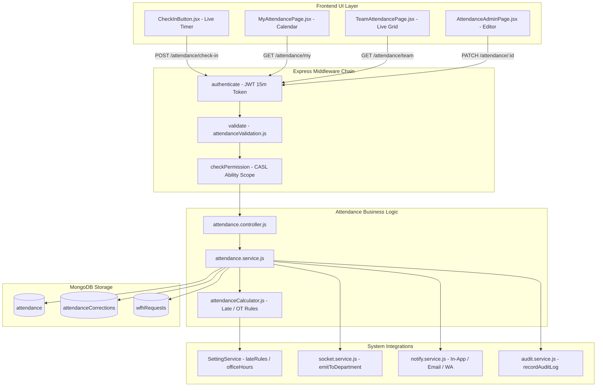
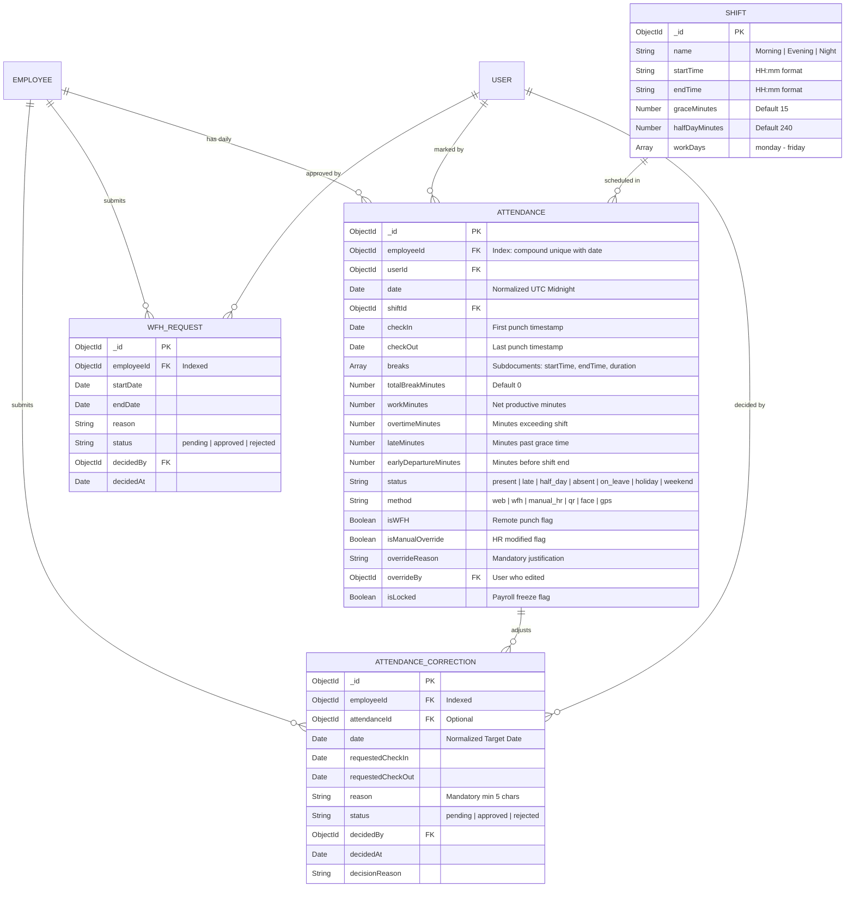
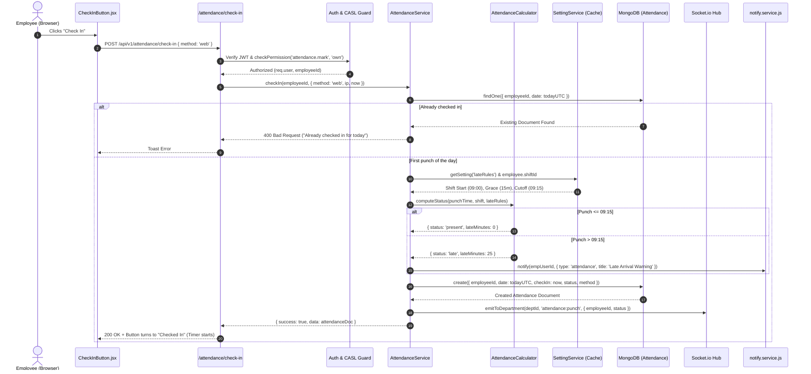

# Architectural Implementation Plan: Module M5 — Attendance & Shifts

**Feature Branch**: `feature/08-attendance`  
**Created**: 2026-10-19  
**Status**: Ready for Tasks Generation & Vertical Slice Execution  
**Module ID**: M5  
**Module Name**: Attendance & Shifts (Core HR Group · Launch Scope P1)  
**Spec Reference**: [`.specify/specs/08-attendance/spec.md`](file:///c:/Users/hamih/OneDrive/Desktop/AtoZ%20Coder/Advanced%20MERN/HRM/.specify/specs/08-attendance/spec.md)  
**Governing Documents**:
- [`docs/TECH-SPEC.md`](file:///c:/Users/hamih/OneDrive/Desktop/AtoZ%20Coder/Advanced%20MERN/HRM/docs/TECH-SPEC.md) Sections 3 (Folders), 4 (DB), 5 (API), 6 (Auth), 8 (Request Lifecycle)
- [`docs/BUILD-GUIDE.md`](file:///c:/Users/hamih/OneDrive/Desktop/AtoZ%20Coder/Advanced%20MERN/HRM/docs/BUILD-GUIDE.md) Section 10 (Rows 5.1 to 5.15)
- [`docs/MODULES.md`](file:///c:/Users/hamih/OneDrive/Desktop/AtoZ%20Coder/Advanced%20MERN/HRM/docs/MODULES.md) Section M5

---

## 1. Architecture Summary & Technical Context

Module M5 provides the enterprise workforce attendance, shift scheduling, and punch-clock engine. It tracks employee presence, computes status classifications (`present`, `late`, `half_day`, `absent`, `on_leave`, `holiday`, `weekend`), tracks meal and prayer breaks, processes manager approvals for Work-From-Home (WFH) and attendance corrections, auto-marks absences through a nightly Pakistan-timezone cron job, and freezes attendance prior to monthly payroll execution.

### Technical Context & Invariants
- **Language / Environment**: Node.js v20+ / ES Modules (`.js`), React 18 / Vite (`.jsx`). Strictly ZERO TypeScript.
- **Data Persistence**: MongoDB with Mongoose ODM.
  - Unique compound index `{ employeeId: 1, date: 1 }` guarantees zero duplicate entries per calendar day.
  - Dates normalized to UTC start-of-day (`YYYY-MM-DDT00:00:00.000Z`).
- **Dynamic Business Rules**:
  - `lateRules`: Dynamically queried from `SettingService.getSetting('lateRules')` (grace minutes, late threshold, half-day count trigger, penalty paisa).
  - `officeHours` & `workingDays`: Fallback shift hours loaded from `SettingService.getSetting('officeHours')`.
- **Central Services Integration**:
  - Real-time punch emission: Socket.io rooms (`user:${userId}`, `department:${deptId}`).
  - Multi-channel notification: Centralized `notify(targetIds, payload)` for late warnings, WFH decisions, and correction updates.
  - Auditing: All HR manual edits generate immutable logs in `auditLogs` via `recordAuditLog()`.

---

## 2. Archify Architectural Diagrams

### Diagram 1: System Flow & Request Lifecycle


---

### Diagram 2: Entity Relationship Diagram (ERD)


---

### Diagram 3: Main Flow Sequence Diagram (Web Clock-In & Rules Engine)


---

## 3. Exact File Manifest

### Backend Files (`backend/src/`)
```text
backend/src/
├── models/
│   ├── attendance.model.js               # Core daily attendance schema & indexes
│   ├── attendanceCorrection.model.js     # Missed punch correction requests schema
│   └── wfhRequest.model.js               # Remote work authorization schema
├── modules/
│   └── attendance/
│       ├── attendance.validation.js      # Zod validation schemas for all actions
│       ├── attendance.service.js         # Core business logic & database queries
│       ├── attendanceCalculator.js       # Pure calculation engine (late, OT, half-day)
│       ├── attendance.controller.js      # HTTP request handling & response mapping
│       └── attendance.routes.js          # Route declarations with CASL permissions
├── jobs/
│   └── autoAbsent.job.js                 # Nightly 23:59 PKT automated absence evaluation
└── tests/
    ├── attendance.model.test.js          # Unique index & compound constraint tests
    ├── attendance.calc.test.js           # Late rules & overtime unit calculation tests
    ├── attendance.api.test.js            # End-to-end API & scoping tests
    └── m5.attendance.e2e.test.js         # Multi-role Playwright integration suite
```

### Frontend Files (`frontend/src/`)
```text
frontend/src/
├── features/
│   └── attendance/
│       ├── attendanceApi.js              # RTK Query API endpoints & cache invalidation
│       ├── components/
│       │   ├── CheckInButton.jsx         # Dashboard live punch-clock widget with timer
│       │   ├── AttendanceCalendar.jsx    # Interactive monthly color-coded calendar
│       │   ├── CorrectionModal.jsx       # Missed-punch correction submission modal
│       │   ├── WFHModal.jsx              # Remote work-from-home application modal
│       │   ├── AttendanceEditModal.jsx   # HR admin manual punch override modal
│       │   └── BreakControl.jsx          # Lunch and prayer break toggle controls
│       └── pages/
│           ├── MyAttendancePage.jsx      # Employee personal attendance hub & calendar
│           ├── TeamAttendancePage.jsx    # Department Manager live presence grid
│           ├── AttendanceAdminPage.jsx   # HR company-wide management, edit & lock hub
│           └── AttendanceCorrectionsPage.jsx # Correction requests & approvals list
```

---

## 4. API Endpoints, Permission Taxonomy & Scopes

### 4.1 Master Endpoints Specification

| # | Method | Endpoint | CASL Permission | Allowed Scopes | Description |
| :---: | :---: | :--- | :--- | :---: | :--- |
| 1 | `POST` | `/api/v1/attendance/check-in` | `attendance.mark` | `own` | Record morning web clock-in timestamp |
| 2 | `POST` | `/api/v1/attendance/check-out` | `attendance.mark` | `own` | Record departure clock-out timestamp |
| 3 | `POST` | `/api/v1/attendance/break-start` | `attendance.mark` | `own` | Start meal or prayer break |
| 4 | `POST` | `/api/v1/attendance/break-end` | `attendance.mark` | `own` | Conclude break and resume work timer |
| 5 | `GET` | `/api/v1/attendance/today` | `attendance.mark` | `own` | Fetch today's current punch and break state |
| 6 | `GET` | `/api/v1/attendance/my` | `attendance.view` | `own` | Monthly calendar and summary metrics |
| 7 | `GET` | `/api/v1/attendance/team` | `attendance.view` | `team`, `department` | Live team presence grid for managers |
| 8 | `GET` | `/api/v1/attendance` | `attendance.view` | `all` | HR company-wide attendance list with filters |
| 9 | `PATCH` | `/api/v1/attendance/:id` | `attendance.edit` | `all` | HR manual punch edit with mandatory reason |
| 10 | `POST` | `/api/v1/attendance/corrections` | `attendance.correction` | `own` | Submit missed-punch correction request |
| 11 | `GET` | `/api/v1/attendance/corrections` | `attendance.view` | `own`, `team`, `all` | Scoped list of correction requests |
| 12 | `PATCH` | `/api/v1/attendance/corrections/:id/decide` | `attendance.approve` | `team`, `all` | Approve or reject correction request |
| 13 | `POST` | `/api/v1/attendance/wfh` | `attendance.wfh` | `own` | Submit Work-From-Home application |
| 14 | `GET` | `/api/v1/attendance/wfh` | `attendance.view` | `own`, `team`, `all` | Scoped list of WFH applications |
| 15 | `PATCH` | `/api/v1/attendance/wfh/:id/decide` | `attendance.approve` | `team`, `all` | Approve or reject WFH application |
| 16 | `POST` | `/api/v1/attendance/lock` | `attendance.lock` | `all` | Freeze monthly attendance before payroll |
| 17 | `GET` | `/api/v1/reports/attendance` | `attendance.export` | `team`, `all` | Download Excel attendance workbook |

### 4.2 Updating `backend/src/shared/permissions.js`
In Step 1 of implementation, the `attendance` module block will be added to `PERMISSIONS_CATALOGUE`:
```javascript
  {
    module: 'attendance',
    label: 'Attendance & Shift Management',
    subject: 'Attendance',
    description: 'Punch clocks, shift schedules, overtime, breaks, corrections, and payroll lock.',
    actions: [
      { action: 'attendance.mark', label: 'Mark Attendance & Breaks', allowedScopes: ['own'], defaultScope: 'own' },
      { action: 'attendance.view', label: 'View Attendance Records', allowedScopes: ['own', 'team', 'department', 'all'], defaultScope: 'own' },
      { action: 'attendance.edit', label: 'Edit & Override Punches', allowedScopes: ['all'], defaultScope: 'all' },
      { action: 'attendance.approve', label: 'Approve Corrections & WFH', allowedScopes: ['team', 'department', 'all'], defaultScope: 'team' },
      { action: 'attendance.lock', label: 'Lock Attendance for Payroll', allowedScopes: ['all'], defaultScope: 'all' },
      { action: 'attendance.wfh', label: 'Apply for Work-From-Home', allowedScopes: ['own'], defaultScope: 'own' },
      { action: 'attendance.correction', label: 'Request Missed Punch Correction', allowedScopes: ['own'], defaultScope: 'own' },
      { action: 'attendance.export', label: 'Export Attendance Reports', allowedScopes: ['team', 'all'], defaultScope: 'team' }
    ]
  }
```

---

## 5. Automated Verification & Test Strategy

1. **Unit Tests (`tests/attendance.calc.test.js`)**:
   - Verify 09:14 punch on 09:00 shift with 15m grace = `present` (0 late minutes).
   - Verify 09:20 punch = `late` (20 late minutes).
   - Verify 13:30 punch past half-day cutoff = `half_day`.
   - Verify 18:00 departure on 8-hour shift = 0 overtime.
   - Verify 20:00 departure on 8-hour shift = 120 overtime minutes.
2. **Database Integrity Tests (`tests/attendance.model.test.js`)**:
   - Verify MongoDB compound unique index `{ employeeId: 1, date: 1 }` rejects duplicate clock-ins on same day.
3. **API & Scoping Tests (`tests/attendance.api.test.js`)**:
   - Department Manager only receives own department attendance records.
   - Employee receives 403 when trying to access `/api/v1/attendance` (all) or edit another user's punch.
   - HR edit requires non-empty justification string and generates `auditLogs` record.
4. **End-to-End Playwright Verification (`tests/m5.attendance.e2e.test.js`)**:
   - Super Admin: Tests month locking, admin override, and Excel export.
   - HR Manager: Edits punch with justification reason, reviews team punches.
   - Department Manager: Inspects live team grid, approves WFH and correction requests.
   - Employee: Marks check-in, tests live work timer, starts/ends break, requests correction, views color-coded calendar.
