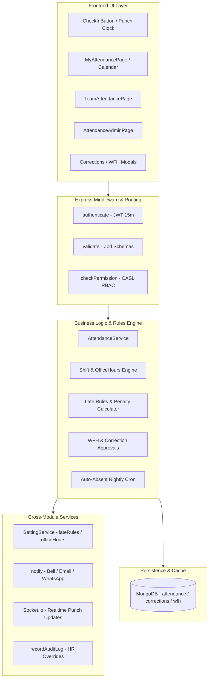

# Feature Specification: Module M5 — Attendance & Shifts

**Feature Branch**: `feature/08-attendance`  
**Created**: 2026-10-19  
**Status**: Ready for Architectural Planning & Implementation  
**Module ID**: M5  
**Module Name**: Attendance & Shifts (Core HR Group · Launch Scope P1)  
**Spec Folder**: `.specify/specs/08-attendance`  
**Governing Documents**:
- [`docs/FRD.md`](file:///c:/Users/hamih/OneDrive/Desktop/AtoZ%20Coder/Advanced%20MERN/HRM/docs/FRD.md) Section M5 (Attendance & Shifts) & Section 11 (Permission Matrix M5 Row)
- [`docs/BUILD-GUIDE.md`](file:///c:/Users/hamih/OneDrive/Desktop/AtoZ%20Coder/Advanced%20MERN/HRM/docs/BUILD-GUIDE.md) Section 10 (Rows 5.1 to 5.15)
- [`docs/TECH-SPEC.md`](file:///c:/Users/hamih/OneDrive/Desktop/AtoZ%20Coder/Advanced%20MERN/HRM/docs/TECH-SPEC.md) Section 1, 2, 3, 4, 7 & 8

---

## 1. Executive Summary & Architecture Integration

Module M5 establishes the core time-tracking, shift management, and workforce presence pipeline for the software house. It records daily punches, enforces company work schedules and late rules, tracks breaks, processes manager approvals for Work-From-Home (WFH) and attendance corrections, auto-marks absences via a nightly cron job, and freezes attendance via a monthly lock before payroll preparation (M9).



### Architectural Invariants & Cross-Module Dependencies
1. **Vertical Slice Execution**: Every feature row is delivered sequentially with its backend model, validation, service, controller, routes, unit test, frontend RTK Query hook, UI component, CASL `Can` guarding, and multi-role verification.
2. **Date & Timezone Standardization**:
   - Dates are stored normalized to the UTC start-of-day timestamp (`YYYY-MM-DDT00:00:00.000Z`) to ensure the unique compound index `(employeeId + date)` prevents duplicate records per calendar day.
   - All client punch-in/out times are rendered in `Asia/Karachi` (PKT / UTC+5) on the frontend.
3. **M2 Settings Binding**:
   - Grace minutes, late count penalties, and half-day thresholds are dynamically loaded from `SettingService.getSetting('lateRules')`.
   - Default office hours and flexible shift allowances are retrieved from `SettingService.getSetting('officeHours')` and `workingDays`.
4. **M8 Centralized Notifications**:
   - Automated alerts for punch confirmations, late arrivals, WFH submission/approvals, and correction requests invoke `notify(userIds, payload)`.
5. **M26 CASL Permissions**:
   - Super Admin: **Full** (`attendance.*`, scope: `all`)
   - HR Manager: **Manage** (`attendance.view`, `attendance.mark`, `attendance.edit`, `attendance.approve`, `attendance.lock`, scope: `all`)
   - Department Manager: **Team** (`attendance.view`, `attendance.approve`, scope: `team` / `department`)
   - Employee: **Own** (`attendance.mark`, `attendance.view`, `attendance.correction`, `attendance.wfh`, scope: `own`)

---

## 2. Context7 Verified Library Syntax Patterns

### 2.1 Node-Cron Scheduled Task with Pakistan Timezone
*Source: Official Node-Cron Documentation via Context7 (`/node-cron/node-cron`)*

```javascript
import cron from 'node-cron';
import { runNightlyAutoAbsent } from './jobs/autoAbsent.job.js';

// Executes daily at 23:59 PKT (Asia/Karachi)
export const initAttendanceCrons = () => {
  cron.schedule('59 23 * * *', async () => {
    console.log('[Cron:AutoAbsent] Starting nightly auto-absent evaluation...');
    await runNightlyAutoAbsent();
  }, {
    timezone: 'Asia/Karachi',
    name: 'nightly-auto-absent'
  });
};
```

### 2.2 ExcelJS Streaming Workbook Generation
*Source: Official ExcelJS Documentation via Context7 (`/exceljs/exceljs`)*

```javascript
import ExcelJS from 'exceljs';

export const generateAttendanceExcelBuffer = async (records) => {
  const workbook = new ExcelJS.Workbook();
  workbook.creator = 'HRM System Enterprise';
  workbook.created = new Date();

  const sheet = workbook.addWorksheet('Monthly Attendance Report');

  sheet.columns = [
    { header: 'Employee ID', key: 'empCode', width: 14 },
    { header: 'Employee Name', key: 'name', width: 24 },
    { header: 'Department', key: 'department', width: 18 },
    { header: 'Date', key: 'date', width: 14 },
    { header: 'Shift', key: 'shift', width: 16 },
    { header: 'Check In', key: 'checkIn', width: 12 },
    { header: 'Check Out', key: 'checkOut', width: 12 },
    { header: 'Work Hours', key: 'workHours', width: 12 },
    { header: 'Status', key: 'status', width: 14 },
    { header: 'Overtime (Min)', key: 'overtime', width: 14 }
  ];

  // Apply corporate header styling
  sheet.getRow(1).font = { bold: true, color: { argb: 'FFFFFFFF' } };
  sheet.getRow(1).fill = {
    type: 'pattern',
    pattern: 'solid',
    fgColor: { argb: 'FF1E2235' }
  };

  records.forEach((row) => sheet.addRow(row));

  return await workbook.xlsx.writeBuffer({
    useSharedStrings: true,
    useStyles: true
  });
};
```

### 2.3 Mongoose Unique Compound Constraint & Status Enum
*Source: Mongoose Official Schema Guide*

```javascript
const attendanceSchema = new mongoose.Schema({
  employeeId: {
    type: mongoose.Schema.Types.ObjectId,
    ref: 'Employee',
    required: true,
    index: true
  },
  date: {
    type: Date,
    required: true
  },
  status: {
    type: String,
    enum: ['present', 'late', 'half_day', 'absent', 'on_leave', 'holiday', 'weekend'],
    default: 'present'
  }
}, { timestamps: true });

// Prevent duplicate attendance records for the same employee on the same calendar day
attendanceSchema.index({ employeeId: 1, date: 1 }, { unique: true });
```

---

## 3. Prioritized User Stories & Acceptance Criteria

### [Story 5.1] Daily Attendance Data Model & Integrity (Priority: P1)
**BUILD-GUIDE ID**: `5.1`  
**Description**: As the HRM system, I must store daily attendance records in MongoDB with a unique compound constraint on `(employeeId + date)` so that an employee cannot have duplicate attendance entries for any single day.

**Why this priority**: Fundamental database foundation for time-tracking; prevents race conditions and data corruption.  
**Independent Test**: Attempting to insert two records for the same employee on the same day throws MongoDB duplicate key error code `11000`.

**Acceptance Scenarios**:
1. **Given** no existing attendance record for Employee `E1` on `2026-10-19`,  
   **When** a check-in is logged for `E1` on `2026-10-19`,  
   **Then** the document is created with normalized date `2026-10-19T00:00:00.000Z`.
2. **Given** an existing attendance record for `E1` on `2026-10-19`,  
   **When** another record is inserted for `E1` on `2026-10-19`,  
   **Then** the database rejects the write with HTTP 409 Conflict.
3. **Given** any authenticated role,  
   **When** querying attendance records,  
   **Then** records are populated with `shiftId` and `employeeId` details.

---

### [Story 5.2] Shift Assignment & Employee Shift Binding (Priority: P1)
**BUILD-GUIDE ID**: `5.2`  
**Description**: As an HR Manager, I want to assign individual or group shifts to employees so that their attendance calculations reference the correct start time, end time, and grace period.

**Why this priority**: Required before punch calculations (late arrivals and overtime) can be computed.  
**Independent Test**: Assigning a shift updates `employee.shiftId` and reflects in employee profile and attendance calculations.

**Acceptance Scenarios**:
1. **Given** HR Manager on Employee edit page,  
   **When** selecting "Morning Shift (09:00 - 18:00)" and saving,  
   **Then** `PATCH /api/v1/employees/:id/shift` updates `shiftId` with HTTP 200.
2. **Given** an Employee with no custom shift assigned,  
   **When** attendance is calculated,  
   **Then** system automatically falls back to default office hours from M2 Company Settings.
3. **Given** an Employee viewing own profile,  
   **When** navigating to the shift section,  
   **Then** the assigned shift name, timings, and grace minutes are displayed in read-only mode.

---

### [Story 5.3] Web Clock-In with Timestamp & Method Capture (Priority: P1)
**BUILD-GUIDE ID**: `5.3`  
**Description**: As an Employee, I want to click a "Check In" button on the portal dashboard so that my work commencement time, client IP address, and location method are recorded in real time.

**Why this priority**: Core primary action for employee attendance self-service.  
**Independent Test**: Employee clocks in; button state updates to "Checked In", displays live work timer, and creates record in DB.

**Acceptance Scenarios**:
1. **Given** an authenticated Employee on the dashboard who has not checked in today,  
   **When** clicking the green "Check In" button,  
   **Then** `POST /api/v1/attendance/check-in` creates an attendance document with `checkIn: new Date()`, `method: 'web'`, and status based on shift rules.
2. **Given** an Employee who already checked in today,  
   **When** attempting to send another `POST /api/v1/attendance/check-in`,  
   **Then** system returns HTTP 400 Bad Request ("Already checked in for today").
3. **Given** an Employee checking in,  
   **When** the action completes,  
   **Then** a real-time event `attendance:punch` is emitted to their Department Manager via Socket.io.

---

### [Story 5.4] Web Clock-Out & Duration Computation (Priority: P1)
**BUILD-GUIDE ID**: `5.4`  
**Description**: As an Employee, I want to click a "Check Out" button at the end of my workday so that my exit time is recorded and total gross work hours are computed.

**Why this priority**: Essential to calculate net work duration, early departures, and overtime for payroll.  
**Independent Test**: Clicking "Check Out" records `checkOut` timestamp and calculates `totalMinutes` and `effectiveHours`.

**Acceptance Scenarios**:
1. **Given** an Employee who checked in at 09:00,  
   **When** clicking "Check Out" at 18:00,  
   **Then** `POST /api/v1/attendance/check-out` sets `checkOut: 18:00`, computes `totalMinutes: 540`, and sets button state to "Completed for Today".
2. **Given** an Employee who has not checked in today,  
   **When** attempting to call check-out,  
   **Then** system rejects with HTTP 400 ("Must check in before checking out").
3. **Given** an Employee who already checked out today,  
   **When** clicking check-out again,  
   **Then** system prevents duplicate check-outs unless HR admin overrides or re-opens punch.

---

### [Story 5.5] Break Tracking (Start / End Breaks) (Priority: P2)
**BUILD-GUIDE ID**: `5.5`  
**Description**: As an Employee, I want to record lunch and prayer breaks by toggling a "Start Break" and "End Break" action so that break duration is subtracted from gross office time to determine net productive hours.

**Why this priority**: Accurate tracking of billable software development hours vs breaks.  
**Independent Test**: Start break, wait/record end break; total break minutes are subtracted from `workMinutes`.

**Acceptance Scenarios**:
1. **Given** an Employee currently checked in,  
   **When** clicking "Start Break",  
   **Then** `POST /api/v1/attendance/break-start` adds an open break item `{ startTime: Date }` and button toggles to "End Break".
2. **Given** an active ongoing break,  
   **When** employee clicks "End Break",  
   **Then** `POST /api/v1/attendance/break-end` stamps `endTime: Date`, calculates break duration in minutes, and updates `totalBreakMinutes`.
3. **Given** an ongoing break,  
   **When** employee attempts to "Check Out",  
   **Then** system automatically closes the active break before finalizing check-out.

---

### [Story 5.6] Automated Late, Early Departure & Half-Day Rules (Priority: P1)
**BUILD-GUIDE ID**: `5.6`  
**Description**: As the Attendance Rules Engine, I must compare check-in and check-out timestamps against assigned shift timings and M2 `lateRules` to automatically classify attendance status (`present`, `late`, `half_day`).

**Why this priority**: Direct input to monthly payroll deductions and employee discipline tracking.  
**Independent Test**: Clock-in at 09:20 on a 09:00 shift with 15m grace marks status as `late`; clock-in past half-day threshold marks `half_day`.

**Acceptance Scenarios**:
1. **Given** Shift start 09:00 with 15m grace (cutoff 09:15),  
   **When** employee checks in at 09:12,  
   **Then** status is marked as `present` with `lateMinutes: 0`.
2. **Given** Shift start 09:00 with 15m grace,  
   **When** employee checks in at 09:25,  
   **Then** status is marked as `late` with `lateMinutes: 25`, and a late notification is dispatched via M8.
3. **Given** M2 Late Rules setting `halfDayThresholdLateCount: 3`,  
   **When** an employee reaches their 3rd late arrival in the current month,  
   **Then** an alert notifies HR and employee that the 3rd late triggers a half-day salary penalty.
4. **Given** Shift end 18:00,  
   **When** employee checks out at 16:30 without approved half-day leave,  
   **Then** record flags `isEarlyDeparture: true` with `earlyDepartureMinutes: 90`.

---

### [Story 5.7] Overtime Computation (Priority: P2)
**BUILD-GUIDE ID**: `5.7`  
**Description**: As the Attendance Engine, I must compute overtime minutes when an employee works past their scheduled shift duration so that approved overtime can be credited in payroll (M9).

**Why this priority**: Required for overtime compensation calculation in software house operations.  
**Independent Test**: Employee on 8-hour shift checks out after 10 hours; record reflects `overtimeMinutes: 120`.

**Acceptance Scenarios**:
1. **Given** an 8-hour scheduled shift (09:00 to 18:00 including 1-hour break),  
   **When** employee checks out at 20:00,  
   **Then** `overtimeMinutes` is calculated as `120` (2 hours).
2. **Given** a Department Manager viewing team attendance,  
   **When** inspecting the daily list,  
   **Then** overtime hours are prominently highlighted for manager verification without exposing salary values.

---

### [Story 5.8] Work-From-Home (WFH) Request & Approval Workflow (Priority: P2)
**BUILD-GUIDE ID**: `5.8`  
**Description**: As an Employee, I want to submit a Work-From-Home (WFH) request for upcoming dates so that upon Department Manager approval, I can clock in remotely without geo-fence or office network restrictions.

**Why this priority**: Critical for hybrid software houses operating in Pakistan.  
**Independent Test**: Employee submits WFH; Manager approves; employee attendance record flags `isWFH: true`.

**Acceptance Scenarios**:
1. **Given** an Employee,  
   **When** submitting WFH form for `2026-10-25` with reason "Power maintenance",  
   **Then** `POST /api/v1/attendance/wfh` creates a pending request and notifies Department Manager via M8.
2. **Given** Department Manager,  
   **When** clicking "Approve" on `PATCH /api/v1/attendance/wfh/:id/decide`,  
   **Then** request status becomes `approved`, and on that date the employee check-in accepts `method: 'wfh'`.
3. **Given** an Employee whose WFH request was rejected,  
   **When** checking in from home,  
   **Then** standard office rules and late penalties apply.

---

### [Story 5.9] Personal Monthly Color-Coded Attendance Calendar (Priority: P1)
**BUILD-GUIDE ID**: `5.9`  
**Description**: As an Employee, I want a monthly calendar view (`MyAttendancePage.jsx`) displaying each day colored by status (Present: Green, Late: Amber, Half-Day: Orange, Absent: Red, Leave: Blue, Holiday: Purple) and summary cards.

**Why this priority**: Core self-service visibility so employees can monitor their attendance and late count.  
**Independent Test**: Navigating to `/attendance/my` renders the interactive calendar for the current month with correct summary statistics.

**Acceptance Scenarios**:
1. **Given** an authenticated Employee,  
   **When** visiting `/attendance/my`,  
   **Then** `GET /api/v1/attendance/my?month=2026-10` returns daily records with summary metrics (Present, Late, Absent, Leaves, Net Hours).
2. **Given** an employee clicking on any specific day card,  
   **When** the day details popover opens,  
   **Then** exact check-in, check-out, break history, and calculated late minutes are shown.
3. **Given** month switcher controls (`< Prev`, `Next >`),  
   **When** clicking previous month,  
   **Then** the calendar smoothly reloads and displays historical month data.

---

### [Story 5.10] Department Manager Team Attendance Live View (Priority: P1)
**BUILD-GUIDE ID**: `5.10`  
**Description**: As a Department Manager, I want a real-time team attendance dashboard (`TeamAttendancePage.jsx`) showing who is currently present, on break, late, on leave, or absent today in my department.

**Why this priority**: Team leaders require instant operational visibility to coordinate project standups and daily tasks.  
**Independent Test**: Manager logs in; `/teams/my/attendance` displays all direct department reports with live statuses.

**Acceptance Scenarios**:
1. **Given** Department Manager,  
   **When** opening Team Attendance page,  
   **Then** `GET /api/v1/attendance/team` returns only employees belonging to the manager's assigned department.
2. **Given** an employee in the department clocks in,  
   **When** the WebSocket event `attendance:punch` fires,  
   **Then** the manager's team table updates live without requiring manual browser refresh.
3. **Given** an Employee from Department B,  
   **When** Department Manager A queries team attendance,  
   **Then** Employee B is strictly excluded (CASL data scope: `team`).

---

### [Story 5.11] HR Attendance Admin Editor & Audit Trail (Priority: P1)
**BUILD-GUIDE ID**: `5.11`  
**Description**: As an HR Manager, I want to view all company attendance records, search by department or employee, and manually edit punch times or statuses with a mandatory justification reason.

**Why this priority**: Essential administrative override capability to resolve hardware or network issues while maintaining strict audit compliance.  
**Independent Test**: HR edits an attendance record; previous and new values with reason are logged to `auditLogs`.

**Acceptance Scenarios**:
1. **Given** HR Manager on `AttendanceAdminPage.jsx`,  
   **When** opening the edit modal for an employee's punch and updating check-in from 09:35 to 09:00 with reason "Biometric scanner failure",  
   **Then** `PATCH /api/v1/attendance/:id` updates the record, sets `isManualOverride: true`, and records an audit log.
2. **Given** an Employee or Department Manager,  
   **When** attempting to send `PATCH /api/v1/attendance/:id`,  
   **Then** the API returns HTTP 403 Forbidden (`attendance.edit` required).
3. **Given** HR Manager submitting edit without a reason string,  
   **When** Zod validation runs,  
   **Then** request is rejected with HTTP 400 ("Override justification reason is required").

---

### [Story 5.12] Missed-Punch Attendance Correction Requests (Priority: P2)
**BUILD-GUIDE ID**: `5.12`  
**Description**: As an Employee, I want to submit an attendance correction request when I forgot to clock in or out, so that my Department Manager or HR can review and adjust my attendance.

**Why this priority**: Prevents incorrect auto-absent penalties caused by human error or connectivity glitches.  
**Independent Test**: Employee submits correction; Manager approves; underlying attendance record updates automatically.

**Acceptance Scenarios**:
1. **Given** an Employee who missed check-out yesterday,  
   **When** clicking "Request Correction" and entering `requestedCheckOut: 18:00` with reason "Network outage",  
   **Then** `POST /api/v1/attendance/corrections` creates a pending correction document.
2. **Given** Department Manager or HR Manager,  
   **When** approving via `PATCH /api/v1/attendance/corrections/:id/decide`,  
   **Then** the attendance document is patched with the approved times, recalculates late/work hours, and notifies employee via M8.
3. **Given** an already approved or rejected correction request,  
   **When** attempting to re-decide it,  
   **Then** system rejects with HTTP 400 ("Request has already been processed").

---

### [Story 5.13] Nightly Auto-Absent Automated Cron Job (Priority: P1)
**BUILD-GUIDE ID**: `5.13`  
**Description**: As the Automated System, I must execute a cron job every night at 23:59 PKT that scans all active employees; if an employee has no attendance record and no approved leave or gazetted holiday for today, an `absent` record is automatically created.

**Why this priority**: Guarantees complete daily records so monthly payroll deductions are calculated without missing gaps.  
**Independent Test**: Triggering `runNightlyAutoAbsent()` creates `absent` entries for employees without punches, excluding employees on approved leave.

**Acceptance Scenarios**:
1. **Given** an active Employee who did not clock in on a working day (Monday to Friday),  
   **When** the nightly cron executes at 23:59 PKT,  
   **Then** an attendance record with `status: 'absent'`, `totalMinutes: 0`, and `isAutoGenerated: true` is inserted.
2. **Given** an Employee who has an approved leave (from M6) for today,  
   **When** the cron runs,  
   **Then** the employee is marked `status: 'on_leave'` instead of `absent`.
3. **Given** today is a gazetted Pakistan holiday (e.g., Pakistan Day) or weekend,  
   **When** the cron runs,  
   **Then** no absent records are generated.

---

### [Story 5.14] Monthly Attendance Lock Before Payroll (Priority: P1)
**BUILD-GUIDE ID**: `5.14`  
**Description**: As an HR Manager, I want to freeze and lock a specific month's attendance records (`POST /api/v1/attendance/lock`) so that once attendance is verified, no further edits, check-ins, or corrections can alter payroll inputs.

**Why this priority**: Required quality gate ensuring deterministic payroll generation in Module M9.  
**Independent Test**: Locking October 2026 prevents any punch, edit, or correction for October dates.

**Acceptance Scenarios**:
1. **Given** HR Manager or Super Admin,  
   **When** clicking "Lock Month Attendance" for `month: 2026-10`,  
   **Then** `POST /api/v1/attendance/lock` updates the month's lock status in database and marks records as `isLocked: true`.
2. **Given** a locked month,  
   **When** an employee attempts to submit a correction request for that month,  
   **Then** the system rejects with HTTP 400 ("Attendance for this month is locked for payroll").
3. **Given** a locked month,  
   **When** an HR user attempts to edit a record,  
   **Then** the system requires Super Admin unlocking permission.

---

### [Story 5.15] Attendance Excel Export Report (Priority: P2)
**BUILD-GUIDE ID**: `5.15`  
**Description**: As an HR Manager, I want to download a formatted corporate Excel report (`GET /api/v1/reports/attendance`) filtered by department, month, and employee, with summary statistics and color-coded statuses.

**Why this priority**: Required for executive reporting, compliance records, and manual auditing.  
**Independent Test**: Requesting the export downloads an `.xlsx` workbook generated via ExcelJS matching the filtered dataset.

**Acceptance Scenarios**:
1. **Given** HR Manager or Super Admin,  
   **When** requesting `GET /api/v1/reports/attendance?month=2026-10&departmentId=...`,  
   **Then** system returns HTTP 200 with headers `Content-Type: application/vnd.openxmlformats-officedocument.spreadsheetml.sheet` and `Content-Disposition: attachment; filename=attendance-2026-10.xlsx`.
2. **Given** Department Manager requesting the report,  
   **When** the download is generated,  
   **Then** records are strictly filtered to their own department members.
3. **Given** an Employee requesting the report,  
   **When** attempting to download company-wide report,  
   **Then** system returns HTTP 403 Forbidden or restricts download strictly to own attendance history.

---

## 4. Key Entities & Database Schemas

### 4.1 Attendance Document (`Attendance`)
- `_id`: ObjectId
- `employeeId`: ObjectId (ref: `Employee`, required, indexed)
- `userId`: ObjectId (ref: `User`, indexed)
- `date`: Date (normalized to UTC midnight `00:00:00.000Z`, required)
- `shiftId`: ObjectId (ref: `Shift`, optional)
- `checkIn`: Date (timestamp of first punch)
- `checkOut`: Date (timestamp of last punch)
- `breaks`: Array of subdocuments:
  - `startTime`: Date
  - `endTime`: Date
  - `durationMinutes`: Number
  - `reason`: String
- `totalBreakMinutes`: Number (default: 0)
- `workMinutes`: Number (net minutes excluding breaks, default: 0)
- `overtimeMinutes`: Number (default: 0)
- `lateMinutes`: Number (default: 0)
- `earlyDepartureMinutes`: Number (default: 0)
- `status`: Enum `['present', 'late', 'half_day', 'absent', 'on_leave', 'holiday', 'weekend']`
- `method`: Enum `['web', 'wfh', 'manual_hr', 'qr', 'face', 'gps']` (default: `'web'`)
- `isWFH`: Boolean (default: false)
- `isManualOverride`: Boolean (default: false)
- `overrideReason`: String
- `overrideBy`: ObjectId (ref: `User`)
- `isLocked`: Boolean (locked during payroll freeze, default: false)
- **Indexes**:
  - `{ employeeId: 1, date: 1 }` (Unique constraint)
  - `{ date: 1, status: 1 }`
  - `{ isLocked: 1, date: 1 }`

### 4.2 Attendance Correction Request (`AttendanceCorrection`)
- `_id`: ObjectId
- `employeeId`: ObjectId (ref: `Employee`, required, indexed)
- `attendanceId`: ObjectId (ref: `Attendance`, optional if missed check-in entirely)
- `date`: Date (required)
- `requestedCheckIn`: Date
- `requestedCheckOut`: Date
- `reason`: String (required, min 5 chars)
- `status`: Enum `['pending', 'approved', 'rejected']` (default: `'pending'`)
- `decidedBy`: ObjectId (ref: `User`)
- `decidedAt`: Date
- `decisionReason`: String
- **Indexes**:
  - `{ employeeId: 1, status: 1 }`
  - `{ status: 1, date: -1 }`

### 4.3 Work-From-Home Request (`WFHRequest`)
- `_id`: ObjectId
- `employeeId`: ObjectId (ref: `Employee`, required, indexed)
- `startDate`: Date (required)
- `endDate`: Date (required)
- `reason`: String (required)
- `status`: Enum `['pending', 'approved', 'rejected']` (default: `'pending'`)
- `decidedBy`: ObjectId (ref: `User`)
- `decidedAt`: Date
- **Indexes**:
  - `{ employeeId: 1, startDate: 1, endDate: 1 }`

---

## 5. Non-Functional Requirements & Performance Gates

1. **High Concurrency Punch Handling**: Punch-in API must respond in $< 50\text{ ms}$ under 100 concurrent employee clock-in bursts at 09:00 AM.
2. **Atomic Updates**: Check-in and check-out utilize atomic `$set` operations with unique indexes to prevent double-punch race conditions.
3. **Graceful Failover**: If Redis is offline, attendance punch routes proceed directly to MongoDB without blocking user clock-ins.
4. **Audit Immutability**: Any HR manual edit produces an audit log entry in `auditLogs` collection with diffs and actor ID.
5. **Security & Data Isolation**: Multi-role CASL middleware prevents employees from accessing or modifying coworker records.

---

## 6. Measurable Success Criteria

- **SC-001**: 100% of BUILD-GUIDE Section 10 rows (5.1 to 5.15) covered with dedicated automated tests.
- **SC-002**: Daily attendance punch completes in $< 1\text{ second}$ on mobile viewports (390px) and desktop.
- **SC-003**: 0 duplicate attendance documents allowed per employee per day in MongoDB.
- **SC-004**: Nightly auto-absent cron marks unpunched employees as absent within $< 5\text{ seconds}$ for 100 active staff.
- **SC-005**: All 4 default roles (Super Admin, HR Manager, Department Manager, Employee) verified via Playwright with 0 console errors.
