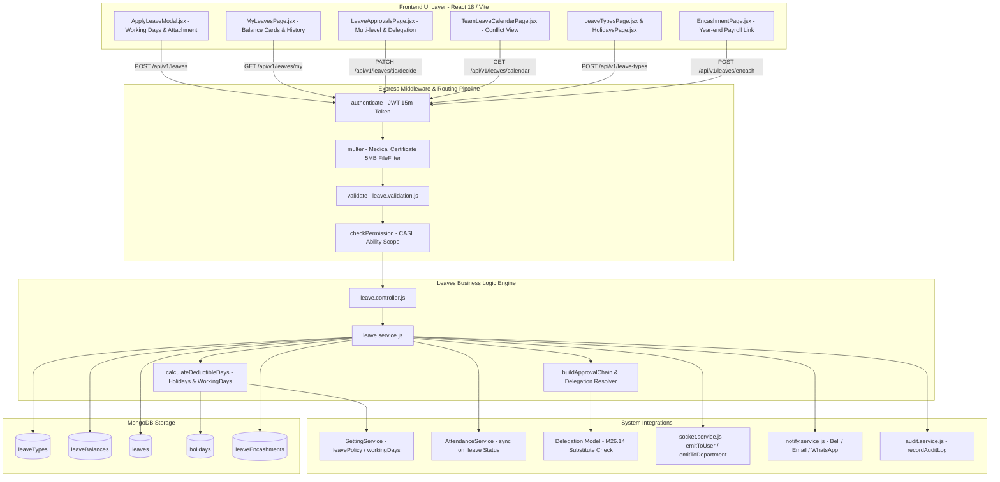
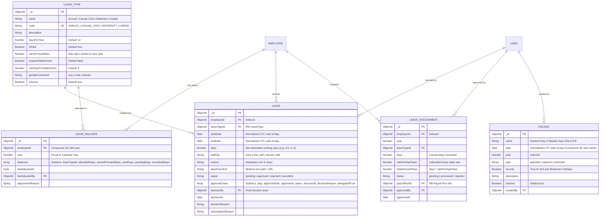

# Architectural Implementation Plan: Module M6 — Leave & Holidays

**Feature Branch**: `feature/09-leave`  
**Created**: 2026-10-19  
**Status**: Ready for Tasks Generation & Vertical Slice Execution  
**Module ID**: M6  
**Module Name**: Leave & Holidays (Core HR Group · Launch Scope P1)  
**Spec Reference**: [`.specify/specs/09-leave/spec.md`](file:///c:/Users/hamih/OneDrive/Desktop/AtoZ%20Coder/Advanced%20MERN/HRM/.specify/specs/09-leave/spec.md)  
**Governing Documents**:
- [`docs/TECH-SPEC.md`](file:///c:/Users/hamih/OneDrive/Desktop/AtoZ%20Coder/Advanced%20MERN/HRM/docs/TECH-SPEC.md) Sections 3 (Folders), 4 (DB), 5 (API), 6 (Auth), 8 (Request Lifecycle)
- [`docs/BUILD-GUIDE.md`](file:///c:/Users/hamih/OneDrive/Desktop/AtoZ%20Coder/Advanced%20MERN/HRM/docs/BUILD-GUIDE.md) Section 11 (Rows 6.1 to 6.15)
- [`docs/MODULES.md`](file:///c:/Users/hamih/OneDrive/Desktop/AtoZ%20Coder/Advanced%20MERN/HRM/docs/MODULES.md) Section M6

---

## 1. Architecture Summary & Technical Context

Module M6 implements the enterprise time-off, statutory leave quota allocation, dynamic approval hierarchy, and gazetted public holiday management engine for the software house. It enforces company leave policies configured in M2 (`leavePolicy`), computes net deductible days across working days and public holidays, supports half-day leaves (0.5 day), requires medical certificate uploads for extended sick leaves via Multer, routes applications through multi-level approval hierarchies with M26.14 temporal delegation integration, synchronizes final approvals directly into M5 Attendance records (`status: 'on_leave'`), provides team leave collision visibility, processes year-end leave encashments for M9 Payroll, and exports detailed Excel reports via ExcelJS.

### Technical Context & Invariants
- **Language / Environment**: Node.js v20+ / ES Modules (`.js`), React 18 / Vite (`.jsx`). Strictly ZERO TypeScript (`.ts` / `.tsx`).
- **Data Persistence**: MongoDB with Mongoose ODM:
  - Dates normalized to UTC start-of-day (`YYYY-MM-DDT00:00:00.000Z`) to ensure date matching across Attendance and Holidays.
  - Compound unique index on `LeaveBalance`: `{ employeeId: 1, year: 1 }`.
  - Compound unique index on `Holiday`: `{ date: 1, name: 1 }`.
  - Unique index on `LeaveType`: `{ code: 1 }`.
- **Cross-Module Integrations**:
  - `M2 SettingService`: Loaded settings for `leavePolicy` (`fiscalYearStart`, `carryForwardLimit`, `sandwichRule`, `probationLeaveAllowed`, `encashmentAllowed`) and `workingDays`.
  - `M5 AttendanceService`: On final approval (`status: 'approved'`), upserts `Attendance` records for every working date with `status: 'on_leave'`. On cancellation, clears `on_leave` status.
  - `M26 DelegationService`: Resolves active delegations (`delegation.model.js`) when evaluating whether an actor has authority to approve a team member's leave on behalf of their manager.
  - `M8 notifyService` & `Socket.io`: Dispatches in-app bell notifications, socket events (`leave:created`, `leave:approved`, `leave:rejected`), and transactional emails on decision.
  - `M9 Payroll Integration`: Encashments register `Encashment` records with calculated minor currency units (paisa) for addition into the monthly payroll run.
  - `M0 Central Services`: `ApiError`, `asyncHandler`, `recordAuditLog`, `paginate`.

---

## 2. Archify Architectural Diagrams

### Diagram 1: System Flow & Request Lifecycle


---

### Diagram 2: Entity Relationship Diagram (ERD)


---

### Diagram 3: Main Flow Sequence Diagram (Leave Submission & Auto-Sync)
```mermaid
sequenceDiagram
    autonumber
    actor Emp as Employee
    participant UI as ApplyLeaveModal.jsx
    participant API as /api/v1/leaves
    participant Auth as Auth & CASL Guard
    participant Svc as LeaveService
    participant DayCalc as DayCalculator
    participant Settings as SettingService (M2)
    participant DB as MongoDB (Leaves / Balances)
    participant AttSvc as AttendanceService (M5)
    participant Notify as notify.service.js (M8)
    actor Mgr as Dept Manager / Delegate

    Emp->>UI: Selects Dates (e.g. Mon-Tue), Type (Casual), Enters Reason
    UI->>API: POST /api/v1/leaves { leaveTypeId, startDate, endDate, reason }
    API->>Auth: Verify JWT & checkPermission('leave.apply', 'own')
    Auth-->>API: Authorized (req.user, employeeId)
    API->>Svc: applyLeave(employeeId, payload)

    Svc->>Settings: getSetting('workingDays') & getSetting('leavePolicy')
    Svc->>DB: find Active Holidays in range
    Svc->>DayCalc: calculateDeductibleDays(startDate, endDate, workingDays, holidays)
    DayCalc-->>Svc: netDays = 2

    Svc->>DB: Check Overlapping Existing Leaves
    alt Overlap Detected
        Svc-->>API: 409 Conflict ("Overlaps with existing leave period")
        API-->>UI: Show Error Banner
    else No Overlap
        Svc->>DB: findOne(LeaveBalance, { employeeId, year })
        alt Insufficient Available Quota
            Svc-->>API: 400 Bad Request ("Insufficient leave balance")
            API-->>UI: Toast Error
        else Sufficient Quota
            Svc->>Svc: buildApprovalChain(employeeId, netDays)
            Svc->>DB: atomic update LeaveBalance (pendingDays += 2)
            Svc->>DB: create Leave document (status: 'pending')
            Svc->>Notify: notify(managerUserId, { type: 'leave', title: 'New Leave Request' })
            Svc-->>API: 201 Created (Leave Record)
            API-->>UI: Success Toast + Refresh Balances
        end
    end

    Note over Mgr, Svc: Multi-level Approval Phase
    Mgr->>API: PATCH /api/v1/leaves/:id/decide { action: 'approve' }
    API->>Auth: checkPermission('leave.approve', 'team') or Active Delegation
    Auth-->>API: Authorized
    API->>Svc: decideLeave(leaveId, approverUserId, 'approve', notes)

    Svc->>DB: Mark step approved; check if final approval step
    alt Final Approval Reached
        Svc->>DB: update Leave status = 'approved'
        Svc->>DB: atomic update LeaveBalance (pendingDays -= 2, usedDays += 2)
        Svc->>AttSvc: markLeaveAttendance(employeeId, startDate, endDate, 'Casual Leave')
        AttSvc->>DB: Upsert Attendance records (status: 'on_leave')
        Svc->>Notify: notify(empUserId, { type: 'leave', title: 'Leave Approved' })
        Svc-->>API: 200 OK ({ status: 'approved' })
    end
```

---

## 3. Exact File Manifest

### Backend Files (`backend/src/`)
```text
backend/src/
├── models/
│   ├── leaveType.model.js               # Leave types schema (quota, carry-forward, attachment rules)
│   ├── leaveBalance.model.js            # Yearly employee balances schema (quota, carried, used, pending)
│   ├── leave.model.js                   # Leave application schema (dates, approvalChain, medical proof)
│   ├── holiday.model.js                 # Public holidays schema (Pakistan gazetted & lunar holidays)
│   └── leaveEncashment.model.js         # Year-end leave encashment schema for M9 Payroll
├── modules/
│   └── leaves/
│       ├── leave.validation.js          # Zod schemas for application, decisions, types, and holidays
│       ├── leave.service.js             # Core business logic: quota, carryover, chain, conflict, encash
│       ├── leaveCalculator.js           # Net working days, holiday exclusions, and sandwich rule math
│       ├── leave.controller.js          # HTTP controllers mapping requests to service methods
│       └── leave.routes.js              # Express router with authenticate, multer, validate, checkPermission
├── jobs/
│   └── yearlyLeave.job.js               # Annual/fiscal year leave balance allocation & carry-forward cron
├── seed/
│   └── holidays.seed.js                 # Standard Pakistan gazetted holidays seed script
└── tests/
    ├── leave.model.test.js              # Schema validation, unique indexes & compound keys
    ├── leave.calc.test.js               # Working days, holiday exclusion & sandwich rule unit tests
    ├── leave.api.test.js                # API endpoints, status codes, and authorization tests
    ├── leave.approval.test.js           # Multi-tier approval chain and M26 delegation tests
    └── m6.leave.e2e.test.js             # Multi-role Playwright integration test suite
```

### Frontend Files (`frontend/src/`)
```text
frontend/src/
├── features/
│   └── leaves/
│       ├── leavesApi.js                 # RTK Query API endpoints, tags, and mutations
│       ├── pages/
│       │   ├── MyLeavesPage.jsx         # Employee self-service dashboard (balance cards, history, apply)
│       │   ├── LeaveApprovalsPage.jsx   # Manager & HR approval queue with delegation badges
│       │   ├── TeamLeaveCalendarPage.jsx# Interactive calendar view showing team absences and conflicts
│       │   ├── LeaveTypesPage.jsx       # Admin leave categories configuration screen
│       │   ├── HolidaysPage.jsx         # Company gazetted and optional holiday calendar editor
│       │   └── EncashmentPage.jsx       # HR year-end leave encashment processing screen
│       └── components/
│           ├── ApplyLeaveModal.jsx      # Leave application modal with half-day toggle & attachment
│           ├── LeaveBalanceCards.jsx    # Linear Dark category-wise progress bars and quota cards
│           ├── LeaveDecideModal.jsx     # Approve / Reject confirmation modal with reason inputs
│           ├── LeaveTypeModal.jsx       # Add/Edit leave type configuration modal
│           ├── HolidayModal.jsx         # Add/Edit gazetted holiday dialog
│           └── BalanceAdjustmentModal.jsx # HR manual balance override modal with audit reason
└── components/
    └── layout/
        └── Sidebar.jsx                  # Add Leave & Holidays navigation items guarded by CASL Can
```

---

## 4. Database Schemas, Validation Rules & Indexes

### 4.1 Collection: `leaveTypes`
- **Validation Rules**:
  - `code`: String, uppercase, trim, required, unique.
  - `daysPerYear`: Number, min: 0, required.
  - `carryForwardMax`: Number, min: 0, default: 0.
  - `minDaysForAttachment`: Number, min: 1, default: 3.
- **Indexes**:
  - `{ code: 1 }` (Unique)
  - `{ isActive: 1 }`

### 4.2 Collection: `leaveBalances`
- **Validation Rules**:
  - `employeeId`: ObjectId, required, ref 'Employee'.
  - `year`: Number, required, 4-digit integer.
  - `balances`: Array of objects containing `leaveTypeId`, `allocatedDays`, `carriedForwardDays`, `usedDays`, `pendingDays`, `encashedDays`.
- **Indexes**:
  - `{ employeeId: 1, year: 1 }` (Unique compound index)

### 4.3 Collection: `leaves`
- **Validation Rules**:
  - `startDate`, `endDate`: Normalized UTC date.
  - `days`: Number, min: 0.5.
  - `halfDay`: Enum `['none', 'first_half', 'second_half']`.
  - `status`: Enum `['pending', 'approved', 'rejected', 'cancelled']`.
- **Indexes**:
  - `{ employeeId: 1, startDate: 1 }`
  - `{ status: 1 }`
  - `{ "approvalChain.approverId": 1, "approvalChain.status": 1 }`

### 4.4 Collection: `holidays`
- **Validation Rules**:
  - `name`: String, required.
  - `date`: Normalized UTC start-of-day.
  - `type`: Enum `['gazetted', 'optional', 'restricted']`.
- **Indexes**:
  - `{ date: 1, name: 1 }` (Unique compound index)
  - `{ year: 1 }`

### 4.5 Collection: `leaveEncashments`
- **Validation Rules**:
  - `days`: Number, min: 1.
  - `ratePerDayPaisa`: Number, integer paisa.
  - `totalAmountPaisa`: Number, integer paisa.
- **Indexes**:
  - `{ employeeId: 1, year: 1 }`
  - `{ status: 1 }`

---

## 5. API Endpoints, Permissions & Shared Permissions Configuration

### 5.1 Route & Permission Mappings
| Method | Endpoint | Description | Permission Action | Required Scope |
| :--- | :--- | :--- | :--- | :--- |
| `GET` | `/api/v1/leave-types` | List all active leave types | `leave.view` | `own` |
| `POST` | `/api/v1/leave-types` | Create a new leave type | `leave.settings` | `all` |
| `PATCH` | `/api/v1/leave-types/:id` | Update an existing leave type | `leave.settings` | `all` |
| `DELETE` | `/api/v1/leave-types/:id` | Soft-disable a leave type | `leave.settings` | `all` |
| `POST` | `/api/v1/leaves` | Submit new leave application | `leave.apply` | `own` |
| `GET` | `/api/v1/leaves/my` | View own leave applications | `leave.view` | `own` |
| `GET` | `/api/v1/leaves/balance` | Query live leave balance | `leave.view` | `own` (or `team`/`all`) |
| `GET` | `/api/v1/leaves/approvals`| View pending approval requests | `leave.approve` | `team` |
| `PATCH` | `/api/v1/leaves/:id/decide`| Approve or reject request | `leave.approve` | `team` / `all` |
| `PATCH` | `/api/v1/leaves/:id/cancel`| Cancel pending/approved leave | `leave.apply` | `own` |
| `GET` | `/api/v1/leaves/calendar` | Team leave conflict calendar | `leave.view` | `own` |
| `GET` | `/api/v1/holidays` | List company public holidays | Public / Authenticated | Public / Authenticated |
| `POST` | `/api/v1/holidays` | Create a public holiday | `leave.settings` | `all` |
| `PATCH` | `/api/v1/holidays/:id` | Update holiday date/details | `leave.settings` | `all` |
| `DELETE` | `/api/v1/holidays/:id` | Remove a public holiday | `leave.settings` | `all` |
| `POST` | `/api/v1/leaves/encash` | Submit or process encashment | `leave.encash` | `own` / `all` |
| `PATCH` | `/api/v1/leave-balances/:id` | HR manual quota adjustment | `leave.settings` | `all` |
| `GET` | `/api/v1/reports/leaves` | ExcelJS leave report export | `report.export` | `team` / `all` |

### 5.2 Required Update in `backend/src/shared/permissions.js`
To support statutory leave encashment (Row 6.13) under granular PBAC, add `leave.encash` to the `leaves` module definition in `backend/src/shared/permissions.js`:

```javascript
{
  action: 'leave.encash',
  label: 'Leave Encashment',
  description: 'Submit and approve unutilized annual leave encashment requests for payroll payout.',
  allowedScopes: ['own', 'all'],
  defaultScope: 'own'
}
```
And add `leave.encash` with scope `'all'` to `roles.seed.js` for Super Admin and HR Manager, and scope `'own'` for Employee.

---

## 6. Implementation Milestones & Next Step

1. **Step 1 (6.1 & 6.11)**: Leave Types & Pakistan Holidays Seed & CRUD (`leaveType.model.js`, `holiday.model.js`).
2. **Step 2 (6.2, 6.9 & 6.14)**: Yearly Balance Allocation, Live Cards & HR Override (`leaveBalance.model.js`, `yearlyLeave.job.js`).
3. **Step 3 (6.3, 6.4 & 6.5)**: Leave Application, Half-Day (0.5d), Working Days Calc & Multer Medical Proof (`leave.model.js`).
4. **Step 4 (6.6, 6.7 & 6.8)**: Multi-Level Approval Chain, M26 Delegation, Decision & Cancellation.
5. **Step 5 (6.10 & 6.12)**: Team Leave Conflict Calendar & M5 Attendance Auto-Synchronization (`status: 'on_leave'`).
6. **Step 6 (6.13 & 6.15)**: Year-End Leave Encashment (M9 Link) & ExcelJS Report Export.

Aap agla step trigger kar sakte hain:
- `/speckit-tasks` (Tammam 15 rows ko actionable micro-tasks checklist me convert karne ke liye).
