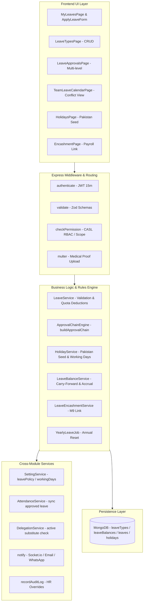

# Feature Specification: Module M6 — Leave & Holidays

**Feature Branch**: `feature/09-leave`  
**Created**: 2026-10-19  
**Status**: Ready for Architectural Planning & Implementation  
**Module ID**: M6  
**Module Name**: Leave & Holidays (Core HR Group · Launch Scope P1)  
**Spec Folder**: `.specify/specs/09-leave`  
**Governing Documents**:
- [`docs/FRD.md`](file:///c:/Users/hamih/OneDrive/Desktop/AtoZ%20Coder/Advanced%20MERN/HRM/docs/FRD.md) Section M6 (Leave & Holidays) & Section 11 (Permission Matrix M6 Row)
- [`docs/BUILD-GUIDE.md`](file:///c:/Users/hamih/OneDrive/Desktop/AtoZ%20Coder/Advanced%20MERN/HRM/docs/BUILD-GUIDE.md) Section 11 (Rows 6.1 to 6.15)
- [`docs/TECH-SPEC.md`](file:///c:/Users/hamih/OneDrive/Desktop/AtoZ%20Coder/Advanced%20MERN/HRM/docs/TECH-SPEC.md) Section 1, 2, 3, 4, 7, 8 & 11

---

## 1. Executive Summary & Architecture Integration

Module M6 orchestrates employee time-off, statutory leave entitlement management, approval delegation workflows, and public holidays for the software house. It enforces company leave policies configured in M2 (`leavePolicy`), handles half-day leaves, requires medical proofs for extended sick leaves via Multer uploads, routes applications through multi-level approval hierarchies with M26.14 delegation support, synchronizes approved absences directly into M5 Attendance records, provides conflict visibility calendars, supports year-end leave encashment for M9 Payroll calculations, and exports comprehensive audit reports via ExcelJS.



### Architectural Invariants & Cross-Module Dependencies
1. **Vertical Slice Execution**: Every feature row is built and verified end-to-end: Backend model, Zod validation, service methods, controllers, Express routes, unit/integration test, RTK Query endpoints, UI page/components, and multi-role access checks.
2. **Working Days & Gazetted Holidays Calculation**:
   - Total requested leave days calculate strictly across company working days (from `SettingService.getSetting('workingDays')`) and exclude active Gazetted Holidays from `Holiday` collection.
   - Sandwich rule logic respects `leavePolicy.sandwichRule` setting from M2.
3. **M5 Attendance Direct Synchronization**:
   - When a leave request achieves final approval (`status: 'approved'`), the system automatically invokes `AttendanceService` to mark `status: 'on_leave'` for every working date in the range, preventing the nightly auto-absent cron (`autoAbsent.job.js`) from falsely marking staff absent.
4. **M26 CASL RBAC & Delegation Support**:
   - `leave.apply`: scope `own`.
   - `leave.view`: scope `own` for Employee, `team` for Department Manager, `all` for HR Manager and Super Admin.
   - `leave.approve`: scope `team` / `department` / `all` with optional numeric day limits (`approvalLimit.js`).
   - If an assigned manager has a valid, active delegation (`delegation.model.js` from M26.14) covering `leave.approve`, their designated delegate possesses full authority to approve or reject requests.
5. **M9 Payroll Integration**:
   - Unpaid leaves calculate automatic deductions during monthly payroll processing.
   - Approved leave encashments (`Encashment` records) register as taxable/non-taxable earning additions in the employee's payroll run.
6. **Timezone & Currency**:
   - All dates stored in UTC at midnight (`YYYY-MM-DDT00:00:00.000Z`) and rendered in `Asia/Karachi` (PKT, UTC+5).
   - Encashment payouts are calculated and persisted in integer minor currency units (paisa).

---

## 2. Context7 Verified Library Syntax Patterns

### 2.1 ExcelJS Formatted Streaming Workbook Export
*Source: Official ExcelJS Documentation via Context7 (`/exceljs/exceljs`)*

```javascript
import ExcelJS from 'exceljs';

export const generateLeaveExcelReport = async (leaves, res) => {
  const workbook = new ExcelJS.Workbook();
  workbook.creator = 'HRM System (Pakistan)';
  workbook.created = new Date();

  const worksheet = workbook.addWorksheet('Leave Report', {
    views: [{ showGridLines: true }]
  });

  worksheet.columns = [
    { header: 'Employee ID', key: 'empId', width: 14 },
    { header: 'Employee Name', key: 'name', width: 22 },
    { header: 'Department', key: 'department', width: 18 },
    { header: 'Leave Type', key: 'type', width: 16 },
    { header: 'Start Date', key: 'startDate', width: 14 },
    { header: 'End Date', key: 'endDate', width: 14 },
    { header: 'Days', key: 'days', width: 10 },
    { header: 'Half Day', key: 'halfDay', width: 12 },
    { header: 'Status', key: 'status', width: 14 },
    { header: 'Reason', key: 'reason', width: 30 }
  ];

  // Header styling with Dark Linear Craft palette
  const headerRow = worksheet.getRow(1);
  headerRow.font = { bold: true, color: { argb: 'FFFFFFFF' } };
  headerRow.fill = {
    type: 'pattern',
    pattern: 'solid',
    fgColor: { argb: 'FF1E2235' }
  };
  headerRow.alignment = { vertical: 'middle', horizontal: 'center' };
  headerRow.height = 24;

  leaves.forEach((l) => {
    worksheet.addRow({
      empId: l.employeeId?.employeeId || 'N/A',
      name: `${l.employeeId?.firstName || ''} ${l.employeeId?.lastName || ''}`.trim(),
      department: l.employeeId?.departmentId?.name || 'N/A',
      type: l.leaveTypeId?.name || 'N/A',
      startDate: l.startDate ? l.startDate.toISOString().split('T')[0] : '',
      endDate: l.endDate ? l.endDate.toISOString().split('T')[0] : '',
      days: l.days,
      halfDay: l.halfDay || 'none',
      status: l.status.toUpperCase(),
      reason: l.reason || ''
    });
  });

  res.setHeader('Content-Type', 'application/vnd.openxmlformats-officedocument.spreadsheetml.sheet');
  res.setHeader('Content-Disposition', `attachment; filename=leave-report-${Date.now()}.xlsx`);

  await workbook.xlsx.write(res);
  res.end();
};
```

### 2.2 Multer Memory Storage with File Type & Size Validation
*Source: Official Multer Documentation via Context7 (`/expressjs/multer`)*

```javascript
import multer from 'multer';
import { ApiError } from '../../utils/apiError.js';

// Medical certificate proof storage in memory before streaming to Cloudinary / storage
export const medicalAttachmentUpload = multer({
  storage: multer.memoryStorage(),
  limits: {
    fileSize: 5 * 1024 * 1024 // 5 MB ceiling
  },
  fileFilter: (req, file, cb) => {
    const allowedMimeTypes = ['application/pdf', 'image/jpeg', 'image/png'];
    if (allowedMimeTypes.includes(file.mimetype)) {
      cb(null, true);
    } else {
      cb(new ApiError(400, 'Invalid file type. Only PDF, JPG, and PNG medical certificates are allowed.'));
    }
  }
});
```

### 2.3 Date-Fns Working Days & Overlap Verification
*Source: Official Date-Fns Documentation via Context7 (`/date-fns/date-fns`)*

```javascript
import { eachDayOfInterval, isSameDay, parseISO, startOfDay } from 'date-fns';

/**
 * Calculates net deductible leave days by filtering out weekend non-working days and public holidays.
 */
export const calculateDeductibleDays = ({ startDate, endDate, halfDay, workingDays = [1, 2, 3, 4, 5], holidays = [] }) => {
  if (halfDay && halfDay !== 'none') {
    return 0.5;
  }

  const daysInRange = eachDayOfInterval({
    start: startOfDay(new Date(startDate)),
    end: startOfDay(new Date(endDate))
  });

  const holidayDates = holidays.map(h => startOfDay(new Date(h.date)).getTime());

  const deductibleDays = daysInRange.filter(d => {
    const dayOfWeek = d.getDay(); // 0 = Sunday, 1 = Monday...
    const isWorkingDay = workingDays.includes(dayOfWeek);
    const isHoliday = holidayDates.includes(d.getTime());
    return isWorkingDay && !isHoliday;
  });

  return deductibleDays.length;
};
```

---

## 3. Role & Permission Access Matrix (M6)

Governed by `docs/FRD.md` Section 11 (Leave & Holidays row) and `backend/src/shared/permissions.js`:

| Endpoint / Capability | Super Admin | HR Manager | Dept. Manager | Employee | CASL Permission |
| :--- | :---: | :---: | :---: | :---: | :--- |
| `GET /api/v1/leave-types` | Full | View / Edit | View | View | `leave.view:own` |
| `POST/PATCH/DELETE /api/v1/leave-types` | Full | Manage | 403 Forbidden | 403 Forbidden | `leave.settings:all` |
| `POST /api/v1/leaves` (Apply) | Own | Own | Own | Own (Self) | `leave.apply:own` |
| `GET /api/v1/leaves/my` | Own | Own | Own | Own | `leave.view:own` |
| `GET /api/v1/leaves/balance` | All | All (by empId) | Team | Own | `leave.view:own` / `team` / `all` |
| `GET /api/v1/leaves/approvals` | All | All | Team (Scoped) | 403 Forbidden | `leave.approve:team` |
| `PATCH /api/v1/leaves/:id/decide` | Full | Manage | Team (within limit) | 403 Forbidden | `leave.approve:team` / `all` |
| `PATCH /api/v1/leaves/:id/cancel` | Cancel Any | Cancel Any | Cancel Team Pending | Cancel Own Pending | `leave.apply:own` / `leave.settings:all` |
| `GET /api/v1/leaves/calendar` | All | All | Department / Team | Department / Team | `leave.view:own` |
| `GET /api/v1/holidays` | View | View | View | View | Public / Authenticated |
| `POST/PATCH/DELETE /api/v1/holidays` | Full | Manage | 403 Forbidden | 403 Forbidden | `leave.settings:all` |
| `POST /api/v1/leaves/encash` | Manage | Manage | 403 Forbidden | Request Own | `leave.apply:own` / `leave.settings:all` |
| `PATCH /api/v1/leave-balances/:id` | Full | Manage (with reason) | 403 Forbidden | 403 Forbidden | `leave.settings:all` |
| `GET /api/v1/reports/leaves` | Full | All Company | Team / Dept | 403 Forbidden | `report.export:team` / `all` |

---

## 4. Prioritized User Stories & Acceptance Criteria

### User Story 1 - Leave Types Definition & Management (BUILD-GUIDE Row 6.1 · Priority: P1)

**User Journey**:  
As an **HR Manager** or **Super Admin**, I want to define and configure company leave categories (Annual, Casual, Sick, Maternity, Paternity, Unpaid, Comp-Off) with default annual allowances, carry-forward rules, paid/unpaid status, and medical attachment rules, so that company time-off policies are accurately enforced.

**Why this priority**:  
Foundational prerequisite. Leave balances, applications, and validation cannot execute without active Leave Types.

**Independent Test**:  
`POST /api/v1/leave-types` creates an "Annual Leave" type with 14 days quota. `GET /api/v1/leave-types` lists it with full configuration. Employee can read leave types for application dropdowns.

**Acceptance Scenarios**:
1. **Given** Super Admin or HR Manager is logged in, **When** submitting a valid leave type with code `'ANNUAL'`, 14 days, paid, and carryForwardMax of 5, **Then** a new `LeaveType` record is persisted and returned in the standard response envelope.
2. **Given** Department Manager or Employee attempts to create, edit, or delete a leave type, **When** invoking `POST/PATCH/DELETE /api/v1/leave-types`, **Then** the server responds with `403 Forbidden`.
3. **Given** any authenticated user, **When** invoking `GET /api/v1/leave-types`, **Then** the list of active leave types is returned for dropdown population.
4. **Given** HR attempts to delete a leave type that is referenced in existing `Leave` or `LeaveBalance` records, **When** requesting deletion, **Then** the server prevents hard deletion and flags `isActive: false` (soft-disable).

---

### User Story 2 - Salana Quota Allocation & Carry-Forward Engine (BUILD-GUIDE Row 6.2 · Priority: P1)

**User Journey**:  
As the **HR Management Engine**, the system must automatically allocate yearly leave quotas to all active employees at onboarding and at the beginning of every fiscal year (per `leavePolicy.fiscalYearStart`), computing remaining unused annual leaves and rolling forward balances up to the configured carry-forward ceiling.

**Why this priority**:  
Employees cannot apply for leaves without initialized `LeaveBalance` records.

**Independent Test**:  
Executing `allocateYearlyLeaveBalances(employeeId, year)` initializes quota buckets for all active leave types. Running the yearly carry-forward job carries over up to `carryForwardMax` days from previous year's balance into `carriedForwardDays`.

**Acceptance Scenarios**:
1. **Given** a new employee is onboarded in M3, **When** `initializeEmployeeLeaveBalances(employeeId, currentYear)` triggers, **Then** a `LeaveBalance` document is created with quotas matching each active `LeaveType`'s default days.
2. **Given** an employee has 8 remaining annual leave days at year-end, with a carry-forward cap of 5 days, **When** the scheduled `yearlyLeave.job.js` runs, **Then** 5 days are assigned to `carriedForwardDays` for the new year and the remaining 3 days expire.
3. **Given** an employee is on probation and `leavePolicy.probationLeaveAllowed` is `false`, **When** evaluating available leaves, **Then** only Unpaid or Casual leaves (if policy permits) are available for submission.

---

### User Story 3 - Employee Leave Application with Validation (BUILD-GUIDE Row 6.3 · Priority: P1)

**User Journey**:  
As an **Employee**, I want to submit a leave request specifying leave type, start date, end date, and reason, so that my supervisor can review and approve my absence while ensuring weekends, gazetted holidays, and balance shortages are automatically handled.

**Why this priority**:  
Core self-service functionality of Module M6.

**Independent Test**:  
Submit `POST /api/v1/leaves` for 3 working days with 10 available balance days. Balance reflects 3 days reserved in `pendingDays`. An application exceeding available balance returns `400 Bad Request`.

**Acceptance Scenarios**:
1. **Given** an employee with 5 available Casual leave days submits a request for 2 working days, **When** `POST /api/v1/leaves` executes, **Then** the application is saved with status `'pending'`, deductible days calculated as 2, and `pendingDays` incremented by 2.
2. **Given** an employee applies for dates spanning a weekend (Saturday/Sunday) and a gazetted holiday (e.g. Pakistan Day, March 23), **When** deductible days are computed, **Then** non-working days and holidays are excluded from the net deducted count.
3. **Given** an employee attempts to apply for dates overlapping with an existing pending or approved leave request, **When** validation executes, **Then** the request is rejected with `409 Conflict` ("Leave request overlaps with an existing time-off period").
4. **Given** an employee attempts to apply for more days than their `totalDays + carriedForwardDays - usedDays - pendingDays`, **When** submitted, **Then** the server rejects the request with `400 Bad Request` ("Insufficient leave balance").

---

### User Story 4 - Half-Day Leave Support (BUILD-GUIDE Row 6.4 · Priority: P1)

**User Journey**:  
As an **Employee**, I want to request a half-day absence (`first_half` or `second_half`), so that I can attend personal appointments without burning a full calendar day of leave quota.

**Why this priority**:  
Standard software house operational requirement (Row 6.4).

**Independent Test**:  
Submitting a leave request with `halfDay: 'first_half'` on a single date verifies that `days: 0.5` is deducted from available quota.

**Acceptance Scenarios**:
1. **Given** an employee selects the Half-Day toggle on `ApplyLeaveForm.jsx`, **When** selecting either First Half or Second Half, **Then** the end date is locked to the start date and `days` is set to 0.5.
2. **Given** an employee submits a half-day leave request with `halfDay: 'second_half'`, **When** processed by `LeaveService`, **Then** exactly 0.5 day is reserved in `pendingDays`.
3. **Given** an employee tries to select a multi-day date range with `halfDay` enabled, **When** Zod validation runs, **Then** it rejects with `400 Bad Request` ("Half-day leaves can only be applied for a single calendar day").

---

### User Story 5 - Sick Leave Medical Certificate Attachment (BUILD-GUIDE Row 6.5 · Priority: P2)

**User Journey**:  
As an **HR Manager**, I want the system to require a valid medical certificate file upload for Sick leaves exceeding 2 consecutive days, so that health-related absences are backed by legitimate medical documentation.

**Why this priority**:  
Statutory and company compliance rule preventing casual abuse of medical quotas.

**Independent Test**:  
Submit Sick leave for 3 days without an attachment $\rightarrow$ returns `400 Bad Request` ("Medical certificate attachment required for sick leave exceeding 2 days"). Submitting with a valid PDF/JPEG $\rightarrow$ uploads file, attaches URL, and saves request.

**Acceptance Scenarios**:
1. **Given** an employee applies for 1 day of Sick leave, **When** no file is uploaded, **Then** the request is accepted without error.
2. **Given** an employee applies for 3 consecutive days of Sick leave, **When** submitted without an attachment, **Then** the API rejects with `400 Bad Request`.
3. **Given** an employee uploads an invalid file type (e.g. `.exe` or `.zip`), **When** Multer runs, **Then** it rejects with `400 Bad Request` ("Only PDF, JPG, and PNG files are allowed").
4. **Given** an authorized approver reviews the sick leave, **When** inspecting `LeaveApprovalsPage.jsx`, **Then** a clickable secure link/preview of the medical certificate is visible.

---

### User Story 6 - Multi-Level Approval Chain & Delegation Integration (BUILD-GUIDE Row 6.6 · Priority: P1)

**User Journey**:  
As a **Department Manager** or **HR Manager**, I want leave applications to route through an ordered multi-tier approval chain (Manager $\rightarrow$ HR $\rightarrow$ Super Admin for high durations), with automatic substitution support for active delegations from M26.14, so that approvals are transparent and uninterrupted during manager absences.

**Why this priority**:  
Core governance and operational integrity requirement.

**Independent Test**:  
An application by an employee routes to their `reportingManagerId`. If duration > 5 days (configured limit), the chain requires subsequent approval by HR and Super Admin. An active delegate in `delegation.model.js` can approve on behalf of the manager.

**Acceptance Scenarios**:
1. **Given** an employee submits a leave request, **When** `buildApprovalChain(employeeId, days)` runs, **Then** the request initializes with `approvalChain: [{ approverRole: 'Department Manager', approverId: managerId, status: 'pending' }, { approverRole: 'HR Manager', status: 'pending' }]`.
2. **Given** a Department Manager has delegated approval authority to another Team Lead via M26.14 (`delegation.model.js`), **When** the delegate inspects `LeaveApprovalsPage.jsx`, **Then** the pending team leave is visible in their approval queue.
3. **Given** the delegate approves the request, **When** recorded, **Then** the approval step notes `approvedBy: delegateId` and `delegatedFrom: managerId`.

---

### User Story 7 - Leave Decision Workflow: Approve / Reject with Reason (BUILD-GUIDE Row 6.7 · Priority: P1)

**User Journey**:  
As an **Approver (Department Manager / HR / Super Admin)**, I want to approve or reject pending leave requests with optional approval comments or mandatory rejection reasons, so that employees understand the rationale behind time-off decisions.

**Why this priority**:  
Core decision pipeline for workforce management.

**Independent Test**:  
`PATCH /api/v1/leaves/:id/decide` with `{ action: 'reject', reason: 'Critical sprint deadline' }` updates status to `'rejected'`, reverts `pendingDays` back to available balance, and dispatches an in-app and email notification to the employee.

**Acceptance Scenarios**:
1. **Given** a pending leave request, **When** the authorized manager approves it, **Then** the current step marks `'approved'`; if final step, request status transitions to `'approved'` and `usedDays` is incremented while `pendingDays` is decremented.
2. **Given** an approver rejects a leave request without a reason, **When** submitting, **Then** validation fails with `400 Bad Request` ("Rejection reason is required").
3. **Given** an approver submits a rejection with a reason, **When** processed, **Then** status becomes `'rejected'`, `pendingDays` is restored, and `notify(employeeUserId, { type: 'leave', action: 'rejected', reason })` alerts the applicant.

---

### User Story 8 - Leave Cancellation & Balance Restoration (BUILD-GUIDE Row 6.8 · Priority: P1)

**User Journey**:  
As an **Employee**, I want to cancel my pending leave request or request cancellation of an upcoming approved leave, so that my leave quota is restored if my personal plans change.

**Why this priority**:  
Prevents permanent loss of leave entitlement when circumstances change.

**Independent Test**:  
Employee cancels a pending request $\rightarrow$ status changes to `'cancelled'`, `pendingDays` decremented. Employee cancels an upcoming approved request before start date $\rightarrow$ status changes to `'cancelled'`, `usedDays` decremented.

**Acceptance Scenarios**:
1. **Given** an employee has a `'pending'` leave request, **When** clicking "Cancel Request" (`PATCH /api/v1/leaves/:id/cancel`), **Then** status changes to `'cancelled'` and `pendingDays` is immediately released.
2. **Given** an employee has an `'approved'` leave whose start date is in the future, **When** requesting cancellation, **Then** the request is cancelled, `usedDays` is restored, and corresponding future `Attendance` records marked `'on_leave'` are cleared.
3. **Given** an employee attempts to cancel a past leave that has already transpired, **When** submitted, **Then** the API rejects with `400 Bad Request` ("Past leave records cannot be self-cancelled; contact HR for balance adjustments").

---

### User Story 9 - Live Leave Balance Cards & Quota Inspector (BUILD-GUIDE Row 6.9 · Priority: P1)

**User Journey**:  
As an **Employee** or **Manager**, I want to see a live visual breakdown of my leave balances (Total Quota, Carried Over, Used, Pending, Remaining) across all categories (Annual, Casual, Sick, Unpaid), so that I can plan future time-off with accurate balance awareness.

**Why this priority**:  
Primary self-service dashboard component (Row 6.9).

**Independent Test**:  
`GET /api/v1/leaves/balance` returns the authenticated actor's current-year breakdown. UI displays sleek Linear Dark cards with colored progress bars for each category.

**Acceptance Scenarios**:
1. **Given** an employee visits `MyLeavesPage.jsx`, **When** the page loads, **Then** category cards display `totalQuota`, `carriedForward`, `used`, `pending`, and `available` with correct math.
2. **Given** an HR Manager or Super Admin queries `GET /api/v1/leaves/balance?employeeId=:id`, **When** authorized, **Then** the specified employee's full balance summary is returned.
3. **Given** a Department Manager queries `GET /api/v1/leaves/balance?employeeId=:id`, **When** the employee belongs to their team, **Then** the balance is returned; if not in their team, the API responds with `403 Forbidden`.

---

### User Story 10 - Team Leave Conflict Calendar (BUILD-GUIDE Row 6.10 · Priority: P2)

**User Journey**:  
As a **Department Manager** or **Employee**, I want an interactive monthly/weekly calendar showing who in my department or team is scheduled to be on leave, so that we avoid scheduling conflicts, prevent team understaffing, and maintain sprint capacity.

**Why this priority**:  
Prevents operational disruption and resource shortages.

**Independent Test**:  
`GET /api/v1/leaves/calendar?month=YYYY-MM` returns all approved leaves for the user's department/team. `TeamLeaveCalendarPage.jsx` renders overlapping leave tags with employee name and leave type badges.

**Acceptance Scenarios**:
1. **Given** a Department Manager accesses `TeamLeaveCalendarPage.jsx`, **When** selecting a month, **Then** all approved team absences display across the calendar grid.
2. **Given** an employee applies for leave on dates where 2 or more team members are already approved for leave, **When** filling `ApplyLeaveForm.jsx`, **Then** an amber capacity warning alert renders ("2 team members are already on leave during this period").
3. **Given** an Employee views the calendar, **When** rendered, **Then** they see peer names and departments but confidential reasons and medical attachments remain hidden.

---

### User Story 11 - Pakistan Gazetted Holiday Calendar & Seed (BUILD-GUIDE Row 6.11 · Priority: P1)

**User Journey**:  
As an **HR Manager**, I want the system pre-populated with Pakistan's official gazetted holidays (Kashmir Day, Pakistan Day, Labour Day, Independence Day, Eid-ul-Fitr, Eid-ul-Adha, Ashura, Quaid Day / Christmas) with the ability to edit lunar dates and add regional/optional holidays, so that employee leave calculations automatically exclude public holidays.

**Why this priority**:  
Statutory accuracy for Pakistan software house operations.

**Independent Test**:  
Seed script populates standard gazetted holidays for the current year. HR edits Eid-ul-Fitr dates $\rightarrow$ `PATCH /api/v1/holidays/:id` updates dates and future leave calculations immediately reflect the revised holiday.

**Acceptance Scenarios**:
1. **Given** the database is initialized, **When** the holiday seed executes, **Then** 10+ standard Pakistan gazetted holidays are seeded with fixed or tentative lunar dates.
2. **Given** moon sighting confirms Eid dates shift by one day, **When** HR Manager updates the holiday date via `HolidaysPage.jsx`, **Then** the record updates and `updatedBy` is logged.
3. **Given** an Employee checks `HolidaysPage.jsx`, **When** the page loads, **Then** upcoming public holidays are displayed with day of week, name, and optional/mandatory badge.

---

### User Story 12 - Attendance Linkage & Automatic Leave Attendance Synchronization (BUILD-GUIDE Row 6.12 · Priority: P1)

**User Journey**:  
As the **HR System**, when an employee's leave request achieves final approval, the system must automatically create or update the corresponding `Attendance` records in M5 with `status: 'on_leave'`, so that employee records reflect planned absence and the nightly auto-absent cron job does not erroneously mark them absent.

**Why this priority**:  
Seamless cross-module integration between M6 Leave and M5 Attendance.

**Independent Test**:  
Approve an employee leave for tomorrow $\rightarrow$ verify that tomorrow's `Attendance` record exists with `status: 'on_leave'`. Running `runNightlyAutoAbsent()` skips this employee without generating an unexcused absence.

**Acceptance Scenarios**:
1. **Given** a leave request is marked `'approved'`, **When** the transaction commits, **Then** for every working day in the leave interval, an `Attendance` record is created/upserted with `status: 'on_leave'` and `notes: 'Approved Leave: <Type>'`.
2. **Given** a previously approved leave is cancelled in User Story 8, **When** cancelled, **Then** the linked `Attendance` records have their `status: 'on_leave'` cleared so normal attendance rules resume.
3. **Given** an employee has an approved leave for today, **When** the nightly `autoAbsent.job.js` runs at 23:59 PKT, **Then** the system detects the `on_leave` status and does not flag an absence.

---

### User Story 13 - Year-End Leave Encashment Engine (BUILD-GUIDE Row 6.13 · Priority: P2)

**User Journey**:  
As an **Employee** or **HR Manager**, I want unutilized eligible annual leave balances to be converted into cash encashment at the close of the annual cycle (per `leavePolicy.encashmentAllowed`), so that employees receive fair financial compensation for unavailed vacation days in their M9 payroll.

**Why this priority**:  
Key employee compensation and financial closure feature.

**Independent Test**:  
Execute `POST /api/v1/leaves/encash` for 5 unused annual leave days. System verifies eligibility, deducts 5 days from `LeaveBalance.encashedDays`, and creates a pending payroll earning record for the upcoming payroll run.

**Acceptance Scenarios**:
1. **Given** `leavePolicy.encashmentAllowed` is `true` in M2, **When** HR initiates annual encashment for an employee with 6 unused annual days, **Then** an `Encashment` record is created for approved days and balance is updated.
2. **Given** `leavePolicy.encashmentAllowed` is `false`, **When** an encashment request is submitted, **Then** the API rejects with `400 Bad Request` ("Leave encashment is disabled under current company policy").
3. **Given** an employee has encashed leaves, **When** Module M9 generates the monthly payroll run, **Then** the encashment days are multiplied by the daily wage rate and added to gross earnings.

---

### User Story 14 - HR Manual Leave Balance Adjustment & Audit Trail (BUILD-GUIDE Row 6.14 · Priority: P2)

**User Journey**:  
As an **HR Manager** or **Super Admin**, I want to manually adjust an employee's leave balance (credit extra days, deduct penalty days, or rectify onboarding errors) with a mandatory adjustment reason, so that exceptions can be accommodated while maintaining an immutable audit log.

**Why this priority**:  
Administrative flexibility with zero accountability leakage.

**Independent Test**:  
HR updates balance via `PATCH /api/v1/leave-balances/:id` adding 2 days with reason `'Bereavement special allowance'`. Record updates, and an entry is created in `auditLogs` with before/after state.

**Acceptance Scenarios**:
1. **Given** HR Manager opens the Balance Adjustment modal on `EmployeeProfilePage.jsx` or `LeaveAdminPage.jsx`, **When** specifying +2 days with reason `'Compensatory off for weekend deployment'`, **Then** `LeaveBalance` updates and `AuditLog` captures the event.
2. **Given** an administrator attempts to adjust a balance without providing `overrideReason`, **When** submitting, **Then** validation fails with `400 Bad Request` ("Adjustment reason is required").
3. **Given** a Department Manager or Employee attempts to invoke `PATCH /api/v1/leave-balances/:id`, **When** evaluated, **Then** the API rejects with `403 Forbidden`.

---

### User Story 15 - Leave Analytics & Excel Report Export (BUILD-GUIDE Row 6.15 · Priority: P2)

**User Journey**:  
As an **HR Manager** or **Super Admin**, I want to export filtered leave records and balance utilization metrics to a styled Excel (`.xlsx`) spreadsheet via ExcelJS, so that executive management and compliance auditors can analyze workforce absenteeism trends.

**Why this priority**:  
Reporting and executive visibility requirement (Row 6.15).

**Independent Test**:  
Invoking `GET /api/v1/reports/leaves?departmentId=...&year=2026` streams an Excel workbook with Dark Linear headers, employee details, leave types, date ranges, and statuses.

**Acceptance Scenarios**:
1. **Given** an HR Manager accesses the Reports page, **When** clicking "Export Leave Report", **Then** `GET /api/v1/reports/leaves` streams a multi-column `.xlsx` file.
2. **Given** a Department Manager requests the export, **When** processed, **Then** the query is scoped strictly to employees in their own department.
3. **Given** an Employee attempts to call `GET /api/v1/reports/leaves`, **When** checked against CASL, **Then** the request is rejected with `403 Forbidden`.

---

## 5. Edge Cases & Boundary Conditions

1. **Sandwich Rule Enforcement**:
   - If `leavePolicy.sandwichRule` is active, a Friday leave followed by a Monday leave automatically counts Saturday and Sunday as deductible leave days.
2. **Half-Day Boundary Constraints**:
   - Half-day leaves cannot be booked for non-working weekend days or gazetted public holidays.
   - An employee cannot apply for both `first_half` and `second_half` on the exact same date as two separate applications; they must apply for a full-day leave.
3. **Probationary Staff Entitlement**:
   - When `leavePolicy.probationLeaveAllowed` is `false`, attempts by employees whose `probationEndDate` is in the future to apply for Annual or Sick leaves are blocked with an advisory message ("Annual leaves are restricted during probation period").
4. **Race Condition Prevention in Balance Deductions**:
   - Rapid double-clicks on "Submit Leave" must not double-deduct quota or drive `availableDays` below zero. Handled via MongoDB atomic conditional updates (`$inc: { pendingDays: days }` where available >= days).
5. **Simultaneous Approvals & Delegations**:
   - If both the primary manager and the delegated substitute attempt to act on the same pending leave simultaneously, the first committed transaction wins and the second receives `400 Bad Request` ("Leave request has already been decided").

---

## 6. Key Entities & Data Models

### 6.1 `LeaveType` Schema (`backend/src/models/leaveType.model.js`)
- `name`: String (required, unique, e.g. "Annual Leave")
- `code`: String (required, unique, uppercase, e.g. "ANNUAL", "SICK", "CASUAL")
- `description`: String
- `daysPerYear`: Number (default: 14)
- `isPaid`: Boolean (default: true)
- `carryForwardMax`: Number (default: 0)
- `requiresAttachment`: Boolean (default: false)
- `minDaysForAttachment`: Number (default: 3)
- `genderConstraint`: Enum ('any', 'male', 'female') (default: 'any')
- `isActive`: Boolean (default: true)

### 6.2 `LeaveBalance` Schema (`backend/src/models/leaveBalance.model.js`)
- `employeeId`: ObjectId (ref: 'Employee', required)
- `year`: Number (required, e.g. 2026)
- `balances`: Array of:
  - `leaveTypeId`: ObjectId (ref: 'LeaveType', required)
  - `allocatedDays`: Number (default: 0)
  - `carriedForwardDays`: Number (default: 0)
  - `usedDays`: Number (default: 0)
  - `pendingDays`: Number (default: 0)
  - `encashedDays`: Number (default: 0)
- Compound Unique Index: `{ employeeId: 1, year: 1 }`

### 6.3 `Leave` Schema (`backend/src/models/leave.model.js`)
- `employeeId`: ObjectId (ref: 'Employee', required, indexed)
- `leaveTypeId`: ObjectId (ref: 'LeaveType', required)
- `startDate`: Date (required, UTC start-of-day)
- `endDate`: Date (required, UTC start-of-day)
- `days`: Number (required, min: 0.5)
- `halfDay`: Enum ('none', 'first_half', 'second_half') (default: 'none')
- `reason`: String (required, trim)
- `attachmentUrl`: String (optional)
- `status`: Enum ('pending', 'approved', 'rejected', 'cancelled') (default: 'pending')
- `approvalChain`: Array of:
  - `step`: Number
  - `approverRole`: String ('Department Manager', 'HR Manager', 'Super Admin')
  - `approverId`: ObjectId (ref: 'User')
  - `status`: Enum ('pending', 'approved', 'rejected')
  - `decisionAt`: Date
  - `decisionReason`: String
  - `delegatedFrom`: ObjectId (ref: 'User', optional)
- `decisionBy`: ObjectId (ref: 'User')
- `decisionAt`: Date
- `decisionReason`: String
- `cancellationReason`: String

### 6.4 `Holiday` Schema (`backend/src/models/holiday.model.js`)
- `name`: String (required, e.g. "Pakistan Day")
- `date`: Date (required, UTC start-of-day)
- `year`: Number (required)
- `type`: Enum ('gazetted', 'optional', 'restricted') (default: 'gazetted')
- `isLunar`: Boolean (default: false)
- `description`: String
- `isActive`: Boolean (default: true)
- Compound Unique Index: `{ date: 1, name: 1 }`

### 6.5 `LeaveEncashment` Schema (`backend/src/models/leaveEncashment.model.js`)
- `employeeId`: ObjectId (ref: 'Employee', required)
- `year`: Number (required)
- `leaveTypeId`: ObjectId (ref: 'LeaveType', required)
- `days`: Number (required, min: 1)
- `ratePerDayPaisa`: Number (required)
- `totalAmountPaisa`: Number (required)
- `status`: Enum ('pending', 'processed', 'rejected') (default: 'pending')
- `payrollRunId`: ObjectId (ref: 'PayrollRun', optional)
- `approvedBy`: ObjectId (ref: 'User')

---

## 7. Measurable Success Criteria

- **SC-001**: **100% BUILD-GUIDE Coverage**: All 15 rows from `docs/BUILD-GUIDE.md` Section 11 implemented and verified.
- **SC-002**: **Zero Clock / Impersonation Drift**: All dates normalized to UTC start-of-day; employee identity derived strictly from verified JWT claims.
- **SC-003**: **Attendance Consistency**: 100% of approved leave dates automatically reflect `status: 'on_leave'` in M5 Attendance, with zero false auto-absences.
- **SC-004**: **Delegation Integrity**: Delegated managers can seamlessly approve leaves on behalf of absent leads while maintaining explicit delegate audit records.
- **SC-005**: **Test Coverage**: Minimum 25+ automated Vitest integration and security tests passing with zero regressions.
- **SC-006**: **Responsive UX**: Fast rendering (<1.5s) on both desktop and mobile viewports with Linear Dark Craft styling.

---

## 8. BUILD-GUIDE Coverage Cross-Reference Table

| BUILD-GUIDE ID | Feature Description | User Story Number | Priority |
| :---: | :--- | :---: | :---: |
| **6.1** | Leave Types CRUD & Policies | **US1** | **P1** |
| **6.2** | Salana Quota & Carry-Forward Engine | **US2** | **P1** |
| **6.3** | Leave Application & Working Days Validation | **US3** | **P1** |
| **6.4** | Half-Day Leave Support (0.5 day) | **US4** | **P1** |
| **6.5** | Sick Leave Medical Certificate Attachment | **US5** | **P2** |
| **6.6** | Multi-Level Approval Chain & Delegation Integration | **US6** | **P1** |
| **6.7** | Leave Decision Workflow (Approve / Reject with Reason) | **US7** | **P1** |
| **6.8** | Leave Cancellation & Balance Restoration | **US8** | **P1** |
| **6.9** | Live Leave Balance Summary Cards & Quota Inspector | **US9** | **P1** |
| **6.10** | Team Leave Conflict Calendar | **US10** | **P2** |
| **6.11** | Pakistan Gazetted Holiday Calendar & Seed | **US11** | **P1** |
| **6.12** | Attendance Linkage & Auto-Leave Synchronization | **US12** | **P1** |
| **6.13** | Year-End Leave Encashment Engine | **US13** | **P2** |
| **6.14** | HR Manual Leave Balance Adjustment & Audit Trail | **US14** | **P2** |
| **6.15** | Leave Analytics & ExcelJS Report Export | **US15** | **P2** |
