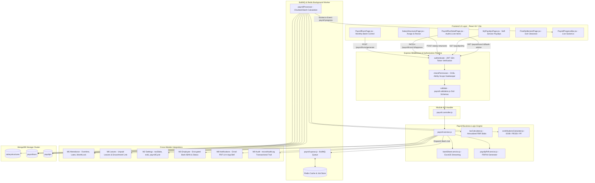
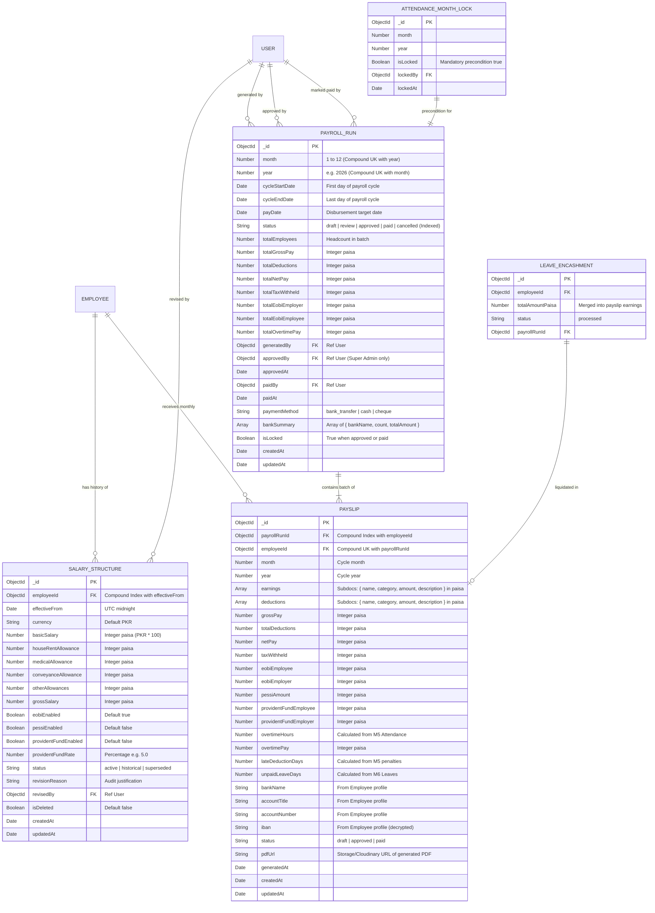
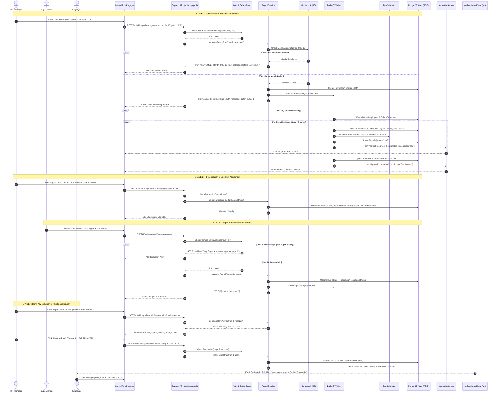

# Architectural Implementation Plan: Module M9 — Payroll (+ Pakistan Statutory Compliance)

**Feature Branch**: `feature/10-Payroll`  
**Created**: 2026-10-20  
**Status**: Ready for Tasks Breakdown & Slice Execution  
**Module ID**: M9  
**Module Name**: Payroll & Pakistan Statutory Compliance (Core HR & Finance Group · Launch Scope P1)  
**Spec Reference**: [`.specify/specs/10-payroll/spec.md`](file:///c:/Users/hamih/OneDrive/Desktop/AtoZ%20Coder/Advanced%20MERN/HRM/.specify/specs/10-payroll/spec.md)  
**Governing Documents**:
- [`docs/TECH-SPEC.md`](file:///c:/Users/hamih/OneDrive/Desktop/AtoZ%20Coder/Advanced%20MERN/HRM/docs/TECH-SPEC.md) Sections 3 (Folders), 4 (DB), 5 (API), 6 (Auth), 8 (Request Lifecycle)
- [`docs/MODULES.md`](file:///c:/Users/hamih/OneDrive/Desktop/AtoZ%20Coder/Advanced%20MERN/HRM/docs/MODULES.md) Section M9 (Payroll & Pakistan Statutory Compliance)
- [`docs/BUILD-GUIDE.md`](file:///c:/Users/hamih/OneDrive/Desktop/AtoZ%20Coder/Advanced%20MERN/HRM/docs/BUILD-GUIDE.md) Section 12 (Rows 9.1 to 9.17)
- [`docs/FRD.md`](file:///c:/Users/hamih/OneDrive/Desktop/AtoZ%20Coder/Advanced%20MERN/HRM/docs/FRD.md) Section 6 (M9 Payroll) & Section 11 (Permission Matrix M9 Row)

---

## 1. Architecture Summary & Technical Context

Module M9 delivers the complete financial calculation, statutory compliance, multi-stage approval lifecycle, and salary disbursement engine for software houses operating in Pakistan. It is designed to handle high-frequency workforce attendance data, statutory tax slabs, retirement benefits, multi-bank transfer advice formats, and tamper-proof audit trails.

### Core Architecture Highlights
1. **Integer Paisa Currency Standard (Anti-Rounding Invariant):**
   - Every financial currency value (base pay, house rent, medical, conveyance, overtime pay, deductions, tax withheld, EOBI, gross, net pay) is strictly stored and calculated as an **integer in minor currency units (paisa: PKR × 100)**.
   - Eliminates floating-point drift and discrepancies between payslips, bank sheets, and ledger balances.
2. **Pakistan Statutory Compliance Engine:**
   - **FBR Progressive Income Tax (Finance Act Salaried Slabs):** Evaluated by annualizing taxable monthly earnings (`Monthly × 12`), matching progressive slab brackets configured in M2 `taxSlabs`, computing total annual tax liability, and dividing by 12 (`Math.round(annualTax / 12)`).
   - **EOBI (Employees' Old-Age Benefits Institution):** Mandatory split based on gazetted statutory minimum wage (PKR 37,000 / 3,700,000 paisa) loaded from M2 `eobi`: 1% employee contribution (`37,000 paisa`) + 5% employer contribution (`185,000 paisa`).
   - **PESSI & Provident Fund:** Optional percentage rules loaded dynamically from M2 `pessi` and `providentFund`.
3. **Asynchronous BullMQ Batch Processor:**
   - Payroll generation for 100+ employees is dispatched asynchronously via BullMQ (`payroll-queue`) backed by Redis.
   - Emits real-time progress events (`payroll:progress`, `{ completed, total, percentage }`) over Socket.io so the frontend displays live generation progress without HTTP timeout risks.
4. **4-Stage Governed Release Lifecycle:**
   - `Draft` $\rightarrow$ `Review` $\rightarrow$ `Approved` $\rightarrow$ `Paid`.
   - Clear segregation of duties: HR Managers generate and review line-item adjustments; only Super Admin holds `payroll.approve` authority to release the run and freeze payslips.
5. **Multi-Document ACID Transactions:**
   - State transitions (`draft` $\rightarrow$ `approved` $\rightarrow$ `paid`), line-item adjustments, and final exit settlements are wrapped in MongoDB `session.withTransaction()` to ensure zero orphaned or inconsistent financial records.
6. **Statutory Bank Advice & Branded PDF Delivery:**
   - Generates streaming Excel transfer advice files (`.xlsx`) via ExcelJS formatted for major Pakistani banks (Meezan Bank, HBL, UBL, MCB, Allied Bank).
   - Generates digitally signed/branded monthly PDF payslips and Annual Tax Withholding Certificates (Form IT-3) via PDFKit / pdfmake, dispatched directly through M8 Email and Socket.io.

---

## 2. Exact Files Listing

All files adhere strictly to ES Modules (`.js`) on the backend and React 18 (`.jsx`) on the frontend. Zero TypeScript files.

### 2.1 Backend Files (`backend/src/`)

```
backend/src/
├── models/
│   ├── salaryStructure.model.js       # Employee salary components (basic, allowances, statutory flags) in integer paisa
│   ├── payrollRun.model.js            # Monthly payroll cycle record, 4-stage lifecycle status, financial aggregates
│   └── payslip.model.js               # Detailed employee payslip sub-ledger, line-item earnings & deductions
├── modules/payroll/
│   ├── payroll.validation.js          # Zod validation schemas for salary structures, runs, adjustments, export
│   ├── taxCalculator.js               # Annualized FBR progressive slab tax calculation logic (Finance Act)
│   ├── contributionsCalculator.js     # Statutory EOBI (1%/5%), PESSI, and Provident Fund deductions
│   ├── bankSheet.service.js           # ExcelJS streaming workbook builder for Pakistani corporate bank formats
│   ├── payslipPdf.service.js          # Branded payslip PDF and annual tax withholding certificate generator
│   ├── payroll.queue.js               # BullMQ Queue and Worker setup for asynchronous batch processing
│   ├── payroll.service.js             # Core domain logic: generation, adjustments, transactions, settlement
│   ├── payroll.controller.js          # HTTP controller with standard API envelope { success, data, message, meta }
│   └── payroll.routes.js              # Express router protected by authenticate -> checkPermission -> validate
└── tests/payroll/
    ├── taxCalculator.test.js          # Vitest unit test suite verifying FBR 2024-2025 tax slab mathematics
    └── contributions.test.js          # Vitest unit test suite verifying EOBI, PESSI, and integer paisa accuracy
```

### 2.2 Frontend Files (`frontend/src/features/payroll/`)

```
frontend/src/features/payroll/
├── payrollApi.js                      # RTK Query API slice with optimistic cache tags for runs, slips, structures
├── pages/
│   ├── SalaryStructuresPage.jsx       # Employee salary structure configuration, gross preview, revision history
│   ├── PayrollRunsPage.jsx            # Monthly payroll runs dashboard, lifecycle status badges, BullMQ trigger
│   ├── PayrollRunDetailPage.jsx       # Run audit view: employee payslips table, totals bar, approve/paid actions
│   ├── MyPayslipsPage.jsx             # Employee self-service view: monthly payslips list, PDF download, tax summary
│   └── FinalSettlementPage.jsx        # Employee exit settlement: leave encashment, gratuity, notice pay, deductions
└── components/
    ├── SalaryFormModal.jsx            # Create/assign initial salary structure modal with real-time tax breakdown
    ├── SalaryRevisionModal.jsx        # Increment/decrement salary modal with mandatory audit revision reason
    ├── PayrollProgressBar.jsx         # Live Socket.io BullMQ batch progress bar with spinner and counters
    ├── PayslipAdjustmentDrawer.jsx    # HR slide-over drawer to add bonus, arrears, or manual deduction to draft slip
    ├── PayslipPreviewModal.jsx        # Modal previewing formatted payslip breakdown prior to PDF export
    ├── BankAdviceExportModal.jsx      # Modal to select bank template (Meezan, HBL, Standard) and export .xlsx
    ├── TaxBreakdownCard.jsx           # Expandable visual card showing annualized taxable gross & slab math
    └── SettlementGratuityModal.jsx    # Modal calculating final service gratuity and unutilized leave encashment
```

---

## 3. Archify Architectural Diagrams

### Diagram 1: System Flow & Request Lifecycle


---

### Diagram 2: Entity Relationship Diagram (ERD)


---

### Diagram 3: Main Flow Sequence Diagram (Payroll Generation & 4-Stage Release Lifecycle)


---

## 4. Database Verification & MongoDB Schema Specifications

### 4.1 Schema Fields, Types, and Index Verification

```javascript
// ==============================================================================
// 1. SalaryStructure Schema Definition
// ==============================================================================
export const salaryStructureSchemaDefinition = {
  employeeId: { type: mongoose.Schema.Types.ObjectId, ref: 'Employee', required: true, index: true },
  effectiveFrom: { type: Date, required: true },
  currency: { type: String, default: 'PKR', trim: true },
  basicSalary: { type: Number, required: true, min: 0 },         // Paisa integer
  houseRentAllowance: { type: Number, default: 0, min: 0 },     // Paisa integer
  medicalAllowance: { type: Number, default: 0, min: 0 },       // Paisa integer
  conveyanceAllowance: { type: Number, default: 0, min: 0 },    // Paisa integer
  otherAllowances: { type: Number, default: 0, min: 0 },        // Paisa integer
  grossSalary: { type: Number, required: true, min: 0 },         // Paisa integer
  eobiEnabled: { type: Boolean, default: true },
  pessiEnabled: { type: Boolean, default: false },
  providentFundEnabled: { type: Boolean, default: false },
  providentFundRate: { type: Number, default: 0, min: 0, max: 100 },
  status: { type: String, enum: ['active', 'historical', 'superseded'], default: 'active', index: true },
  revisionReason: { type: String, trim: true, default: '' },
  revisedBy: { type: mongoose.Schema.Types.ObjectId, ref: 'User', default: null },
  isDeleted: { type: Boolean, default: false }
};

// Indexes:
// 1. { employeeId: 1, effectiveFrom: -1 } - History retrieval
// 2. { employeeId: 1, status: 1 } - Active structure lookup

// ==============================================================================
// 2. PayrollRun Schema Definition
// ==============================================================================
export const payrollRunSchemaDefinition = {
  month: { type: Number, required: true, min: 1, max: 12 },
  year: { type: Number, required: true },
  cycleStartDate: { type: Date, required: true },
  cycleEndDate: { type: Date, required: true },
  payDate: { type: Date, required: true },
  status: { type: String, enum: ['draft', 'review', 'approved', 'paid', 'cancelled'], default: 'draft', index: true },
  totalEmployees: { type: Number, default: 0 },
  totalGrossPay: { type: Number, default: 0 },                  // Paisa integer
  totalDeductions: { type: Number, default: 0 },                // Paisa integer
  totalNetPay: { type: Number, default: 0 },                    // Paisa integer
  totalTaxWithheld: { type: Number, default: 0 },               // Paisa integer
  totalEobiEmployer: { type: Number, default: 0 },              // Paisa integer
  totalEobiEmployee: { type: Number, default: 0 },              // Paisa integer
  totalOvertimePay: { type: Number, default: 0 },               // Paisa integer
  generatedBy: { type: mongoose.Schema.Types.ObjectId, ref: 'User', required: true },
  approvedBy: { type: mongoose.Schema.Types.ObjectId, ref: 'User', default: null },
  approvedAt: { type: Date, default: null },
  paidBy: { type: mongoose.Schema.Types.ObjectId, ref: 'User', default: null },
  paidAt: { type: Date, default: null },
  paymentMethod: { type: String, enum: ['bank_transfer', 'cash', 'cheque'], default: 'bank_transfer' },
  bankSummary: [{
    bankName: { type: String },
    count: { type: Number },
    totalAmount: { type: Number }
  }],
  isLocked: { type: Boolean, default: false }
};

// Compound Unique Index:
// { month: 1, year: 1 } (Unique constraint to prevent duplicate monthly runs)

// ==============================================================================
// 3. Payslip Schema Definition
// ==============================================================================
export const payslipSchemaDefinition = {
  payrollRunId: { type: mongoose.Schema.Types.ObjectId, ref: 'PayrollRun', required: true, index: true },
  employeeId: { type: mongoose.Schema.Types.ObjectId, ref: 'Employee', required: true, index: true },
  month: { type: Number, required: true },
  year: { type: Number, required: true },
  earnings: [{
    name: { type: String, required: true },
    category: { type: String, enum: ['basic', 'house_rent', 'medical', 'conveyance', 'allowance', 'overtime', 'bonus', 'arrears', 'encashment'], required: true },
    amount: { type: Number, required: true, min: 0 },           // Paisa integer
    description: { type: String, default: '' }
  }],
  deductions: [{
    name: { type: String, required: true },
    category: { type: String, enum: ['tax', 'eobi', 'pessi', 'provident_fund', 'unpaid_leave', 'late_penalty', 'loan_installment', 'advance', 'manual'], required: true },
    amount: { type: Number, required: true, min: 0 },           // Paisa integer
    description: { type: String, default: '' }
  }],
  grossPay: { type: Number, required: true, min: 0 },           // Paisa integer
  totalDeductions: { type: Number, required: true, min: 0 },    // Paisa integer
  netPay: { type: Number, required: true, min: 0 },             // Paisa integer
  taxWithheld: { type: Number, default: 0 },                    // Paisa integer
  eobiEmployee: { type: Number, default: 0 },                   // Paisa integer
  eobiEmployer: { type: Number, default: 0 },                   // Paisa integer
  pessiAmount: { type: Number, default: 0 },                    // Paisa integer
  providentFundEmployee: { type: Number, default: 0 },          // Paisa integer
  providentFundEmployer: { type: Number, default: 0 },          // Paisa integer
  overtimeHours: { type: Number, default: 0 },
  overtimePay: { type: Number, default: 0 },
  lateDeductionDays: { type: Number, default: 0 },
  unpaidLeaveDays: { type: Number, default: 0 },
  bankName: { type: String, default: '' },
  accountTitle: { type: String, default: '' },
  accountNumber: { type: String, default: '' },
  iban: { type: String, default: '' },
  status: { type: String, enum: ['draft', 'approved', 'paid'], default: 'draft', index: true },
  pdfUrl: { type: String, default: '' },
  generatedAt: { type: Date, default: Date.now }
};

// Compound Unique Index:
// { payrollRunId: 1, employeeId: 1 } (One slip per employee per run)
// Additional Index:
// { employeeId: 1, year: 1, month: 1 } (Fast self-service history query)
```

---

## 5. API Endpoints Catalog & CASL Authorization Matrix

All endpoints are mounted under `/api/v1/payroll` (and `/api/v1/salary-structures`, `/api/v1/payslips`).

| HTTP Method | Full Endpoint Path | Controller Handler | Permission Name | Required Scope | Permitted Roles | Description |
|---|---|---|---|---|---|---|
| `GET` | `/api/v1/salary-structures` | `getSalaryStructures` | `payroll.manage` | `all` | Super Admin, HR Manager | Paginated list of employee salary structures |
| `POST` | `/api/v1/salary-structures` | `createSalaryStructure` | `payroll.manage` | `all` | Super Admin, HR Manager | Assign initial salary structure in integer paisa |
| `GET` | `/api/v1/salary-structures/employee/:id` | `getEmployeeStructure` | `payroll.view` | `own` / `all` | Super Admin, HR Manager, Employee (own) | Get current active salary structure + history |
| `PUT` | `/api/v1/salary-structures/employee/:id` | `reviseSalaryStructure` | `payroll.manage` | `all` | Super Admin, HR Manager | Record salary revision with mandatory reason |
| `POST` | `/api/v1/payroll/runs/generate` | `generatePayrollRun` | `payroll.run` | `all` | Super Admin, HR Manager | Trigger BullMQ batch generation (requires MonthLock) |
| `GET` | `/api/v1/payroll/runs` | `getPayrollRuns` | `payroll.view` | `all` | Super Admin, HR Manager | List all monthly payroll runs with lifecycle status |
| `GET` | `/api/v1/payroll/runs/:id` | `getPayrollRunById` | `payroll.view` | `all` | Super Admin, HR Manager | Detailed run view with totals and paginated payslips |
| `PATCH` | `/api/v1/payroll/runs/:id/payslips/:slipId` | `adjustPayslipLineItem` | `payroll.run` | `all` | Super Admin, HR Manager | Add/edit line-item earnings/deductions on draft slip |
| `PATCH` | `/api/v1/payroll/runs/:id/approve` | `approvePayrollRun` | `payroll.approve` | `all` | **Super Admin only** | Transition run from Review to Approved & lock |
| `PATCH` | `/api/v1/payroll/runs/:id/mark-paid` | `markPayrollPaid` | `payroll.approve` | `all` | **Super Admin only** | Mark run as Paid, trigger payslip delivery |
| `GET` | `/api/v1/payroll/runs/:id/bank-advice` | `exportBankAdvice` | `payroll.export` | `all` | Super Admin, HR Manager | Stream Excel transfer advice (.xlsx) for selected bank |
| `GET` | `/api/v1/payslips/my` | `getMyPayslips` | `payroll.view` | `own` | Super Admin, HR Manager, Dept Manager, Employee | Self-service paginated history of paid/approved slips |
| `GET` | `/api/v1/payslips/:id/pdf` | `downloadPayslipPdf` | `payroll.view` | `own` / `all` | Super Admin, HR Manager, Employee (own) | Download branded monthly PDF payslip |
| `GET` | `/api/v1/payslips/annual-tax-certificate` | `getAnnualTaxCertificate`| `payroll.view` | `own` / `all` | Super Admin, HR Manager, Employee (own) | Generate Form IT-3 annual tax certificate PDF |
| `POST` | `/api/v1/payroll/final-settlement/:id` | `processFinalSettlement` | `payroll.manage` | `all` | Super Admin, HR Manager | Exit clearance: gratuity, leave encashment, notice pay |
| `GET` | `/api/v1/payroll/team-overtime` | `getTeamOvertimeHours` | `attendance.view`| `team` | Dept Manager, HR Manager, Super Admin | View team overtime hours (zero salary figures leaked) |

---

## 6. Permissions Step: `shared/permissions.js` & `roles.seed.js`

### 6.1 `shared/permissions.js` Verification
The catalogue in `backend/src/shared/permissions.js` already includes the five core actions under module `'payroll'` with correct subjects and allowed scopes:
- `payroll.view`: allowedScopes `['own', 'all']`, defaultScope `'own'`
- `payroll.manage`: allowedScopes `['all']`, defaultScope `'all'`
- `payroll.run`: allowedScopes `['all']`, defaultScope `'all'`
- `payroll.approve`: allowedScopes `['all']`, defaultScope `'all'`
- `payroll.export`: allowedScopes `['all']`, defaultScope `'all'`

### 6.2 `backend/src/seed/roles.seed.js` Synchronization Step
Verify and ensure role assignment mapping aligns with the security governance contract:
1. **Super Admin:** Receives master wildcard `can('manage', 'all')` covering all payroll actions.
2. **HR Manager:**
   - `{ action: 'payroll.view', subject: 'Payroll', scope: 'all' }`
   - `{ action: 'payroll.manage', subject: 'Payroll', scope: 'all' }`
   - `{ action: 'payroll.run', subject: 'Payroll', scope: 'all' }`
   - `{ action: 'payroll.export', subject: 'Payroll', scope: 'all' }`
   - *(Note: `payroll.approve` is strictly withheld to enforce executive release segregation).*
3. **Department Manager:**
   - `{ action: 'payroll.view', subject: 'Payroll', scope: 'own' }`
   - *(No `team` salary scope, no `payroll.manage`, no `payroll.run`, no `payroll.approve`).*
4. **Employee:**
   - `{ action: 'payroll.view', subject: 'Payroll', scope: 'own' }`

---

## 7. Quality Gates & Test Verification Plan

### 7.1 Vitest Unit Tests
1. **`taxCalculator.test.js`**:
   - Monthly taxable gross below minimum taxable bracket (PKR 50,000 / PKR 600,000 annual) $\rightarrow$ 0 tax.
   - Monthly taxable gross PKR 100,000 (PKR 1,200,000 annual) $\rightarrow$ slab 2 calculation verification.
   - Monthly taxable gross PKR 250,000, PKR 500,000, and PKR 1,000,000 boundary checks.
   - Integer paisa invariance: no floating-point fractions returned.
2. **`contributionsCalculator.test.js`**:
   - EOBI calculation with PKR 37,000 minimum wage: Employee = PKR 370 (37,000 paisa), Employer = PKR 1,850 (185,000 paisa).
   - PESSI calculation when enabled vs disabled.
   - Provident Fund deductions at custom percentage rates.

### 7.2 Integration & End-to-End Scenarios
1. **Attendance MonthLock Gatekeeper:**
   - Attempting `POST /api/v1/payroll/runs/generate` on an unlocked month returns `422 Unprocessable Entity`.
2. **BullMQ Background Batch:**
   - Generate batch for 100 seeded employees; assert live Socket.io events emit progress up to 100%.
3. **Approval RBAC Enforcement:**
   - HR Manager token calls `PATCH /api/v1/payroll/runs/:id/approve` $\rightarrow$ `403 Forbidden`.
   - Super Admin token calls `PATCH /api/v1/payroll/runs/:id/approve` $\rightarrow$ `200 OK`.
4. **Bank Advice Excel Export:**
   - Stream Meezan Bank advice file and verify column headers (`Beneficiary Name`, `IBAN`, `Amount`, `Purpose`).
5. **Data Privacy Guard:**
   - Department Manager calling `/api/v1/payroll/runs` returns `403 Forbidden`.
   - Department Manager calling `/api/v1/payroll/team-overtime` returns only names and hours, zero salary fields.
