# Feature Specification: Module M9 — Payroll (+ Pakistan Statutory Compliance)

**Feature Branch**: `feature/10-Payroll`  
**Created**: 2026-10-20  
**Status**: Ready for Architectural Planning & Implementation  
**Module ID**: M9  
**Module Name**: Payroll & Pakistan Statutory Compliance (Phase 1 · Launch Scope P1)  
**Spec Folder**: `.specify/specs/10-payroll`  
**Governing Documents**:
- [`docs/FRD.md`](file:///c:/Users/hamih/OneDrive/Desktop/AtoZ%20Coder/Advanced%20MERN/HRM/docs/FRD.md) Section 6 (M9 Payroll) & Section 11 (Permission Matrix M9 Row)
- [`docs/BUILD-GUIDE.md`](file:///c:/Users/hamih/OneDrive/Desktop/AtoZ%20Coder/Advanced%20MERN/HRM/docs/BUILD-GUIDE.md) Section 12 (Rows 9.1 to 9.17)
- [`docs/TECH-SPEC.md`](file:///c:/Users/hamih/OneDrive/Desktop/AtoZ%20Coder/Advanced%20MERN/HRM/docs/TECH-SPEC.md) Section 1, 2, 3, 4, 7, 8 & 11
- Context7 Official Docs: BullMQ (`/websites/bullmq_io`), Mongoose Transactions (`/websites/mongoosejs`), ExcelJS (`/exceljs/exceljs`)

---

## 1. Executive Summary & Architecture Integration

Module M9 is the core financial and statutory engine of the enterprise HRM system. It calculates, audits, approves, and distributes monthly compensation for software house employees in Pakistan. 

The module aggregates attendance data from **M5 (Attendance & Shifts)**, approved leaves and unutilized annual quota from **M6 (Leave & Holidays)**, statutory rates and FBR tax slabs from **M2 (Company Settings)**, encrypted employee bank and salary details from **M3 (Employee Management)**, and multi-channel transactional messaging via **M8 (Notifications & Announcements)**.

```mermaid
flowchart TD
    subgraph Inputs [Upstream Module Inputs]
        M3Emp[M3 Employee: Encrypted Salary, Bank IBAN, Status]
        M5Att[M5 Attendance: Overtime Hours, Late Penalties, Month Lock]
        M6Leave[M6 Leaves: Unpaid Absences, Approved Encashments]
        M2Set[M2 Settings: FBR Tax Slabs, EOBI, PESSI, PF Rates]
        M10Loan[M10 Loans: Monthly Installment Deductions]
    end

    subgraph CoreEngine [M9 Payroll Engine]
        TaxCalc[Tax Calculator: Annualized FBR Salaried Slabs / 12]
        ContribCalc[Contributions: EOBI + PESSI + Provident Fund]
        SalaryCalc[Gross, Deductions & Net Pay in Integer Paisa]
        BullMQWorker[BullMQ Background Worker: 100+ Batch Runner]
        SocketIO[Socket.io: Live Real-time Progress Bar]
    end

    subgraph Workflow [4-Stage Payroll Lifecycle]
        Draft[1. Draft: Generation & Line-Item Slips Review]
        Review[2. Review: HR Verification & Manual Adjustments]
        Approve[3. Approve: Super Admin Executive Release]
        Paid[4. Paid: Bank Transfer Advice Sheet & Slips Dispatch]
    end

    subgraph Deliverables [Outputs & Multi-Channel Distribution]
        PDFGen[Branded Payslip PDF Engine: pdfmake/PDFKit]
        ExcelAdvice[Pakistani Bank Transfer Advice: ExcelJS]
        CertGen[Annual Withholding Tax Certificate PDF]
        NotifyOut[M8 Notifications: Email PDF + Portal + WhatsApp]
    end

    Inputs --> CoreEngine
    CoreEngine --> Workflow
    Workflow --> Deliverables
```



---

## 2. Invariant Rules & Compliance Standards

1. **JavaScript Only:** All files must strictly be `.js` (Node/Express ES Modules) and `.jsx` (React 18). Zero TypeScript allowed.
2. **Integer Minor Currency Units (Paisa):**
   - Every financial value (base salary, house rent, medical allowance, conveyance allowance, overtime pay, bonus, tax deduction, EOBI, net pay) must be stored and computed as **integers in minor units (paisa = PKR × 100)**.
   - Example: PKR `150,000.00` is represented as integer `15000000`.
   - Never use floating point math for currency storage or intermediate sums.
3. **MongoDB Multi-Document ACID Transactions:**
   - Payroll generation, final state transitions (`draft` $\rightarrow$ `approved` $\rightarrow$ `paid`), and final exit settlements must be wrapped in `session.withTransaction()` or `mongoose.connection.transaction()`.
4. **Pakistan FBR Tax Calculation (Finance Act Salaried Slabs):**
   - Annual Salaried Tax is calculated on `Annual Taxable Gross Salary = (Monthly Taxable Gross × 12)`.
   - Monthly tax deduction = `Math.round(Annual Tax / 12)`.
   - Slabs are dynamically loaded from `taxSlabs` key in M2 Company Settings.
5. **EOBI & PESSI Statutory Split:**
   - EOBI employee contribution (1% of minimum wage) and employer contribution (5% of minimum wage) calculated based on company settings.
6. **Data Privacy & Field Masking (CASL RBAC):**
   - Department Managers have **zero** access to salary figures or total payroll amounts (`None` scope). They are only permitted to view aggregated team overtime hours via `GET /api/v1/payroll/team-overtime`.
   - Employees have access **only to their own payslips, tax certificates, and salary history** (`Own` scope).
   - Super Admin and HR Manager have company-wide authority (`All` scope).
7. **Audit Trail:**
   - Every salary structure update, line-item payslip manual override, and stage approval must write an immutable audit log to `auditLogs` collection with before/after state.

---

## 3. Data Models Specification

### 3.1 `SalaryStructure` Model (`salaryStructure.model.js`)
* Collection: `salarystructures`
* Schema:
  - `employeeId`: `ObjectId`, ref: `Employee`, required, index: true
  - `effectiveFrom`: `Date`, required, UTC midnight
  - `currency`: `String`, default: `'PKR'`
  - `basicSalary`: `Number` (Integer paisa), required, min: 0
  - `houseRentAllowance`: `Number` (Integer paisa), default: 0
  - `medicalAllowance`: `Number` (Integer paisa), default: 0
  - `conveyanceAllowance`: `Number` (Integer paisa), default: 0
  - `otherAllowances`: `Number` (Integer paisa), default: 0
  - `grossSalary`: `Number` (Integer paisa, virtual or stored sum), required
  - `eobiEnabled`: `Boolean`, default: true
  - `pessiEnabled`: `Boolean`, default: false
  - `providentFundEnabled`: `Boolean`, default: false
  - `providentFundRate`: `Number` (percentage, e.g. 5.0), default: 0
  - `status`: `String`, enum: `['active', 'historical', 'superseded']`, default: `'active'`
  - `revisionReason`: `String`, trim: true
  - `revisedBy`: `ObjectId`, ref: `User`
  - `isDeleted`: `Boolean`, default: false
* Compound Index: `{ employeeId: 1, effectiveFrom: -1 }`

### 3.2 `PayrollRun` Model (`payrollRun.model.js`)
* Collection: `payrollruns`
* Schema:
  - `month`: `Number`, required (1 - 12)
  - `year`: `Number`, required (e.g. 2026)
  - `cycleStartDate`: `Date`, required
  - `cycleEndDate`: `Date`, required
  - `payDate`: `Date`, required
  - `status`: `String`, enum: `['draft', 'review', 'approved', 'paid', 'cancelled']`, default: `'draft'`, index: true
  - `totalEmployees`: `Number`, default: 0
  - `totalGrossPay`: `Number` (Integer paisa), default: 0
  - `totalDeductions`: `Number` (Integer paisa), default: 0
  - `totalNetPay`: `Number` (Integer paisa), default: 0
  - `totalTaxWithheld`: `Number` (Integer paisa), default: 0
  - `totalEobiEmployer`: `Number` (Integer paisa), default: 0
  - `totalEobiEmployee`: `Number` (Integer paisa), default: 0
  - `totalOvertimePay`: `Number` (Integer paisa), default: 0
  - `generatedBy`: `ObjectId`, ref: `User`, required
  - `approvedBy`: `ObjectId`, ref: `User`, default: null
  - `approvedAt`: `Date`, default: null
  - `paidBy`: `ObjectId`, ref: `User`, default: null
  - `paidAt`: `Date`, default: null
  - `paymentMethod`: `String`, enum: `['bank_transfer', 'cash', 'cheque']`, default: `'bank_transfer'`
  - `bankSummary`: `Array<{ bankName: String, count: Number, totalAmount: Number }>`
  - `isLocked`: `Boolean`, default: false
* Compound Unique Index: `{ month: 1, year: 1 }` (Only one primary run per calendar month)

### 3.3 `Payslip` Model (`payslip.model.js`)
* Collection: `payslips`
* Schema:
  - `payrollRunId`: `ObjectId`, ref: `PayrollRun`, required, index: true
  - `employeeId`: `ObjectId`, ref: `Employee`, required, index: true
  - `month`: `Number`, required
  - `year`: `Number`, required
  - `earnings`: `Array<{ name: String, category: String, amount: Number, description: String }>` (amounts in paisa)
    * Categories: `'basic'`, `'house_rent'`, `'medical'`, `'conveyance'`, `'allowance'`, `'overtime'`, `'bonus'`, `'arrears'`, `'encashment'`
  - `deductions`: `Array<{ name: String, category: String, amount: Number, description: String }>` (amounts in paisa)
    * Categories: `'tax'`, `'eobi'`, `'pessi'`, `'provident_fund'`, `'unpaid_leave'`, `'late_penalty'`, `'loan_installment'`, `'advance'`, `'manual'`
  - `grossPay`: `Number` (Integer paisa), required
  - `totalDeductions`: `Number` (Integer paisa), required
  - `netPay`: `Number` (Integer paisa), required
  - `workingDays`: `Number`, default: 0
  - `presentDays`: `Number`, default: 0
  - `leaveDays`: `Number`, default: 0
  - `unpaidLeaveDays`: `Number`, default: 0
  - `overtimeHours`: `Number`, default: 0
  - `paymentStatus`: `String`, enum: `['pending', 'paid']`, default: `'pending'`
  - `pdfUrl`: `String`, default: null
  - `isManuallyAdjusted`: `Boolean`, default: false
  - `manualAdjustmentsNote`: `String`, default: null
* Compound Unique Index: `{ payrollRunId: 1, employeeId: 1 }`

---

## 4. User Stories & Acceptance Criteria (Given-When-Then)

### Story 1: Salary Structure Master Definition (BUILD-GUIDE Row 9.1 · Priority: P1)
**As an** HR Manager,  
**I want to** configure a comprehensive salary structure for each employee with itemized allowances in integer paisa,  
**So that** compensation calculations have an authoritative, tamper-proof baseline.

* **Given** an active employee record in M3 without a salary structure,
* **When** HR Manager navigates to `SalaryStructuresPage.jsx` and submits basic salary and allowances (House Rent, Medical, Conveyance, Other),
* **Then** the backend persists the record with all figures converted to integer paisa (`amount * 100`), validates that basic salary $>0$, and assigns status `'active'`.
* **Role Checks**:
  - `Super Admin`: Can view and edit all structures (`200 OK`).
  - `HR Manager`: Can view, create, and update structures (`200 OK`).
  - `Department Manager`: Blocked from viewing salary structures (`403 Forbidden`).
  - `Employee`: Blocked from management endpoint (`403 Forbidden`). Can only see own breakdown on profile.

---

### Story 2: Mid-Month Increment & Effective Date Revisions (BUILD-GUIDE Row 9.2 · Priority: P1)
**As an** HR Manager,  
**I want to** record salary revisions with future or mid-month effective dates,  
**So that** promotions and annual increments automatically apply on the correct pay cycle without corrupting historical payroll audit trails.

* **Given** an employee with an existing active salary structure,
* **When** HR Manager opens the "Revise Salary" modal, enters new allowance numbers, specifies `effectiveFrom: "2026-11-01"`, and provides a revision reason,
* **Then** the previous structure is marked as `'superseded'`, a new structure document is created, and an audit record is logged with before/after salary differentials.
* **Role Checks**:
  - `Super Admin` & `HR Manager`: Full access (`200 OK`).
  - `Dept Manager` & `Employee`: Cannot execute revisions (`403 Forbidden`).

---

### Story 3: Dynamic Earnings Engine Integration (BUILD-GUIDE Row 9.3 · Priority: P1)
**As the** Payroll Engine,  
**I want to** automatically harvest verified overtime hours from M5, approved leave encashments from M6, and one-off bonuses/arrears,  
**So that** employee earnings accurately reflect their operational contributions for the month.

* **Given** an employee with 10 approved overtime hours in M5 and 2 days of approved leave encashment in M6,
* **When** the monthly payroll calculation executes for the pay period,
* **Then** the engine derives hourly rate: `(Gross Salary / (Working Days in Month × Standard Hours))`, computes overtime earning at $1.5\times$ or $2.0\times$ rate, adds leave encashment payout in paisa, and attaches them as separate line items in `payslip.earnings`.
* **Role Checks**:
  - Engine executes autonomously in BullMQ worker.
  - Line items visible to `Super Admin`, `HR Manager`, and owning `Employee`.

---

### Story 4: Dynamic Deductions Engine (BUILD-GUIDE Row 9.4 · Priority: P1)
**As the** Payroll Engine,  
**I want to** deduct unpaid leaves from M6, late arrival penalties from M5, and scheduled loan/advance repayments,  
**So that** gross pay is accurately reduced before statutory tax computation.

* **Given** an employee with 2 days of unpaid leave, 3 unexcused late arrivals exceeding company grace rules (configured in M2), and a PKR 5,000 monthly loan repayment,
* **When** the payroll processor evaluates deductions for the employee,
* **Then** daily rate `(Gross Salary / Working Days)` is multiplied by unpaid days, late penalty per company rule is calculated, loan installment is deducted, and all items are appended to `payslip.deductions`.
* **Role Checks**:
  - Line-by-line deductions visible in payslip review drawer.

---

### Story 5: FBR Pakistan Salaried Income Tax Calculator (BUILD-GUIDE Row 9.5 · Priority: P1)
**As a** Finance & HR Officer,  
**I want** income tax automatically calculated according to official Pakistani Federal Board of Revenue (FBR) salaried tax slabs,  
**So that** the organization complies with Pakistan Finance Act withholding tax laws.

* **Given** an employee's taxable gross monthly salary in PKR,
* **When** `calculatePakistanIncomeTax(monthlyGrossPaisa, taxSlabs)` is called,
* **Then** the calculator projects annual taxable salary: `(monthlyGrossPaisa × 12) / 100`, matches the active tax slab bracket (July–June tax year), calculates annual tax liability, divides by 12, and returns monthly tax deduction in integer paisa.
* **Unit Test Requirement**:
  - Covered by exhaustive Vitest unit tests in `backend/tests/payroll.tax.test.js` validating all 6 FBR tax slabs (e.g. up to 600K 0%, 600K-1.2M 5%, 1.2M-2.2M, etc.).

---

### Story 6: EOBI, PESSI, & Provident Fund Contributions (BUILD-GUIDE Row 9.6 · Priority: P1)
**As an** HR Manager,  
**I want** statutory contributions for EOBI, PESSI, and Provident Fund calculated automatically,  
**So that** employee retirement and social security obligations are met without manual spreadsheet calculations.

* **Given** active EOBI and PESSI toggles in employee salary structure and M2 company settings,
* **When** payroll calculation runs,
* **Then** `calculateContributions(salaryStructure, companySettings)` computes employee EOBI share (e.g. 1% of minimum wage) and employer EOBI share (5% of minimum wage), computes Provident Fund deduction if enrolled, and records employee and employer shares separately.
* **Unit Test Requirement**:
  - Covered by unit tests in `backend/tests/payroll.contributions.test.js`.

---

### Story 7: One-Click Automated Payroll Generation via BullMQ (BUILD-GUIDE Row 9.7 · Priority: P1)
**As an** HR Manager,  
**I want to** initiate a full company payroll run with a single click and watch real-time progress,  
**So that** payroll for 100+ employees executes smoothly in the background without HTTP request timeouts.

* **Given** attendance locked for the target month in M5,
* **When** HR Manager clicks "Generate Payroll" on `PayrollRunsPage.jsx`,
* **Then** `POST /api/v1/payroll/runs` enqueues a background job in BullMQ queue `'payroll-run'`, creates a `PayrollRun` in `'draft'` state, and streams job progress events (`0%` to `100%`) to the client UI via Socket.io.
* **Role Checks**:
  - `HR Manager` & `Super Admin`: Can trigger payroll generation (`201 Created`).
  - `Dept Manager` & `Employee`: Blocked (`403 Forbidden`).

---

### Story 8: 4-Stage Payroll Lifecycle Management (BUILD-GUIDE Row 9.8 · Priority: P1)
**As a** Super Admin,  
**I want** payroll release governed by a strict 4-stage lifecycle (Draft $\rightarrow$ Review $\rightarrow$ Approve $\rightarrow$ Paid),  
**So that** no funds or payslips can be disbursed without executive authorization.

* **Given** a generated payroll run in `'review'` status,
* **When** Super Admin reviews summary totals and clicks "Approve Payroll",
* **Then** `PATCH /api/v1/payroll/runs/:id/approve` transitions the run to `'approved'`, locking all line items from further edits.
* **When** payment is dispatched and "Mark as Paid" is clicked,
* **Then** `PATCH /api/v1/payroll/runs/:id/mark-paid` transitions status to `'paid'` and triggers automatic distribution of payslips.
* **Role Checks**:
  - `Super Admin`: Exclusive authority to approve and mark paid (`200 OK`).
  - `HR Manager`: Can generate and submit for review; cannot release paid status without permission.

---

### Story 9: Line-Item Payslip Adjustment Drawer (BUILD-GUIDE Row 9.9 · Priority: P2)
**As an** HR Manager,  
**I want to** adjust specific line items on an individual employee's payslip while the run is in Draft/Review,  
**So that** special one-time bonuses, corrections, or hardship allowances can be incorporated before executive sign-off.

* **Given** a payroll run in `'draft'` or `'review'` state,
* **When** HR Manager opens the payslip adjustment drawer and adds an adjustment line (e.g., Performance Bonus: PKR 15,000) with a mandatory note,
* **Then** the payslip totals (gross, tax, net pay) and parent `PayrollRun` aggregations are recalculated atomically in a MongoDB transaction.
* **When** the run is `'approved'` or `'paid'`,
* **Then** editing is strictly locked (`400 Bad Request`).

---

### Story 10: Branded Payslip PDF Generation (BUILD-GUIDE Row 9.10 · Priority: P1)
**As an** Employee,  
**I want to** download a professionally branded, tamper-evident payslip PDF,  
**So that** I have official proof of income and tax deductions for banking, visa, or personal records.

* **Given** an approved or paid payroll run,
* **When** Employee clicks "Download PDF" on `MyPayslipsPage.jsx` or Topbar,
* **Then** `GET /api/v1/payslips/:id/pdf` streams a branded PDF generated via `pdf.service.js` featuring the company logo from M2, employee job metadata, detailed earnings table, deductions breakdown, net pay in words, and verification footer.
* **Role Checks**:
  - `Employee`: Can download own payslip (`200 OK`). Cannot access other employees' PDFs (`403 Forbidden`).
  - `HR Manager` & `Super Admin`: Can download any payslip (`200 OK`).

---

### Story 11: Multi-Channel Payslip Delivery (BUILD-GUIDE Row 9.11 · Priority: P2)
**As an** HR Manager,  
**I want** payslips delivered across multiple channels (Web Portal, Email, optional WhatsApp),  
**So that** employees receive instant, accessible notification the moment payroll is released.

* **Given** a payroll run transitioned to `'paid'`,
* **When** the dispatch notification worker executes,
* **Then** each employee receives an in-app notification bell update, an automated transactional email with attached PDF payslip via Nodemailer, and an optional WhatsApp alert (if configured in M2/M8).
* **Role Checks**:
  - Autonomous dispatch triggered upon `mark-paid`.

---

### Story 12: Pakistani Corporate Bank Transfer Advice Sheet (BUILD-GUIDE Row 9.12 · Priority: P1)
**As a** Finance / HR Officer,  
**I want to** export salary disbursement advice sheets formatted for commercial banks in Pakistan,  
**So that** batch online corporate salary transfers can be executed without manual copy-pasting.

* **Given** an approved payroll run,
* **When** HR selects bank format (e.g. Meezan Bank, HBL, Standard Corporate CSV/XLSX) and clicks "Export Bank Advice",
* **Then** `GET /api/v1/payroll/runs/:id/bank-sheet?bank=Meezan` streams an Excel workbook via ExcelJS with Account Title, Decrypted IBAN/Account Number, Net Pay in PKR, and Employee Code.
* **Role Checks**:
  - `Super Admin` & `HR Manager`: Allowed (`200 OK`).
  - `Dept Manager` & `Employee`: Strictly forbidden (`403 Forbidden`).

---

### Story 13: Final Exit Settlement Engine (BUILD-GUIDE Row 9.13 · Priority: P2)
**As an** HR Manager,  
**I want to** generate a full and final settlement statement for an exiting or resigned employee,  
**So that** unutilized leave encashment, gratuity, pending salary days, and loan recoveries are computed cleanly.

* **Given** an employee in `'Notice'` or `'Resigned'` status in M3/M18,
* **When** HR triggers `POST /api/v1/payroll/final-settlement/:employeeId`,
* **Then** the engine calculates pro-rated salary for active days in the month, adds M6 unutilized leave encashment, calculates gratuity (if service $>1$ year), deducts remaining M10 loan balance, and generates a finalized settlement voucher.
* **Role Checks**:
  - `Super Admin` & `HR Manager`: Allowed.

---

### Story 14: Annual Salaried Withholding Tax Certificate (BUILD-GUIDE Row 9.14 · Priority: P2)
**As an** Employee,  
**I want to** download an annual salary withholding tax certificate (Section 149 of Income Tax Ordinance, 2001),  
**So that** I can file my annual income tax return with the FBR.

* **Given** completed payroll cycles across a tax year (e.g. Tax Year 2026: July 2025 – June 2026),
* **When** Employee navigates to `MyPayslipsPage.jsx` $\rightarrow$ "Tax Certificate" and selects the tax year,
* **Then** `GET /api/v1/payslips/tax-certificate?year=2026` aggregates gross compensation and total tax withheld, streaming an official Section 149 Certificate PDF.
* **Role Checks**:
  - `Employee`: Can generate own tax certificate (`200 OK`).

---

### Story 15: Tax & EOBI Compliance Reports (BUILD-GUIDE Row 9.15 · Priority: P2)
**As an** HR Manager or Finance Auditor,  
**I want to** export monthly and annual withholding tax and EOBI contribution schedules,  
**So that** statutory challans and electronic filings can be reconciled against bank payments.

* **Given** completed payroll runs,
* **When** user queries `GET /api/v1/reports/tax?month=10&year=2026` or `/reports/eobi`,
* **Then** the endpoint returns detailed employee-wise tax deduction schedules and EOBI contribution statements (employee 1% + employer 5%) formatted for statutory submission.
* **Role Checks**:
  - `Super Admin` & `HR Manager`: Full access (`200 OK`).
  - `Dept Manager` & `Employee`: Forbidden (`403 Forbidden`).

---

### Story 16: Scoped Department Manager Team Overtime View (BUILD-GUIDE Row 9.16 · Priority: P2)
**As a** Department Manager,  
**I want to** view total overtime hours and attendance metrics logged by my team without seeing their confidential salaries,  
**So that** I can manage workload distribution and project staffing fairly.

* **Given** a Department Manager logged into the system,
* **When** navigating to `TeamAttendancePage.jsx` or team payroll view (`GET /api/v1/payroll/team-overtime`),
* **Then** the response includes subordinate employee names, designation, and total overtime hours, with **all financial fields (hourly cost, overtime pay, gross salary) strictly excluded / stripped**.
* **Role Checks**:
  - `Department Manager`: Can see team overtime hours only (`200 OK`, zero salary leak).

---

### Story 17: Departmental Payroll Cost Analytics (BUILD-GUIDE Row 9.17 · Priority: P2)
**As a** Super Admin,  
**I want to** review department-wise payroll expenditure analytics on the executive dashboard,  
**So that** corporate budget allocation and headcount costs are transparent.

* **Given** finalized payroll runs in the database,
* **When** Super Admin loads the executive analytics dashboard (`GET /api/v1/reports/payroll-cost`),
* **Then** an aggregation pipeline groups total gross payroll, employer EOBI contributions, and overtime costs by department, displaying visual breakdown charts.
* **Role Checks**:
  - `Super Admin`: Full access (`200 OK`).
  - `HR Manager`: Permitted if assigned report permissions.
  - `Dept Manager` & `Employee`: Blocked (`403 Forbidden`).

---

## 5. Official Library Syntax Patterns (Context7 Verified)

### 5.1 BullMQ: Queue, Worker & Real-Time Progress Updates
```javascript
// backend/src/modules/payroll/payroll.queue.js
import { Queue, Worker } from 'bullmq';
import { env } from '../../config/env.js';
import { processPayrollRun } from './payrollProcessor.js';
import { getIO } from '../../socket.js';

const connection = {
  host: env.REDIS_HOST || '127.0.0.1',
  port: env.REDIS_PORT || 6379,
  password: env.REDIS_PASSWORD || undefined
};

export const payrollQueue = new Queue('payroll-run', { connection });

export const initPayrollWorker = () => {
  const worker = new Worker(
    'payroll-run',
    async (job) => {
      const { runId, month, year, generatedBy } = job.data;
      return await processPayrollRun(runId, month, year, generatedBy, async (progressData) => {
        // BullMQ official progress reporting
        await job.updateProgress(progressData);
      });
    },
    { connection, concurrency: 1 }
  );

  worker.on('progress', (job, progress) => {
    // Stream real-time progress to connected clients via Socket.io
    const io = getIO();
    if (io) {
      io.to('payroll').emit('payroll:progress', {
        jobId: job.id,
        runId: job.data.runId,
        ...progress
      });
    }
  });

  worker.on('failed', (job, err) => {
    console.error(`[Payroll Worker] Job ${job?.id} failed:`, err.message);
  });

  return worker;
};
```

### 5.2 Mongoose Multi-Document ACID Transactions
```javascript
// backend/src/modules/payroll/payroll.service.js
import mongoose from 'mongoose';
import { PayrollRun } from '../../models/payrollRun.model.js';
import { Payslip } from '../../models/payslip.model.js';
import { ApiError } from '../../utils/apiError.js';

export const approvePayrollRun = async (runId, user) => {
  const session = await mongoose.startSession();
  let updatedRun;

  try {
    await session.withTransaction(async () => {
      const run = await PayrollRun.findById(runId).session(session);
      if (!run) throw new ApiError(404, 'Payroll run not found');
      if (run.status !== 'review') {
        throw new ApiError(400, `Cannot approve payroll in status '${run.status}'`);
      }

      run.status = 'approved';
      run.approvedBy = user._id;
      run.approvedAt = new Date();
      await run.save({ session });

      // Lock all child payslips in the same atomic transaction
      await Payslip.updateMany(
        { payrollRunId: run._id },
        { $set: { isLocked: true } },
        { session }
      );

      updatedRun = run;
    });
  } finally {
    await session.endSession();
  }

  return updatedRun;
};
```

### 5.3 ExcelJS Streaming Bank Transfer Sheet
```javascript
// backend/src/modules/payroll/bankSheet.service.js
import ExcelJS from 'exceljs';

export const streamBankAdviceSheet = async (res, run, payslips, bankName) => {
  res.setHeader('Content-Type', 'application/vnd.openxmlformats-officedocument.spreadsheetml.sheet');
  res.setHeader('Content-Disposition', `attachment; filename="Bank_Advice_${bankName}_${run.year}_${run.month}.xlsx"`);

  const workbook = new ExcelJS.stream.xlsx.WorkbookWriter({ stream: res });
  const sheet = workbook.addWorksheet('Salary Disbursement');

  sheet.columns = [
    { header: 'Sr #', key: 'sr', width: 8 },
    { header: 'Employee Code', key: 'empCode', width: 15 },
    { header: 'Account Title', key: 'accountTitle', width: 30 },
    { header: 'Bank Name', key: 'bank', width: 20 },
    { header: 'Account / IBAN Number', key: 'iban', width: 32 },
    { header: 'Disbursement Amount (PKR)', key: 'amount', width: 25 },
    { header: 'Remarks', key: 'remarks', width: 30 }
  ];

  // Header styling (Dark Linear Craft aesthetic #1E2235)
  const headerRow = sheet.getRow(1);
  headerRow.font = { bold: true, color: { argb: 'FFFFFFFF' } };
  headerRow.fill = {
    type: 'pattern',
    pattern: 'solid',
    fgColor: { argb: 'FF1E2235' }
  };
  headerRow.commit();

  let index = 1;
  for (const slip of payslips) {
    const netPkr = (slip.netPay / 100).toFixed(2);
    const row = sheet.addRow({
      sr: index++,
      empCode: slip.employeeId?.employeeCode || 'EMP-N/A',
      accountTitle: slip.employeeId?.name || '',
      bank: bankName,
      iban: slip.decryptedIban || 'N/A',
      amount: Number(netPkr),
      remarks: `Salary ${run.month}/${run.year}`
    });
    row.commit();
  }

  await sheet.commit();
  await workbook.commit();
};
```

---

## 6. BUILD-GUIDE ID Coverage & Mapping Matrix

Every feature defined in [`docs/BUILD-GUIDE.md`](file:///c:/Users/hamih/OneDrive/Desktop/AtoZ%20Coder/Advanced%20MERN/HRM/docs/BUILD-GUIDE.md) Section 12 is accounted for and directly mapped below:

| BUILD-GUIDE ID | Feature Name | Spec User Story | Priority | Target Verification |
| :---: | :--- | :---: | :---: | :--- |
| **9.1** | Salary structure model & CRUD | Story 1 | **P1** | `salary.structure.test.js` (Paisa conversion & validation) |
| **9.2** | Salary revision & effective date | Story 2 | **P1** | `salary.revision.test.js` (Superseded history & audit) |
| **9.3** | Earnings (Overtime, Bonus, Encashment) | Story 3 | **P1** | `payroll.earnings.test.js` (M5/M6 dynamic harvest) |
| **9.4** | Deductions (Unpaid leave, Late, Loans) | Story 4 | **P1** | `payroll.deductions.test.js` (M5/M6/M10 deduction math) |
| **9.5** | Pakistan FBR Salaried Tax Calculator | Story 5 | **P1** | `payroll.tax.test.js` (Unit test all FBR brackets) |
| **9.6** | Statutory Contributions (EOBI, PESSI, PF) | Story 6 | **P1** | `payroll.contributions.test.js` (Statutory split) |
| **9.7** | BullMQ Payroll Run Generator + Socket | Story 7 | **P1** | `payroll.generation.test.js` (Worker batch execution) |
| **9.8** | 4-Stage Lifecycle (Draft $\rightarrow$ Paid) | Story 8 | **P1** | `payroll.lifecycle.test.js` (ACID transaction state machine) |
| **9.9** | Line-Item Payslip Adjustment Drawer | Story 9 | **P2** | `payslip.adjust.test.js` (Atomic recalculation) |
| **9.10** | Branded Payslip PDF Generator | Story 10 | **P1** | `payslip.pdf.test.js` (PDF streaming verification) |
| **9.11** | Multi-channel delivery (Portal, Email) | Story 11 | **P2** | `payslip.delivery.test.js` (Email & in-app alerts) |
| **9.12** | Corporate Bank Transfer Advice Sheet | Story 12 | **P1** | `bank.advice.test.js` (ExcelJS streaming & decrypted IBAN) |
| **9.13** | Final Exit Settlement Engine | Story 13 | **P2** | `final.settlement.test.js` (Exit gratuity & loan settlement) |
| **9.14** | Annual Salaried Tax Certificate (S. 149) | Story 14 | **P2** | `tax.certificate.test.js` (Annual tax certificate PDF) |
| **9.15** | Withholding Tax & EOBI Schedules | Story 15 | **P2** | `tax.eobi.reports.test.js` (Statutory compliance reports) |
| **9.16** | Scoped Manager Team Overtime View | Story 16 | **P2** | `manager.overtime.test.js` (Zero salary leak verification) |
| **9.17** | Departmental Payroll Cost Analytics | Story 17 | **P2** | `payroll.analytics.test.js` (Cost center aggregation) |
| **E2E-M9** | 4-Role Playwright Browser Verification | Full Suite | **P1** | `m9.payroll.e2e.test.js` (Real Chrome multi-role flows) |
