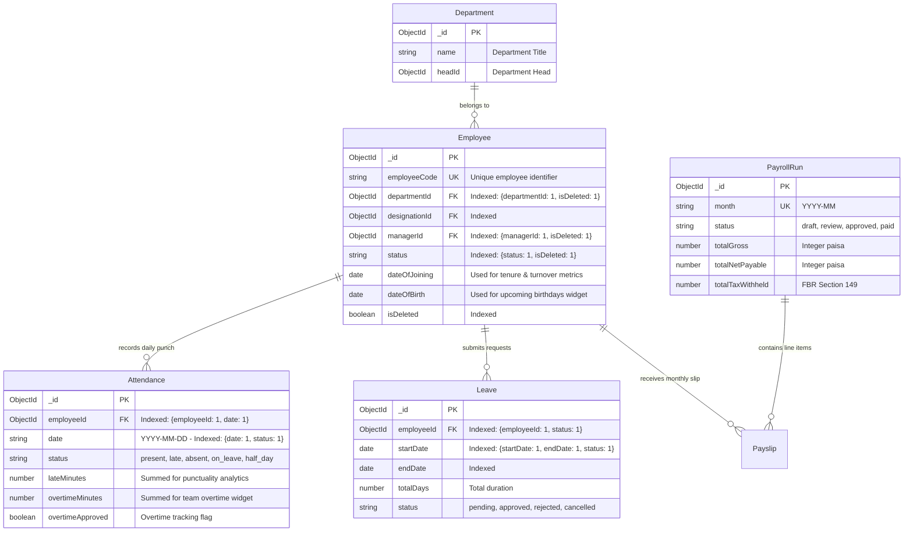
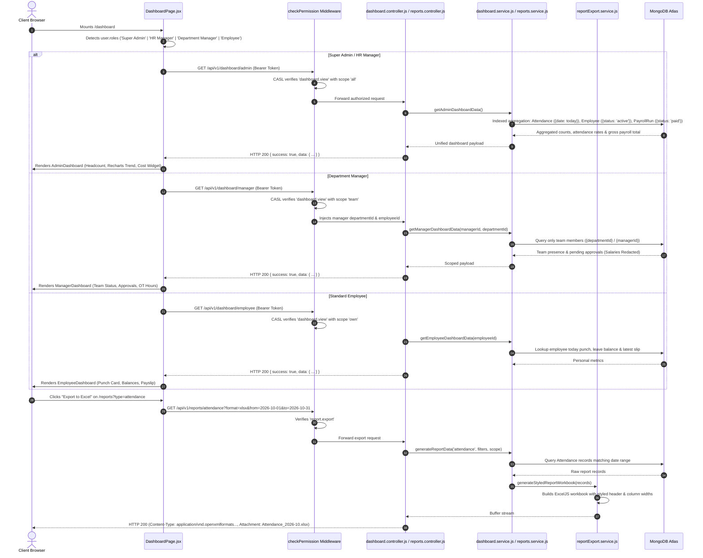

# Architectural Implementation Plan: Module M7 — Dashboard & Reports

**Feature Branch**: `feature/11-dashboard`  
**Created**: 2026-10-21  
**Status**: Ready for Tasks Breakdown & Slice Execution  
**Module ID**: M7  
**Module Name**: Dashboard & Reports (Core HR Group · Launch Scope P1/P2)  
**Spec Reference**: [`.specify/specs/11-dashboard/spec.md`](file:///c:/Users/hamih/OneDrive/Desktop/AtoZ%20Coder/Advanced%20MERN/HRM/.specify/specs/11-dashboard/spec.md)  
**Governing Documents**:
- [`docs/TECH-SPEC.md`](file:///c:/Users/hamih/OneDrive/Desktop/AtoZ%20Coder/Advanced%20MERN/HRM/docs/TECH-SPEC.md) Sections 3 (Folders), 4 (DB), 5 (API), 6 (Auth), 8 (Request Lifecycle)
- [`docs/MODULES.md`](file:///c:/Users/hamih/OneDrive/Desktop/AtoZ%20Coder/Advanced%20MERN/HRM/docs/MODULES.md) Section M7 (Dashboard & Reports)
- [`docs/BUILD-GUIDE.md`](file:///c:/Users/hamih/OneDrive/Desktop/AtoZ%20Coder/Advanced%20MERN/HRM/docs/BUILD-GUIDE.md) Section 13 (Rows 7.1 to 7.8)
- [`docs/FRD.md`](file:///c:/Users/hamih/OneDrive/Desktop/AtoZ%20Coder/Advanced%20MERN/HRM/docs/FRD.md) Section 4.7 (M7 Dashboard & Reports) & Section 11 (Permission Matrix M7 Row)

---

## 1. Architecture Summary & Technical Context

Module M7 delivers the centralized analytical intelligence and operational command center for the HRM system. It does not introduce stand-alone transactional state of its own; instead, it acts as an **analytical aggregation engine** across all completed Phase 1 modules:
* **M3 (Employee Management)**: Headcount, department distributions, joining/tenure cohorts, upcoming birthdays, probation alerts.
* **M5 (Attendance & Shifts)**: Today's live check-ins, punctuality, late minutes, overtime hours, active breaks, monthly attendance trends.
* **M6 (Leave & Holidays)**: On-leave staff, annual leave quotas, upcoming gazetted holidays, and pending multi-tier approval queues.
* **M9 (Payroll & Pakistan Statutory Compliance)**: Departmental payroll expenditure in integer paisa, monthly FBR tax withholdings, EOBI/PESSI employer liabilities, and employee latest payslip summary.
* **M8 (Notifications & Announcements)**: Pinned notice board updates and urgent broadcast alerts.

### Core Architecture Highlights
1. **Zero-Leakage Role Dispatcher Architecture:**
   - Instead of exposing single omnibus endpoints, Module M7 implements explicit role-scoped endpoints:
     - `GET /api/v1/dashboard/admin` (Requires `dashboard.view: all`)
     - `GET /api/v1/dashboard/hr` (Requires `dashboard.view: all`)
     - `GET /api/v1/dashboard/manager` (Requires `dashboard.view: team`)
     - `GET /api/v1/dashboard/employee` (Requires `dashboard.view: own`)
   - The frontend gateway `DashboardPage.jsx` inspects the user's primary role and renders the dedicated view, ensuring sensitive metrics (e.g. executive payroll costs, company-wide attrition) never enter client state for managers or employees.
2. **Indexed High-Performance MongoDB Aggregations:**
   - All dashboard widget queries execute on pre-indexed compound keys:
     - Today's Attendance: `{ date: 1, status: 1 }` in `Attendance` collection.
     - Pending Approvals: `{ status: 1 }` in `Leave` and `{ status: 1 }` in `AttendanceCorrection`.
     - Department Distributions: `{ departmentId: 1, isDeleted: 1 }` in `Employee` collection.
     - Team Manager Scoping: Filtered via `{ managerId: 1, isDeleted: 1 }` or `{ departmentId: 1 }`.
   - Aggregations leverage MongoDB `$facet` pipelines to compute counts, rates, and distributions in a single round-trip.
3. **Multi-Axis Reports & Dynamic Filtering Engine:**
   - Consolidated endpoint `GET /api/v1/reports/:type` supporting 6 standardized report types: `attendance`, `leave`, `payroll`, `headcount`, `turnover`, and `department-cost`.
   - Dynamic query validation (`from`, `to`, `departmentId`, `employeeId`, `status`) parsed via Zod and scoped via CASL.
4. **Streaming Multi-Format Export Engine (ExcelJS + PDFKit):**
   - High-performance streaming exports without disk I/O bottlenecks.
   - Excel (`.xlsx`): Styled corporate workbooks with frozen headers, auto-fit column widths, and alternating zebra stripes.
   - PDF (`.pdf`): Clean multi-page tabular document with enterprise header, generated timestamp, and page numbers.
   - Streaming requests transmit the in-memory Redux `accessToken` securely with `credentials: 'include'`.

---

## 2. Exact Files Listing

All code strictly uses ES Modules (`.js`) on the backend and React 18 (`.jsx`) on the frontend. Zero TypeScript files.

### 2.1 Backend Files (`backend/src/`)

```
backend/src/
├── shared/
│   └── permissions.js                    # [Update] Register 'dashboard' and 'reports' actions and scopes in PERMISSIONS_CATALOGUE
├── modules/dashboard/
│   ├── dashboard.validation.js           # Zod schemas for dashboard query date ranges and parameters
│   ├── dashboard.service.js              # Aggregation pipelines: getAdminDashboard, getHrDashboard, getManagerDashboard, getEmployeeDashboard
│   ├── dashboard.controller.js           # HTTP controller handling /dashboard/* endpoints
│   └── dashboard.routes.js               # Express router protected by authenticate -> checkPermission
├── modules/reports/
│   ├── reports.validation.js             # Zod validation schema for report types, date filters, and formats
│   ├── reports.service.js                # Aggregation queries for attendance, leave, payroll, headcount, turnover, department-cost
│   ├── reports.controller.js             # HTTP controller handling /reports/:type and binary export streaming
│   └── reports.routes.js                 # Express router protected by authenticate -> checkPermission(scoped)
├── services/
│   └── reportExport.service.js           # ExcelJS workbook formatting & PDFKit streaming generators
└── tests/
    ├── dashboard.test.js                 # Vitest integration tests for all 4 role dashboard aggregations & 403 barriers
    └── reports.test.js                   # Vitest tests for multi-axis report queries, filtering, and streaming exports
```

### 2.2 Frontend Files (`frontend/src/features/`)

```
frontend/src/features/
├── dashboard/
│   ├── dashboardApi.js                   # RTK Query API slice for /dashboard/admin, /dashboard/hr, /dashboard/manager, /dashboard/employee
│   ├── DashboardPage.jsx                 # Smart gateway dispatcher rendering tailored role views
│   ├── components/
│   │   ├── AdminDashboard.jsx            # Executive company overview: headcount, financials, 7-day attendance trend, department cost
│   │   ├── HrDashboard.jsx               # Workforce operations: pending approval queues, today's leaves, birthday list, probation alerts
│   │   ├── ManagerDashboard.jsx          # Team command view: team presence, team pending leaves, team overtime hours (salary redacted)
│   │   ├── EmployeeDashboard.jsx         # Self-service hub: attendance punch card, leave balance cards, latest payslip shortcut
│   │   └── widgets/
│   │       ├── StatCard.jsx              # Reusable KPI card with trend indicator and accent pill
│   │       ├── AttendanceChart.jsx       # Recharts 7-day attendance trend AreaChart with gradient fill
│   │       ├── PendingList.jsx           # Tabbed pending action list with quick links
│   │       ├── BirthdaysCard.jsx         # Upcoming team birthdays & work anniversaries card
│   │       └── DepartmentCostChart.jsx   # Recharts BarChart displaying departmental compensation distribution
└── reports/
    ├── reportsApi.js                     # RTK Query API slice for report data fetching and query caching
    ├── pages/
    │   └── ReportsPage.jsx               # Multi-tab report navigation and management console
    └── components/
        ├── ReportFilterToolbar.jsx       # Date range presets, department dropdown, employee search bar
        ├── ReportDataTable.jsx           # DataTable rendering paginated columns based on active report type
        └── ExportButtons.jsx             # One-click triggers for Excel (.xlsx) and PDF (.pdf) downloads
```

---

## 3. Archify Architectural Diagrams

### Diagram 1: Request Lifecycle & Role-Based Aggregation Pipeline
```mermaid
flowchart TD
    subgraph Client [Frontend UI (React 18 + Recharts + RTK Query)]
        UI_Gateway[DashboardPage.jsx: Role Detection Gate]
        UI_Admin[AdminDashboard.jsx]
        UI_HR[HrDashboard.jsx]
        UI_Mgr[ManagerDashboard.jsx]
        UI_Emp[EmployeeDashboard.jsx]
        UI_Reports[ReportsPage.jsx + ReportFilterToolbar]
    end

    subgraph SecurityGate [Express Middleware Layer]
        Auth[authenticate: JWT Access Token]
        CASL[checkPermission: 'dashboard.view' / 'report.view' / 'report.export']
        Zod[validate: dateRangeSchema / reportQuerySchema]
        ScopeFilter[Scope Resolver: Injects req.query.scopeFilter based on PBAC]
    end

    subgraph Controllers [Domain Controllers]
        DashCtrl[dashboard.controller.js]
        ReportCtrl[reports.controller.js]
    end

    subgraph Services [Domain Services & Exporters]
        DashSvc[dashboard.service.js: Faceted MongoDB Aggregations]
        ReportSvc[reports.service.js: Multi-Axis Data Pipelines]
        ExportSvc[reportExport.service.js: ExcelJS & PDFKit Streamers]
    end

    subgraph Database [MongoDB Collections - Indexed Lookups]
        ColEmp[(Employee: departmentId, managerId, status)]
        ColAtt[(Attendance: date, status, employeeId)]
        ColLeave[(Leave: status, startDate, endDate)]
        ColPay[(PayrollRun & Payslip: month, status, totals)]
        ColAudit[(AuditLog: export tracking)]
    end

    UI_Gateway -->|Role: Super Admin| UI_Admin
    UI_Gateway -->|Role: HR Manager| UI_HR
    UI_Gateway -->|Role: Dept Manager| UI_Mgr
    UI_Gateway -->|Role: Employee| UI_Emp

    UI_Admin -->|GET /dashboard/admin| Auth
    UI_HR -->|GET /dashboard/hr| Auth
    UI_Mgr -->|GET /dashboard/manager| Auth
    UI_Emp -->|GET /dashboard/employee| Auth
    UI_Reports -->|GET /reports/:type| Auth

    Auth --> CASL --> Zod --> ScopeFilter
    ScopeFilter -->|/dashboard/*| DashCtrl
    ScopeFilter -->|/reports/*| ReportCtrl

    DashCtrl --> DashSvc
    ReportCtrl --> ReportSvc
    ReportCtrl -->|format=xlsx/pdf| ExportSvc

    DashSvc --> ColEmp
    DashSvc --> ColAtt
    DashSvc --> ColLeave
    DashSvc --> ColPay

    ReportSvc --> ColEmp
    ReportSvc --> ColAtt
    ReportSvc --> ColLeave
    ReportSvc --> ColPay
    ExportSvc --> ColAudit
```

---

### Diagram 2: Entity Relationship & Aggregation Data Flow (ERD)


---

### Diagram 3: Main Sequence Diagram (Role Dashboard Dispatch & Streaming Export)


---

## 4. Database Schema Verification & Indexed Query Optimization

### 4.1 Index Alignment Table

All aggregation pipelines in `dashboard.service.js` and `reports.service.js` rely strictly on existing compound and single indexes:

| Query Operation | Target Collection | Existing Index Used | Performance Guarantee |
| :--- | :--- | :--- | :--- |
| **Today's Attendance Status** | `Attendance` | `{ date: 1, status: 1 }` | $O(\log N)$ index scan; no collection scan. |
| **Pending Leave Count** | `Leave` | `{ status: 1 }` & `{ 'approvalChain.approverId': 1, status: 1 }` | Fast index range scan for operational counts. |
| **Pending Punch Corrections**| `AttendanceCorrection` | `{ status: 1 }` | Instant count of pending correction requests. |
| **Department Headcount** | `Employee` | `{ departmentId: 1, isDeleted: 1 }` | Fast grouping by department with soft-delete filter. |
| **Team Scoping (Manager)** | `Employee` | `{ managerId: 1, isDeleted: 1 }` | Resolves team subordinates in $< 2\text{ms}$. |
| **Monthly Payroll Totals** | `PayrollRun` | `{ month: 1 }` (unique) & `{ status: 1 }` | Instant lookup of active/paid payroll figures. |
| **Attendance Date Range Report**| `Attendance` | `{ employeeId: 1, date: 1 }` & `{ date: 1, status: 1 }` | Bounded index scan between `from` and `to`. |
| **Leave Utilization Report** | `Leave` | `{ startDate: 1, endDate: 1, status: 1 }` | Bounded index scan for date overlap. |

---

## 5. API Endpoints, RBAC Permissions & Catalog Registration

### 5.1 Endpoints Specification

| Method | Endpoint | Description | Permission Required | Enforced Scope |
| :--- | :--- | :--- | :--- | :---: |
| `GET` | `/api/v1/dashboard/admin` | Executive KPI analytics & payroll cost | `dashboard.view` | `all` |
| `GET` | `/api/v1/dashboard/hr` | Operational workforce status & queues | `dashboard.view` | `all` |
| `GET` | `/api/v1/dashboard/manager` | Team attendance, leaves & overtime | `dashboard.view` | `team` |
| `GET` | `/api/v1/dashboard/employee` | Self-service punch, balance & latest slip | `dashboard.view` | `own` |
| `GET` | `/api/v1/reports/:type` | Tabular data for 6 report types | `report.view` | `scoped` |
| `GET` | `/api/v1/reports/:type/export` | Stream styled Excel (`.xlsx`) or PDF | `report.export` | `scoped` |

### 5.2 Step-by-Step Permission Catalog Registration (`shared/permissions.js`)

In [backend/src/shared/permissions.js](file:///c:/Users/hamih/OneDrive/Desktop/AtoZ%20Coder/Advanced%20MERN/HRM/backend/src/shared/permissions.js), register two new domain modules:

```javascript
// 1. Dashboard Module
{
  module: 'dashboard',
  label: 'Dashboards & Analytics',
  subject: 'Dashboard',
  description: 'Role-based organizational and personal analytical workspaces.',
  actions: [
    {
      action: 'dashboard.view',
      label: 'View Dashboard',
      description: 'Access role-specific dashboard (Admin, HR, Manager, or Employee).',
      allowedScopes: ['own', 'team', 'all'],
      defaultScope: 'own'
    }
  ]
},
// 2. Reports Module
{
  module: 'reports',
  label: 'Reports & Analytics',
  subject: 'Report',
  description: 'Multi-axis organizational compliance reports and export engines.',
  actions: [
    {
      action: 'report.view',
      label: 'View Reports',
      description: 'Access attendance, leave, payroll, headcount, and turnover reports.',
      allowedScopes: ['team', 'all'],
      defaultScope: 'team'
    },
    {
      action: 'report.export',
      label: 'Export Reports (Excel/PDF)',
      description: 'Export report data to styled Microsoft Excel or PDF documents.',
      allowedScopes: ['team', 'all'],
      defaultScope: 'team'
    }
  ]
}
```

---

## 6. Verification & Automated Test Strategy

1. **Vitest Unit & Integration Suites**:
   - `backend/tests/dashboard.test.js`:
     - Super Admin retrieves full executive analytics including payroll totals.
     - HR Manager retrieves operational queues and upcoming birthdays.
     - Department Manager retrieves strictly team subordinates with salary figures redacted (`403` on `/dashboard/admin`).
     - Employee retrieves personal status and latest slip only.
   - `backend/tests/reports.test.js`:
     - `GET /api/v1/reports/attendance` returns paginated date-filtered records.
     - `GET /api/v1/reports/payroll` blocks Department Manager (`403`).
     - `GET /api/v1/reports/attendance?format=xlsx` streams a valid `.xlsx` buffer with proper headers.
2. **Real-Browser Verification (Playwright MCP)**:
   - Login as Super Admin ➔ verify executive stat cards, Recharts attendance trend, and cost metrics.
   - Login as HR Manager ➔ verify pending approval list and today's on-leave roster.
   - Login as Department Manager ➔ verify team status card (no salary leaks).
   - Login as Employee ➔ verify personal punch card and leave balances.
   - Mobile Viewport (390px) ➔ verify all grids collapse and charts resize without horizontal overflow.
