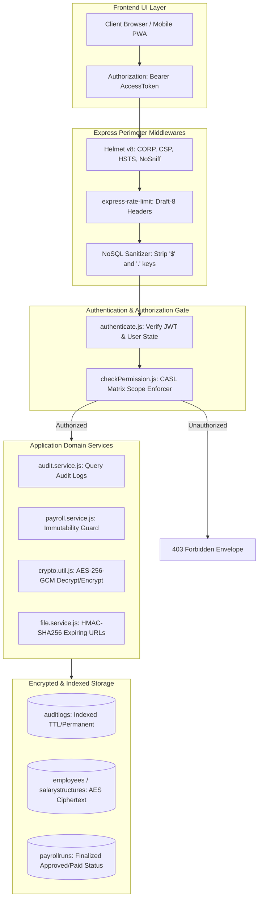
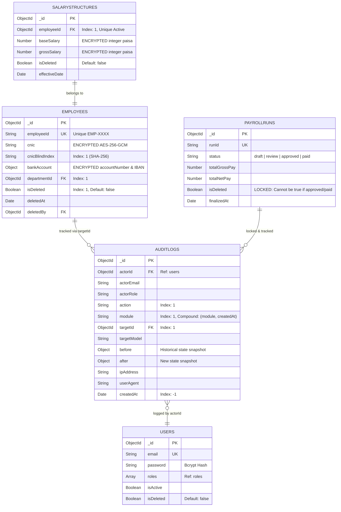

# Architectural Implementation Plan: Module X1 — Security, Audit & Quality Gate

**Feature Branch**: `feature/12-Security`  
**Created**: 2026-10-21  
**Status**: Ready for Tasks Breakdown & Slice Execution  
**Module ID**: X1  
**Module Name**: Security, Audit & Quality Gate (Phase 1 Final Gate · Launch Scope P1/P2)  
**Spec Reference**: [`.specify/specs/12-security/spec.md`](file:///c:/Users/hamih/OneDrive/Desktop/AtoZ%20Coder/Advanced%20MERN/HRM/.specify/specs/12-security/spec.md)  
**Governing Documents**:
- [`docs/TECH-SPEC.md`](file:///c:/Users/hamih/OneDrive/Desktop/AtoZ%20Coder/Advanced%20MERN/HRM/docs/TECH-SPEC.md) Sections 3 (Folders), 4 (DB), 5 (API), 6 (Auth), 8 (Request Lifecycle)
- [`docs/MODULES.md`](file:///c:/Users/hamih/OneDrive/Desktop/AtoZ%20Coder/Advanced%20MERN/HRM/docs/MODULES.md) Section X1 (Security, Audit & Quality Gate)
- [`docs/BUILD-GUIDE.md`](file:///c:/Users/hamih/OneDrive/Desktop/AtoZ%20Coder/Advanced%20MERN/HRM/docs/BUILD-GUIDE.md) Section 14 (Rows X1.1 to X1.10)
- [`docs/FRD.md`](file:///c:/Users/hamih/OneDrive/Desktop/AtoZ%20Coder/Advanced%20MERN/HRM/docs/FRD.md) Section 11 (Permission Matrix), Section 12 (Non-functional Requirements)

---

## 1. Architecture Summary & Technical Context

Module X1 represents the systemic hardening, security auditability, data lifecycle control, and quality verification gate required to launch Phase 1 (Core HR & Payroll). As mandated by FRD Section 12 and TECH-SPEC Section 6, the HRM platform processes high-liability corporate assets: National Identity Cards (CNIC), banking IBANs, statutory compliance records, and salary payouts. Module X1 bridges raw database state and enterprise defense-in-depth.

### Core Architecture Pillars

1. **Immutable Audit Trail Explorer (Row X1.1):**
   - The backend exposes a high-performance paginated query endpoint (`GET /api/v1/audit-logs`) secured strictly by CASL action `audit.view: all`.
   - The frontend implements `AuditLogsPage.jsx` equipped with `AuditLogFilterToolbar.jsx` (filters by actor, module, action, date range) and `AuditLogDiffModal.jsx` (property-level visual diff highlighting changes between `before` and `after` snapshots).
   - Backed by indexed compound keys in `auditlogs`: `{ module: 1, createdAt: -1 }`, `{ actorId: 1, createdAt: -1 }`, and `{ targetId: 1 }`.

2. **Universal Soft Delete Invariant & Finalized Payroll Lock (Row X1.2):**
   - Soft deletion standard: Models enforce `{ isDeleted: { type: Boolean, default: false }, deletedAt: Date, deletedBy: ObjectId }`. Standard read pipelines automatically filter out records where `isDeleted: true`.
   - Payroll Lock Invariant: In `payroll.service.js`, `deleteRun(runId)` enforces an unbypassable transactional guard:
     ```javascript
     if (['approved', 'paid'].includes(run.status)) {
       throw new ApiError(400, 'Cannot delete an approved or paid payroll run.');
     }
     ```

3. **Cryptographic Integrity at Rest (Row X1.3):**
   - AES-256-GCM authenticated cipher with distinct 12-byte initialization vectors (`iv`) and 16-byte authentication tags (`authTag`).
   - Verified across sensitive database fields:
     - `Employee`: `cnic` (stored encrypted with SHA-256 blind index for exact search), `bankAccount.accountNumber`, `bankAccount.iban`.
     - `SalaryStructure`: `baseSalary`, `grossSalary` (integer minor units paisa, encrypted at rest).
     - `Payslip`: `netPay`, `totalGrossPay` (encrypted at rest).

4. **Universal PBAC Route Audit Matrix (Row X1.4):**
   - An automated route audit crawler introspects Express router stacks in `app.js` and asserts that every non-public route mounts `authenticate` and `checkPermission`.
   - Comprehensive multi-role integration test matrix validates that `Super Admin` passes while unauthorized roles (`Department Manager`, `Employee`) receive strict `403 Forbidden` responses.

5. **Layered Perimeter Defense (Row X1.5):**
   - **Rate Limiting**: `express-rate-limit` v7/v8 with `standardHeaders: 'draft-8'` and `legacyHeaders: false`.
     - Global API: 500 requests per 15 minutes.
     - Auth & OTP: 10 requests per 15 minutes.
     - Heavy Exports: 30 requests per minute.
   - **Helmet v8**: `Cross-Origin-Resource-Policy: { policy: 'same-site' }`, `X-Content-Type-Options: nosniff`, and custom CSP.
   - **NoSQL Operator Sanitization**: Express middleware recursively sanitizes query, params, and body, stripping dangerous keys starting with `$` or containing `.`.

6. **Ephemeral Signed File Streaming (Row X1.6):**
   - Employee vault documents and leave medical certificates are protected from direct static file serving.
   - Ephemeral download URLs incorporate an expiration timestamp and HMAC-SHA256 signature (`/api/v1/files/download?path=...&expires=...&signature=...`).
   - Tampered or expired URLs (> 300 seconds) are rejected with `403 Forbidden`.

7. **Disaster Recovery & Restore Verification (Row X1.7):**
   - Automated script `verifyRestore.js` tests the backup archive by restoring into an isolated temporary database (`hrm_restore_verification`), checking document counts and schema indexes, and dropping the test database upon completion.

8. **High-Density Performance Benchmark (Row X1.8):**
   - Scalability verification script `benchmarkPerformance.js` seeds 500 employees, 30 days of attendance, and 12 payroll runs, validating that directory lookups, admin dashboards, and report queries respond in < 1,500ms (well under the 3,000ms threshold).

9. **Multi-Viewport Responsive Verification (Row X1.9):**
   - Playwright automated layout tests verify zero horizontal overflow (`scrollWidth === innerWidth`) and accessible touch targets (>= 44px) across 390px (Mobile), 768px (Tablet), and 1280px (Desktop).

10. **Phase 1 Quality Gate CI Green (Row X1.10):**
    - Consolidated execution of Vitest unit/service calculation tests, Supertest API tests, and Playwright end-to-end browser journeys passing with 0 errors.

---

## 2. Exact Files Listing

### 2.1 Backend Files (`backend/src/`)

```
backend/src/
├── shared/
│   └── permissions.js                    # [Update] Register 'audit' module and 'audit.view' permission
├── middlewares/
│   ├── sanitize.js                       # [New] NoSQL injection and parameter pollution sanitizer
│   └── rateLimiter.js                    # [Update/New] Standardized express-rate-limit instances (draft-8)
├── modules/audit/
│   ├── audit.validation.js               # [New] Zod query schemas for audit logs pagination & filters
│   ├── audit.service.js                  # [New] Audit query pipelines with actor/module/date filtering
│   ├── audit.controller.js               # [New] HTTP controller for GET /api/v1/audit-logs
│   └── audit.routes.js                   # [New] Express router protected by authenticate -> checkPermission('audit.view', 'all')
├── modules/files/
│   ├── file.service.js                   # [New] HMAC-SHA256 URL signing and verification utilities
│   ├── file.controller.js                # [New] Secure file streaming handler validating signatures
│   └── file.routes.js                    # [New] Protected route GET /api/v1/files/download
├── scripts/
│   ├── verifyRestore.js                  # [New] Automated backup & isolated database restore verifier
│   └── benchmarkPerformance.js           # [New] 500-employee performance & index latency benchmark
backend/tests/
├── security.audit.test.js                # [New] Comprehensive 403 Forbidden multi-role API audit matrix (X1.4)
├── softdelete.lock.test.js               # [New] Soft delete query isolation & finalized payroll lock tests (X1.2)
├── encryption.test.js                    # [New] AES-256-GCM encryption at rest database inspection (X1.3)
└── auditlogs.test.js                     # [New] Audit log querying, filtering, and diff verification (X1.1)
```

### 2.2 Frontend Files (`frontend/src/`)

```
frontend/src/
├── App.jsx                               # [Update] Register /audit-logs route protected by Can permission="audit.view"
├── components/layout/
│   └── Sidebar.jsx                       # [Update] Add 'Audit Logs' navigation item with ShieldCheck icon
├── features/audit/
│   ├── auditApi.js                       # [New] RTK Query API slice for GET /api/v1/audit-logs
│   ├── pages/
│   │   └── AuditLogsPage.jsx             # [New] Main audit logs table with pagination and sorting
│   └── components/
│       ├── AuditLogFilterToolbar.jsx     # [New] Filter toolbar (module, action, actor, date range)
│       └── AuditLogDiffModal.jsx         # [New] Visual property-level JSON before/after diff viewer
```

---

## 3. Mermaid Architecture & Workflow Diagrams

### Diagram 1: System Security & Perimeter Request Lifecycle
*Archify Engine: Client -> Perimeter Middlewares -> Security Gates -> Business Services -> Storage*



---

### Diagram 2: Entity Relationship Diagram (ERD) & Security Invariants
*Collections, Indexes, Encryption Keys, and Soft Deletion Flags*



---

### Diagram 3: Main Sequence Diagram — Audit Log Inspection & Ephemeral File Download Flow
*Sequence of Operations for Audit Log Forensics and Signed File Download*

```mermaid
sequenceDiagram
    autonumber
    actor Admin as Super Admin
    participant UI as AuditLogsPage.jsx
    participant MW as Security & PBAC Gate
    participant AuditCtrl as audit.controller.js
    participant AuditSvc as audit.service.js
    participant DB as MongoDB (auditlogs)
    participant FileCtrl as file.controller.js
    participant FileSvc as file.service.js

    Note over Admin, DB: Flow A: Audit Logs Inspection & Diff View
    Admin->>UI: Navigate to /audit-logs with filters (module='payroll')
    UI->>MW: GET /api/v1/audit-logs?module=payroll&page=1&limit=20
    MW->>MW: Verify JWT Token & checkPermission('audit.view', 'all')
    alt Role is not Super Admin
        MW-->>UI: 403 Forbidden { success: false, message: 'Forbidden' }
    else Role is Super Admin
        MW->>AuditCtrl: getAuditLogs(req, res)
        AuditCtrl->>AuditSvc: queryAuditLogs(filters, pagination)
        AuditSvc->>DB: AuditLog.find(query).sort({ createdAt: -1 }).skip(0).limit(20)
        DB-->>AuditSvc: Return matched audit documents & total count
        AuditSvc-->>AuditCtrl: Formatted envelope payload
        AuditCtrl-->>UI: 200 OK { success: true, data: { items, total, page } }
        UI->>Admin: Render table; User clicks "View Diff"
        UI->>UI: AuditLogDiffModal opens, rendering JSON tree diff
    end

    Note over Admin, FileSvc: Flow B: Ephemeral Signed Document Download
    Admin->>UI: Click "Download Medical Certificate"
    UI->>FileCtrl: GET /api/v1/files/signed-url?path=uploads/med_123.pdf
    FileCtrl->>FileSvc: generateSignedFileUrl(path, expiresIn=300)
    FileSvc-->>FileCtrl: Return signed URL with expires timestamp & HMAC signature
    FileCtrl-->>UI: 200 OK { signedUrl: '/api/v1/files/download?...' }
    UI->>FileCtrl: GET /api/v1/files/download?path=uploads/med_123.pdf&expires=...&signature=...
    FileCtrl->>FileSvc: verifySignedFileUrl(path, expires, signature)
    alt URL expired (time > expires) OR Signature Mismatch
        FileSvc-->>FileCtrl: Invalid / Expired
        FileCtrl-->>UI: 403 Forbidden ("Link expired or invalid signature")
    else URL valid & signature matches
        FileSvc-->>FileCtrl: Signature Valid
        FileCtrl-->>UI: 200 OK (Binary File Stream with Content-Disposition attachment)
    end
```

---

## 4. API Endpoints, Permissions & Scope Catalogue

| Method | Endpoint | Permission Name | Required Scope | Allowed Roles | Description |
| :--- | :--- | :--- | :---: | :--- | :--- |
| `GET` | `/api/v1/audit-logs` | `audit.view` | `all` | Super Admin | Query paginated audit trails with filtering and before/after diffs. |
| `GET` | `/api/v1/files/signed-url` | `file.view` | `own` / `team` / `all` | Super Admin, HR, Manager, Employee | Generate 5-minute ephemeral HMAC-SHA256 download URL for private files. |
| `GET` | `/api/v1/files/download` | Signature Verified | Public Signature | Anyone holding valid signed URL | Stream private file; validates timestamp and HMAC timing-safe equality. |
| `POST` | `/api/v1/settings/backup` | `setting.edit` | `all` | Super Admin | Generate compressed database BSON backup archive. |
| `DELETE` | `/api/v1/payroll/runs/:id` | `payroll.manage` | `all` | Super Admin | Locked: Rejects if status is `approved` or `paid` (`400 Bad Request`). |

### Registering Permissions in `backend/src/shared/permissions.js`
Step required during implementation:
```javascript
{
  module: 'audit',
  label: 'Audit & Compliance Logging',
  subject: 'AuditLog',
  description: 'Forensic inspection of immutable system audit trails and data diffs.',
  actions: [
    {
      action: 'audit.view',
      label: 'View Audit Logs',
      description: 'Access the system audit log screen and inspect state changes.',
      allowedScopes: ['all'],
      defaultScope: 'all'
    }
  ]
}
```

---

## 5. Security & Verification Guardrails

1. **Strict 403 Test Matrix (`security.audit.test.js`)**:
   - Automated crawler extracts all mounted routes from Express app.
   - Executes requests across all 4 roles to guarantee that no administrative or financial route allows unauthorized access.
2. **Soft Delete Query Sanitization (`softdelete.lock.test.js`)**:
   - Asserts that soft-deleted employees, departments, and users do not appear in normal API responses, active dropdowns, or authentication queries.
   - Verifies finalized payroll runs cannot be deleted under any circumstance.
3. **Encryption Verification (`encryption.test.js`)**:
   - Directly inspects MongoDB documents using Mongoose raw driver to confirm that `cnic`, `bankAccount`, and salary integers are stored as ciphertext strings rather than plaintext.
4. **Automated Disaster Recovery Script (`verifyRestore.js`)**:
   - Dumps database to archive, restores into `hrm_restore_verification`, validates collection counts, and cleans up.
5. **High-Density Performance Benchmark (`benchmarkPerformance.js`)**:
   - Seeds 500 employees, 30 days of attendance punches, and 12 months of payroll.
   - Runs `GET /api/v1/employees`, `GET /api/v1/dashboard/admin`, and `GET /api/v1/reports/attendance`.
   - Asserts latency < 3,000ms.
