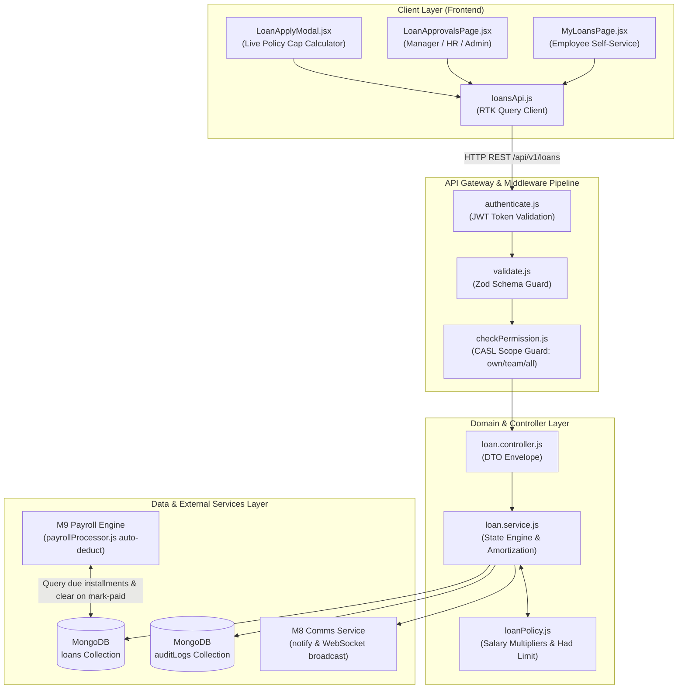
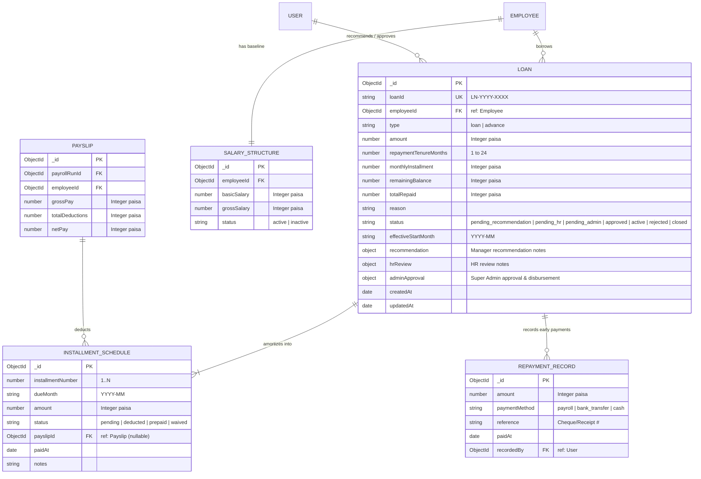
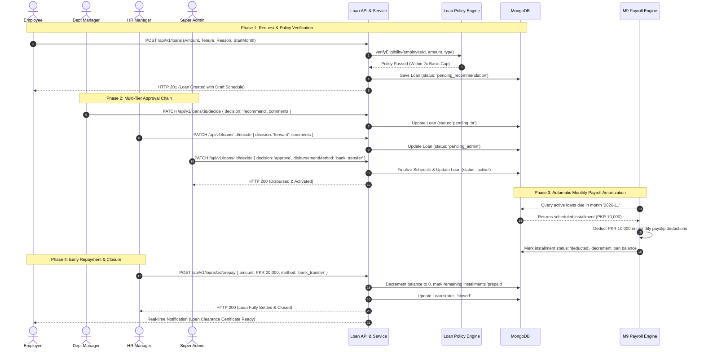

# Technical Architecture Blueprint: M10 — Loans & Salary Advances

**Feature**: M10 Loans & Advances  
**Spec Reference**: `.specify/specs/13-Loans/spec.md`  
**Target Branch**: `feature/13-loans`  
**Architecture Archetype**: Enterprise Service-Layer Pattern, Integer Paisa Invariant, CASL Multi-Tier RBAC, Forest & Emerald Craft (`DESIGN.md`)  
**Status**: Ready for Implementation  

---

## 1. System Architecture & Request Lifecycle

Conforming strictly to `docs/TECH-SPEC.md` Section 3 (Layer Architecture) and Section 8 (Request Lifecycle):

```
HTTP Client (React 18 / RTK Query)
  │  Bearer JWT in Authorization Header + Credentials: include
  ▼
Express Router (`/api/v1/loans`)
  │
  ├── 1. `authenticate` Middleware (Verify Access Token, Load req.user)
  │
  ├── 2. `validate` Middleware (Zod Schema Validation for body, params, query)
  │
  ├── 3. `checkPermission` Middleware (CASL Rule Check: action, subject, scope)
  │
  ├── 4. `loan.controller.js` (Extract sanitized DTO, call service, wrap in apiResponse)
  │
  ├── 5. `loan.service.js` (Business logic, policy validation, multi-tier state machine)
  │       │
  │       ├── MongoDB Replica Set Transaction (`session.withTransaction`)
  │       │     ├── Loan & Installment Schedule Persistence
  │       │     └── `auditLogs` Collection Entry (Before/After State)
  │       │
  │       ├── M8 Comms Engine: `notify()` (Real-time Socket.IO + In-App Notification)
  │       │
  │       └── M9 Payroll Engine Hook: `payrollProcessor.js` Auto-Deduction
  │
  ▼
JSON Response Envelope: `{ success: true, data: { ... }, message: "...", meta: null }`
```

---

## 2. Mermaid Visual Architecture Diagrams (Archify Engine)

### Diagram 1: Module Flow & Request Lifecycle Architecture



---

### Diagram 2: Entity-Relationship Diagram (ERD)



---

### Diagram 3: Main Lifecycle Sequence Diagram (Application to Closure)



---

## 3. Exact File Directory Structure

All files adhere to plain JavaScript (`.js` / `.jsx`) and existing project conventions:

```
HRM/
├── backend/
│   ├── src/
│   │   ├── models/
│   │   │   └── loan.model.js               # Mongoose schema, compound indexes, embedded schedule
│   │   ├── modules/
│   │   │   └── loans/
│   │   │       ├── loanPolicy.js           # Borrowing salary caps, tenure rules & eligibility helpers
│   │   │       ├── loan.validation.js       # Zod schemas: create, decide, prepay, query
│   │   │       ├── loan.service.js          # Business logic: state transitions, schedule compiler, prepay
│   │   │       ├── loan.controller.js       # Express HTTP controllers with uniform envelope
│   │   │       └── loan.routes.js           # Authenticated, validated, and CASL-guarded router
│   │   ├── shared/
│   │   │   └── permissions.js               # Updated with 'loans' module actions & scopes
│   │   ├── modules/payroll/
│   │   │   ├── payrollProcessor.js          # Wire auto-deduction of due loan installments into payslip
│   │   │   └── payroll.service.js           # Wire installment clearance on markPayrollPaid
│   │   └── app.js                           # Mount /api/v1/loans router
│   └── tests/
│       └── loan.test.js                     # Complete Vitest integration test suite (6 slices)
│
└── frontend/
    └── src/
        ├── features/
        │   └── loans/
        │       ├── loansApi.js              # RTK Query endpoints for loan lifecycle
        │       ├── pages/
        │       │   ├── MyLoansPage.jsx       # Employee portal: active loans, schedule drawer, apply modal
        │       │   ├── LoanApprovalsPage.jsx # Manager / HR / Admin sequential approval workstation
        │       │   └── LoanLedgerPage.jsx    # HR/Finance organization-wide loan recovery ledger
        │       └── components/
        │           ├── LoanApplyModal.jsx    # Application form with live limit computation
        │           ├── LoanScheduleDrawer.jsx# Detailed monthly amortization timeline drawer
        │           ├── LoanDecisionModal.jsx # Recommendation / Approval action modal with audit notes
        │           ├── EarlyPrepaymentModal.jsx # Lump-sum settlement and receipt modal
        │           └── LoanStatsCard.jsx     # Executive KPI cards (Total Borrowed, Outstanding, Recovered)
        └── components/layout/
            └── Sidebar.jsx                  # Add "Loans & Advances" navigation item
```

---

## 4. API Endpoints, RBAC Permissions & Data Scopes

The permissions catalogue in [`backend/src/shared/permissions.js`](file:///c:/Users/hamih/OneDrive/Desktop/AtoZ%20Coder/Advanced%20MERN/HRM/backend/src/shared/permissions.js) will be extended with the `loans` module:

| HTTP Verb | Endpoint Path | Action Name | Allowed Scopes | Description & Role Gates |
| :--- | :--- | :--- | :--- | :--- |
| `POST` | `/api/v1/loans` | `loan.create` | `own` | Submit loan or salary advance request. |
| `GET` | `/api/v1/loans` | `loan.view` | `own`, `team`, `department`, `all` | Retrieve paginated loans filtered by active user scope. |
| `GET` | `/api/v1/loans/my-eligibility` | `loan.create` | `own` | Returns live borrowing caps, max allowed amounts, and active balances. |
| `GET` | `/api/v1/loans/:id` | `loan.view` | `own`, `team`, `all` | Retrieve granular loan details with populated audit log & approval trail. |
| `GET` | `/api/v1/loans/:id/schedule` | `loan.view` | `own`, `team`, `all` | Retrieve amortization schedule with payslip references. |
| `PATCH` | `/api/v1/loans/:id/decide` | `loan.recommend` / `loan.approve` | `team`, `all` | Sequential decision: Manager recommend, HR forward, Super Admin approve/reject. |
| `POST` | `/api/v1/loans/:id/prepay` | `loan.prepay` | `all` | Record lump-sum early cash/bank repayment and adjust balance. |
| `GET` | `/api/v1/loans/ledger/summary` | `loan.view` | `all` | Executive KPI analytics: total disbursed, total recovered, total outstanding debt. |

### Permission Catalogue Addition (`shared/permissions.js`):
```javascript
{
  module: 'loans',
  label: 'Loans & Salary Advances',
  subject: 'Loan',
  description: 'Employee borrowing policies, multi-tier approvals, amortization, and early prepayments.',
  actions: [
    {
      action: 'loan.view',
      label: 'View Loans & Schedules',
      description: 'View loan records and installment schedules within assigned scope.',
      allowedScopes: ['own', 'team', 'department', 'all'],
      defaultScope: 'own'
    },
    {
      action: 'loan.create',
      label: 'Apply for Loan / Advance',
      description: 'Submit an emergency advance or installment loan request.',
      allowedScopes: ['own'],
      defaultScope: 'own'
    },
    {
      action: 'loan.recommend',
      label: 'Recommend Loan Applications',
      description: 'Department Manager review and recommend team member requests.',
      allowedScopes: ['team', 'all'],
      defaultScope: 'team'
    },
    {
      action: 'loan.approve',
      label: 'Approve & Disburse Loans',
      description: 'HR Manager and Super Admin final authorization and disbursement trigger.',
      allowedScopes: ['all'],
      defaultScope: 'all'
    },
    {
      action: 'loan.prepay',
      label: 'Record Early Repayment & Settle',
      description: 'Record lump-sum cash/bank early prepayment to amortize loan early.',
      allowedScopes: ['all'],
      defaultScope: 'all'
    }
  ]
}
```

---

## 5. Payroll Integration Blueprint (M9 Auto-Deduction Engine)

### 5.1 Payroll Batch Processing Hook (`payrollProcessor.js`)
When generating payslips for month `YYYY-MM`:
1. Query active loans for the target employee:
   ```javascript
   const activeLoans = await Loan.find({
     employeeId: emp._id,
     status: 'active',
     'schedule.dueMonth': yearMonthStr,
     'schedule.status': 'pending'
   });
   ```
2. For each active loan, extract the installment due for `yearMonthStr`:
   - Append a deduction item to `payslip.deductions`:
     - `name`: `Loan Installment (${loan.loanId})`
     - `category`: `loan.type === 'advance' ? 'advance' : 'loan_installment'`
     - `amount`: `installment.amount` (in integer paisa)
     - `description`: `Installment ${installment.installmentNumber}/${loan.repaymentTenureMonths}`

### 5.2 Payroll Disbursement Clearance Hook (`payroll.service.js`)
When Super Admin or HR marks the payroll run as `paid` (`markPayrollPaid`):
1. For each generated payslip in the batch, inspect deductions of category `loan_installment` and `advance`.
2. Within the MongoDB session transaction:
   - Mark the scheduled installment as `status: 'deducted'`.
   - Set `paidAt: new Date()`, `payslipId: slip._id`.
   - Decrement `loan.remainingBalance -= installment.amount`.
   - Increment `loan.totalRepaid += installment.amount`.
   - If `loan.remainingBalance <= 0`:
     - Update `loan.status = 'closed'`.
     - Dispatch completion notification to employee: `"Congratulations! Your loan ${loan.loanId} has been fully repaid."`

---

## 6. Implementation Waves & Execution Steps

### Wave 1: Data Contracts, Permissions & Backend Core
- **Step 1.1**: Update [`backend/src/shared/permissions.js`](file:///c:/Users/hamih/OneDrive/Desktop/AtoZ%20Coder/Advanced%20MERN/HRM/backend/src/shared/permissions.js) with `loans` actions.
- **Step 1.2**: Implement [`backend/src/models/loan.model.js`](file:///c:/Users/hamih/OneDrive/Desktop/AtoZ%20Coder/Advanced%20MERN/HRM/backend/src/models/loan.model.js) with compound indexes and embedded schedule subdocuments.
- **Step 1.3**: Implement [`backend/src/modules/loans/loanPolicy.js`](file:///c:/Users/hamih/OneDrive/Desktop/AtoZ%20Coder/Advanced%20MERN/HRM/backend/src/modules/loans/loanPolicy.js) (Had borrowing limits: 1x gross for advances, 2x basic for loans).
- **Step 1.4**: Implement [`backend/src/modules/loans/loan.validation.js`](file:///c:/Users/hamih/OneDrive/Desktop/AtoZ%20Coder/Advanced%20MERN/HRM/backend/src/modules/loans/loan.validation.js) with integer paisa validation.
- **Step 1.5**: Implement [`backend/src/modules/loans/loan.service.js`](file:///c:/Users/hamih/OneDrive/Desktop/AtoZ%20Coder/Advanced%20MERN/HRM/backend/src/modules/loans/loan.service.js) & [`loan.controller.js`](file:///c:/Users/hamih/OneDrive/Desktop/AtoZ%20Coder/Advanced%20MERN/HRM/backend/src/modules/loans/loan.controller.js).
- **Step 1.6**: Register routes in [`backend/src/modules/loans/loan.routes.js`](file:///c:/Users/hamih/OneDrive/Desktop/AtoZ%20Coder/Advanced%20MERN/HRM/backend/src/modules/loans/loan.routes.js) and mount in [`app.js`](file:///c:/Users/hamih/OneDrive/Desktop/AtoZ%20Coder/Advanced%20MERN/HRM/backend/src/app.js).

### Wave 2: Payroll Engine Linkage & Automated Amortization
- **Step 2.1**: Hook scheduled loan deduction into [`payrollProcessor.js`](file:///c:/Users/hamih/OneDrive/Desktop/AtoZ%20Coder/Advanced%20MERN/HRM/backend/src/modules/payroll/payrollProcessor.js).
- **Step 2.2**: Hook installment settlement and automatic loan closure into [`payroll.service.js`](file:///c:/Users/hamih/OneDrive/Desktop/AtoZ%20Coder/Advanced%20MERN/HRM/backend/src/modules/payroll/payroll.service.js).
- **Step 2.3**: Author automated integration test suite in [`backend/tests/loan.test.js`](file:///c:/Users/hamih/OneDrive/Desktop/AtoZ%20Coder/Advanced%20MERN/HRM/backend/tests/loan.test.js).

### Wave 3: Frontend User Experience (`DESIGN.md` Forest & Emerald Craft)
- **Step 3.1**: Create [`loansApi.js`](file:///c:/Users/hamih/OneDrive/Desktop/AtoZ%20Coder/Advanced%20MERN/HRM/frontend/src/features/loans/loansApi.js) RTK Query service.
- **Step 3.2**: Implement [`LoanStatsCard.jsx`](file:///c:/Users/hamih/OneDrive/Desktop/AtoZ%20Coder/Advanced%20MERN/HRM/frontend/src/features/loans/components/LoanStatsCard.jsx) and [`LoanApplyModal.jsx`](file:///c:/Users/hamih/OneDrive/Desktop/AtoZ%20Coder/Advanced%20MERN/HRM/frontend/src/features/loans/components/LoanApplyModal.jsx).
- **Step 3.3**: Implement [`LoanScheduleDrawer.jsx`](file:///c:/Users/hamih/OneDrive/Desktop/AtoZ%20Coder/Advanced%20MERN/HRM/frontend/src/features/loans/components/LoanScheduleDrawer.jsx) and [`EarlyPrepaymentModal.jsx`](file:///c:/Users/hamih/OneDrive/Desktop/AtoZ%20Coder/Advanced%20MERN/HRM/frontend/src/features/loans/components/EarlyPrepaymentModal.jsx).
- **Step 3.4**: Implement [`MyLoansPage.jsx`](file:///c:/Users/hamih/OneDrive/Desktop/AtoZ%20Coder/Advanced%20MERN/HRM/frontend/src/features/loans/pages/MyLoansPage.jsx), [`LoanApprovalsPage.jsx`](file:///c:/Users/hamih/OneDrive/Desktop/AtoZ%20Coder/Advanced%20MERN/HRM/frontend/src/features/loans/pages/LoanApprovalsPage.jsx), and [`LoanLedgerPage.jsx`](file:///c:/Users/hamih/OneDrive/Desktop/AtoZ%20Coder/Advanced%20MERN/HRM/frontend/src/features/loans/pages/LoanLedgerPage.jsx).
- **Step 3.5**: Add navigation links in [`Sidebar.jsx`](file:///c:/Users/hamih/OneDrive/Desktop/AtoZ%20Coder/Advanced%20MERN/HRM/frontend/src/components/layout/Sidebar.jsx) and register routes in App Router.

---

## 7. Next Actions

Run `/speckit-tasks` to generate ordered, granular micro-tasks with automated verification gates.
