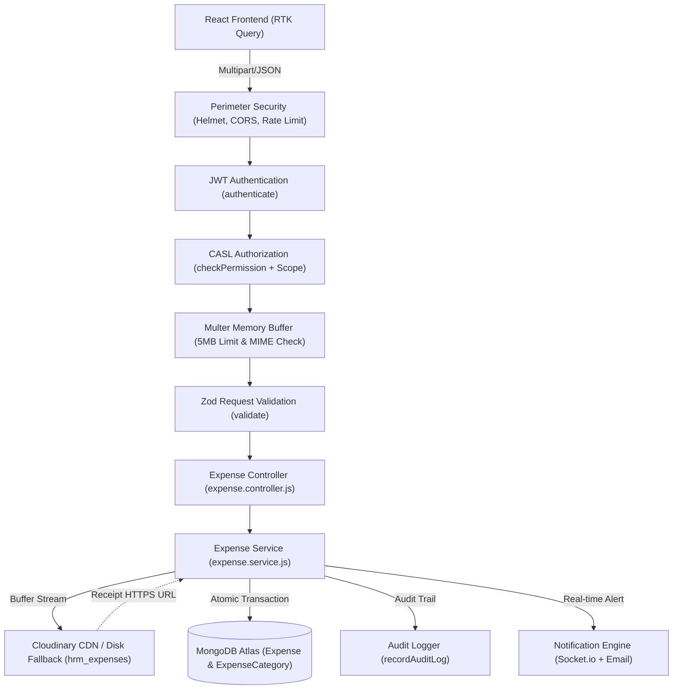
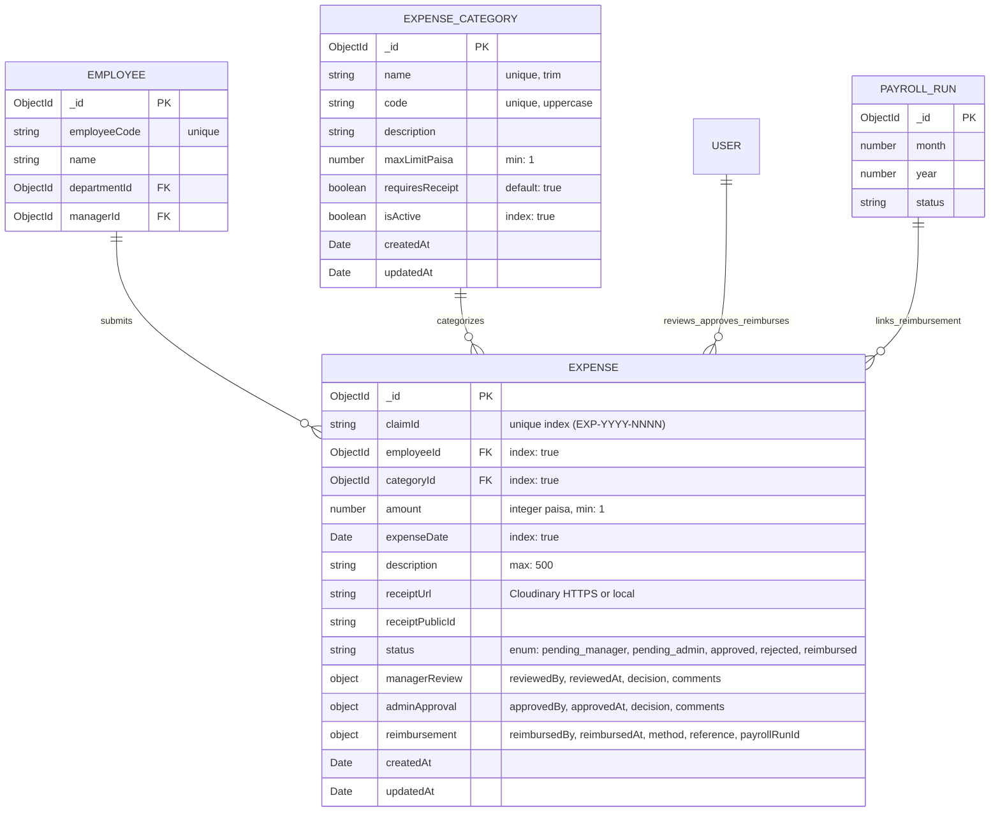
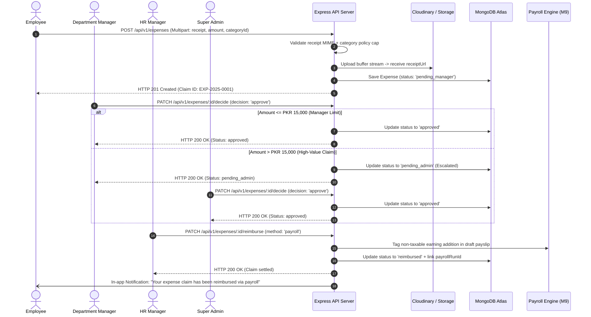

# Implementation Plan: Module M11 — Expense Claims

**Branch**: `feature/14-expenses` | **Date**: 2026-10-29 | **Spec**: [`.specify/specs/14-Expenses/spec.md`](file:///c:/Users/hamih/OneDrive/Desktop/AtoZ%20Coder/Advanced%20MERN/HRM/.specify/specs/14-Expenses/spec.md)

**Input**: Feature Specification from `.specify/specs/14-Expenses/spec.md`  
**Governing Documents**: `docs/TECH-SPEC.md` (Sections 3, 4, 5, 6, 8) & `docs/MODULES.md` (Section M11) & `docs/BUILD-GUIDE.md` (Section 16 · Rows 11.1 to 11.5)

---

## 1. Executive Summary & Architecture Blueprint

Module M11 delivers the corporate **Expense Claims** subsystem. It enables staff members to submit out-of-pocket business expenditures with mandatory verifiable receipt proof, enforces category-specific monetary caps ($1\text{ PKR} = 100\text{ paisa}$ integer precision), executes sequential hierarchical approval routing based on monetary approval limits, and settles verified claims through monthly payroll runs (Module M9) or direct disbursements.

### Architectural Invariants:
1. **Monetary Precision**: All currency amounts stored as positive integer paisa in MongoDB (`min: 1`).
2. **Mandatory Receipt Proof**: Claims without an attached image or PDF fail perimeter validation with `HTTP 400 Bad Request`.
3. **Dual-Tier Upload Handling**: Multer in-memory storage buffer streamed directly to Cloudinary (`folder: 'hrm_expenses'`) with deterministic fallback to local disk storage (`uploads/expenses/`) in test environments.
4. **Hierarchical State Engine**:
   - `pending_manager`: Awaiting direct department manager review.
   - `pending_admin`: Escalated to executive review when claim $>$ manager approval threshold (default PKR 15,000 / 1,500,000 paisa) or if applicant is a manager.
   - `approved`: Formally authorized for disbursement.
   - `rejected`: Declined with mandatory audit remarks.
   - `reimbursed`: Disbursed either as a non-taxable earning addition in the next payroll run or via direct corporate wire.
5. **Separation of Duties**: Applicants cannot approve or reimburse their own expense claims (`HTTP 403 Forbidden`).

---

## 2. Technical Context & Constitution Check

- **Language / Runtime**: Node.js v22 (ESM Modules, `"type": "module"`).
- **Backend Stack**: Express.js, Mongoose 8.x, Zod 3.x, Multer 1.4.5, Cloudinary v2, CASL Ability.
- **Frontend Stack**: React 19, Vite, Redux Toolkit Query (RTK Query), Tailwind CSS, Lucide Icons.
- **Testing Engine**: Vitest, Supertest, Playwright.
- **Storage**: MongoDB Atlas (`hrm_development` / `hrm_production`), Cloudinary cloud storage, local disk fallback.
- **Constitution Gate Status**:
  - `YAGNI`: Minimal clean models (`ExpenseCategory`, `Expense`). No speculative multi-currency or wallet abstractions.
  - `Stdlib / Installed Libs First`: Reuses existing `isCloudinaryConfigured()` and `uploadBufferToCloudinary()` helpers from `backend/src/config/cloudinary.js`.
  - `Security Boundary`: CASL check on every route; 24-character hexadecimal ObjectId path validation via Zod; XSS sanitization on description and comments.

---

## 3. Concrete File Layout & Implementation Directory Tree

### Backend (`backend/src/`)
```text
backend/src/
├── models/
│   ├── expenseCategory.model.js        # Category metadata, policy caps (integer paisa), receipt mandates
│   └── expense.model.js                # Claim record, receipt URL, status lifecycle, multi-tier audit
├── modules/
│   └── expenses/
│       ├── expense.validation.js       # Zod contracts (create, query, decide, reimburse, category CRUD)
│       ├── expense.service.js          # Core business logic, upload streaming, approval routing, payroll link
│       ├── expense.controller.js       # Express route handlers with unified apiResponse wrapper
│       └── expense.routes.js           # Guarded routes with authenticate, checkPermission, validate, multer
├── shared/
│   └── permissions.js                  # Register 'expense.*' permission catalogue
├── seed/
│   └── roles.seed.js                   # Seed expense permissions across 4 default system roles
└── tests/
    ├── expense.test.js                 # Unit calculations & integration lifecycle suite
    ├── m11.expenses.e2e.test.js        # Multi-role journey test suite (Employee, Manager, HR, Super Admin)
    └── m11.expenses.security.test.js   # Threat-hardening suite (BOLA, self-approval, XSS, ReDoS)
```

### Frontend (`frontend/src/`)
```text
frontend/src/
├── features/
│   └── expenses/
│       ├── expensesApi.js              # RTK Query endpoints (injectEndpoints into baseApi)
│       ├── pages/
│       │   ├── MyExpensesPage.jsx      # Employee portal: claim submission, status tracking, receipts
│       │   ├── ExpenseApprovalsPage.jsx# Manager/Admin approval queue with monetary threshold filter
│       │   ├── ExpenseCategoriesPage.jsx# Admin/HR category & limit management portal
│       │   └── ExpenseReportsPage.jsx  # Categorized monthly expense analytics & department breakdown
│       └── components/
│           ├── ExpenseClaimModal.jsx   # Submission modal with live limit validation & drag-drop receipt
│           ├── ExpenseDecisionModal.jsx# Multi-tier decision modal (approve/reject/escalate)
│           ├── ExpenseReimburseModal.jsx# HR disbursement dialog (payroll addition vs direct wire)
│           └── ReceiptViewerModal.jsx  # Modal to securely inspect attached receipt image / PDF
├── components/layout/
│   └── Sidebar.jsx                     # Register "Expenses" nav group with role-scoped links
└── App.jsx                             # Register protected routes (/expenses, /expenses/approvals, etc.)
```

---

## 4. Visual Architecture & Flow Diagrams (Archify Engine)

### Diagram 1: System Flow & Request Pipeline


---

### Diagram 2: Entity-Relationship Diagram (ERD)


---

### Diagram 3: Main Lifecycle Sequence Diagram


---

## 5. API Contracts & CASL Authorization Matrix

### Master Permissions Catalogue (`backend/src/shared/permissions.js`)
To be registered in `PERMISSIONS_CATALOGUE`:
```javascript
{
  module: 'expenses',
  label: 'Expense Claims & Reimbursements',
  subject: 'Expense',
  description: 'Corporate out-of-pocket expenses, approvals, and payroll reimbursements.',
  actions: [
    {
      action: 'expense.view',
      label: 'View Expense Claims',
      description: 'View expense claim records and receipt attachments.',
      allowedScopes: ['own', 'team', 'department', 'all'],
      defaultScope: 'own'
    },
    {
      action: 'expense.create',
      label: 'Submit Expense Claim',
      description: 'Submit an out-of-pocket claim with receipt proof.',
      allowedScopes: ['own'],
      defaultScope: 'own'
    },
    {
      action: 'expense.approve',
      label: 'Approve / Reject Claims',
      description: 'Approve or reject expense claims within authorized monetary limits.',
      allowedScopes: ['team', 'department', 'all'],
      defaultScope: 'team'
    },
    {
      action: 'expense.reimburse',
      label: 'Process Reimbursement',
      description: 'Mark approved claims as reimbursed via payroll or direct wire.',
      allowedScopes: ['all'],
      defaultScope: 'all'
    },
    {
      action: 'expense.settings',
      label: 'Manage Expense Categories & Policy Caps',
      description: 'Configure corporate expense categories, rules, and monetary limits.',
      allowedScopes: ['all'],
      defaultScope: 'all'
    }
  ]
}
```

### Role Capability Distribution (`backend/src/seed/roles.seed.js`)
- **Super Admin**: Wildcard `manage:all` (Full executive control).
- **HR Manager**:
  - `expense.view` (`all`)
  - `expense.create` (`own`)
  - `expense.approve` (`all`)
  - `expense.reimburse` (`all`)
  - `expense.settings` (`all`)
- **Department Manager**:
  - `expense.view` (`team`)
  - `expense.create` (`own`)
  - `expense.approve` (`team`) (Claims $\le$ threshold)
- **Employee**:
  - `expense.view` (`own`)
  - `expense.create` (`own`)

---

## 6. Detailed API Route Signatures

| # | HTTP | Endpoint | CASL Guard | Request Shape | Response Data |
| :--- | :--- | :--- | :--- | :--- | :--- |
| 1 | `GET` | `/api/v1/expense-categories` | `expense.view` (`own`) | Query: `?active=true` | `ExpenseCategory[]` |
| 2 | `POST` | `/api/v1/expense-categories` | `expense.settings` (`all`) | Body: `{ name, code, maxLimitPaisa, requiresReceipt }` | `ExpenseCategory` |
| 3 | `PUT` | `/api/v1/expense-categories/:id` | `expense.settings` (`all`) | Body: `{ name, maxLimitPaisa, requiresReceipt, isActive }` | `ExpenseCategory` |
| 4 | `POST` | `/api/v1/expenses` | `expense.create` (`own`) | Multipart: `categoryId`, `amount`, `expenseDate`, `description`, `receipt` file | `Expense` (status: `pending_manager`) |
| 5 | `GET` | `/api/v1/expenses` | `expense.view` (`own`/`team`/`all`) | Query: `?page=1&limit=20&status=&categoryId=` | `{ items: Expense[], total, page, totalPages }` |
| 6 | `GET` | `/api/v1/expenses/:id` | `expense.view` (`own`/`team`/`all`) | Params: `id` (24-char hex ObjectId) | `Expense` (populated employee, category, reviewers) |
| 7 | `PATCH` | `/api/v1/expenses/:id/decide` | `expense.approve` (`team`/`all`) | Body: `{ decision: 'approve'\|'reject'\|'escalate', comments }` | `Expense` (updated status) |
| 8 | `PATCH` | `/api/v1/expenses/:id/reimburse` | `expense.reimburse` (`all`) | Body: `{ method: 'payroll'\|'direct', reference }` | `Expense` (status: `reimbursed`) |
| 9 | `GET` | `/api/v1/reports/expenses` | `report.view` (`team`/`all`) | Query: `?month=YYYY-MM&departmentId=` | `{ totalAmountPaisa, categoryBreakdown[], departmentBreakdown[] }` |

---

## 7. Quality Gates & Test Verification Plan

1. **Unit & Calculation Suite (`tests/expense.test.js`)**:
   - Rejects zero, negative, and fractional paisa amounts.
   - Enforces category policy ceiling (returns 422 if amount exceeds cap).
   - Generates sequential formatted claim IDs (`EXP-YYYY-0001`).
2. **Multi-Role End-to-End Suite (`tests/m11.expenses.e2e.test.js`)**:
   - Role 1 (Employee): Submits claim with receipt $\rightarrow$ inspects claim on `MyExpensesPage`.
   - Role 2 (Department Manager): Approves team claim $\le$ PKR 15,000 $\rightarrow$ status becomes `approved`. Escalates claim $>$ PKR 15,000 $\rightarrow$ status becomes `pending_admin`.
   - Role 3 (Super Admin): Approves escalated high-value claim.
   - Role 4 (HR Manager): Reimburses approved claim via payroll $\rightarrow$ verifies attachment to draft payslip.
3. **Adversarial Security & Hardening Suite (`tests/m11.expenses.security.test.js`)**:
   - **Missing Receipt**: Rejects claim without file upload (`400 Bad Request`).
   - **Invalid File Type**: Rejects executable/script files disguised as images (`400 Bad Request`).
   - **Separation of Duties**: Rejects self-approval attempts by applicants (`403 Forbidden`).
   - **BOLA / IDOR**: Employee cannot view or modify peer claims (`403 Forbidden`).
   - **Malformed ObjectIds**: Rejects non-hex route parameters cleanly with `400 Bad Request`.
   - **Double Reimbursement**: Subsequent calls to reimburse an already settled claim return `400 Bad Request`.

---

## 8. Next Step

Run **`/speckit-tasks`** to generate the sequential task execution checklist (`tasks.md`) with automated dependencies and implementation waves.

