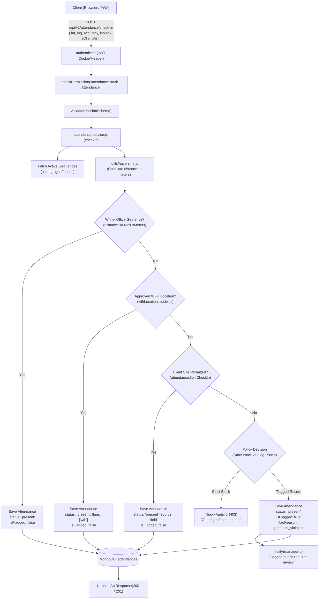
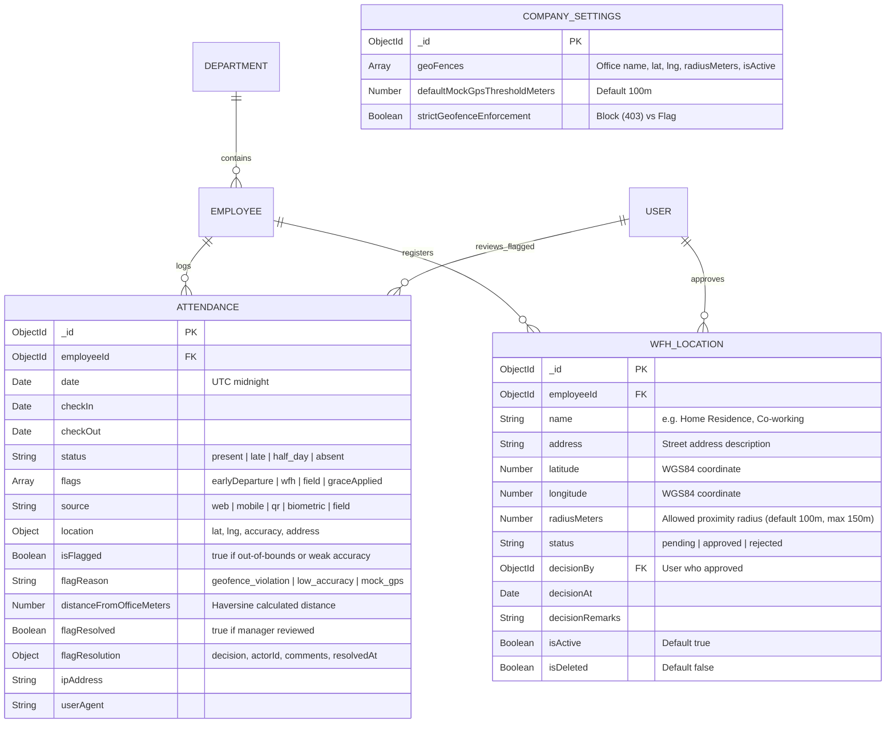
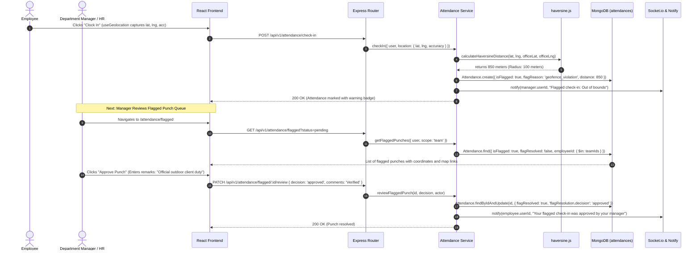

# Architecture Plan: Module M14 — GPS / Geo-fencing Smart Attendance

**Module**: `M14` — GPS / Geo-fencing  
**Target Folder**: `.specify/specs/15-geofence`  
**Specification Reference**: [`.specify/specs/15-geofence/spec.md`](file:///c:/Users/hamih/OneDrive/Desktop/AtoZ%20Coder/Advanced%20MERN/HRM/.specify/specs/15-geofence/spec.md)  
**Standard Architecture Rules**: `docs/TECH-SPEC.md` Sections 3 (Folders), 4 (Database), 5 (API), 6 (Auth), 8 (Request Lifecycle) & `docs/MODULES.md` Section M14.

---

## 1. Architectural Strategy & Design Principles

Module M14 extends the attendance domain by converting passive browser clock-ins into spatially validated attendance events:
1. **Zero Client Trust Boundary**:
   - Punch coordinates (`latitude`, `longitude`, `accuracy`, `isMock`) are received via HTTPS.
   - Distance validation is performed purely on the server using a high-precision spherical Earth model ($R = 6,371,000 \text{ m}$) via [`haversine.js`](file:///c:/Users/hamih/OneDrive/Desktop/AtoZ%20Coder/Advanced%20MERN/HRM/backend/src/utils/haversine.js).
2. **Multi-Boundary Proximity Evaluation**:
   - **Primary Boundary**: Company office geofences configured in `settings.geoFences` (Row 2.8).
   - **Secondary Boundary**: Approved employee home/remote locations in `wfhLocation.model.js` (Row 14.4).
   - **Exemption Boundary**: Field/sales personnel checking in on-site at clients holding `attendance.fieldCheckIn` permission (Row 14.5).
   - If outside all authorized perimeters: Punch is either rejected (`HTTP 403`) or stored with `isFlagged: true` and routed to the Flagged Review Queue.
3. **Point-In-Time Privacy Standard**:
   - Geolocation is requested **strictly when the employee hits the check-in or check-out button**.
   - No background geolocation watchers, WebSocket tracking streams, or continuous GPS polling routes exist.
4. **Interactive Spatial Visualization**:
   - Leaflet + OpenStreetMap render office circular boundaries (`L.circle`) and punch location markers (`L.marker`) with role-based scoping (Manager $\rightarrow$ team; HR/Admin $\rightarrow$ organization).

---

## 2. Exact Files & Directory Structure

All files use plain JavaScript (`.js` / `.jsx`).

```text
backend/
├── src/
│   ├── utils/
│   │   └── haversine.js                          [14.1] Haversine formula calculation utility
│   ├── models/
│   │   ├── wfhLocation.model.js                  [14.4] Approved remote/WFH employee coordinates model
│   │   └── attendance.model.js                   [14.2, 14.3] Extended location & flagged punch fields
│   ├── modules/
│   │   └── attendance/
│   │       ├── attendance.validation.js          [14.2–14.6] Extended checkIn, WFH location, & flagged schemas
│   │       ├── attendance.service.js             [14.2–14.6] Spatial evaluation, WFH CRUD, flagged punch reviewer
│   │       ├── attendance.controller.js          [14.4–14.7] WFH location handlers, flagged punches, punch map locations
│   │       └── attendance.routes.js              [14.4–14.7] Endpoints mounted under /api/v1/attendance
│   └── shared/
│       └── permissions.js                        [RBAC] New actions: attendance.fieldCheckIn, attendance.geo.view
frontend/
├── src/
│   ├── hooks/
│   │   └── useGeolocation.js                     [14.2, 14.8] Client hook wrapping navigator.geolocation with privacy prompt
│   ├── features/
│   │   └── attendance/
│   │       ├── attendanceApi.js                  [RTK Query] Endpoints: getFlaggedPunches, reviewFlaggedPunch, getPunchLocations, wfhLocations CRUD
│   │       ├── components/
│   │       │   ├── GeoLocationBadge.jsx          [14.2] Proximity status pill (Inside Office / Approved WFH / Out of Fence)
│   │       │   ├── WfhLocationModal.jsx          [14.4] Form modal to pin home address & radius on map
│   │       │   └── PunchMap.jsx                  [14.7] Interactive Leaflet map with geofence circles and markers
│   │       └── pages/
│   │           ├── WfhLocationsPage.jsx          [14.4] Employee remote location management & HR approval table
│   │           ├── FlaggedPunchesPage.jsx        [14.6] Managerial & HR review center for out-of-bounds/low-accuracy punches
│   │           └── PunchLocationsMapPage.jsx     [14.7] Visual spatial overview of daily employee check-in pins
backend/tests/
├── haversine.test.js                             [14.1-TEST] Unit tests for known benchmark coordinate distances
└── m14.geofence.e2e.test.js                      [14.E2E-TEST] Multi-role E2E test across Employee, Manager, HR, Super Admin
```

---

## 3. Architecture Diagrams (Senior Architect & Archify)

### Diagram 1: Geofenced Check-In & Request Lifecycle



---

### Diagram 2: Entity Relationship Diagram (ERD)



---

### Diagram 3: Main Sequence Diagram (Flagged Punch Resolution Workflow)



---

## 4. API Endpoints, Permissions & Scopes Matrix

| HTTP Method | Route | Permission Required | CASL Subject | Data Scope | Description |
|---|---|---|---|---|---|
| `POST` | `/api/v1/attendance/check-in` | `attendance.mark` | `Attendance` | `own` | Submits check-in with GPS coordinates & accuracy |
| `POST` | `/api/v1/attendance/check-out` | `attendance.mark` | `Attendance` | `own` | Submits check-out with GPS coordinates |
| `GET` | `/api/v1/attendance/flagged` | `attendance.approve` | `Attendance` | `team` / `all` | Retrieves pending flagged punches with distances & reasons |
| `PATCH` | `/api/v1/attendance/flagged/:id/review` | `attendance.approve` | `Attendance` | `team` / `all` | Regularize (approve) or penalize (reject) flagged check-ins |
| `GET` | `/api/v1/attendance/locations` | `attendance.view` | `Attendance` | `team` / `all` | Returns coordinate pins & geofences for Leaflet PunchMap |
| `GET` | `/api/v1/attendance/wfh-locations` | `attendance.wfh` | `WfhLocation` | `own` / `all` | List registered WFH remote locations |
| `POST` | `/api/v1/attendance/wfh-locations` | `attendance.wfh` | `WfhLocation` | `own` | Employee registers home GPS coordinates & radius |
| `PATCH` | `/api/v1/attendance/wfh-locations/:id/status` | `attendance.approve` | `WfhLocation` | `all` | HR Manager approves or rejects remote WFH location |
| `DELETE` | `/api/v1/attendance/wfh-locations/:id` | `attendance.wfh` | `WfhLocation` | `own` / `all` | Deletes/deactivates WFH location record |

---

## 5. Security & Verification Constraints

1. **Haversine Unit Test (`haversine.test.js`)**:
   - Zero-distance test: identical points must return `0.00 meters`.
   - Known benchmark coordinate test: Karachi I.I. Chundrigar Road office (`24.8532, 67.0099`) to Clifton Branch (`24.8138, 67.0305`) verified against standard geodetic tables.
   - Robust boundary handling for antipodal and equatorial edge points.
2. **Point-In-Time Capture Invariant**:
   - Geolocation is only accessed when user initiates clock in/out.
   - Frontend displays clear Privacy Notice text in UI before location request.
3. **HTTPS & Security**:
   - Geolocation API (`navigator.geolocation`) strictly requires HTTPS or `localhost` in production modern browsers.
   - Low accuracy ($> 100\text{ m}$) automatically triggers low-accuracy flagging.
