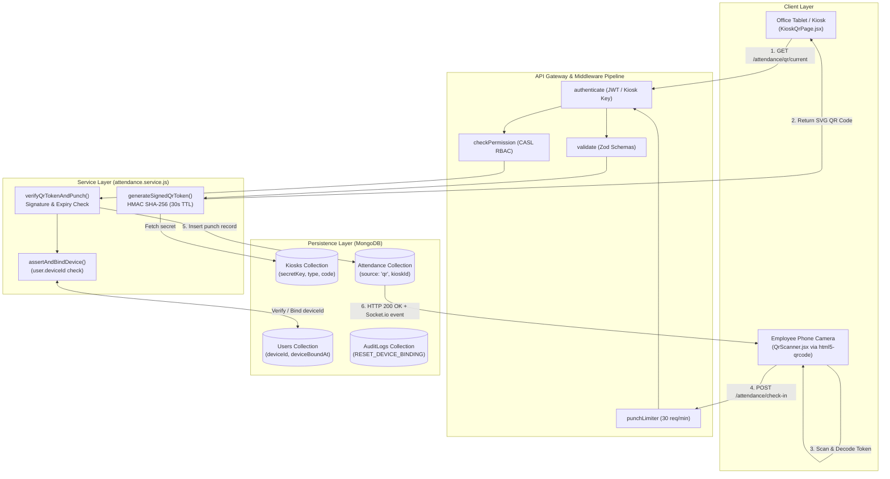
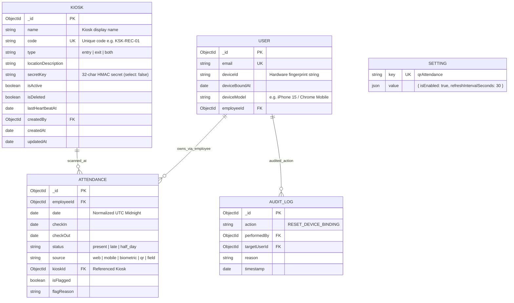
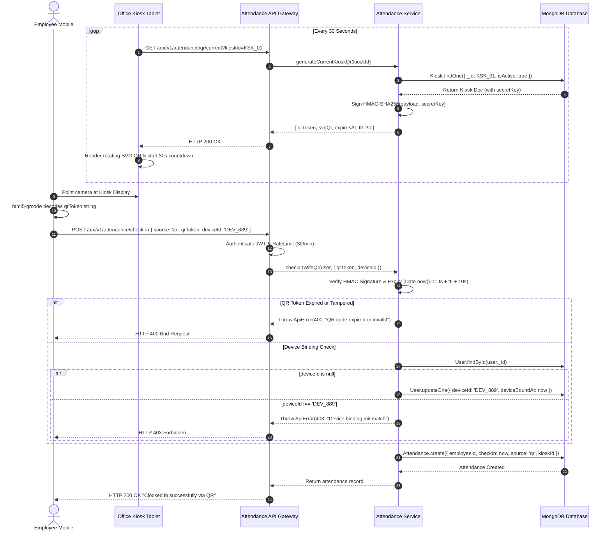

# Technical Architecture Plan: Module M13 — QR Code Attendance

**Feature Branch**: `feature/16-qr`  
**Created**: October 30, 2026  
**Status**: Ready for Implementation  
**Specification**: [`.specify/specs/16-qr/spec.md`](file:///c:/Users/hamih/OneDrive/Desktop/AtoZ%20Coder/Advanced%20MERN/HRM/.specify/specs/16-qr/spec.md)  
**Governing Documents**:
- `docs/TECH-SPEC.md`: Sections 3 (Folders), 4 (Database), 5 (API Architecture), 6 (Authentication & CASL), 8 (Request Lifecycle)
- `docs/BUILD-GUIDE.md`: Section 18 (Rows 13.1 to 13.6)
- `docs/MODULES.md`: Section M13 (QR Code Attendance)

---

## 1. Executive Architecture Summary

Module M13 provides secure, high-throughput on-premise attendance clock-in/out through physical kiosks running dynamic rotating QR codes.

### Key Architectural Tenets
1. **Zero-Trust Kiosk Security**: Each physical kiosk device is registered with a unique 32-byte cryptographic secret key stored encrypted/unselected in MongoDB.
2. **HMAC SHA-256 Dynamic Token Rotation**: The kiosk display auto-refreshes every 30 seconds (`GET /attendance/qr/current?kioskId=...`), generating a Base64URL-encoded payload (`{ kId, kType, ts, ttl, nonce }`) and HMAC SHA-256 signature.
3. **Anti-Screenshot & Anti-Replay Engine**: Clock-in validation enforces a strict time-to-live ($30\text{s} + 10\text{s grace}$ for network latency). Replay attacks or forwarded photos fail cryptographic timestamp verification.
4. **Physical Device Binding (1 Employee = 1 Phone)**: The employee's `user.deviceId` is bound on their first verified scan. Mismatched device punches are blocked with HTTP 403.
5. **Decoupled Kiosk Display Mode**: Kiosks run in clean kiosk mode (`/attendance/kiosk/:id/display`) with full-screen dark aesthetic and visual circular countdown progress indicator.

---

## 2. Mermaid Diagrams (Archify Architecture Engine)

### Diagram 1: System Flow & Request Pipeline


---

### Diagram 2: Entity-Relationship Diagram (ERD)


---

### Diagram 3: Main Sequence Diagram (Dynamic QR Punch Lifecycle)


---

## 3. Exact Files Directory Structure

### Backend (`backend/src/`)
```text
backend/src/
├── models/
│   ├── kiosk.model.js                     # [NEW] Kiosk Schema with secretKey & directionality
│   ├── user.model.js                      # [MODIFY] Add deviceId, deviceBoundAt, deviceModel
│   └── attendance.model.js                # [MODIFY] Add kioskId ObjectId reference
├── modules/
│   └── attendance/
│       ├── attendance.validation.js       # [MODIFY] Add kiosk CRUD, QR token, and resetDevice schemas
│       ├── attendance.service.js          # [MODIFY] Add kiosk CRUD, HMAC QR signing, device binding logic
│       ├── attendance.controller.js       # [MODIFY] Add kiosk and QR endpoints
│       └── attendance.routes.js           # [MODIFY] Register /kiosks, /qr/current, /users/:id/reset-device
├── shared/
│   └── permissions.js                     # [MODIFY] Register 'attendance.kiosk.manage'
├── seed/
│   └── roles.seed.js                      # [MODIFY] Grant 'attendance.kiosk.manage' to Super Admin & HR Manager
└── tests/
    └── m13.qr.e2e.test.js                 # [NEW] Comprehensive 15+ automated tests for Module M13
```

### Frontend (`frontend/src/`)
```text
frontend/src/
├── features/
│   └── attendance/
│       ├── attendanceApi.js               # [MODIFY] Add RTK Query hooks for kiosks & dynamic QR
│       ├── pages/
│       │   ├── KiosksPage.jsx             # [NEW] Directory for managing kiosk hardware & directionality
│       │   ├── KioskQrPage.jsx            # [NEW] Dedicated full-screen high-contrast dynamic rotating QR display
│       │   └── MyAttendancePage.jsx       # [MODIFY] Integrate QR scan launcher button
│       └── components/
│           ├── KioskModal.jsx             # [NEW] Modal for creating/updating kiosk devices
│           ├── QrScannerModal.jsx         # [NEW] html5-qrcode camera scanner modal with feedback
│           └── PunchCardWidget.jsx        # [MODIFY] Add "Scan QR" button with permission & setting checks
├── features/
│   └── users/
│       └── components/
│           └── ResetDeviceModal.jsx       # [NEW] HR device unbinding confirmation modal
├── components/
│   └── layout/
│       └── Sidebar.jsx                    # [MODIFY] Add "Attendance Kiosks" link under Attendance dropdown
└── App.jsx                                # [MODIFY] Register /attendance/kiosks & /attendance/kiosk/:id/display
```

---

## 4. API Endpoints, Permissions & Scope Specifications

| Endpoint | Method | Permission Name | Required Scope | Request Body / Query | Success Status | Description |
| :--- | :---: | :--- | :---: | :--- | :---: | :--- |
| `/api/v1/attendance/kiosks` | `GET` | `attendance.kiosk.manage` | `all` | `query: { search, type, isActive }` | 200 OK | List registered office kiosk devices. |
| `/api/v1/attendance/kiosks` | `POST` | `attendance.kiosk.manage` | `all` | `body: { name, code, type, locationDescription }` | 201 Created | Register a new kiosk and generate its 32-char secret. |
| `/api/v1/attendance/kiosks/:id` | `PATCH` | `attendance.kiosk.manage` | `all` | `body: { name, type, locationDescription, isActive }` | 200 OK | Update kiosk configuration or toggle active status. |
| `/api/v1/attendance/kiosks/:id` | `DELETE` | `attendance.kiosk.manage` | `all` | — | 200 OK | Soft delete a kiosk device. |
| `/api/v1/attendance/qr/current` | `GET` | `attendance.mark` or Kiosk Auth | `own` | `query: { kioskId }` | 200 OK | Fetches current signed rotating QR token + SVG markup. |
| `/api/v1/attendance/check-in` | `POST` | `attendance.mark` | `own` | `body: { source: 'qr', qrToken, deviceId, deviceModel }` | 200 OK | Validates QR signature, checks TTL, binds/checks device, records clock-in. |
| `/api/v1/attendance/check-out` | `POST` | `attendance.mark` | `own` | `body: { source: 'qr', qrToken, deviceId }` | 200 OK | Validates QR signature, checks TTL, records clock-out. |
| `/api/v1/users/:id/reset-device` | `POST` | `attendance.kiosk.manage` or `user.manage` | `all` | `body: { reason }` | 200 OK | Unbinds user's physical device and logs audit entry. |

---

## 5. Security Architecture & Threat Mitigations

1. **Anti-Replay & Screenshot Defenses**:
   - Rotation Interval: 30 seconds default (configurable 15s–120s in `Setting` key `qrAttendance`).
   - Token Payload: `{ kId, kType, ts, ttl, nonce }` signed with HMAC-SHA256 using the kiosk's private secret.
   - Server Verification: `Math.floor(Date.now() / 1000) <= (ts + ttl + 10)`. Photos taken and sent via WhatsApp/Slack expire before receipt.
2. **Anti-Proxy Attendance (Device Binding)**:
   - Client sends browser/device fingerprint (`deviceId`).
   - On scan 1: Stored in `User.deviceId` with `deviceBoundAt`.
   - On scan 2+: Strict equality check (`user.deviceId === req.body.deviceId`). A colleague cannot scan for another user on their own phone.
3. **Kiosk Secret Key Protection**:
   - `secretKey` field in `kioskSchema` is configured with `select: false`.
   - The secret is never transmitted to client browsers; QR tokens are signed server-side.
4. **Brute Force & Flooding Mitigation**:
   - `punchLimiter` (30 requests/min/IP) on check-in/out endpoints.
   - `requestsLimiter` (30 requests/15min) on device reset endpoint.
   - Perimeter `sanitize` middleware strips NoSQL injection operators (`$`, `.`).

---

## 6. Implementation Dependencies

- **Frontend**: `html5-qrcode` (v2.3.8) for fast, responsive cross-browser camera video stream scanning.
- **Backend**: `qrcode` (v1.5.4) for high-performance SVG vector QR generation. Standard Node.js `crypto` module for HMAC-SHA256 signatures.
