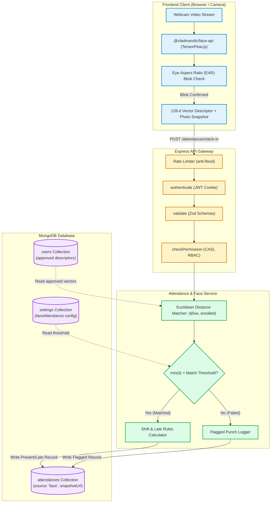
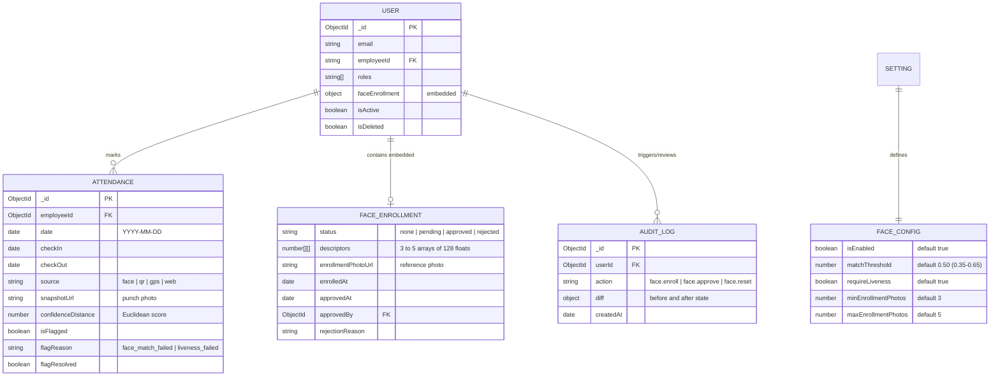
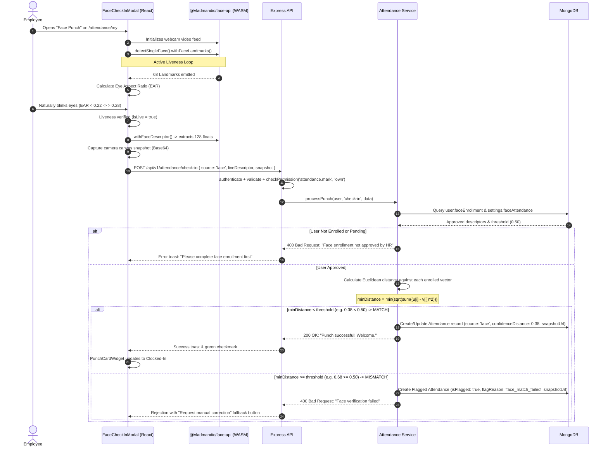

# Technical Architecture Plan: Module M12 — Face Recognition Attendance

**Feature Branch**: `feature/17-face`  
**Specification**: [`.specify/specs/17-face/spec.md`](file:///c:/Users/hamih/OneDrive/Desktop/AtoZ%20Coder/Advanced%20MERN/HRM/.specify/specs/17-face/spec.md)  
**Governance**: `docs/TECH-SPEC.md` (Sections 3, 4, 5, 6, 8) & `docs/MODULES.md` (Section 6)  
**Created**: October 31, 2026  
**Status**: Ready for Implementation  

---

## 1. System Architecture & Component Responsibilities

Module M12 introduces an on-device neural inference pipeline using `@vladmandic/face-api` (TensorFlow.js) coupled with a server-side Euclidean vector matching engine in Node.js/Express.

```
+───────────────────────────────────────────────────────────────────────────────────────────────────+
|                                    1. CLIENT FRONTEND PIPELINE                                    |
|                                                                                                   |
|  useFaceApi Hook (public/models)                                                                  |
|  ├── tinyFaceDetector (Lightweight 320x320 face bounding box)                                     |
|  ├── faceLandmark68Net (68 coordinates for eyes, nose, mouth, jawline)                             |
|  └── faceRecognitionNet (Outputs 128-d Float32Array embedding vector)                             |
|                                                                                                   |
|  Liveness Detection Engine (Client-side anti-spoof)                                               |
|  └── Eye Aspect Ratio (EAR) = (||p2-p6|| + ||p3-p5||) / (2 * ||p1-p4||)                          |
|      Blink cycle triggers: EAR drops below 0.22, then recovers > 0.28                             |
+───────────────────────────────────────────────────────────────────────────────────────────────────+
                                             │
                       HTTPS REST (JSON + Base64 Snapshot)
                                             ▼
+───────────────────────────────────────────────────────────────────────────────────────────────────+
|                                    2. EXPRESS BACKEND PIPELINE                                    |
|                                                                                                   |
|  Routes (/api/v1/attendance/face/* & /check-in)                                                   |
|  ├── authenticate (JWT access token via httpOnly cookie or Bearer header)                         |
|  ├── validate (Zod runtime schemas: enrollFaceSchema, facePunchSchema, approveEnrollmentSchema)   |
|  └── checkPermission (CASL RBAC: attendance.mark, attendance.face.manage, scoped queries)         |
|                                                                                                   |
|  Attendance & Face Verification Service                                                           |
|  ├── Multi-Vector Euclidean Distance Matcher: d(u, v) = sqrt(sum((u[i] - v[i])^2))               |
|  ├── Threshold Validator: min(d) < setting.faceAttendance.matchThreshold (default 0.50)           |
|  └── Auto-Flagging Engine: Mismatches/spoofs create flagged attendance records for HR review      |
+───────────────────────────────────────────────────────────────────────────────────────────────────+
                                             │
                                             ▼
+───────────────────────────────────────────────────────────────────────────────────────────────────+
|                                        3. PERSISTENCE LAYER                                       |
|                                                                                                   |
|  MongoDB Collections:                                                                             |
|  ├── users: faceEnrollment { status, descriptors: [[Number]], enrollmentPhotoUrl, approvedBy }   |
|  ├── attendances: source: 'face', snapshotUrl, confidenceDistance, isFlagged, flagReason         |
|  ├── settings: faceAttendance { isEnabled, matchThreshold, requireLiveness }                      |
|  └── auditlogs: enrollment approval, rejection, and manual resets with diff audit               |
+───────────────────────────────────────────────────────────────────────────────────────────────────+
```

---

## 2. Exact Files & Directory Mapping

### Backend Layer (`backend/`)
1. **Model Modifications**:
   - [`backend/src/models/user.model.js`](file:///c:/Users/hamih/OneDrive/Desktop/AtoZ%20Coder/Advanced%20MERN/HRM/backend/src/models/user.model.js): Add `faceEnrollment` schema (status `enum: ['none', 'pending', 'approved', 'rejected']`, `descriptors: [[Number]]`, `enrollmentPhotoUrl`, `enrolledAt`, `approvedAt`, `approvedBy`, `rejectionReason`).
   - [`backend/src/models/attendance.model.js`](file:///c:/Users/hamih/OneDrive/Desktop/AtoZ%20Coder/Advanced%20MERN/HRM/backend/src/models/attendance.model.js): Extend `source` enum with `'face'`; add `snapshotUrl` (string), `confidenceDistance` (number), and extend `flagReason` enum with `'face_match_failed'`, `'liveness_failed'`, `'face_not_enrolled'`.
2. **Validation Layer**:
   - [`backend/src/modules/attendance/attendance.validation.js`](file:///c:/Users/hamih/OneDrive/Desktop/AtoZ%20Coder/Advanced%20MERN/HRM/backend/src/modules/attendance/attendance.validation.js):
     - `enrollFaceSchema`: Validates `descriptors` (array of 3 to 5 arrays of 128 numbers) and `enrollmentPhoto` (base64 image data URI).
     - `faceApprovalSchema`: Validates `rejectionReason` (optional for approve, required for reject).
     - Extend `checkInSchema` and `checkOutSchema` to accept optional `liveDescriptor: z.array(z.number()).length(128)`, `snapshot: z.string().optional()`.
3. **Service Layer**:
   - [`backend/src/modules/attendance/attendance.service.js`](file:///c:/Users/hamih/OneDrive/Desktop/AtoZ%20Coder/Advanced%20MERN/HRM/backend/src/modules/attendance/attendance.service.js):
     - `enrollFace(userId, { descriptors, enrollmentPhotoUrl })`: Saves pending enrollment.
     - `getFaceEnrollmentStatus(userId)`: Returns current status and photo.
     - `getFaceEnrollments(filters, pagination)`: HR query with status filter and employee details.
     - `approveFaceEnrollment(targetUserId, adminUserId)`: Marks status `approved`.
     - `rejectFaceEnrollment(targetUserId, adminUserId, reason)`: Marks status `rejected`.
     - `resetFaceEnrollment(targetUserId, adminUserId, reason)`: Resets to `none` and clears vectors.
     - `verifyFacePunch(user, liveDescriptor, snapshotUrl)`: Computes Euclidean distance against user's approved descriptors, checks threshold from Settings, logs flagged punch on mismatch.
4. **Controller & Routes Layer**:
   - [`backend/src/modules/attendance/attendance.controller.js`](file:///c:/Users/hamih/OneDrive/Desktop/AtoZ%20Coder/Advanced%20MERN/HRM/backend/src/modules/attendance/attendance.controller.js): Add handlers for enroll, status, enrollments list, approve, reject, reset.
   - [`backend/src/modules/attendance/attendance.routes.js`](file:///c:/Users/hamih/OneDrive/Desktop/AtoZ%20Coder/Advanced%20MERN/HRM/backend/src/modules/attendance/attendance.routes.js): Register routes with rate limiting, authentication, validation, and CASL permission checks.
5. **Permissions & Seeds**:
   - [`backend/src/shared/permissions.js`](file:///c:/Users/hamih/OneDrive/Desktop/AtoZ%20Coder/Advanced%20MERN/HRM/backend/src/shared/permissions.js): Add `attendance.face.manage` permission.
   - [`backend/src/seed/roles.seed.js`](file:///c:/Users/hamih/OneDrive/Desktop/AtoZ%20Coder/Advanced%20MERN/HRM/backend/src/seed/roles.seed.js): Grant `attendance.face.manage` to `Super Admin` and `HR Manager`.

### Frontend Layer (`frontend/`)
1. **Public Model Weights**:
   - `frontend/public/models/`: Neural weights for `tiny_face_detector`, `face_landmark_68`, and `face_recognition`.
2. **API Hooks**:
   - [`frontend/src/features/attendance/attendanceApi.js`](file:///c:/Users/hamih/OneDrive/Desktop/AtoZ%20Coder/Advanced%20MERN/HRM/frontend/src/features/attendance/attendanceApi.js): Add RTK Query mutations & queries: `enrollFace`, `getFaceStatus`, `getFaceEnrollments`, `approveFaceEnrollment`, `rejectFaceEnrollment`, `resetFaceEnrollment`.
3. **Hooks & Utilities**:
   - `frontend/src/features/attendance/hooks/useFaceApi.js`: Handles loading models from `/models`, initialization state, camera stream binding, and face detection loop.
   - `frontend/src/features/attendance/utils/livenessDetector.js`: Real-time EAR computation for eye blink detection.
4. **Components & Modals**:
   - `frontend/src/features/attendance/components/FaceCheckInModal.jsx`: Camera scanner modal with live liveness guidance, auto-capture upon blink, descriptor extraction, and check-in/out submission.
   - `frontend/src/features/attendance/components/LivenessFeedback.jsx`: Visual visual eye icon / bounding box indicator showing live status.
   - `frontend/src/features/attendance/components/EnrollmentCaptureWizard.jsx`: 3-frame capture helper (Front, Left, Right) with visual progress dots.
5. **Pages**:
   - `frontend/src/features/attendance/pages/FaceEnrollPage.jsx`: Employee self-service wizard to enroll their face.
   - `frontend/src/features/attendance/pages/FaceEnrollmentsPage.jsx`: HR administration portal to review pending face photos and approve/reject with search and filters.
   - `frontend/src/features/attendance/pages/FlaggedPunchesPage.jsx`: Update to support reviewing face match failures with captured photo snapshots.
   - [`frontend/src/features/attendance/pages/MyAttendancePage.jsx`](file:///c:/Users/hamih/OneDrive/Desktop/AtoZ%20Coder/Advanced%20MERN/HRM/frontend/src/features/attendance/pages/MyAttendancePage.jsx) & `PunchCardWidget.jsx`: Add "Face Punch" action button.
   - [`frontend/src/features/settings/components/AttendanceRulesForm.jsx`](file:///c:/Users/hamih/OneDrive/Desktop/AtoZ%20Coder/Advanced%20MERN/HRM/frontend/src/features/settings/components/AttendanceRulesForm.jsx): Add Face Recognition settings card (enable toggle, threshold slider 0.35-0.65, require liveness).

---

## 3. Mermaid Visual Architecture Diagrams

### Diagram 1: System Flow (Client $\rightarrow$ API $\rightarrow$ Service $\rightarrow$ MongoDB)


---

### Diagram 2: Entity-Relationship Diagram (ERD)


---

### Diagram 3: Main Flow Sequence Diagram (Liveness $\rightarrow$ Vector Match $\rightarrow$ Punch)


---

## 4. Endpoints, Permissions & Scope Specifications

| Endpoint | Method | Permission | Scope | Request Body / Params | Expected Response |
| :--- | :---: | :--- | :---: | :--- | :--- |
| `POST /api/v1/attendance/face/enroll` | `POST` | `attendance.mark` | `own` | `{ descriptors: number[][], photo: string }` | `{ success: true, message: "Face enrollment submitted for HR approval" }` |
| `GET /api/v1/attendance/face/status` | `GET` | `attendance.mark` | `own` | `None` | `{ success: true, data: { status, enrollmentPhotoUrl, enrolledAt } }` |
| `GET /api/v1/attendance/face/enrollments` | `GET` | `attendance.face.manage` | `all` | Query: `?status=pending&page=1&limit=20` | `{ success: true, data: [usersWithEnrollment], meta: { ... } }` |
| `PATCH /api/v1/attendance/face/:userId/approve` | `PATCH` | `attendance.face.manage` | `all` | `None` | `{ success: true, message: "Face enrollment approved successfully" }` |
| `PATCH /api/v1/attendance/face/:userId/reject` | `PATCH` | `attendance.face.manage` | `all` | `{ reason: string }` | `{ success: true, message: "Face enrollment rejected" }` |
| `DELETE /api/v1/attendance/face/:userId` | `DELETE` | `attendance.face.manage` | `all` | `{ reason: string }` | `{ success: true, message: "Face enrollment cleared for re-enrolling" }` |
| `POST /api/v1/attendance/check-in` | `POST` | `attendance.mark` | `own` | `{ source: 'face', liveDescriptor, snapshot }` | `{ success: true, data: attendanceRecord, message: "Clock-In successful" }` |
| `POST /api/v1/attendance/check-out` | `POST` | `attendance.mark` | `own` | `{ source: 'face', liveDescriptor, snapshot }` | `{ success: true, data: attendanceRecord, message: "Clock-Out successful" }` |

### New Permission Addition Step:
In [`backend/src/shared/permissions.js`](file:///c:/Users/hamih/OneDrive/Desktop/AtoZ%20Coder/Advanced%20MERN/HRM/backend/src/shared/permissions.js):
```javascript
{
  action: 'attendance.face.manage',
  label: 'Manage Face Recognition Attendance',
  description: 'Review pending face enrollments, approve/reject photo embeddings, and inspect flagged face punch snapshots.',
  module: 'attendance',
  subject: 'Attendance',
  allowedScopes: ['all', 'department']
}
```
Seeded to `Super Admin` and `HR Manager` in [`backend/src/seed/roles.seed.js`](file:///c:/Users/hamih/OneDrive/Desktop/AtoZ%20Coder/Advanced%20MERN/HRM/backend/src/seed/roles.seed.js).

