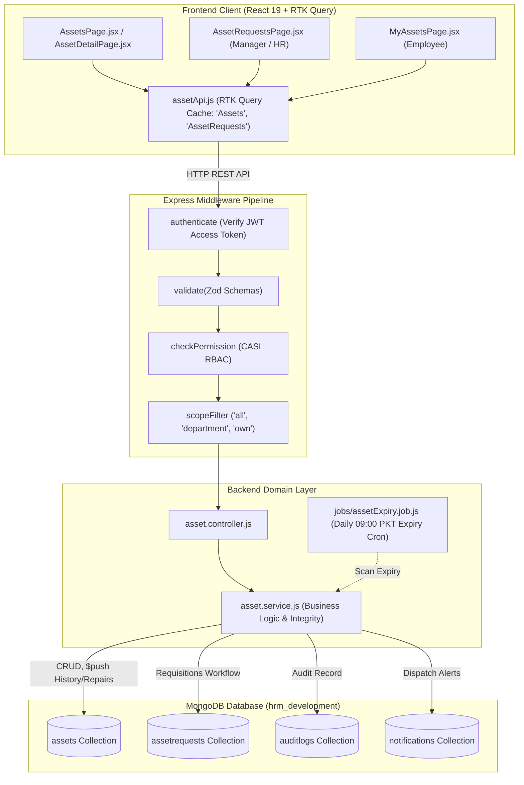
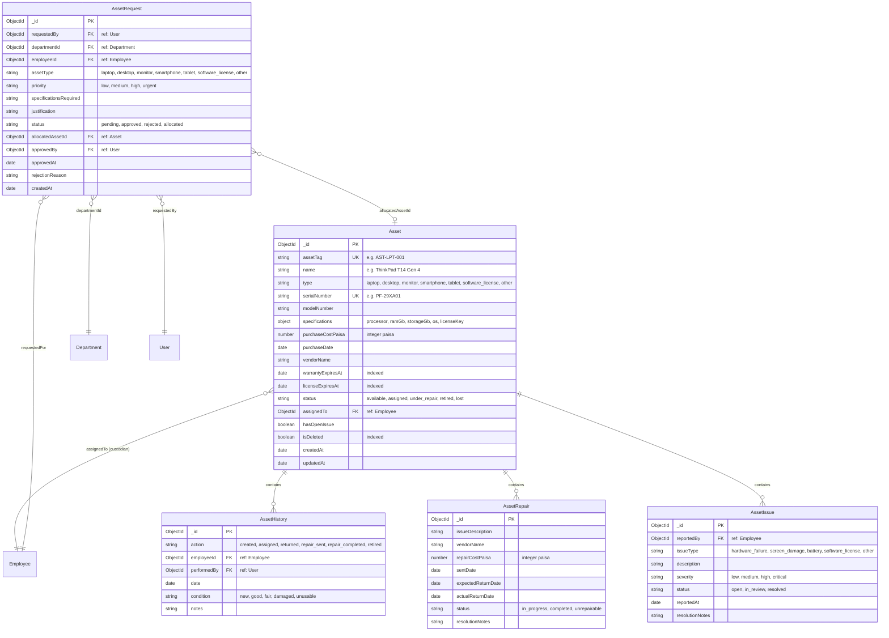
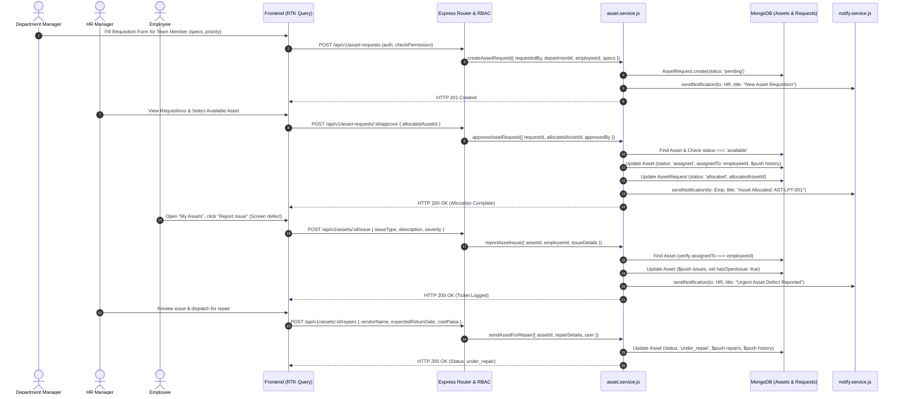

# Architecture Plan: Module M23 — Asset Management

**Module ID**: `M23`  
**Module Name**: `Asset Management`  
**Phase / Milestone**: `Phase 2: Smart Operations (Item 18)`  
**Plan Directory**: `.specify/specs/18-assets/plan.md`  
**Specification Reference**: [`.specify/specs/18-assets/spec.md`](file:///c:/Users/hamih/OneDrive/Desktop/AtoZ%20Coder/Advanced%20MERN/HRM/.specify/specs/18-assets/spec.md)  
**Target BUILD-GUIDE**: Section 20 (Rows 23.1 to 23.6)  

---

## 1. Technical Architecture & Component Tree

Per `docs/TECH-SPEC.md` Section 3, Section 5, and Section 8, the Asset Management module adheres to the strict 5-layer separation of concerns:
```
Client (RTK Query) 
  --> Routes (Express) 
  --> Middleware Pipeline (Auth, Validation, CASL RBAC, Scope Filter) 
  --> Controller (Input unpacking, Response envelope) 
  --> Service (Business rules, DB operations, Audit & Notifications) 
  --> Database (MongoDB Collections & Indexes)
```

### 1.1. Exact Files to Create / Modify

#### Backend Files
| File Path | Purpose |
| :--- | :--- |
| `backend/src/models/asset.model.js` | Mongoose schema for assets, including subdocuments: `history[]`, `repairs[]`, `issues[]`, unique indexes on `assetTag` and `serialNumber`. |
| `backend/src/models/assetRequest.model.js` | Mongoose schema for manager asset requisitions (`status: ['pending', 'approved', 'rejected', 'allocated']`). |
| `backend/src/modules/assets/asset.validation.js` | Zod validation schemas for asset creation, updates, assignment, return, repairs, issue reporting, and requisitions. |
| `backend/src/modules/assets/asset.service.js` | Business logic for inventory CRUD, assignment, return, repair transitions, issue logging, requisition approvals, and notifications. |
| `backend/src/modules/assets/asset.controller.js` | HTTP request handlers wrapping service calls in standard envelope `{ success, data, message, meta }`. |
| `backend/src/modules/assets/asset.routes.js` | Express route definitions with middleware chains (`authenticate`, `validate`, `checkPermission`). |
| `backend/src/jobs/assetExpiry.job.js` | Scheduled daily cron checking warranties and software licenses expiring within 30 days. |
| `backend/src/shared/permissions.js` | Module permissions definition (`asset.view`, `asset.create`, `asset.manage`, `asset.assign`, `asset.request`, `asset.issue`). |
| `backend/src/seed/roles.seed.js` | Core roles permission assignment across Super Admin, HR Manager, Department Manager, and Employee. |
| `backend/src/server.js` | Route mounting: `app.use('/api/v1/assets', assetRoutes)` and cron job startup. |

#### Frontend Files
| File Path | Purpose |
| :--- | :--- |
| `frontend/src/features/assets/assetApi.js` | RTK Query slice providing endpoints for assets and asset requests with tag cache invalidation (`['Assets', 'AssetRequests']`). |
| `frontend/src/features/assets/pages/AssetsPage.jsx` | Inventory management dashboard with status metrics, filter bar, search, and asset register table. |
| `frontend/src/features/assets/pages/AssetDetailPage.jsx` | Detailed asset overview, current custodian card, interactive history timeline, repair history, and open issue banner. |
| `frontend/src/features/assets/pages/AssetRequestsPage.jsx` | Requisitions review table for managers and HR with filter tabs, requisition modal, and allocation dialog. |
| `frontend/src/features/assets/pages/MyAssetsPage.jsx` | Employee self-service view listing currently assigned assets and "Report Issue" action modal. |
| `frontend/src/features/assets/components/AssetFormModal.jsx` | Modal dialog for registering or editing an asset (hardware specs, tag, serial, warranty, vendor). |
| `frontend/src/features/assets/components/AssetAssignModal.jsx` | Modal dialog to assign available asset to an active employee. |
| `frontend/src/features/assets/components/AssetReturnModal.jsx` | Modal dialog to return asset from custodian back to inventory with condition rating. |
| `frontend/src/features/assets/components/AssetRepairModal.jsx` | Modal dialog to log service repair details and vendor costs. |
| `frontend/src/features/assets/components/AssetIssueModal.jsx` | Employee modal dialog to report malfunctioning equipment. |
| `frontend/src/features/assets/components/AssetRequestModal.jsx` | Manager modal dialog to submit asset requisition for team members. |
| `frontend/src/components/layout/Sidebar.jsx` | Add "Assets" navigation section with "Asset Register", "Requisitions", and "My Assets". |
| `frontend/src/App.jsx` | Register routes `/assets`, `/assets/:id`, `/assets/requests`, `/assets/my` with `<ProtectedRoute>` and `<Can>` guards. |

#### Test Files
| File Path | Purpose |
| :--- | :--- |
| `backend/tests/m23.asset.e2e.test.js` | Comprehensive Vitest E2E test verifying rows 23.1 to 23.6 across all 4 roles. |
| `backend/tests/m23.asset.security.test.js` | Stress tests for privilege escalation, IDOR, NoSQL injection, and double-assignment race conditions. |

---

## 2. Archify & Mermaid Architecture Diagrams

### 2.1. Module Layer & Request Flow Diagram


---

### 2.2. Entity-Relationship Diagram (ERD)


---

### 2.3. Main Sequence Diagram: Requisition, Allocation & Defect Lifecycle


---

## 3. Database Schemas, Validation & Indexes Verification (MongoDB MCP)

From our live query via `mongodb` MCP on `hrm_development`:
- Database collections: `assets` and `assetrequests` will be newly created.
- **Indexes to enforce**:
  - `Asset`:
    - `{ assetTag: 1 }` (unique: true)
    - `{ serialNumber: 1 }` (unique: true)
    - `{ isDeleted: 1, status: 1 }` (compound query index)
    - `{ assignedTo: 1, isDeleted: 1 }` (custodian filter index)
    - `{ warrantyExpiresAt: 1 }` (sparse index for expiry cron)
    - `{ licenseExpiresAt: 1 }` (sparse index for license cron)
  - `AssetRequest`:
    - `{ departmentId: 1, status: 1 }`
    - `{ employeeId: 1 }`
    - `{ requestedBy: 1 }`
    - `{ status: 1 }`

---

## 4. Endpoint Specifications with CASL Permissions & Scopes

| Endpoint | Method | Permission Required | Allowed Scopes | Description |
| :--- | :--- | :--- | :--- | :--- |
| `/api/v1/assets` | `GET` | `asset.view` | `all`, `department` | List assets with search, filters (type, status), pagination. |
| `/api/v1/assets` | `POST` | `asset.create` | `all` | Register new hardware/software asset. |
| `/api/v1/assets/my` | `GET` | `asset.view` | `own` | Get assets assigned to currently authenticated employee. |
| `/api/v1/assets/:id` | `GET` | `asset.view` | `all`, `department`, `own` | Single asset profile, specifications, history timeline, repairs. |
| `/api/v1/assets/:id` | `PUT` | `asset.manage` | `all` | Update asset details, specifications, vendor info. |
| `/api/v1/assets/:id` | `DELETE` | `asset.manage` | `all` | Soft-delete asset (`isDeleted = true`). |
| `/api/v1/assets/:id/assign` | `POST` | `asset.assign` | `all` | Assign asset to employee; transition status to `'assigned'`. |
| `/api/v1/assets/:id/return` | `POST` | `asset.assign` | `all` | Return asset to inventory; transition status to `'available'`. |
| `/api/v1/assets/:id/repairs` | `POST` | `asset.manage` | `all` | Dispatch asset to repair vendor; status `'under_repair'`. |
| `/api/v1/assets/:id/repairs/:repairId` | `PATCH` | `asset.manage` | `all` | Complete repair maintenance; restore status to `'available'`. |
| `/api/v1/assets/:id/issue` | `POST` | `asset.issue` | `own` | Employee reports hardware malfunction/defect. |
| `/api/v1/asset-requests` | `GET` | `asset.request` | `all`, `department` | Query asset requisitions (Dept Manager filtered to team; HR sees all). |
| `/api/v1/asset-requests` | `POST` | `asset.request` | `department`, `all` | Requisition asset for an employee in actor's department. |
| `/api/v1/asset-requests/:id/approve` | `POST` | `asset.manage` | `all` | Approve requisition and allocate an available asset. |
| `/api/v1/asset-requests/:id/reject` | `POST` | `asset.manage` | `all` | Reject requisition with mandatory reason note. |

---

## 5. Permissions Registration Steps

1. In `backend/src/shared/permissions.js`:
   Add the `assets` module definition under `PERMISSIONS_CATALOGUE`:
   ```javascript
   {
     module: 'assets',
     label: 'Asset Management',
     subject: 'Asset',
     description: 'Company hardware and software asset registry, assignment, repair, and requisitions.',
     actions: [
       { action: 'asset.view', label: 'View Assets', description: 'View company assets inventory and personal custody.', allowedScopes: ['own', 'department', 'all'], defaultScope: 'own' },
       { action: 'asset.create', label: 'Register Assets', description: 'Create new hardware and software assets.', allowedScopes: ['all'], defaultScope: 'all' },
       { action: 'asset.manage', label: 'Manage Assets & Repairs', description: 'Update, soft delete, repair, and approve requisitions.', allowedScopes: ['all'], defaultScope: 'all' },
       { action: 'asset.assign', label: 'Assign & Recover Assets', description: 'Assign assets to employees and process returns.', allowedScopes: ['all'], defaultScope: 'all' },
       { action: 'asset.request', label: 'Requisition Assets', description: 'Request hardware/software for department team members.', allowedScopes: ['own', 'department', 'all'], defaultScope: 'department' },
       { action: 'asset.issue', label: 'Report Asset Issue', description: 'Submit defect and damage tickets on assigned assets.', allowedScopes: ['own'], defaultScope: 'own' }
     ]
   }
   ```
2. In `backend/src/seed/roles.seed.js`:
   Assign actions to the 4 system roles:
   - **Super Admin**: `asset.view` (`all`), `asset.create` (`all`), `asset.manage` (`all`), `asset.assign` (`all`), `asset.request` (`all`), `asset.issue` (`own`).
   - **HR Manager**: `asset.view` (`all`), `asset.create` (`all`), `asset.manage` (`all`), `asset.assign` (`all`), `asset.request` (`all`), `asset.issue` (`own`).
   - **Department Manager**: `asset.view` (`department`), `asset.request` (`department`), `asset.issue` (`own`).
   - **Employee**: `asset.view` (`own`), `asset.issue` (`own`).

