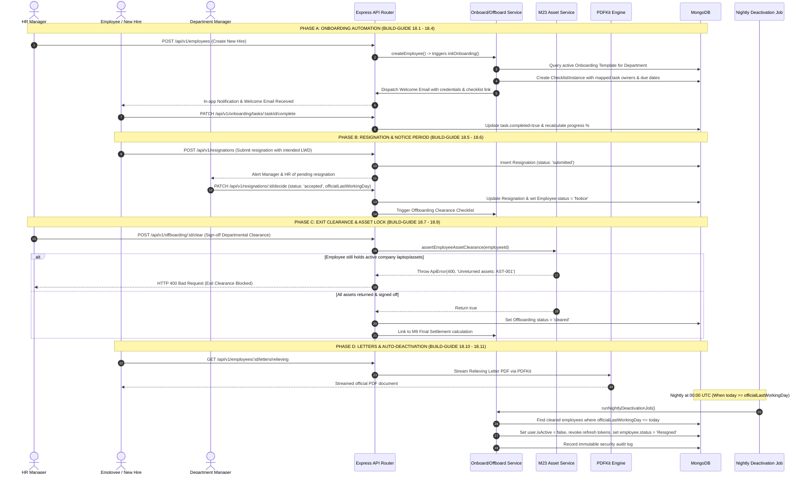

# Implementation Plan: Module M18 — Onboarding & Offboarding

**Feature Branch**: `feature/19-onboarding-offboarding`  
**Date**: 2026-11-01  
**Spec Reference**: [`.specify/specs/19-onboarding-offboarding/spec.md`](file:///c:/Users/hamih/OneDrive/Desktop/AtoZ%20Coder/Advanced%20MERN/HRM/.specify/specs/19-onboarding-offboarding/spec.md)  
**Target BUILD-GUIDE**: Section 21 (Rows 18.1 to 18.11)  
**Functional Requirements**: `docs/FRD.md` Section M18 & Permission Matrix Row 406  
**Technical Architecture**: `docs/TECH-SPEC.md` Sections 3, 4, 5, 6, 8 and `docs/MODULES.md`  

---

## 1. Architectural Summary & System Context

Module M18 governs the complete entry and exit lifecycle of the workforce. It provides automated operational orchestration across departments:
- **Onboarding Pipeline**: Triggered automatically on employee creation (M3 Row 3.2), instantiating department-specific checklist tasks for IT provisioning, HR compliance, orientation, and manager introduction.
- **Offboarding Pipeline**: Governs resignation submission, manager/executive decision workflows, notice period tracking, departmental handover clearance, mandatory company asset recovery (guarded by M23 `assertEmployeeAssetClearance`), confidential exit interviews, integration with M9 final payroll settlements, automated PDF generation of Relieving and Experience letters via `PDFKit`, and automated scheduled account deactivation on the employee's `lastWorkingDay`.

### Technical Context & Runtime Constants
- **Language**: JavaScript (ES Modules, Node.js 22+, React 18, Vite). Strictly NO TypeScript.
- **Databases**: MongoDB (Mongoose ODM) with replica set transactions for multi-document clearance updates; Redis / BullMQ for scheduled task notifications and nightly deactivation jobs.
- **Document Generation**: `pdfkit` dynamic memory streaming directly to Express response headers (`Content-Type: application/pdf`).
- **Validation**: `zod` schemas for strict runtime payload and route parameter integrity.
- **Security & RBAC**: Dynamic CASL ability evaluation with horizontal PBAC scoping (`own`, `department`, `all`).

---

## 2. Archify & Mermaid Architecture Diagrams

### 2.1 Module Request & Middleware Lifecycle Flow
Visualizes request traversal through security headers, JWT extraction, CASL authorization, Zod schema validation, service domain execution, and persistence.

```mermaid
flowchart TD
    Client["Client (Browser / React RTK Query)"] -->|HTTP Request with Bearer Token| Express["Express Router /api/v1/*"]
    
    subgraph Middleware Pipeline
        Express --> Auth["authenticate (JWT Bearer Verification)"]
        Auth --> Perm["checkPermission(action, subjectScope)"]
        Perm -->|403 Forbidden if unauthorized| PermDeny["Reject HTTP 403"]
        Perm -->|Authorized| Val["validate(zodSchema)"]
        Val -->|400 Bad Request if invalid payload/params| ValDeny["Reject HTTP 400"]
    end

    Val -->|Validated & Authorized Payload| Controller["Onboarding / Resignation Controller"]
    
    subgraph Service Layer (Domain Logic)
        Controller --> Service["Onboarding / Offboarding Service"]
        Service --> Audit["recordAuditLog()"]
        Service --> Notify["notify() (Socket.io + Email + In-App)"]
        Service --> AssetGuard["assertEmployeeAssetClearance() (M23)"]
        Service --> PDFEngine["PDFKit Document Stream Engine"]
    end

    subgraph Persistence & Infrastructure
        Service --> MongoDB[("MongoDB Atlas (hrm_development)")]
        Service --> CronJob["Node-Cron / BullMQ (Nightly Deactivation)"]
        PDFEngine -->|Binary Stream| Client
    end
```

---

### 2.2 Entity Relationship Diagram (ERD)
Illustrates collections, subdocuments, references, unique keys, and relationship cardinalities for Module M18.

```mermaid
erDiagram
    DEPARTMENT ||--o{ CHECKLIST_TEMPLATE : "filters by"
    CHECKLIST_TEMPLATE ||--o{ CHECKLIST_INSTANCE : "instantiates"
    EMPLOYEE ||--o{ CHECKLIST_INSTANCE : "assigned to"
    USER ||--o{ CHECKLIST_TASK : "owned by"
    
    EMPLOYEE ||--o{ RESIGNATION : "submits"
    RESIGNATION ||--o| EXIT_INTERVIEW : "contains"
    EMPLOYEE ||--o{ ASSET : "holds equipment (M23)"

    CHECKLIST_TEMPLATE {
        ObjectId _id PK
        string name UK
        string type "onboarding | offboarding"
        ObjectId departmentId FK "nullable"
        array tasks "embedded subdocuments"
        boolean isActive
        ObjectId createdBy FK
        Date createdAt
    }

    CHECKLIST_INSTANCE {
        ObjectId _id PK
        ObjectId employeeId FK
        ObjectId templateId FK
        string type "onboarding | offboarding"
        string status "pending | in_progress | completed | cancelled"
        number progressPercent "0 to 100"
        Date startDate
        Date completedDate
        array tasks "embedded subdocuments"
        boolean isDeleted
        Date createdAt
    }

    CHECKLIST_TASK {
        ObjectId _id PK
        string title
        string description
        string category "it | hr | department | finance | admin"
        string roleAssignee "employee | manager | hr | it_admin"
        ObjectId ownerId FK
        Date dueDate
        boolean completed
        Date completedAt
        ObjectId completedBy FK
        string notes
    }

    RESIGNATION {
        ObjectId _id PK
        ObjectId employeeId FK
        Date submissionDate
        Date intendedLastWorkingDay
        Date officialLastWorkingDay
        string reason "enum"
        string comments
        string status "submitted | accepted | rejected | withdrawn"
        ObjectId decidedBy FK
        Date decidedAt
        string rejectionReason
        number noticePeriodDays
        ObjectId handoverEmployeeId FK
        boolean isDeleted
        Date createdAt
    }

    EXIT_INTERVIEW {
        ObjectId _id PK
        ObjectId employeeId FK
        ObjectId resignationId FK UK
        Date submittedAt
        object ratings "culture, mgmt, comp, growth, wlb"
        string primaryReason
        string feedbackManagement
        string feedbackCompany
        boolean wouldRecommend
        boolean isConfidential
    }
```

---

### 2.3 Main End-to-End Sequence Diagram (The Lifecycle Flow)
Covers Employee Creation &rarr; Auto-Checklist Generation &rarr; Task Execution &rarr; Resignation Submission &rarr; Decision & Notice &rarr; Asset Clearance Lock &rarr; Letter PDF Generation &rarr; Scheduled Deactivation.



---

## 3. Exact Files Directory Layout

### 3.1 Backend Files (`backend/`)
```text
backend/src/
├── models/
│   ├── checklistTemplate.model.js       # Template schema for onboarding & offboarding
│   ├── checklist.model.js               # Active checklist instance with task subdocs
│   ├── resignation.model.js             # Resignation workflow schema & notice tracking
│   └── exitInterview.model.js           # Confidential exit questionnaire & ratings
├── modules/
│   └── onboarding/
│       ├── onboarding.validation.js     # Zod schemas for templates, tasks, resignations, clearance
│       ├── onboarding.service.js        # Core domain business logic, clearance hooks, PDF rendering
│       ├── onboarding.controller.js     # Express request/response envelope handlers
│       └── onboarding.routes.js         # Protected API routes with authenticate -> checkPermission -> validate
├── jobs/
│   └── deactivate.job.js                # Nightly cron scanner deactivating departed employees
└── shared/
    └── permissions.js                   # Adds onboard.view, onboard.manage, offboard.view, offboard.manage, resignation.submit
```

### 3.2 Frontend Files (`frontend/`)
```text
frontend/src/
├── features/
│   └── onboarding/
│       ├── onboardingApi.js             # RTK Query API endpoints, mutations & cache invalidation
│       ├── pages/
│       │   ├── ChecklistTemplatesPage.jsx # HR management of onboarding/offboarding templates
│       │   ├── OnboardingPage.jsx       # Real-time dashboard of active employee onboardings
│       │   ├── MyTasksPage.jsx          # Self-service assigned task list ordered by due date
│       │   ├── ResignationPage.jsx      # Employee resignation submit & manager review queue
│       │   └── OffboardingPage.jsx      # Departmental exit clearance checklist & asset recovery
│       └── components/
│           ├── ChecklistTemplateModal.jsx # Template authoring & task item builder modal
│           ├── ResignationModal.jsx     # Resignation submission & decision dialog
│           ├── ExitClearanceModal.jsx   # Multi-department sign-off dialog with asset lock
│           ├── ExitInterviewModal.jsx   # Confidential exit survey form
│           └── LettersModal.jsx         # Download Experience & Relieving letter dialog
└── components/
    └── layout/
        └── Sidebar.jsx                  # Adds "Onboarding" & "Offboarding" navigation links
```

### 3.3 Test Files (`backend/tests/`)
```text
backend/tests/
├── m18.onboarding.e2e.test.js           # Multi-role functional test suite for rows 18.1 to 18.11
└── m18.onboarding.security.test.js      # Adversarial security, PBAC scoping, asset locks & IDOR
```

---

## 4. Database Schema Specifications & Indexes

### 4.1 Collection: `checklisttemplates`
- **Model**: [`checklistTemplate.model.js`](file:///c:/Users/hamih/OneDrive/Desktop/AtoZ%20Coder/Advanced%20MERN/HRM/backend/src/models/checklistTemplate.model.js)
- **Indexes**:
  - `{ name: 1 }` (unique, `isDeleted: false`)
  - `{ type: 1, departmentId: 1 }`
- **Validation Rules**:
  - `name`: String, trimmed, min 3, max 100
  - `type`: String, enum: `['onboarding', 'offboarding']`
  - `departmentId`: ObjectId ref `Department`, optional/nullable
  - `tasks`: Array of task definitions `{ title, description, category, roleAssignee, dueDaysOffset, isMandatory }`

### 4.2 Collection: `checklists`
- **Model**: [`checklist.model.js`](file:///c:/Users/hamih/OneDrive/Desktop/AtoZ%20Coder/Advanced%20MERN/HRM/backend/src/models/checklist.model.js)
- **Indexes**:
  - `{ employeeId: 1, type: 1 }`
  - `{ status: 1 }`
  - `{ 'tasks.ownerId': 1, 'tasks.completed': 1 }`
  - `{ 'tasks.dueDate': 1 }`
- **Validation Rules**:
  - `employeeId`: ObjectId ref `Employee`, required
  - `type`: Enum `['onboarding', 'offboarding']`
  - `status`: Enum `['pending', 'in_progress', 'completed', 'cancelled']`
  - `progressPercent`: Number between 0 and 100

### 4.3 Collection: `resignations`
- **Model**: [`resignation.model.js`](file:///c:/Users/hamih/OneDrive/Desktop/AtoZ%20Coder/Advanced%20MERN/HRM/backend/src/models/resignation.model.js)
- **Indexes**:
  - `{ employeeId: 1, status: 1 }`
  - `{ submissionDate: -1 }`
  - `{ officialLastWorkingDay: 1 }`
- **Validation Rules**:
  - `employeeId`: ObjectId ref `Employee`, required
  - `intendedLastWorkingDay`: Date, required
  - `officialLastWorkingDay`: Date, optional
  - `status`: Enum `['submitted', 'accepted', 'rejected', 'withdrawn']`
  - `reason`: String, enum: `['better_opportunity', 'career_change', 'higher_education', 'personal_reasons', 'relocation', 'health_reasons', 'other']`

### 4.4 Collection: `exitinterviews`
- **Model**: [`exitInterview.model.js`](file:///c:/Users/hamih/OneDrive/Desktop/AtoZ%20Coder/Advanced%20MERN/HRM/backend/src/models/exitInterview.model.js)
- **Indexes**:
  - `{ resignationId: 1 }` (unique)
  - `{ employeeId: 1 }`
- **Validation Rules**:
  - `ratings`: Object `{ cultureRating, managementRating, compensationRating, workLifeBalanceRating, careerGrowthRating }` (each 1-5 integer)
  - `primaryReason`: String, trimmed, min 3, max 200

---

## 5. API Route Contracts & Permission Mapping

All routes are mounted under `/api/v1/onboarding`, `/api/v1/resignations`, and `/api/v1/offboarding`.

| Route | Method | Required Permission | Allowed Scopes | Description |
|---|---|---|---|---|
| `/api/v1/onboarding/templates` | `GET` | `onboard.view` | `department`, `all` | List checklist templates |
| `/api/v1/onboarding/templates` | `POST` | `onboard.manage` | `all` | Create checklist template |
| `/api/v1/onboarding/templates/:id` | `PUT` | `onboard.manage` | `all` | Update template definition |
| `/api/v1/onboarding/templates/:id` | `DELETE` | `onboard.manage` | `all` | Soft-delete template |
| `/api/v1/onboarding` | `GET` | `onboard.view` | `team`, `department`, `all` | List active onboarding instances |
| `/api/v1/onboarding/:id` | `GET` | `onboard.view` | `own`, `team`, `department`, `all` | Single onboarding progress & tasks |
| `/api/v1/onboarding/tasks/my` | `GET` | `onboard.view` | `own` | List tasks assigned to current user |
| `/api/v1/onboarding/tasks/:taskId/complete`| `PATCH` | `onboard.view` | `own`, `all` | Mark task completed |
| `/api/v1/onboarding/:id/welcome-email` | `POST` | `onboard.manage` | `all` | Manually re-dispatch welcome email |
| `/api/v1/resignations` | `POST` | `resignation.submit` | `own` | Employee submits resignation |
| `/api/v1/resignations` | `GET` | `offboard.view` | `team`, `department`, `all` | List pending/accepted resignations |
| `/api/v1/resignations/:id/decide` | `PATCH` | `offboard.manage` | `department`, `all` | Accept or reject resignation & set LWD |
| `/api/v1/offboarding` | `GET` | `offboard.view` | `team`, `department`, `all` | List exit clearance checklists |
| `/api/v1/offboarding/:id/clear` | `POST` | `offboard.manage` | `all` | Sign-off final clearance (Asset Lock) |
| `/api/v1/exit-interviews` | `POST` | `offboard.view` | `own` | Submit confidential exit survey |
| `/api/v1/exit-interviews/:resignationId` | `GET` | `offboard.manage` | `all` | HR inspects exit survey responses |
| `/api/v1/employees/:id/letters/:type` | `GET` | `offboard.view` | `own`, `all` | Stream Experience / Relieving PDF |

---

## 6. Permissions Catalogue Additions (`shared/permissions.js`)

Add the following domain entry under `PERMISSIONS_CATALOGUE`:

```javascript
{
  module: 'onboarding',
  label: 'Onboarding & Offboarding Lifecycle',
  subject: 'Checklist',
  description: 'Employee onboarding checklists, task assignments, resignations, exit clearances, and service letters.',
  actions: [
    {
      action: 'onboard.view',
      label: 'View Onboarding Checklists',
      description: 'View active onboarding workflows, checklist items, and assigned tasks.',
      allowedScopes: ['own', 'team', 'department', 'all'],
      defaultScope: 'own'
    },
    {
      action: 'onboard.manage',
      label: 'Manage Onboarding Templates & Orchestration',
      description: 'Create checklist templates, assign tasks, and trigger welcome emails.',
      allowedScopes: ['all'],
      defaultScope: 'all'
    },
    {
      action: 'resignation.submit',
      label: 'Submit Resignation',
      description: 'Submit formal resignation with proposed last working day and transition notes.',
      allowedScopes: ['own'],
      defaultScope: 'own'
    },
    {
      action: 'offboard.view',
      label: 'View Offboarding & Resignations',
      description: 'Inspect employee resignations, exit checklists, and clearance status.',
      allowedScopes: ['own', 'team', 'department', 'all'],
      defaultScope: 'own'
    },
    {
      action: 'offboard.manage',
      label: 'Manage Offboarding, Decisions & Letters',
      description: 'Accept resignations, approve exit clearances, and generate relieving letters.',
      allowedScopes: ['department', 'all'],
      defaultScope: 'department'
    }
  ]
}
```

---

## 7. Implementation & Verification Checklist

- [ ] Add M18 permissions to `backend/src/shared/permissions.js` and update default roles in `backend/src/seed/roles.seed.js`.
- [ ] Create models: `checklistTemplate.model.js`, `checklist.model.js`, `resignation.model.js`, `exitInterview.model.js`.
- [ ] Create Zod schemas in `onboarding.validation.js` with 24-character hexadecimal ObjectId regex refinements.
- [ ] Implement `onboarding.service.js` with cross-module hooks (`assertEmployeeAssetClearance` for asset lock, `generateLetterStream` for PDFKit).
- [ ] Implement `onboarding.controller.js` and mount `onboarding.routes.js` in `backend/src/app.js`.
- [ ] Implement background job `jobs/deactivate.job.js` and mount in `server.js`.
- [ ] Build frontend RTK Query API `onboardingApi.js` and 5 pages with responsive shadcn modals.
- [ ] Add navigation links in `Sidebar.jsx` and routes in `App.jsx`.
- [ ] Run automated multi-role test suite verifying rows 18.1 to 18.11.

