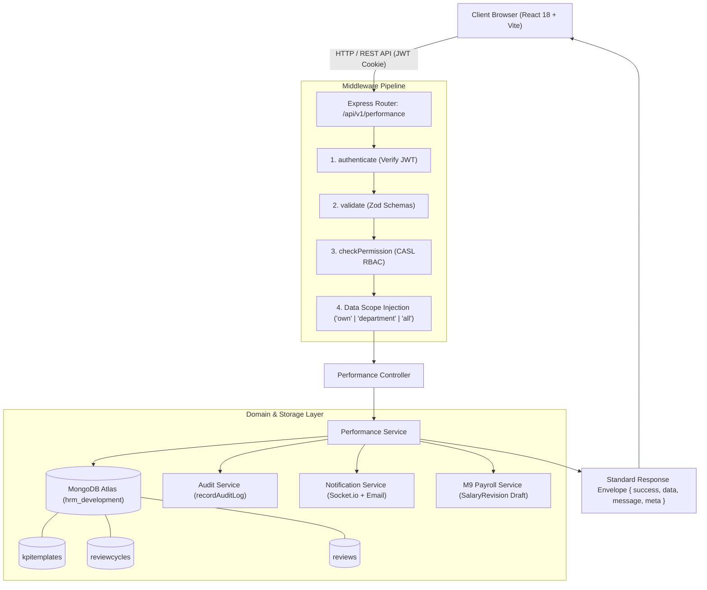
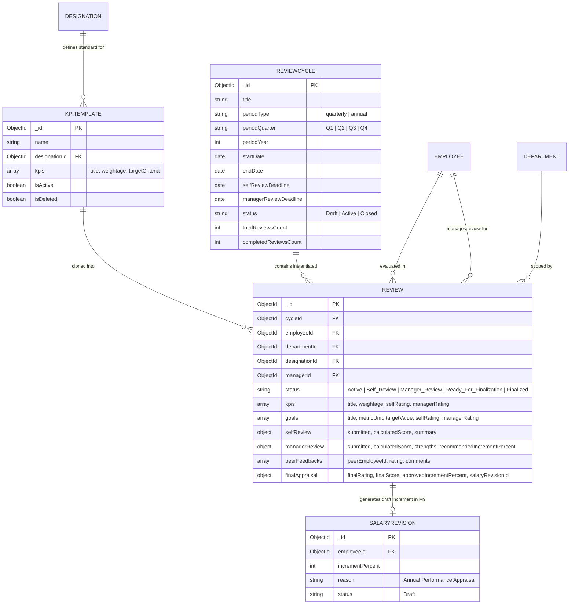
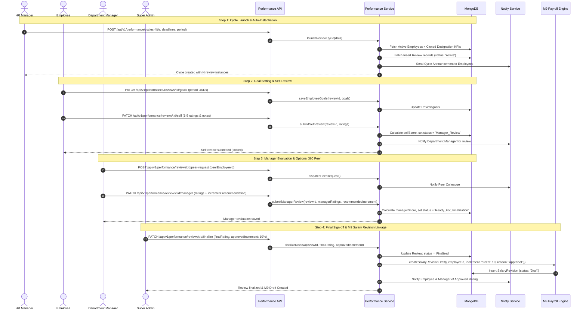

# Architecture & Implementation Plan: Module M19 — Performance & Appraisal

**Feature**: Module M19 — Performance & Appraisal  
**Spec Directory**: `.specify/specs/20-performance-appraisal/`  
**Git Branch**: `feature/20-performance-appraisal`  
**Target BUILD-GUIDE**: Section 22 (Rows 19.1 to 19.9)  
**Target Architecture**: `docs/TECH-SPEC.md` Sections 3, 4, 5, 6, 8 & `docs/MODULES.md` M19  
**Execution Standard**: JavaScript ES Modules only (`.js`, `.jsx`). No TypeScript. Strict compliance with Ponytail 7-Rung Ladder.

---

## 1. System Architecture & Request Lifecycle

Following `docs/TECH-SPEC.md` Section 8, all requests for Performance & Appraisal flow through a strict unidirectional lifecycle:
```
Client (Web / Mobile)
   │
   ▼ (HTTP / JSON with httpOnly JWT Cookie)
Express Router (`performance.routes.js`)
   │
   ├──▶ 1. `authenticate`: Verifies JWT access token, loads `req.user`
   ├──▶ 2. `validate(schema)`: Validates body, query, and params with Zod
   ├──▶ 3. `checkPermission(action, subject)`: CASL-based PBAC authorization
   ├──▶ 4. Scope Injection (`req.dataScope` = 'own' | 'department' | 'all')
   │
   ▼
Controller (`performance.controller.js`)
   │ Parses inputs, passes `user`, `dataScope`, and payloads to service
   ▼
Domain Service (`performance.service.js`)
   │ Business logic, transaction orchestration, score calculation, audit logging
   ├──▶ MongoDB (`KpiTemplate`, `ReviewCycle`, `Review`, `Employee`, `AuditLog`)
   ├──▶ Redis Cache (cycle progress and active review counters)
   └──▶ External Cross-Module Links:
          ├── M8 Socket.io Notification Service (`notify.service.js`)
          └── M9 Payroll Service (`salaryRevision` draft injection)
   │
   ▼
Standard Response Envelope (`{ success: true, data, message, meta }`)
```

---

## 2. Exact Files & Directory Structure

All files adhere strictly to `.js` and `.jsx`:

### Backend Files (`backend/src/`)
```
backend/
├── src/
│   ├── models/
│   │   ├── kpiTemplate.model.js           # M19: Master KPI template per designation
│   │   ├── reviewCycle.model.js           # M19: Quarterly / Annual review cycle orchestrator
│   │   └── review.model.js                # M19: Individual employee review instance & scoring
│   ├── modules/
│   │   └── performance/
│   │       ├── performance.validation.js  # Zod schemas for templates, cycles, goals, reviews
│   │       ├── performance.service.js     # Core business logic, scoring, and M9 linkage
│   │       ├── performance.controller.js  # Request handlers and response envelope
│   │       └── performance.routes.js      # Protected REST API endpoints with PBAC guards
│   ├── shared/
│   │   └── permissions.js                 # Add performance.* permission catalogue definitions
│   ├── seed/
│   │   └── roles.seed.js                  # Grant performance permissions to default 4 roles
│   └── app.js                             # Mount /api/v1/performance routes
└── tests/
    └── m19.performance.e2e.test.js        # Comprehensive Vitest multi-role E2E test suite
```

### Frontend Files (`frontend/src/`)
```
frontend/
├── src/
│   ├── features/
│   │   └── performance/
│   │       ├── performanceApi.js          # RTK Query API slice with precise tag invalidations
│   │       ├── pages/
│   │       │   ├── KpiTemplatesPage.jsx   # HR/Admin: Designation-wise KPI templates CRUD
│   │       │   ├── ReviewCyclesPage.jsx   # HR/Admin: Cycle orchestrator & progress dashboard
│   │       │   ├── MyReviewPage.jsx       # Employee: Personal goals & self-review evaluation
│   │       │   ├── TeamReviewsPage.jsx    # Manager: Subordinates appraisal queue & ratings
│   │       │   └── CycleProgressPage.jsx  # HR: Cycle completion tracking & pending list
│   │       └── components/
│   │           ├── KpiTemplateModal.jsx   # Modal for authoring KPI items with 100% weightage check
│   │           ├── ReviewCycleModal.jsx   # Modal for launching quarterly/annual cycle
│   │           ├── GoalsEditor.jsx        # Component for defining and editing period OKRs/goals
│   │           ├── ManagerReviewModal.jsx # Manager rating slider/inputs (1-5 scale) & notes
│   │           ├── PeerFeedbackModal.jsx  # 360 peer feedback questionnaire modal
│   │           └── FinalizeReviewModal.jsx# Super Admin/HR final score approval & M9 increment dialog
│   ├── components/
│   │   └── layout/
│   │       └── Sidebar.jsx                # Navigation links under "Performance" category
│   └── App.jsx                            # Route declarations for performance pages
```

---

## 3. Database Schema, Validation & Indexes (Verified via MongoDB MCP)

### 3.1 `KpiTemplate` (`backend/src/models/kpiTemplate.model.js`)
- **Collection**: `kpitemplates`
- **Fields**:
  - `name`: `String`, required, trimmed (e.g. "Senior Frontend Engineer Core KPIs")
  - `designationId`: `ObjectId`, ref: `'Designation'`, required
  - `description`: `String`, trimmed
  - `kpis`: Array of subdocuments:
    - `title`: `String`, required, trimmed
    - `description`: `String`, trimmed
    - `weightage`: `Number`, required, min: 1, max: 100
    - `targetCriteria`: `String`, required
  - `isActive`: `Boolean`, default: `true`
  - `createdBy`: `ObjectId`, ref: `'User'`, required
  - `isDeleted`: `Boolean`, default: `false`
- **Indexes**:
  - `{ name: 1, designationId: 1, isDeleted: 1 }` (Unique compound index)
  - `{ designationId: 1, isDeleted: 1 }`

### 3.2 `ReviewCycle` (`backend/src/models/reviewCycle.model.js`)
- **Collection**: `reviewcycles`
- **Fields**:
  - `title`: `String`, required, trimmed (e.g. "2026 Q3 Performance Appraisal")
  - `periodType`: `String`, enum: `['quarterly', 'annual']`, required
  - `periodQuarter`: `String`, enum: `['Q1', 'Q2', 'Q3', 'Q4', 'None']`, default: `'None'`
  - `periodYear`: `Number`, required
  - `startDate`: `Date`, required
  - `endDate`: `Date`, required
  - `selfReviewDeadline`: `Date`, required
  - `managerReviewDeadline`: `Date`, required
  - `status`: `String`, enum: `['Draft', 'Active', 'Closed']`, default: `'Draft'`
  - `totalReviewsCount`: `Number`, default: 0
  - `completedReviewsCount`: `Number`, default: 0
  - `createdBy`: `ObjectId`, ref: `'User'`, required
  - `isDeleted`: `Boolean`, default: `false`
- **Indexes**:
  - `{ title: 1, periodYear: 1, isDeleted: 1 }` (Unique compound index)
  - `{ status: 1 }`

### 3.3 `Review` (`backend/src/models/review.model.js`)
- **Collection**: `reviews`
- **Fields**:
  - `cycleId`: `ObjectId`, ref: `'ReviewCycle'`, required
  - `employeeId`: `ObjectId`, ref: `'Employee'`, required
  - `departmentId`: `ObjectId`, ref: `'Department'`, required
  - `designationId`: `ObjectId`, ref: `'Designation'`, required
  - `managerId`: `ObjectId`, ref: `'Employee'` (or User), required
  - `status`: `String`, enum: `['Active', 'Self_Review', 'Manager_Review', 'Ready_For_Finalization', 'Finalized', 'Cancelled']`, default: `'Active'`
  - `kpis`: Array of subdocuments:
    - `title`: `String`, required
    - `description`: `String`
    - `weightage`: `Number`, required
    - `targetCriteria`: `String`
    - `selfRating`: `Number`, min: 1, max: 5
    - `selfComments`: `String`, max: 1000
    - `managerRating`: `Number`, min: 1, max: 5
    - `managerComments`: `String`, max: 1000
  - `goals`: Array of subdocuments:
    - `title`: `String`, required
    - `description`: `String`
    - `targetValue`: `String`
    - `metricUnit`: `String`
    - `weightage`: `Number`, default: 0
    - `selfRating`: `Number`, min: 1, max: 5
    - `selfComments`: `String`, max: 1000
    - `managerRating`: `Number`, min: 1, max: 5
    - `managerComments`: `String`, max: 1000
  - `selfReview`:
    - `submitted`: `Boolean`, default: `false`
    - `submittedAt`: `Date`
    - `overallSummary`: `String`, max: 2000
    - `calculatedScore`: `Number`, default: 0
  - `managerReview`:
    - `submitted`: `Boolean`, default: `false`
    - `submittedAt`: `Date`
    - `strengths`: `String`, max: 2000
    - `improvements`: `String`, max: 2000
    - `recommendedIncrementPercent`: `Number`, min: 0, max: 100, default: 0
    - `recommendationNotes`: `String`, max: 1000
    - `calculatedScore`: `Number`, default: 0
  - `peerFeedbacks`: Array of subdocuments:
    - `peerEmployeeId`: `ObjectId`, ref: `'Employee'`
    - `requestedBy`: `ObjectId`, ref: `'User'`
    - `requestedAt`: `Date`
    - `submitted`: `Boolean`, default: `false`
    - `submittedAt`: `Date`
    - `rating`: `Number`, min: 1, max: 5
    - `comments`: `String`, max: 1000
  - `finalAppraisal`:
    - `finalRating`: `Number`, min: 1, max: 5
    - `finalScore`: `Number`
    - `finalComments`: `String`, max: 2000
    - `approvedIncrementPercent`: `Number`, min: 0, max: 100
    - `finalizedBy`: `ObjectId`, ref: `'User'`
    - `finalizedAt`: `Date`
    - `salaryRevisionId`: `ObjectId`, ref: `'SalaryRevision'`
  - `isDeleted`: `Boolean`, default: `false`
- **Indexes**:
  - `{ cycleId: 1, employeeId: 1, isDeleted: 1 }` (Unique compound index)
  - `{ employeeId: 1, status: 1 }`
  - `{ departmentId: 1, status: 1 }`
  - `{ managerId: 1, status: 1 }`
  - `{ cycleId: 1, status: 1 }`

---

## 4. API Endpoints, PBAC Permissions & Scope Matrix

All endpoints prefix: `/api/v1/performance`

| Method | Endpoint | Description | Permission Name | Scope Required |
| :--- | :--- | :--- | :--- | :--- |
| `GET` | `/templates` | List KPI master templates | `performance.template.view` | `all` |
| `POST` | `/templates` | Create KPI master template | `performance.template.manage` | `all` |
| `GET` | `/templates/:id` | Get single KPI template | `performance.template.view` | `all` |
| `PUT` | `/templates/:id` | Update KPI master template | `performance.template.manage` | `all` |
| `DELETE` | `/templates/:id` | Soft-delete KPI template | `performance.template.manage` | `all` |
| `GET` | `/cycles` | List appraisal review cycles | `performance.cycle.view` | `all` |
| `POST` | `/cycles` | Launch cycle & auto-instantiate reviews | `performance.cycle.manage` | `all` |
| `GET` | `/cycles/:id` | Get cycle details & configuration | `performance.cycle.view` | `all` |
| `PATCH` | `/cycles/:id/status` | Update cycle status (`Active`/`Closed`) | `performance.cycle.manage` | `all` |
| `GET` | `/cycles/:id/progress` | Review cycle completion metrics | `performance.cycle.manage` | `all` |
| `GET` | `/reviews` | Scoped list of appraisal reviews | `performance.review.view` | `own` / `department` / `all` |
| `GET` | `/reviews/:id` | Get individual review instance | `performance.review.view` | `own` / `department` / `all` |
| `PATCH` | `/reviews/:id/goals` | Add or update period OKRs/goals | `performance.review.submit` | `own` / `department` |
| `PATCH` | `/reviews/:id/self` | Submit self-review ratings & notes | `performance.review.submit` | `own` |
| `PATCH` | `/reviews/:id/manager` | Submit manager ratings & increment | `performance.review.submit` | `department` |
| `POST` | `/reviews/:id/peer-request` | Request 360° peer evaluation | `performance.peer.manage` | `department` / `all` |
| `POST` | `/peer-feedback/:requestId` | Peer submits qualitative feedback | `performance.peer.manage` | `own` |
| `PATCH` | `/reviews/:id/finalize` | Final sign-off & M9 salary revision | `performance.review.finalize` | `all` |
| `GET` | `/employees/:id/history` | Historical appraisal timeline | `performance.review.view` | `own` / `department` / `all` |

---

## 5. Architectural Mermaid Diagrams

### 5.1 Architecture & Flow Diagram


### 5.2 Entity-Relationship Diagram (ERD)


### 5.3 Main Sequence Diagram: Complete Appraisal Lifecycle & Payroll Linkage


---

## 6. Implementation Verification Plan

1. **Unit & Calculation Invariants**:
   - KPI weightage must sum to 100%.
   - Weighted score formula: `Sum(rating * weightage) / 100` yielding normalized 1.0–5.0 scale.
2. **Horizontal Scoping Assertion**:
   - Super Admin/HR see all reviews.
   - Department Manager sees only department subordinates (`departmentId == user.departmentId`).
   - Employee sees only own reviews (`employeeId == user.employeeId`).
3. **M9 Payroll Integration**:
   - Finalizing with `approvedIncrementPercent > 0` directly instantiates a draft salary revision linked to the employee's existing base salary.
4. **E2E Automated Test Suite**:
   - `backend/tests/m19.performance.e2e.test.js` validating all 9 BUILD-GUIDE rows across all 4 system roles.

