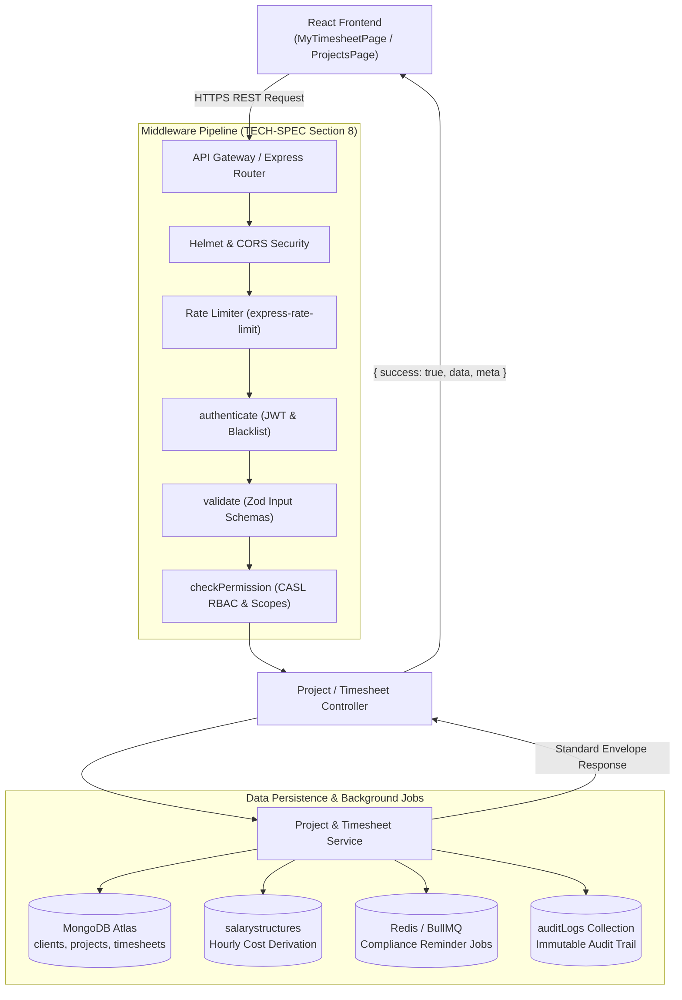
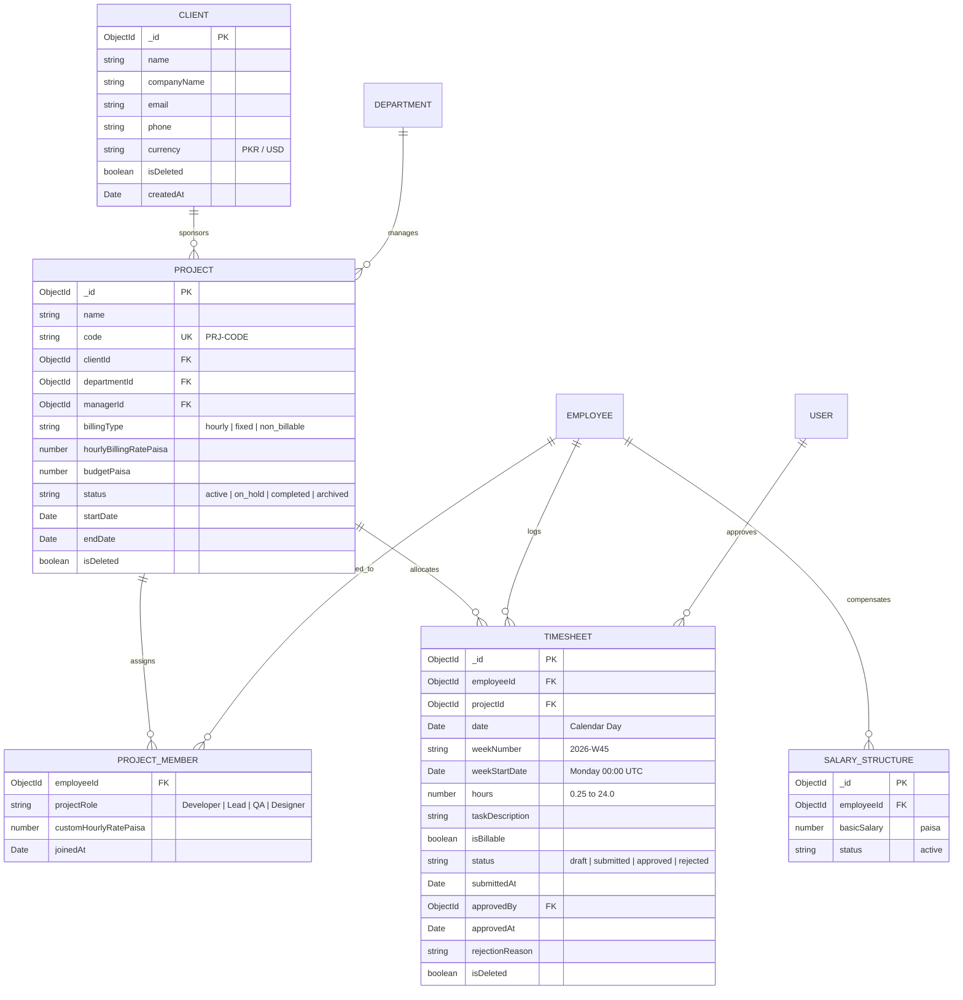

# Technical Architecture & Implementation Blueprint: Module M22 (Projects & Timesheets)

**Feature:** M22 Projects & Timesheets  
**Spec Directory:** `.specify/specs/21-projects-timesheets`  
**Architect:** Senior Software Architect & Archify System  
**Frameworks:** Express.js (Node.js ES Modules), React 18, Tailwind CSS, shadcn/ui, Recharts, date-fns  
**Standards:** `docs/TECH-SPEC.md` (Sections 3, 4, 5, 6, 8), `docs/MODULES.md` (Section 600), `design.md`  

---

## 1. Architectural Overview & System Design

Module M22 orchestrates client portfolio management, project team assignments, weekly timesheet logging grids, multi-level manager approvals, utilization telemetry, and executive project profitability analysis.

### System Invariants
1. **Vertical Slice Order:** Every BUILD-GUIDE row (22.1 to 22.7) is delivered with its backend model, validation, service, controller, and route first, followed by its RTK Query endpoint, UI page/modal, and role-scoped tests.
2. **24-Hour Daily Work Ceiling:** Total hours logged by an employee across all tasks and projects in a single calendar day cannot exceed $24.0$ hours ($15\text{ min} = 0.25\text{ hr}$ increments).
3. **Approval Immutability:** Once a timesheet is marked `approved` by an authorized manager, it is permanently locked against edits, deletions, or backdated inserts.
4. **Project Profitability Restriction:** Profitability and cost intelligence links employee active `SalaryStructure` to compute internal hourly costs against client billing rates. Access to this endpoint is strictly restricted to **Super Admin** (**HTTP 403** for all other roles).
5. **Minor Currency Unit Storage:** Client billing rates, project budgets, and employee hourly costs are strictly stored in integer minor units (paisa: $\text{PKR} \times 100$).

---

## 2. Directory Structure & Exact Files List

```
backend/
├── src/
│   ├── models/
│   │   ├── client.model.js                  # M22: Client portfolio entity (Row 22.1)
│   │   ├── project.model.js                 # M22: Project entity & members array (Rows 22.1, 22.2)
│   │   └── timesheet.model.js               # M22: Timesheet entries & approval states (Rows 22.3, 22.4)
│   ├── modules/
│   │   └── projects/
│   │       ├── project.validation.js        # Zod validation schemas for clients, projects, timesheets
│   │       ├── project.service.js           # Domain business logic, hourly rate derivation, analytics
│   │       ├── project.controller.js        # Request extraction & standardized envelope responses
│   │       └── project.routes.js            # Express router with authenticate, validate, checkPermission
│   └── shared/
│       └── permissions.js                   # M22 CASL permission actions & module definition
└── tests/
    └── m22.projects.e2e.test.js             # Vitest multi-role functional & security E2E suite

frontend/
├── src/
│   ├── features/
│   │   └── projects/
│   │       ├── projectsApi.js               # RTK Query API slice with auto-tag invalidation
│   │       ├── pages/
│   │       │   ├── ProjectsPage.jsx         # Client & project registers with member badges (Row 22.1)
│   │       │   ├── MyTimesheetPage.jsx      # High-density Monday-Sunday weekly timesheet grid (Row 22.3)
│   │       │   ├── TimesheetApprovalsPage.jsx # Manager pending timesheet review queue (Row 22.4)
│   │       │   ├── UtilizationReportPage.jsx  # Recharts stacked bar billable utilization telemetry (Row 22.5)
│   │       │   ├── ProjectProfitabilityPage.jsx # Super Admin gross margins & project cost intelligence (Row 22.6)
│   │       │   └── TimesheetCompliancePage.jsx  # HR missing timesheet tracker & reminder alerts (Row 22.7)
│   │       └── components/
│   │           ├── ProjectModal.jsx         # Project creation & edit dialog
│   │           ├── ClientModal.jsx          # Client registration dialog
│   │           ├── ProjectMembersModal.jsx  # Team assignment & member rate picker (Row 22.2)
│   │           ├── TimesheetWeeklyGrid.jsx  # 7-day grid input with live daily total calculations
│   │           └── TimesheetDecisionModal.jsx # Manager approval/rejection dialog with mandatory comment
│   └── components/layout/Sidebar.jsx        # Navigation links with Can permission gates
```

---

## 3. Mermaid Architecture Diagrams

### Diagram 1: Module Flow & Request Lifecycle


---

### Diagram 2: Entity Relationship Diagram (ERD)


---

### Diagram 3: Main Sequence Diagram (Timesheet Submission to Profitability Aggregation)
```mermaid
sequenceDiagram
    autonumber
    actor Emp as Employee
    actor Mgr as Department Manager
    actor Admin as Super Admin
    participant UI as React UI (RTK Query)
    participant API as Express Router & Middleware
    participant Svc as Project Service Layer
    participant DB as MongoDB Atlas

    Note over Emp,DB: Step 1: Weekly Timesheet Entry & Daily Cap Check
    Emp->>UI: Logs hours on PRJ-01 for Monday (e.g. 8.5 hrs)
    UI->>API: POST /api/v1/timesheets (date, projectId, hours, isBillable)
    API->>API: authenticate + validate + checkPermission('timesheet.log', 'own')
    API->>Svc: logTimeEntry(employeeId, projectId, date, hours)
    Svc->>DB: Query project.members (Verify membership)
    Svc->>DB: Aggregate existing hours for date (Ensure total + hours <= 24.0)
    Svc->>DB: Save Timesheet (status: 'draft')
    Svc-->>UI: HTTP 201 Created

    Note over Emp,Mgr: Step 2: Week Submission & Manager Approval
    Emp->>UI: Clicks "Submit Week for Approval"
    UI->>API: POST /api/v1/timesheets/submit (weekStartDate)
    API->>Svc: submitWeekTimesheets(employeeId, weekStartDate)
    Svc->>DB: UpdateMany status = 'submitted' for draft entries of that week
    Svc-->>UI: HTTP 200 OK (Entries locked)
    
    Mgr->>UI: Opens TimesheetApprovalsPage (Team Queue)
    UI->>API: GET /api/v1/timesheets/pending (scope: 'team')
    API->>Svc: getPendingSubmissions(managerId, deptId)
    Svc-->>UI: List of submitted timesheet summaries
    
    Mgr->>UI: Clicks "Approve Timesheet"
    UI->>API: PATCH /api/v1/timesheets/:id/decide (decision: 'approved')
    API->>Svc: decideTimesheet(id, 'approved', managerUser)
    Svc->>DB: Timesheet.status = 'approved', approvedAt = now
    Svc-->>UI: HTTP 200 OK (Permanently locked)

    Note over Admin,DB: Step 3: Executive Profitability & Hourly Cost Derivation
    Admin->>UI: Opens ProjectProfitabilityPage
    UI->>API: GET /api/v1/reports/project-profitability
    API->>API: checkPermission('report.profitability', 'Super Admin')
    alt Role is not Super Admin
        API-->>UI: HTTP 403 Forbidden
    else Role is Super Admin
        API->>Svc: getProjectProfitabilityReport()
        Svc->>DB: Aggregate approved timesheets by project
        Svc->>DB: Query active SalaryStructure for each employee
        Svc->>Svc: Hourly Cost = Basic Salary ÷ (22 workdays × 8 hrs)
        Svc->>Svc: Cost = Σ(Hours × Hourly Cost); Revenue = Σ(Billable Hours × Bill Rate)
        Svc->>Svc: Margin % = ((Revenue - Cost) / Revenue) * 100
        Svc-->>UI: HTTP 200 OK with Financial Telemetry & Profit Margins
    end
```

---

## 4. API Endpoints, PBAC Permissions & CASL Scope Contracts

All endpoints are mounted at `/api/v1` under `/projects`, `/timesheets`, and `/reports`:

| HTTP Method | Route | Permission Key | Required Scope | Allowed Roles | Description |
| :--- | :--- | :--- | :---: | :--- | :--- |
| **GET** | `/api/v1/clients` | `project.view` | `all` | All authenticated | List active clients |
| **POST** | `/api/v1/clients` | `project.manage` | `all` | Super Admin, HR Mgr | Register new corporate client |
| **GET** | `/api/v1/projects` | `project.view` | `all` / `department` / `own` | All roles | Scoped list of software projects |
| **POST** | `/api/v1/projects` | `project.manage` | `department` / `all` | Super Admin, Dept Mgr | Create project & set billing model |
| **GET** | `/api/v1/projects/:id` | `project.view` | `all` / `department` / `own` | All roles | View project details & member roster |
| **PUT** | `/api/v1/projects/:id` | `project.manage` | `department` / `all` | Super Admin, Dept Mgr | Update project budget, dates, status |
| **PUT** | `/api/v1/projects/:id/members`| `project.manage` | `department` / `all` | Super Admin, Dept Mgr | Assign team members to project |
| **GET** | `/api/v1/timesheets/my-week` | `timesheet.log` | `own` | Employee, All | Get weekly 7-day grid for active user |
| **POST** | `/api/v1/timesheets` | `timesheet.log` | `own` | Employee, All | Log daily hours with 24-hr cap validation |
| **PUT** | `/api/v1/timesheets/:id` | `timesheet.log` | `own` | Employee, All | Update draft hours or task description |
| **DELETE** | `/api/v1/timesheets/:id` | `timesheet.log` | `own` | Employee, All | Remove draft timesheet entry |
| **POST** | `/api/v1/timesheets/submit` | `timesheet.log` | `own` | Employee, All | Submit entire calendar week for approval |
| **GET** | `/api/v1/timesheets/pending`| `timesheet.approve` | `team` / `department` | Super Admin, Dept Mgr | View subordinates' submitted timesheets |
| **PATCH**| `/api/v1/timesheets/:id/decide`| `timesheet.approve` | `team` / `department` | Super Admin, Dept Mgr | Approve or reject submitted timesheet |
| **GET** | `/api/v1/timesheets/missing`| `timesheet.compliance`| `all` / `department` | Super Admin, HR Mgr | View employees missing weekly timesheets |
| **POST** | `/api/v1/timesheets/remind-missing`| `timesheet.compliance`| `all` | Super Admin, HR Mgr | Trigger compliance notification reminders |
| **GET** | `/api/v1/reports/utilization`| `report.utilization`| `all` / `department` / `own`| All roles (scoped) | Billable vs non-billable utilization |
| **GET** | `/api/v1/reports/project-profitability`| `report.profitability`| `all` | **Super Admin ONLY** | Project cost & profit margins |

---

## 5. Security & Invariant Defenses

1. **Member-Only Time Tracking:** When logging time against a project, the service checks `project.members.some(m => m.employeeId.equals(actorEmpId))`. Non-members receive **HTTP 403**.
2. **24-Hour Daily Limit Enforced with Race-Condition Lock:** Before saving a timesheet entry, the service computes existing hours logged across all projects for `date`. If `existingHours + newHours > 24.0`, throws `ApiError(400, 'Daily logged time cannot exceed 24.0 hours')`.
3. **Approved Immutability Invariant:** Both `PUT /timesheets/:id` and `DELETE /timesheets/:id` inspect `timesheet.status`. If `status === 'approved'`, throws `ApiError(400, 'Approved timesheets are locked and cannot be modified')`.
4. **Profitability Separation of Concerns:** In `project.service.js`, `getProjectProfitabilityReport` validates `user.roles.includes('Super Admin')`. All other roles receive immediate **HTTP 403** before any financial calculation or aggregation is initiated.

