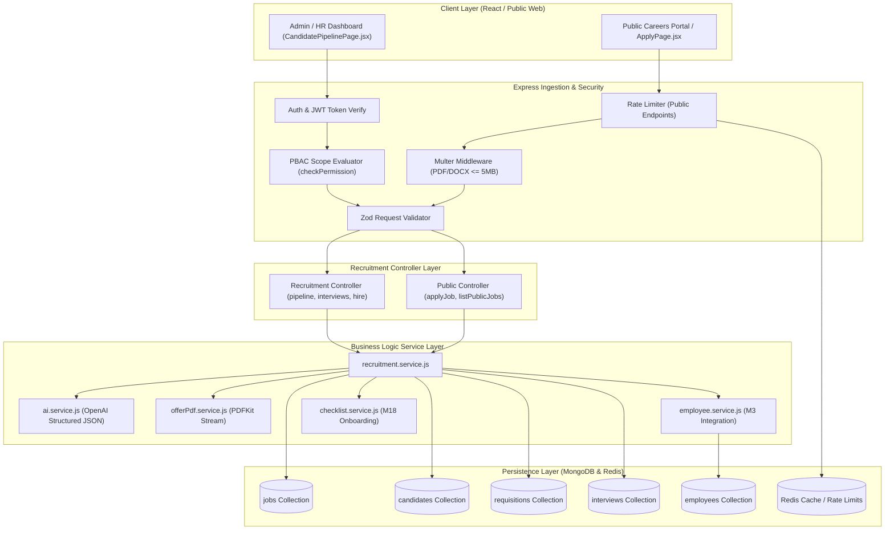
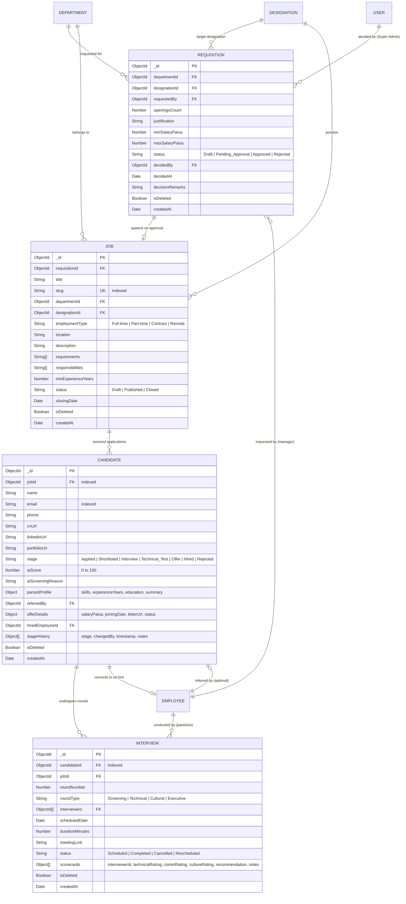
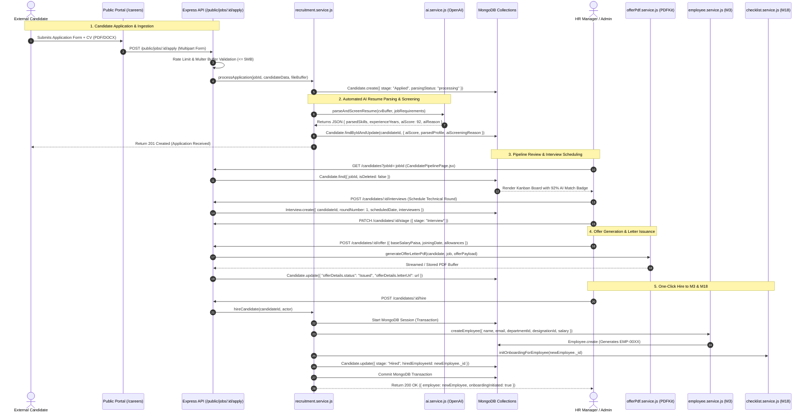

# Technical Architecture Plan: M15 - Recruitment & AI Screening

**Feature Branch**: `feature/22-recruitment-ai-screening`  
**Created**: 2026-11-08  
**Status**: Ready for Implementation  
**Module**: M15 Recruitment & AI Resume Screening  
**Sources of Truth**:
- `docs/TECH-SPEC.md`: Sections 3 (Folders), 4 (DB Schema), 5 (API Design), 6 (Authentication & PBAC), 8 (Request Lifecycle)
- `docs/MODULES.md`: Section 7 · M15 (Recruitment & AI Resume Screening)
- `docs/BUILD-GUIDE.md`: Section 24 (Rows 15.1 to 15.13)
- `docs/FRD.md`: Section 5.3 & Section 11 (Permission Matrix)
- `DESIGN.md`: Forest & Emerald Theme (`#111D17` Dark Surface, `#1A3125` Dark Border, `#00C471` Emerald Accent)

---

## 1. Technical Architecture Blueprint & Layer Alignment

Following `docs/TECH-SPEC.md` Section 3 & Section 8 Request Lifecycle:
```
Client Request (React RTK Query / Public Fetch)
  │
  ▼
Express Route (`backend/src/modules/recruitment/recruitment.routes.js`)
  │
  ├─► Security Headers & Rate Limiting (`express-rate-limit` for public endpoints)
  ├─► Authentication Middleware (`authenticate` for internal / optional for public)
  ├─► Multer Middleware (`uploadResume` - PDF/DOCX <= 5MB in memory/temp storage)
  ├─► Validation Middleware (`validate(recruitmentValidation.schema)`)
  └─► PBAC Authorization Middleware (`checkPermission('action.name', 'scope')`)
        │
        ▼
Recruitment Controller (`recruitment.controller.js`)
  │ - Parses DTO, validates params/query, unwraps actor identity & scope
  │ - Delegates 100% of domain business logic to service layer
  │
  ▼
Recruitment Service (`recruitment.service.js`)
  │ ├─► Database Access (`Requisition`, `Job`, `Candidate`, `Interview`, `Employee`)
  │ ├─► AI Resume Parsing & Scoring Service (`backend/src/services/ai.service.js`)
  │ ├─► Offer Letter Generator (`backend/src/services/offerPdf.service.js` via PDFKit)
  │ ├─► Cross-Module Integrations:
  │ │     ├─► Module M3: Auto-provision `Employee` on `hireCandidate`
  │ │     ├─► Module M18: Trigger onboarding checklist initiation
  │ │     └─► Module M25: Audit trail event logging (`logAuditEvent`)
  │ └─► Email & In-App Notification Service (`email.service.js`, `notify.service.js`)
  │
  ▼
MongoDB Persistence (Indexed Collections with Transactions for Hires)
```

---

## 2. Exact File Inventory

### 2.1 Backend Files
All backend code is standard ES Modules (`.js`).

| Layer | File Path | Description |
|---|---|---|
| **Models** | `backend/src/models/requisition.model.js` | Headcount requisition schema with approval lifecycle, budget, and department refs. |
| **Models** | `backend/src/models/job.model.js` | Job opening schema with public slug, responsibilities, requirements, and status. |
| **Models** | `backend/src/models/candidate.model.js` | Candidate schema with AI parsed payload, fit score (0-100), stage history, and CV URL. |
| **Models** | `backend/src/models/interview.model.js` | Interview rounds with panel members, calendar dates, meeting links, and scorecards. |
| **Validation** | `backend/src/modules/recruitment/recruitment.validation.js` | Zod/Joi schemas for requisitions, job posts, applications, stages, scorecards, and offers. |
| **Service** | `backend/src/modules/recruitment/recruitment.service.js` | Core business logic for ATS, pipeline transitions, referrals, scorecard aggregation, and hiring. |
| **Controller** | `backend/src/modules/recruitment/recruitment.controller.js` | Express handlers mapping HTTP requests/responses, status codes, and error forwarding. |
| **Routes** | `backend/src/modules/recruitment/recruitment.routes.js` | Route definitions with rate limiters, auth middleware, and CASL permissions. |
| **Services** | `backend/src/services/ai.service.js` | OpenAI client with Structured Outputs for CV parsing and resume-to-job scoring. |
| **Services** | `backend/src/services/offerPdf.service.js` | PDFKit streaming engine generating branded, legally formatted PDF offer letters. |
| **Shared** | `backend/src/shared/permissions.js` | Update master permissions catalogue with `recruitment` module actions. |

### 2.2 Frontend Files
All frontend code is React 18+ Vite with Tailwind CSS (`.js`, `.jsx`).

| Type | File Path | Description |
|---|---|---|
| **API Slice** | `frontend/src/features/recruitment/recruitmentApi.js` | RTK Query slice defining all M15 endpoints, invalidation tags, and mutations. |
| **Page** | `frontend/src/features/recruitment/pages/JobsPage.jsx` | Internal Job Management dashboard with requisition queue, active listings, and metrics. |
| **Page** | `frontend/src/features/recruitment/pages/JobFormPage.jsx` | Create / Edit job opening form with rich text description and requirement tags. |
| **Page** | `frontend/src/features/recruitment/pages/CandidatePipelinePage.jsx` | Drag-and-drop Kanban pipeline board (`Applied` → `Hired`/`Rejected`) with AI badges. |
| **Page** | `frontend/src/features/recruitment/pages/InternalJobsPage.jsx` | Employee internal mobility & referral board for staff to view and refer peers. |
| **Public Page**| `frontend/src/features/recruitment/pages/CareersPublicPage.jsx` | Clean, public-facing portal for external applicants to browse openings. |
| **Public Page**| `frontend/src/features/recruitment/pages/ApplyPage.jsx` | Public job application form with CV file drag-and-drop and instant client validation. |
| **Component** | `frontend/src/features/recruitment/components/RequisitionModal.jsx` | Modal for department managers to request headcount and track approvals. |
| **Component** | `frontend/src/features/recruitment/components/CandidateDetailModal.jsx` | Full candidate profile drawer with AI score, parsed CV preview, and stage actions. |
| **Component** | `frontend/src/features/recruitment/components/InterviewScheduleModal.jsx` | Modal to schedule interview rounds with panelist assignment and meeting links. |
| **Component** | `frontend/src/features/recruitment/components/ScorecardModal.jsx` | Multi-criteria evaluation form for interviewers (tech, culture, recommendation). |
| **Component** | `frontend/src/features/recruitment/components/OfferLetterModal.jsx` | Offer letter configuration modal with compensation preview and PDF issuance. |
| **Component** | `frontend/src/features/recruitment/components/EmployeeReferralModal.jsx` | Modal for employees to refer candidates and enter referral notes. |
| **Component** | `frontend/src/features/recruitment/components/AIScreeningBadge.jsx` | Reusable emerald match-percentage badge with popover breakdown. |

---

## 3. Architecture Diagrams (Archify & Mermaid)

### 3.1 Flow Architecture Diagram
Visualizes the end-to-end request lifecycle across both Public and Authenticated execution contexts.



---

### 3.2 Entity Relationship Diagram (ERD)
Complete database relationships, primary keys, foreign keys, and indexes for Module M15.



---

### 3.3 Main Sequence Diagram: End-to-End Recruitment & One-Click Hire
Traces the application lifecycle from public ingestion to employee creation.



---

## 4. Database Schemas, Validation & Index Design

### 4.1 Indexing & Query Optimizations
To ensure sub-50ms response times across recruitment pipelines:
- `Job`: `{ slug: 1 }` (unique), `{ status: 1, departmentId: 1 }` (filtering public/internal listings).
- `Candidate`: `{ jobId: 1, stage: 1 }` (Kanban column aggregation), `{ email: 1, jobId: 1 }` (anti-spam 30-day throttle), `{ aiScore: -1 }` (AI ranking sort).
- `Interview`: `{ candidateId: 1, scheduledDate: 1 }`, `{ "interviewers": 1, status: 1 }` (interviewer availability check).
- `Requisition`: `{ status: 1, departmentId: 1 }`, `{ requestedBy: 1 }`.

### 4.2 Data Integrity Rules
- Soft delete (`isDeleted: true`) on all models.
- All monetary values stored as integer **paisa** (`minSalaryPaisa`, `maxSalaryPaisa`, `baseSalaryPaisa`) to prevent floating-point rounding errors.
- Stage transition whitelist: `Applied` → `Shortlisted` → `Interview` → `Technical_Test` → `Offer` → `Hired` (or `Rejected` from any stage).

---

## 5. API Endpoints & PBAC Permission Mapping

All routes prefixed with `/api/v1/recruitment`:

| HTTP Method | Endpoint URL | Description | Required Permission | Allowed Scopes |
|---|---|---|---|---|
| `GET` | `/public/jobs` | Public job listings for careers site | None (Public) | N/A |
| `GET` | `/public/jobs/:slug` | Public job opening details | None (Public) | N/A |
| `POST` | `/public/jobs/:id/apply` | Public job application with CV | None (Public / Rate-limited) | N/A |
| `GET` | `/requisitions` | List headcount requisitions | `recruitment.requisition.view` | `own`, `team`, `department`, `all` |
| `POST` | `/requisitions` | Submit headcount requisition | `recruitment.requisition.create`| `team`, `department`, `all` |
| `PATCH`| `/requisitions/:id/decide`| Approve/reject requisition | `recruitment.requisition.decide`| `all` (Super Admin) |
| `GET` | `/jobs` | Internal workforce job listings | `recruitment.job.view` | `own`, `department`, `all` |
| `POST` | `/jobs` | Create job opening from requisition| `recruitment.job.manage` | `all` (HR / Admin) |
| `PATCH`| `/jobs/:id` | Update job details / toggle status | `recruitment.job.manage` | `all` (HR / Admin) |
| `GET` | `/candidates` | Get candidates with pipeline filter | `recruitment.candidate.view` | `team`, `department`, `all` |
| `GET` | `/candidates/:id` | Get candidate details & CV data | `recruitment.candidate.view` | `team`, `department`, `all` |
| `POST` | `/candidates/:id/screen` | Trigger / Re-run AI Screening | `recruitment.candidate.screen` | `department`, `all` |
| `PATCH`| `/candidates/:id/stage` | Transition candidate Kanban stage | `recruitment.candidate.stage` | `all` (HR / Admin) |
| `POST` | `/candidates/:id/interviews` | Schedule interview round | `recruitment.interview.manage` | `team`, `department`, `all` |
| `POST` | `/interviews/:id/scorecard`| Submit interviewer evaluation | `recruitment.interview.evaluate`| `own`, `all` |
| `POST` | `/candidates/:id/offer` | Generate & issue offer letter | `recruitment.offer.manage` | `all` (HR / Admin) |
| `GET` | `/candidates/:id/offer/pdf` | Download signed PDF offer letter | `recruitment.offer.view` | `team`, `all` |
| `POST` | `/candidates/:id/hire` | One-click hire candidate to M3 | `recruitment.hire` | `all` (HR / Admin) |
| `POST` | `/referrals` | Employee submits candidate referral | `recruitment.referral.submit` | `own` (All active staff) |

### 5.1 Permissions to Add to `backend/src/shared/permissions.js`
Under the new module section `{ module: 'recruitment', label: 'Recruitment & AI Screening', subject: 'Recruitment', ... }`:
1. `recruitment.requisition.create` (`team`, `department`, `all`)
2. `recruitment.requisition.view` (`own`, `team`, `department`, `all`)
3. `recruitment.requisition.decide` (`all`)
4. `recruitment.job.view` (`own`, `department`, `all`)
5. `recruitment.job.manage` (`all`)
6. `recruitment.candidate.view` (`team`, `department`, `all`)
7. `recruitment.candidate.screen` (`department`, `all`)
8. `recruitment.candidate.stage` (`all`)
9. `recruitment.interview.manage` (`team`, `department`, `all`)
10. `recruitment.interview.evaluate` (`own`, `all`)
11. `recruitment.offer.manage` (`all`)
12. `recruitment.offer.view` (`team`, `all`)
13. `recruitment.hire` (`all`)
14. `recruitment.referral.submit` (`own`)

---

## 6. Official Library Patterns (Context7 Verified)

### 6.1 OpenAI Structured Outputs (`ai.service.js`)
Uses OpenAI `response_format: { type: "json_schema", json_schema: { ... } }` to guarantee strictly typed extraction:
```javascript
import OpenAI from 'openai';

const openai = new OpenAI({ apiKey: process.env.OPENAI_API_KEY });

export const screenResumeWithAI = async ({ resumeText, jobTitle, jobRequirements, jobDescription }) => {
  const completion = await openai.chat.completions.create({
    model: 'gpt-4o-mini',
    response_format: {
      type: 'json_schema',
      json_schema: {
        name: 'resume_screening_result',
        strict: true,
        schema: {
          type: 'object',
          properties: {
            candidateName: { type: 'string' },
            parsedSkills: { type: 'array', items: { type: 'string' } },
            experienceYears: { type: 'number' },
            highestEducation: { type: 'string' },
            aiScore: { type: 'integer', minimum: 0, maximum: 100 },
            matchingStrengths: { type: 'array', items: { type: 'string' } },
            missingSkills: { type: 'array', items: { type: 'string' } },
            screeningSummary: { type: 'string' }
          },
          required: [
            'candidateName',
            'parsedSkills',
            'experienceYears',
            'highestEducation',
            'aiScore',
            'matchingStrengths',
            'missingSkills',
            'screeningSummary'
          ],
          additionalProperties: false
        }
      }
    },
    messages: [
      {
        role: 'system',
        content: 'You are an expert HR recruiter and technical talent screener. Parse the provided CV and objectively evaluate the candidate fit against the job opening.'
      },
      {
        role: 'user',
        content: `JOB TITLE: ${jobTitle}\nJOB DESCRIPTION:\n${jobDescription}\nREQUIREMENTS:\n${jobRequirements.join(', ')}\n\nCANDIDATE CV TEXT:\n${resumeText}`
      }
    ],
    temperature: 0.1
  });

  return JSON.parse(completion.choices[0].message.content);
};
```

### 6.2 Branded PDFKit Offer Letter Stream (`offerPdf.service.js`)
Streams a formal offer letter directly into the HTTP response or disk buffer:
```javascript
import PDFDocument from 'pdfkit';

export const generateOfferLetterPdfStream = (res, { candidate, job, offerDetails, companyInfo }) => {
  const doc = new PDFDocument({ size: 'A4', margin: 50 });
  doc.pipe(res);

  // Header Letterhead
  doc.fontSize(20).font('Helvetica-Bold').fillColor('#00C471').text(companyInfo.name || 'HRM Enterprise');
  doc.fontSize(9).font('Helvetica').fillColor('#64748B').text('Talent Acquisition & People Operations');
  doc.moveDown(1.5);

  // Recipient Block
  doc.fontSize(10).font('Helvetica-Bold').fillColor('#1E293B').text(`Date: ${new Date().toLocaleDateString('en-PK')}`);
  doc.text(`To: ${candidate.name}`);
  doc.font('Helvetica').text(`Email: ${candidate.email}`);
  doc.moveDown(1);

  // Subject
  doc.font('Helvetica-Bold').fontSize(12).fillColor('#0F172A').text(`SUBJECT: CONDITIONAL OFFER OF EMPLOYMENT - ${job.title.toUpperCase()}`);
  doc.moveDown(1);

  // Body
  doc.font('Helvetica').fontSize(10).fillColor('#334155').text(
    `We are delighted to extend to you an offer of employment for the position of ${job.title} at ${companyInfo.name}. ` +
    `Your scheduled date of joining is ${new Date(offerDetails.joiningDate).toLocaleDateString('en-PK')}.`
  );
  doc.moveDown(1);

  // Compensation Table
  doc.font('Helvetica-Bold').text('Compensation & Benefits:');
  doc.font('Helvetica').text(`• Base Salary: PKR ${(offerDetails.baseSalaryPaisa / 100).toLocaleString('en-PK')} per month`);
  if (offerDetails.allowances && offerDetails.allowances.length > 0) {
    offerDetails.allowances.forEach(a => {
      doc.text(`• ${a.name}: PKR ${(a.amountPaisa / 100).toLocaleString('en-PK')}`);
    });
  }

  doc.moveDown(2);
  doc.text('We look forward to welcoming you to our team.');
  doc.moveDown(3);

  // Signatures
  doc.text('_________________________                _________________________');
  doc.text('Authorized HR Signature                     Candidate Acceptance Signature');

  doc.end();
};
```

### 6.3 Secure Multer File Ingestion
Memory storage with file signature validation and 5MB limit:
```javascript
import multer from 'multer';

export const uploadResume = multer({
  storage: multer.memoryStorage(),
  limits: { fileSize: 5 * 1024 * 1024 }, // 5 MB
  fileFilter: (req, file, cb) => {
    const allowedMimes = [
      'application/pdf',
      'application/msword',
      'application/vnd.openxmlformats-officedocument.wordprocessingml.document'
    ];
    if (allowedMimes.includes(file.mimetype)) {
      cb(null, true);
    } else {
      cb(new Error('Only PDF, DOC, and DOCX resumes are accepted.'), false);
    }
  }
});
```

---

## 7. Implementation Milestones & Sequencing

1. **Phase 1: Schemas & Permissions**:
   - Create `requisition.model.js`, `job.model.js`, `candidate.model.js`, `interview.model.js`.
   - Update `backend/src/shared/permissions.js` with all 14 recruitment action identifiers.
2. **Phase 2: Backend Core Services & Controllers**:
   - Implement `ai.service.js` with structured outputs and fallback parser.
   - Implement `offerPdf.service.js` with PDFKit.
   - Implement `recruitment.validation.js` and `recruitment.service.js`.
   - Implement `recruitment.controller.js` and `recruitment.routes.js`.
   - Wire up recruitment routes in `backend/src/app.js`.
3. **Phase 3: Frontend Feature Integration**:
   - Implement `recruitmentApi.js` in RTK Query with automatic cache tag invalidation.
   - Build Public Careers Portal (`CareersPublicPage.jsx` & `ApplyPage.jsx`).
   - Build Admin Job Management & Requisitions (`JobsPage.jsx`, `RequisitionModal.jsx`).
   - Build Drag-and-Drop Kanban Candidate Board (`CandidatePipelinePage.jsx`, `CandidateDetailModal.jsx`).
   - Build Interviewer Scorecard & PDF Offer Modals (`InterviewScheduleModal.jsx`, `ScorecardModal.jsx`, `OfferLetterModal.jsx`).
   - Build Employee Referral Portal (`InternalJobsPage.jsx`, `EmployeeReferralModal.jsx`).
4. **Phase 4: Cross-Module Verification & Testing**:
   - Verify 1-click hire creates active record in `Employee` (M3) and starts onboarding in M18.
   - Run complete end-to-end integration test suite.

