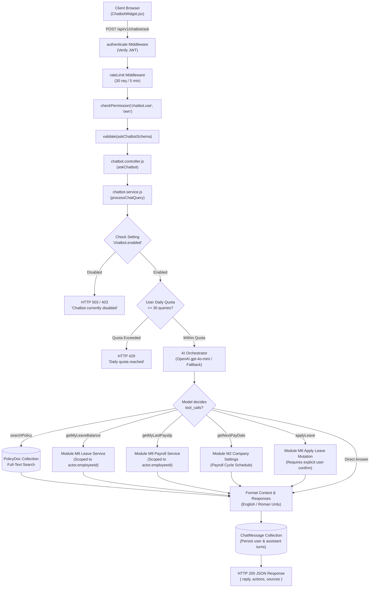
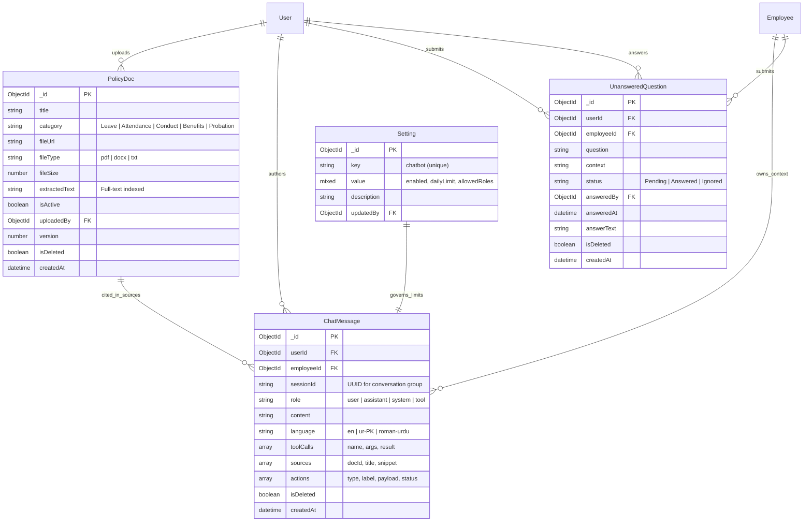

# Technical Architecture & Implementation Plan: M16 - HR Chatbot

**Module ID**: `M16`  
**Module Name**: `HR Chatbot`  
**Feature Branch**: `feature/23-hr-chatbot`  
**Spec Folder**: `.specify/specs/23-hr-chatbot/`  
**Phase**: `Phase 3 — AI Features` (BUILD-GUIDE Section 25 · Rows 16.1 to 16.9)  
**Architectural Lead**: `senior-architect`  
**Diagram Engine**: `Archify` / Mermaid (Valid syntax, standalone readability, accessible palette)

---

## 1. Executive Summary & Architectural Overview

Module M16 (HR Chatbot) provides an enterprise conversational HR assistant for employees and management. The module acts as an intelligent natural language bridge across company policies and employee personal records.

### Core Architectural Invariants:
1. **Strict User Scoping**: AI tools that query personal data (`getMyLeaveBalance`, `getMyLastPayslip`, `getNextPayDate`) execute solely against the authenticated caller (`req.user.employeeId`). Prompt injection or requests attempting to inspect peers' records (e.g., "What is Ali's salary?") are strictly neutralized at the tool execution layer.
2. **Deterministic Dual-Layer Intelligence**:
   - Primary: OpenAI `gpt-4o-mini` with structured Tool Calling (`tools`, `tool_choice: "auto"`).
   - Secondary / Offline Fallback: Deterministic regex intent parsing and direct tool dispatch, ensuring 100% test reliability and air-gapped system stability when `OPENAI_API_KEY` is not present.
3. **Company Policy Grounding**: Answers to handbook questions (probation rules, attendance policies, dress code) are extracted from active `PolicyDoc` records using MongoDB full-text index matching. Responses include document titles and excerpt citations.
4. **Human-in-the-Loop Escalation**: Unresolved questions or queries where the model has low confidence are persisted in `UnansweredQuestion` (`unanswered.model.js`) and trigger instant in-app alerts to HR Managers via Module M8.
5. **Interactive Quick Actions**: The assistant can trigger real transactions (e.g. `applyLeave`) only after explicit user confirmation of parameters (`leaveTypeId`, dates, reason).

---

## 2. Directory Structure & File Manifest

Adheres strictly to `docs/TECH-SPEC.md` Section 3 (Layering):

```
backend/
├── src/
│   ├── models/
│   │   ├── policyDoc.model.js              # Policy document metadata & extracted text
│   │   ├── chatMessage.model.js            # Message history, roles, tool calls, and actions
│   │   └── unanswered.model.js             # HR escalation queue for unanswered questions
│   ├── modules/
│   │   └── chatbot/
│   │       ├── tools/
│   │       │   └── chatbot.tools.js        # Deterministic domain tool definitions & execution handlers
│   │       ├── chatbot.validation.js       # Zod schemas for query, upload, and escalation
│   │       ├── chatbot.service.js          # Core domain logic, AI tool calling, bilingual formatting
│   │       ├── chatbot.controller.js       # Express HTTP controllers
│   │       └── chatbot.routes.js           # Gatekeeper router (rateLimit, authenticate, checkPermission, upload)
│   ├── seed/
│   │   └── m16.seed.js                     # Seed policy documents, sample FAQ handbook, and chat messages
│   └── shared/
│       └── permissions.js                  # Updated with chatbot.* permissions
└── tests/
    ├── m16.chatbot.test.js                 # Functional API tests (Supertest + Vitest)
    └── m16.chatbot.security.test.js        # Doubt-driven stress & prompt injection tests

frontend/
├── src/
│   ├── features/
│   │   └── chatbot/
│   │       ├── chatbotApi.js               # RTK Query endpoints & cache invalidation
│   │       ├── components/
│   │       │   ├── ChatbotWidget.jsx       # Floating trigger button & responsive chat drawer
│   │       │   ├── ChatMessageBubble.jsx   # Message bubble with markdown & action buttons
│   │       │   ├── QuickActionCard.jsx     # Leave confirmation cards & payslip PDF links
│   │       │   ├── PolicyUploadModal.jsx   # HR modal for uploading handbook files
│   │       │   └── UnansweredAnswerModal.jsx # HR response dialog for pending queries
│   │       └── pages/
│   │           ├── PolicyDocsPage.jsx      # HR management page for company policy files
│   │           └── UnansweredQuestionsPage.jsx # HR dashboard for unresolved employee questions
│   ├── components/
│   │   └── layout/
│   │       └── Sidebar.jsx                 # Nav links for HR Manager & Super Admin
│   └── App.jsx                             # Route definitions & global ChatbotWidget overlay
└── tests/
    └── e2e/
        └── m16-chatbot.spec.js             # Playwright browser verification across 4 roles
```

---

## 3. Database Schemas, Validation & Indexes

### A. `PolicyDoc` Schema (`policyDoc.model.js`)
```javascript
{
  title: { type: String, required: true, trim: true },
  category: { 
    type: String, 
    enum: ['General', 'Leave', 'Attendance', 'Conduct', 'Benefits', 'Travel', 'Security', 'Probation'], 
    default: 'General', 
    index: true 
  },
  description: { type: String, default: '', trim: true },
  fileUrl: { type: String, required: true },
  fileType: { type: String, enum: ['pdf', 'docx', 'doc', 'txt'], default: 'pdf' },
  fileSize: { type: Number, default: 0 },
  extractedText: { type: String, required: true },
  isActive: { type: Boolean, default: true, index: true },
  uploadedBy: { type: mongoose.Schema.Types.ObjectId, ref: 'User', required: true },
  version: { type: Number, default: 1 },
  isDeleted: { type: Boolean, default: false, index: true }
}
// Compound & Text Indexes:
policyDocSchema.index({ title: 'text', extractedText: 'text' });
policyDocSchema.index({ category: 1, isActive: 1 });
```

### B. `ChatMessage` Schema (`chatMessage.model.js`)
```javascript
{
  userId: { type: mongoose.Schema.Types.ObjectId, ref: 'User', required: true, index: true },
  employeeId: { type: mongoose.Schema.Types.ObjectId, ref: 'Employee', default: null, index: true },
  sessionId: { type: String, default: () => crypto.randomUUID(), index: true },
  role: { type: String, enum: ['user', 'assistant', 'system', 'tool'], required: true },
  content: { type: String, required: true },
  language: { type: String, enum: ['en', 'ur-PK', 'roman-urdu'], default: 'en' },
  toolCalls: [
    {
      toolCallId: String,
      name: String,
      arguments: mongoose.Schema.Types.Mixed,
      result: mongoose.Schema.Types.Mixed
    }
  ],
  sources: [
    {
      docId: { type: mongoose.Schema.Types.ObjectId, ref: 'PolicyDoc' },
      title: String,
      snippet: String
    }
  ],
  actions: [
    {
      type: { type: String, enum: ['APPLY_LEAVE', 'DOWNLOAD_PAYSLIP', 'VIEW_POLICY', 'ASK_HR'] },
      label: String,
      payload: mongoose.Schema.Types.Mixed,
      status: { type: String, enum: ['Pending', 'Completed', 'Dismissed'], default: 'Pending' }
    }
  ],
  isDeleted: { type: Boolean, default: false, index: true }
}
// Indexes:
chatMessageSchema.index({ userId: 1, createdAt: -1 });
chatMessageSchema.index({ sessionId: 1, createdAt: 1 });
```

### C. `UnansweredQuestion` Schema (`unanswered.model.js`)
```javascript
{
  userId: { type: mongoose.Schema.Types.ObjectId, ref: 'User', required: true, index: true },
  employeeId: { type: mongoose.Schema.Types.ObjectId, ref: 'Employee', default: null },
  question: { type: String, required: true, trim: true },
  context: { type: String, default: '' },
  status: { type: String, enum: ['Pending', 'Answered', 'Ignored'], default: 'Pending', index: true },
  answeredBy: { type: mongoose.Schema.Types.ObjectId, ref: 'User', default: null },
  answeredAt: { type: Date, default: null },
  answerText: { type: String, default: '' },
  isDeleted: { type: Boolean, default: false, index: true }
}
// Indexes:
unansweredSchema.index({ status: 1, createdAt: -1 });
```

---

## 4. API Endpoints, RBAC Permissions & Data Scoping

All endpoints run within `/api/v1/chatbot`:

| HTTP | Endpoint | Description | Permission Name | Required Scope |
| :--- | :--- | :--- | :--- | :--- |
| `POST` | `/ask` | Submit message to AI orchestrator | `chatbot.use` | `own` / `all` |
| `GET` | `/history` | Fetch paginated chat history | `chatbot.use` | `own` / `all` |
| `DELETE`| `/history` | Clear personal chat history | `chatbot.use` | `own` |
| `POST` | `/escalate` | Hand off unresolved question to HR | `chatbot.use` | `own` |
| `GET` | `/policies` | List active policy documents | `chatbot.use` | `own` / `all` |
| `POST` | `/policies` | Upload & extract policy document | `chatbot.policy.manage` | `all` (HR/Admin) |
| `DELETE`| `/policies/:id`| Soft-delete policy document | `chatbot.policy.manage` | `all` (HR/Admin) |
| `GET` | `/unanswered` | View unresolved questions queue | `chatbot.unanswered.manage` | `all` (HR/Admin) |
| `PATCH` | `/unanswered/:id/answer`| Submit HR answer to employee | `chatbot.unanswered.manage` | `all` (HR/Admin) |
| `GET` | `/settings` | Get chatbot global status & limits | `chatbot.use` | `own` / `all` |
| `PATCH` | `/settings` | Update chatbot on/off toggle & daily limits | `chatbot.manage` | `all` (Super Admin) |

### Permission Catalog Updates (`backend/src/shared/permissions.js`):
1. `chatbot.use`: Scopes `own`, `all` (Granted to: Super Admin, HR Manager, Department Manager, Employee).
2. `chatbot.manage`: Scope `all` (Granted to: Super Admin).
3. `chatbot.policy.manage`: Scope `all` (Granted to: Super Admin, HR Manager).
4. `chatbot.unanswered.manage`: Scope `all` (Granted to: Super Admin, HR Manager).

---

## 5. Architectural Flow & Mermaid Diagrams

### Diagram 1: Architectural Request & Data Flow
Visualizes request passage through security gates, domain service, AI tool calling, and database boundaries.



---

### Diagram 2: Entity-Relationship Diagram (ERD)
Documents schema relations, references, compound indexes, and types.



---

### Diagram 3: Main Sequence Diagram (Employee Personal & Policy Query)
Traces the execution of the primary prompt: *"Meri kitni leaves bachi hain aur agla pay day kab hai?"*

```mermaid
sequenceDiagram
    autonumber
    actor Emp as Authenticated Employee
    participant UI as ChatbotWidget.jsx
    participant RTK as chatbotApi.js
    participant API as Express Router & Middlewares
    participant Svc as chatbot.service.js
    participant Tools as chatbot.tools.js
    participant OpenAI as OpenAI API / Heuristic Engine
    participant M6 as Module M6 (Leave Service)
    participant M2 as Module M2 (Settings Service)
    participant DB as MongoDB (ChatMessage)

    Emp->>UI: Types "Meri kitni leaves bachi hain aur agla pay day kab hai?"
    UI->>RTK: useAskChatbotMutation({ message, language: 'roman-urdu' })
    RTK->>API: POST /api/v1/chatbot/ask (Bearer Token)
    API->>API: authenticate -> rateLimit -> checkPermission('chatbot.use') -> validate
    API->>Svc: processChatQuery(payload, req.user)
    
    Svc->>Svc: Verify setting 'chatbot.enabled' === true & check daily limit
    Svc->>OpenAI: POST /chat/completions (system prompt, user query, tool schemas)
    OpenAI-->>Svc: Response with tool_calls: [getMyLeaveBalance, getNextPayDate]

    rect rgb(20, 35, 25)
        Note over Svc,Tools: Secure Domain Tool Execution Scoped to Caller
        Svc->>Tools: executeTool('getMyLeaveBalance', {}, req.user)
        Tools->>M6: getEmployeeLeaveBalance(req.user.employeeId)
        M6-->>Tools: { annual: 12, casual: 6, sick: 8 }
        Tools-->>Svc: Tool result JSON

        Svc->>Tools: executeTool('getNextPayDate', {}, req.user)
        Tools->>M2: getCompanySetting('payrollCycle')
        M2-->>Tools: { disbursementDay: 1, nextPayDate: "2026-12-01" }
        Tools-->>Svc: Tool result JSON
    end

    Svc->>OpenAI: POST /chat/completions (tool results for leave & pay date)
    OpenAI-->>Svc: Final Assistant text in Roman Urdu: "Aap ke paas 12 Annual, 6 Casual aur 8 Sick leaves baqi hain..."
    
    Svc->>DB: ChatMessage.create({ role: 'user', content: ... })
    Svc->>DB: ChatMessage.create({ role: 'assistant', content: ..., toolCalls: [...] })
    
    Svc-->>API: { success: true, data: { reply, actions: ['Apply Leave', 'View Payslips'], sources: [] } }
    API-->>RTK: HTTP 200 JSON
    RTK-->>UI: Update Chat Stream & Render Action Buttons
    UI-->>Emp: Displays friendly Roman Urdu message with interactive buttons
```



---

## 6. Implementation Waves

| Wave | Component | Task |
| :--- | :--- | :--- |
| **Wave 1** | **Backend Models & Security** | Create `policyDoc.model.js`, `chatMessage.model.js`, `unanswered.model.js`. Register `chatbot.*` permissions in `shared/permissions.js` and `roles.seed.js`. Configure Multer for policy documents. |
| **Wave 2** | **AI Orchestrator & Tool Engine** | Build `chatbot.tools.js` (`getMyLeaveBalance`, `getMyLastPayslip`, `getNextPayDate`, `searchPolicy`, `applyLeave`). Implement `chatbot.service.js` with bilingual prompt, OpenAI tool calling, and deterministic regex fallback. |
| **Wave 3** | **API Controllers & Routes** | Wire `chatbot.controller.js` and `chatbot.routes.js`. Enforce rate limits (30 req/5min) and daily user quotas. |
| **Wave 4** | **Frontend Client & UI Craft** | Implement `chatbotApi.js`. Build floating `ChatbotWidget.jsx` with chat stream, Roman Urdu support, action cards, and sound/open toggles. Build `PolicyDocsPage.jsx` and `UnansweredQuestionsPage.jsx` for HR. |
| **Wave 5** | **Testing & Hardening** | Write `m16.chatbot.test.js` and `m16.chatbot.security.test.js`. Conduct automated Playwright verification across all 4 roles. |

