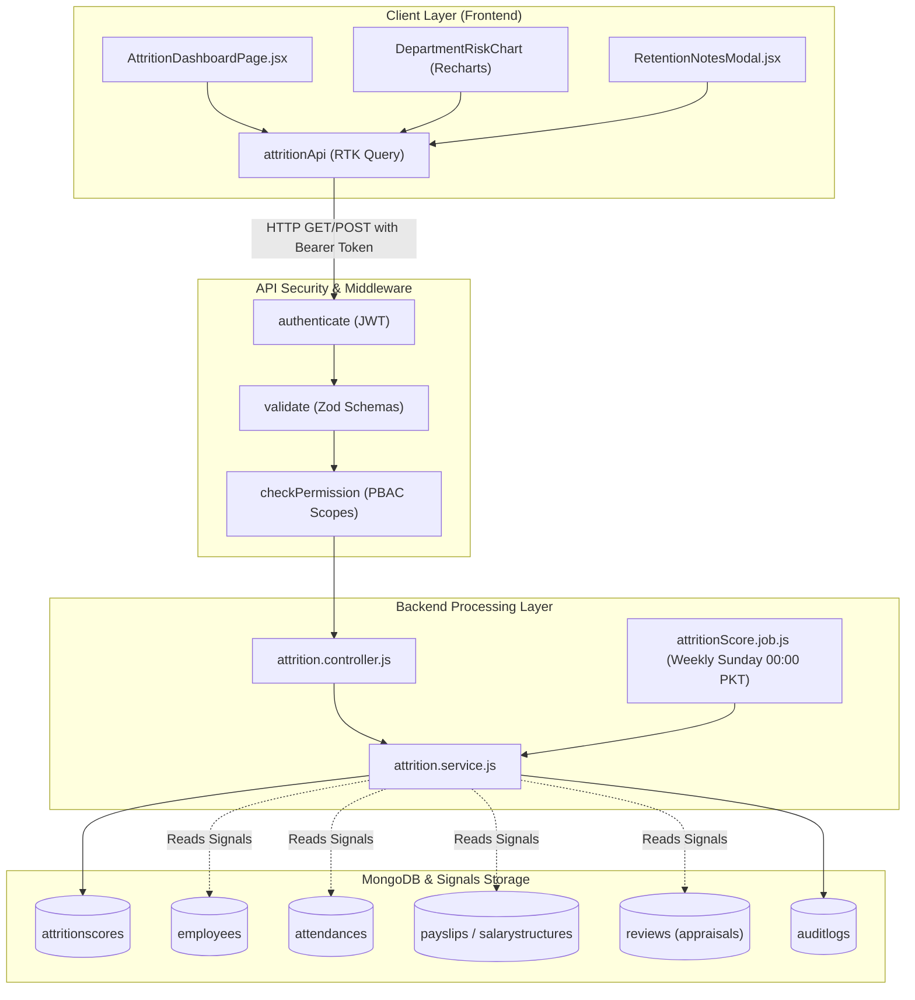
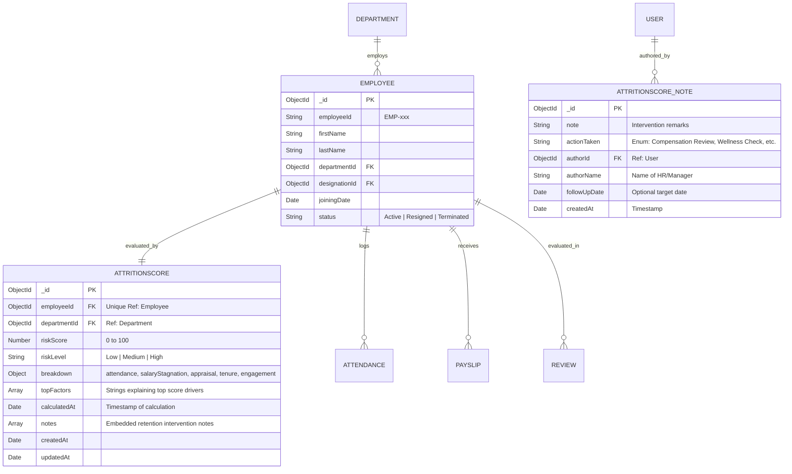
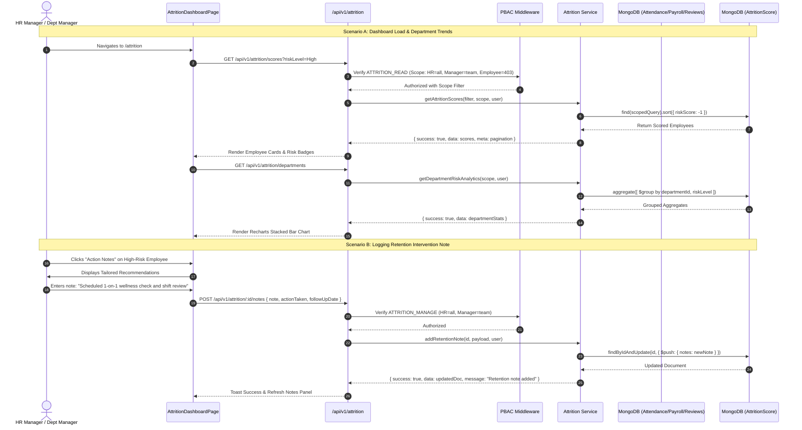

# Technical Architecture & Implementation Plan: M17 Attrition Prediction

**Module:** M17 Attrition Prediction  
**Phase:** Phase 3 — AI Features (Intelligence Scope)  
**Spec Directory:** `.specify/specs/24-attrition-prediction/plan.md`  
**Sources of Truth:**  
- `docs/TECH-SPEC.md`: Sections 3 (Folders), 4 (DB/Indexes), 5 (API Envelopes), 6 (PBAC/CASL Scopes), 8 (Request Lifecycle)  
- `docs/MODULES.md`: Section M17 Attrition Prediction  
- `docs/BUILD-GUIDE.md`: Section 26 (Rows 17.1 to 17.5)  
- `.specify/specs/24-attrition-prediction/spec.md`  

---

## 1. Architectural Blueprint & Alignment

Attrition Prediction is a predictive analytics module designed to prevent unwanted turnover by identifying flight-risk employees before resignations occur. The module follows the canonical 4-tier MERN enterprise architecture specified in `docs/TECH-SPEC.md`:

```
Client (Vite/React/RTK Query) 
  ↳ Express Router (`/api/v1/attrition`)
    ↳ Middleware Pipeline: authenticate (JWT) → validate (Zod) → checkPermission (CASL PBAC)
      ↳ Controller (`attrition.controller.js`)
        ↳ Service (`attrition.service.js`) + Background Job (`jobs/attritionScore.job.js`)
          ↳ MongoDB Multi-Signal Aggregation (`employees`, `attendances`, `payslips`, `reviews`, `departments`)
            ↳ Storage: `attritionscores` collection
```

### Signal Aggregation & Risk Engine Design
The scoring engine queries across existing modules:
- **Module M5 (Attendance):** Counts unplanned absences and late arrivals in the preceding 90-day window.
- **Module M9 (Payroll):** Calculates months elapsed since the last salary increment using `salaryStructures` / `payslips`.
- **Module M19 (Performance):** Checks date of last performance appraisal and historical ratings in `reviews`.
- **Module M3 (Employees):** Computes tenure in current designation/role without promotion.

### Strict Confidentiality Invariant
Attrition scores are strictly confidential:
- `Super Admin` & `HR Manager`: Full company-wide visibility (`scope: 'all'`).
- `Department Manager`: Team-level visibility only (`scope: 'team'`).
- `Employee`: **Zero visibility (HTTP 403 Forbidden & hidden navigation)**.

---

## 2. Exact Files List

### Backend (`backend/src/`)
1. **Model:**
   - [`backend/src/models/attritionScore.model.js`](file:///c:/Users/hamih/OneDrive/Desktop/AtoZ%20Coder/Advanced%20MERN/HRM/backend/src/models/attritionScore.model.js) — Mongoose schema for `AttritionScore` with embedded retention intervention notes and compound indexes.
2. **Validation:**
   - [`backend/src/modules/attrition/attrition.validation.js`](file:///c:/Users/hamih/OneDrive/Desktop/AtoZ%20Coder/Advanced%20MERN/HRM/backend/src/modules/attrition/attrition.validation.js) — Zod schemas for query filtering, calculation triggers, and retention notes.
3. **Service:**
   - [`backend/src/modules/attrition/attrition.service.js`](file:///c:/Users/hamih/OneDrive/Desktop/AtoZ%20Coder/Advanced%20MERN/HRM/backend/src/modules/attrition/attrition.service.js) — Core multi-signal risk calculation algorithm, department analytics aggregation, and note management.
4. **Controller:**
   - [`backend/src/modules/attrition/attrition.controller.js`](file:///c:/Users/hamih/OneDrive/Desktop/AtoZ%20Coder/Advanced%20MERN/HRM/backend/src/modules/attrition/attrition.controller.js) — Request validation extraction, service delegation, and uniform JSON response envelopes.
5. **Routes:**
   - [`backend/src/modules/attrition/attrition.routes.js`](file:///c:/Users/hamih/OneDrive/Desktop/AtoZ%20Coder/Advanced%20MERN/HRM/backend/src/modules/attrition/attrition.routes.js) — Express router guarded by `authenticate`, `validate`, and `checkPermission`.
6. **Background Cron Job:**
   - [`backend/src/jobs/attritionScore.job.js`](file:///c:/Users/hamih/OneDrive/Desktop/AtoZ%20Coder/Advanced%20MERN/HRM/backend/src/jobs/attritionScore.job.js) — Node-cron runner scheduled weekly (Sundays at 00:00 PKT).
7. **Permissions & Registration:**
   - Modify [`backend/src/shared/permissions.js`](file:///c:/Users/hamih/OneDrive/Desktop/AtoZ%20Coder/Advanced%20MERN/HRM/backend/src/shared/permissions.js) — Add `attrition` catalogue entry (`attrition.view`, `attrition.manage`).
   - Modify [`backend/src/seed/roles.seed.js`](file:///c:/Users/hamih/OneDrive/Desktop/AtoZ%20Coder/Advanced%20MERN/HRM/backend/src/seed/roles.seed.js) — Seed permissions for Super Admin, HR Manager, and Dept Manager.
   - Modify [`backend/src/app.js`](file:///c:/Users/hamih/OneDrive/Desktop/AtoZ%20Coder/Advanced%20MERN/HRM/backend/src/app.js) — Mount `/api/v1/attrition` route.
   - Modify [`backend/src/server.js`](file:///c:/Users/hamih/OneDrive/Desktop/AtoZ%20Coder/Advanced%20MERN/HRM/backend/src/server.js) — Initialize `initAttritionJob()`.
8. **Tests & Seeds:**
   - [`backend/tests/m17.attrition.test.js`](file:///c:/Users/hamih/OneDrive/Desktop/AtoZ%20Coder/Advanced%20MERN/HRM/backend/tests/m17.attrition.test.js) — Vitest suite covering all rows 17.1 to 17.5.
   - [`backend/tests/m17.attrition.security.test.js`](file:///c:/Users/hamih/OneDrive/Desktop/AtoZ%20Coder/Advanced%20MERN/HRM/backend/tests/m17.attrition.security.test.js) — Confidentiality, injection defense, and role isolation tests.
   - [`backend/src/seed/m17.seed.js`](file:///c:/Users/hamih/OneDrive/Desktop/AtoZ%20Coder/Advanced%20MERN/HRM/backend/src/seed/m17.seed.js) — Realistic attrition test data across departments.

### Frontend (`frontend/src/`)
1. **API Slice:**
   - [`frontend/src/features/attrition/attritionApi.js`](file:///c:/Users/hamih/OneDrive/Desktop/AtoZ%20Coder/Advanced%20MERN/HRM/frontend/src/features/attrition/attritionApi.js) — RTK Query hooks with cache tag invalidation (`getScores`, `getDepartmentTrends`, `recalculateScores`, `addRetentionNote`).
2. **Components:**
   - [`frontend/src/features/attrition/components/RiskTierBadge.jsx`](file:///c:/Users/hamih/OneDrive/Desktop/AtoZ%20Coder/Advanced%20MERN/HRM/frontend/src/features/attrition/components/RiskTierBadge.jsx) — Red (High), Amber (Medium), Green (Low) badges with pulse dots.
   - [`frontend/src/features/attrition/components/DepartmentRiskChart.jsx`](file:///c:/Users/hamih/OneDrive/Desktop/AtoZ%20Coder/Advanced%20MERN/HRM/frontend/src/features/attrition/components/DepartmentRiskChart.jsx) — Recharts stacked bar chart of department-wise risk distributions.
   - [`frontend/src/features/attrition/components/RetentionNotesModal.jsx`](file:///c:/Users/hamih/OneDrive/Desktop/AtoZ%20Coder/Advanced%20MERN/HRM/frontend/src/features/attrition/components/RetentionNotesModal.jsx) — Modal displaying rule-based retention advice and action note logging.
3. **Pages:**
   - [`frontend/src/features/attrition/pages/AttritionDashboardPage.jsx`](file:///c:/Users/hamih/OneDrive/Desktop/AtoZ%20Coder/Advanced%20MERN/HRM/frontend/src/features/attrition/pages/AttritionDashboardPage.jsx) — Complete risk intelligence dashboard with KPI metric cards, filters, department chart, and employee risk table.
4. **Navigation & Routes:**
   - Modify [`frontend/src/components/layout/Sidebar.jsx`](file:///c:/Users/hamih/OneDrive/Desktop/AtoZ%20Coder/Advanced%20MERN/HRM/frontend/src/components/layout/Sidebar.jsx) — Add "Attrition Risk" link guarded by `can('attrition.view')` (hidden for Employee).
   - Modify [`frontend/src/App.jsx`](file:///c:/Users/hamih/OneDrive/Desktop/AtoZ%20Coder/Advanced%20MERN/HRM/frontend/src/App.jsx) — Register `/attrition` protected route.

---

## 3. Mermaid Architecture Diagrams

### Diagram 1: System Flow & Request Pipeline


---

### Diagram 2: Entity-Relationship Diagram (ERD)


---

### Diagram 3: Main Sequence Diagram (Calculation, Analytics & Note Logging)


---

## 4. Database Schema, Validation & Indexes (Verified via MongoDB MCP)

### Collection: `attritionscores`
```javascript
import mongoose from 'mongoose';

const retentionNoteSchema = new mongoose.Schema(
  {
    note: { type: String, required: true, trim: true, maxlength: 1000 },
    actionTaken: {
      type: String,
      required: true,
      enum: [
        'Compensation Review',
        'One-on-One Wellness Check',
        'Career Pathing / Promotion',
        'Workload Rebalancing',
        'Performance Counseling',
        'Other'
      ],
      default: 'One-on-One Wellness Check'
    },
    authorId: { type: mongoose.Schema.Types.ObjectId, ref: 'User', required: true },
    authorName: { type: String, required: true },
    followUpDate: { type: Date, default: null }
  },
  { timestamps: true }
);

const attritionScoreSchema = new mongoose.Schema(
  {
    employeeId: {
      type: mongoose.Schema.Types.ObjectId,
      ref: 'Employee',
      required: true,
      unique: true,
      index: true
    },
    departmentId: {
      type: mongoose.Schema.Types.ObjectId,
      ref: 'Department',
      required: true,
      index: true
    },
    riskScore: {
      type: Number,
      required: true,
      min: 0,
      max: 100,
      index: true
    },
    riskLevel: {
      type: String,
      required: true,
      enum: ['Low', 'Medium', 'High'],
      index: true
    },
    breakdown: {
      attendance: { type: Number, default: 0 },
      salaryStagnation: { type: Number, default: 0 },
      appraisal: { type: Number, default: 0 },
      tenure: { type: Number, default: 0 },
      engagement: { type: Number, default: 0 }
    },
    topFactors: [{ type: String, trim: true }],
    calculatedAt: {
      type: Date,
      default: Date.now,
      index: true
    },
    notes: [retentionNoteSchema]
  },
  {
    timestamps: true
  }
);

// Compound and operational indexes
attritionScoreSchema.index({ departmentId: 1, riskLevel: 1 });
attritionScoreSchema.index({ riskScore: -1 });
attritionScoreSchema.index({ calculatedAt: -1 });

export const AttritionScore = mongoose.model('AttritionScore', attritionScoreSchema);
```

---

## 5. Endpoints Contract & PBAC Permission Scopes

| HTTP Method | Route | Permission Action | Scopes Allowed | Allowed Roles | Description |
| :--- | :--- | :--- | :--- | :--- | :--- |
| `GET` | `/api/v1/attrition/scores` | `attrition.view` | `all`, `team` | Super Admin, HR Manager, Dept Manager | Paginated list of attrition risk scores with search & filters |
| `GET` | `/api/v1/attrition/scores/:id` | `attrition.view` | `all`, `team` | Super Admin, HR Manager, Dept Manager | Detailed single employee score breakdown & factor analysis |
| `POST` | `/api/v1/attrition/calculate` | `attrition.manage` | `all` | Super Admin, HR Manager | On-demand manual recalculation across all active employees |
| `GET` | `/api/v1/attrition/departments` | `attrition.view` | `all`, `team` | Super Admin, HR Manager, Dept Manager | Department-level risk distribution analytics for Recharts |
| `POST` | `/api/v1/attrition/:id/notes` | `attrition.manage` | `all`, `team` | Super Admin, HR Manager, Dept Manager | Log a retention intervention note with follow-up date |
| `GET` | `/api/v1/attrition/:id/notes` | `attrition.view` | `all`, `team` | Super Admin, HR Manager, Dept Manager | Retrieve history of intervention notes for an employee |

### Registration in `shared/permissions.js`
Add `attrition` entry:
```javascript
{
  module: 'attrition',
  label: 'Attrition Prediction',
  subject: 'Attrition',
  description: 'Weekly flight risk scoring, department analytics, and HR intervention action notes.',
  actions: [
    {
      action: 'attrition.view',
      label: 'View Attrition Risk Scores & Analytics',
      description: 'Inspect employee flight risk scores, contributing factors, and department trends.',
      allowedScopes: ['team', 'department', 'all'],
      defaultScope: 'team'
    },
    {
      action: 'attrition.manage',
      label: 'Manage Attrition Scoring & Action Notes',
      description: 'Trigger on-demand risk recalculation and record employee retention intervention notes.',
      allowedScopes: ['team', 'department', 'all'],
      defaultScope: 'team'
    }
  ]
}
```

---

## 6. Verification & Quality Gates

1. **Vitest Unit & Integration Suites (`tests/m17.attrition.test.js`):**
   - Scoring algorithm validation against multi-signal combinations.
   - On-demand recalculation trigger and persistence.
   - Department aggregation math accuracy.
   - Retention note addition and retrieval.
2. **Vitest Security Suite (`tests/m17.attrition.security.test.js`):**
   - HTTP 401 unauthenticated guard.
   - HTTP 403 regular employee restriction (zero access invariant).
   - Department Manager team boundary isolation (cannot query other departments).
   - NoSQL injection and payload sanitization.
3. **Playwright E2E (`tests/e2e/m17-attrition.spec.js`):**
   - Super Admin & HR Manager see company-wide chart and employee scores.
   - Department Manager sees only team members; cannot see external staff.
   - Employee sees NO sidebar item; direct navigation to `/attrition` redirects to unauthorized.
   - Responsive verification at 390px mobile viewport.

