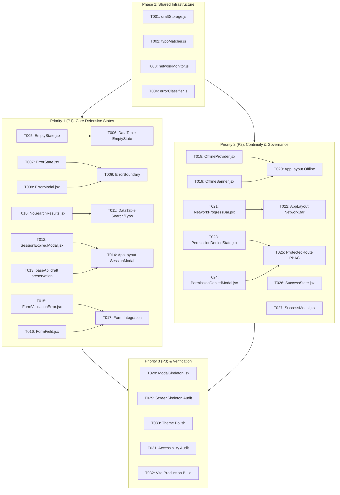

# Tasks: Systemic 10 UI States Framework

**Branch**: `feature/24-systemic-ten-ui-states`  
**Prerequisites**: [`.specify/specs/24-systemic-ten-ui-states/spec.md`](file:///c:/Users/hamih/OneDrive/Desktop/AtoZ%20Coder/Advanced%20MERN/HRM/.specify/specs/24-systemic-ten-ui-states/spec.md), [`.specify/specs/24-systemic-ten-ui-states/plan.md`](file:///c:/Users/hamih/OneDrive/Desktop/AtoZ%20Coder/Advanced%20MERN/HRM/.specify/specs/24-systemic-ten-ui-states/plan.md)  
**Organization**: Granular, testable tasks organized by foundational infrastructure and user stories (P1, P2, P3).  
**Design Standard**: Forest & Emerald craft tokens (`#061A14`, `#111D17`, `#00C471`, `#1A3125`, `#EAECF0`). Zero bloat / Ponytail optimization.

---

## Format: `[ID] [P?] [Story] Description`
- **[P]**: Parallelizable task (different file, no blocking dependency)
- **[Story]**: Mapped user story from `spec.md` (`US1` to `US10`)

---

## Phase 1: Setup & Foundational Engines

**Purpose**: Core client-side utility engines required by the 10 states (draft storage, typo suggestion, network latency, error attribution).

- [X] **T001** [P] Create `frontend/src/lib/draftStorage.js` with functions `saveFormDraft(formId, data, userId)`, `loadFormDraft(formId, userId)`, `clearFormDraft(formId, userId)`, and `hasFormDraft(formId, userId)` using `localStorage` scoped keys (`hrm_draft_recovery_*`).
- [X] **T002** [P] Create `frontend/src/lib/typoMatcher.js` with Levenshtein distance algorithm and `findClosestMatch(query, candidates, threshold)` supporting word-boundary tokenization.
- [X] **T003** [P] Create `frontend/src/lib/networkMonitor.js` to inspect `navigator.connection` (downlink, effectiveType, rtt) and emit network performance events.
- [X] **T004** [P] Create `frontend/src/lib/errorClassifier.js` with `classifyError(error)` resolving fault domains (`server`, `client`, `network`, `auth`, `gateway`), descriptive summaries, and actionable resolution steps.

**Checkpoint**: Foundational engines ready for state components.

---

## Phase 2: User Story 1 (P1) - State 1: Empty States & Data-Entry Onboarding

**Goal**: Deliver `<EmptyState />` component stating what is empty, giving reassurance, and offering exactly one clear next step CTA.

- [X] **T005** [P] [US1] Create `frontend/src/components/common/EmptyState.jsx` with customizable `icon`, `title`, `description`, `action` (`{ label, onClick, href, icon }`), `secondaryAction`, and dark/light styling conforming to `DESIGN.md`.
- [X] **T006** [US1] Update `frontend/src/components/common/DataTable.jsx` to render `<EmptyState />` when `data.length === 0 && !searchTerm`, accepting optional `emptyTitle`, `emptyDescription`, and `emptyAction` props.

**Checkpoint**: All empty tables and list views present context-rich empty states with a direct call-to-action.

---

## Phase 3: User Story 2 (P1) - State 3: Error States & Root-Cause Attribution

**Goal**: Implement `<ErrorState />` and `<ErrorModal />` explaining what went wrong, whose fault it is, and concrete steps to fix it.

- [X] **T007** [P] [US2] Create `frontend/src/components/common/ErrorState.jsx` displaying fault badge (Server / Client / Network / Gateway), explicit headline, explanation, and `[Retry]` + `[Back / Home]` buttons.
- [X] **T008** [P] [US2] Create `frontend/src/components/common/ErrorModal.jsx` dialog with backdrop blur, accessible ARIA attributes, error code badge, and actionable retry controls.
- [X] **T009** [US2] Refactor `frontend/src/components/common/ErrorBoundary.jsx` to use `classifyError` and render `<ErrorState />` with reload and navigation recovery controls.

**Checkpoint**: Runtime and API errors provide clear blame attribution and recovery actions rather than generic error messages.

---

## Phase 4: User Story 3 (P1) - State 6: No Search Results & Typo Suggestions

**Goal**: Implement `<NoSearchResults />` distinguishing empty collections from search misses, with typo suggestion and 1-click reset.

- [X] **T010** [P] [US3] Create `frontend/src/components/common/NoSearchResults.jsx` featuring search query badge, typo suggestion candidate ("Did you mean '{suggestion}'?"), and `[Clear Search & Filters]` button.
- [X] **T011** [US3] Integrate `<NoSearchResults />` into `frontend/src/components/common/DataTable.jsx` when `searchTerm` is active and `filteredData.length === 0`, extracting column values as candidate vocabulary for typo matching.

**Checkpoint**: Table searches with typos suggest closest matching terms and offer instant one-click filter resets.

---

## Phase 5: User Story 4 (P1) - State 8: Session Expired & Draft Preservation Modal

**Goal**: Implement `<SessionExpiredModal />` preserving unsaved form data in `localStorage` upon 401 token expiration before signout.

- [X] **T012** [P] [US4] Create `frontend/src/components/common/SessionExpiredModal.jsx` with backdrop blur, re-authentication email/password inputs, preservation badge ("Your unsaved work is safely preserved"), and `[Sign In & Continue Drafting]` CTA.
- [X] **T013** [US4] Update `frontend/src/lib/baseApi.js` to dispatch a global `session-expired` custom DOM event and snapshot active form inputs via `draftStorage.js` when token refresh fails before executing logout.
- [X] **T014** [US4] Mount `<SessionExpiredModal />` in `frontend/src/components/layout/AppLayout.jsx` listening for `session-expired` events and offering seamless re-authentication.

**Checkpoint**: 401 authorization timeouts safely store form inputs to `localStorage` and present re-login modal without data loss.

---

## Phase 6: User Story 5 (P1) - State 9: Precise Form Validation & Inline Instructions

**Goal**: Implement `<FormField />` and `<FormValidationError />` highlighting invalid inputs with red hairline borders and exact formatting guidance.

- [X] **T015** [P] [US5] Create `frontend/src/components/common/FormValidationError.jsx` displaying alert circle icon and specific inline correction instructions.
- [X] **T016** [P] [US5] Create `frontend/src/components/common/FormField.jsx` wrapping input elements with label, required asterisk, helper text, and accessible `aria-invalid` / `aria-describedby` wiring.
- [X] **T017** [US5] Integrate `<FormField />` and `<FormValidationError />` into core modals (e.g., `EmployeeModal.jsx`, `ExpenseModal.jsx` or `LoanApplyModal.jsx`) ensuring validation errors appear inline rather than generic toast-only.

**Checkpoint**: Invalid inputs highlight with red hairline borders and display exact format instructions directly beneath the field.

---

## Phase 7: User Story 6 (P2) - State 4: Offline Awareness & Cached Continuity

**Goal**: Implement `OfflineProvider` and `<OfflineBanner />` keeping cached data on screen and notifying user during disconnects.

- [X] **T018** [P] [US6] Create `frontend/src/components/common/OfflineProvider.jsx` maintaining `isOnline` state via `window.addEventListener('online' | 'offline')` and exposing `useOffline()` hook.
- [X] **T019** [P] [US6] Create `frontend/src/components/common/OfflineBanner.jsx` showing top floating capsule: `"Offline Mode: Viewing cached data. Offline changes will synchronize when reconnected."`
- [X] **T020** [US6] Mount `<OfflineProvider />` and `<OfflineBanner />` in `frontend/src/components/layout/AppLayout.jsx`, firing an emerald Sonner toast upon reconnection.

**Checkpoint**: Disconnecting internet maintains cached data on screen with non-intrusive banner and triggers auto-reconnect toast.

---

## Phase 8: User Story 7 (P2) - State 5: Slow Network Detection & Lightweight Fallback

**Goal**: Implement `<NetworkProgressBar />` detecting latency > 2500ms and offering progress telemetry and low-bandwidth advice.

- [X] **T021** [P] [US7] Create `frontend/src/components/common/NetworkProgressBar.jsx` rendering a 2px animated emerald telemetry bar along the viewport top edge during high-latency requests with slow connection advisory badge.
- [X] **T022** [US7] Mount `<NetworkProgressBar />` in `frontend/src/components/layout/AppLayout.jsx` and connect to active RTK Query fetching state and network latency telemetry.

**Checkpoint**: High latency queries display top-edge progress feedback and reassurance preventing duplicate clicks.

---

## Phase 9: User Story 8 (P2) - State 7: Permission Denied & Contextual Escalation

**Goal**: Implement `<PermissionDeniedState />` and `<PermissionDeniedModal />` explaining missing permissions and offering a safe return path.

- [X] **T023** [P] [US8] Create `frontend/src/components/common/PermissionDeniedState.jsx` with ShieldLock icon, required permission badge, explanation of role restrictions, and `[Return to Dashboard]` button.
- [X] **T024** [P] [US8] Create `frontend/src/components/common/PermissionDeniedModal.jsx` for action-level permission denials with option to request access from HR admin.
- [X] **T025** [US8] Update `frontend/src/components/ProtectedRoute.jsx` to render `<PermissionDeniedState />` instead of silent redirect when user lacks `requiredPermission` or `requiredRole`.

**Checkpoint**: 403 authorization failures show required permission details, reason for denial, and clear return path.

---

## Phase 10: User Story 9 (P2) - State 10: Success States with Reassurance & Next Steps

**Goal**: Implement `<SuccessState />` and `<SuccessModal />` providing confirmation, data reassurance, and multi-step pipeline preview.

- [X] **T026** [P] [US9] Create `frontend/src/components/common/SuccessState.jsx` with emerald checkmark, reference ID, data safety confirmation, and sequential "What Happens Next" workflow step tracker.
- [X] **T027** [P] [US9] Create `frontend/src/components/common/SuccessModal.jsx` dialog displaying confirmation summary, downstream approval pipeline, and primary/secondary CTAs (`[View Record]` / `[Create Another]`).

**Checkpoint**: Successful submissions reassure users of data persistence and clearly show upcoming lifecycle stages.

---

## Phase 11: User Story 10 (P3) - State 2: Loading Skeletons Geometry Alignment

**Goal**: Implement `<ModalSkeleton />` and audit skeleton geometry to ensure zero Cumulative Layout Shift (CLS).

- [X] **T028** [P] [US10] Create `frontend/src/components/common/ModalSkeleton.jsx` with form field shimmers, header shimmers, and button shimmers for drawer/modal loading states.
- [X] **T029** [US10] Audit `frontend/src/components/common/ScreenSkeleton.jsx` variants (`table`, `cards`, `profile`, `matrix`) to match target page DOM geometry.

**Checkpoint**: No solitary spinning wheels replace content blocks; all loading states match target geometry.

---

## Phase 12: Polish, Integration Verification & Build

**Purpose**: Verify end-to-end integration across all 10 states, design alignment, and clean production build.

- [X] **T030** Verify theme consistency with `DESIGN.md` (Emerald `#00C471`, Card `#111D17` / `#FFFFFF`, Border `#1A3125` / `#EAECF0`).
- [X] **T031** Verify accessibility compliance (`role="dialog"`, `aria-invalid`, `aria-describedby`, keyboard `Esc` handling).
- [X] **T032** Run production frontend build: `npm run build --prefix frontend` ensuring 0 errors.

---

## Dependencies & Execution Order

---

## Parallel Execution Opportunities

- **Batch 1 (Foundational Engines)**: `T001`, `T002`, `T003`, `T004` can all be implemented in parallel.
- **Batch 2 (Core Components)**: `T005` (`EmptyState`), `T007` (`ErrorState`), `T008` (`ErrorModal`), `T010` (`NoSearchResults`), `T012` (`SessionExpiredModal`), `T015`/`T016` (`FormField`), `T018`/`T019` (`Offline`), `T021` (`NetworkProgressBar`), `T023`/`T024` (`PermissionDenied`), `T026`/`T027` (`SuccessState`/`SuccessModal`), `T028` (`ModalSkeleton`) can be constructed simultaneously.
- **Batch 3 (Integrations)**:
  - `T006` & `T011` inside `DataTable.jsx`.
  - `T014`, `T020`, `T022` inside `AppLayout.jsx`.
  - `T013` inside `baseApi.js`.
  - `T025` inside `ProtectedRoute.jsx`.
- **Batch 4 (Verification)**: `T030`, `T031`, `T032`.

