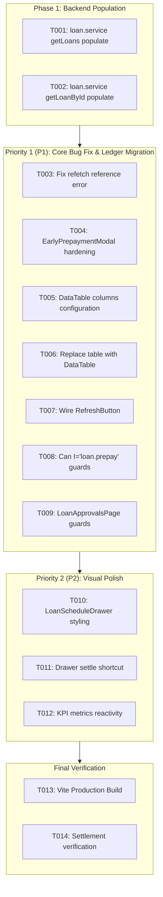

# Tasks: Loans & Advances UI Modernization & Settlement Bug Resolution

**Branch**: `feature/25-loans-and-advances-ui-and-settlement`  
**Prerequisites**: [`.specify/specs/25-loans-and-advances-ui-and-settlement/spec.md`](file:///c:/Users/hamih/OneDrive/Desktop/AtoZ%20Coder/Advanced%20MERN/HRM/.specify/specs/25-loans-and-advances-ui-and-settlement/spec.md), [`.specify/specs/25-loans-and-advances-ui-and-settlement/plan.md`](file:///c:/Users/hamih/OneDrive/Desktop/AtoZ%20Coder/Advanced%20MERN/HRM/.specify/specs/25-loans-and-advances-ui-and-settlement/plan.md)  
**Organization**: Structured into sequential, independently verifiable phases mapped to User Stories (P1, P2).  
**Design Standard**: Forest & Emerald craft tokens (`#061A14`, `#111D17`, `#00C471`, `#1A3125`, `#EAECF0`). Ponytail optimization.

---

## Format: `[ID] [P?] [Story] Description`
- **[P]**: Parallelizable task (different file, no blocking dependency)
- **[Story]**: Target user journey from `spec.md` (`US1` to `US5`)

---

## Phase 1: Setup & Backend Serialization

**Purpose**: Ensure the backend query populates all borrower employee attributes and department details needed by the frontend.

- [x] **T001** [P] Update `backend/src/modules/loans/loan.service.js` in `getLoans()` to populate `employeeId` with `name`, `employeeCode`, `avatar`, and nested `departmentId` (`name`, `code`) and `designationId` (`title`).
- [x] **T002** [P] Update `backend/src/modules/loans/loan.service.js` in `getLoanById()` to similarly populate `employeeId.departmentId` and `employeeId.designationId`.

**Checkpoint**: `/api/v1/loans` returns populated borrower names, codes, and departments.

---

## Phase 2: User Story 1 (P1) - Bug Fix: Early Prepayment & Account Settlement

**Goal**: Eliminate the false-alarm error toast on prepayment settlement by fixing the undefined `refetch()` reference error and hardening the modal.

- [x] **T003** [US1] In `frontend/src/features/loans/pages/LoanLedgerPage.jsx`, fix the `EarlyPrepaymentModal`'s `onClose` callback to invoke `refetchLoans()` and `refetchSummary()` instead of the non-existent `refetch()`.
- [x] **T004** [P] [US1] Refactor `frontend/src/features/loans/components/EarlyPrepaymentModal.jsx` to:
  - Integrate `<FormField />` with inline validation instructions (`State 9`).
  - Add a *"Full Settle"* shortcut button auto-filling the exact remaining balance.
  - Display dynamic remaining balance preview chip (`PKR 0 (Closed)`).
  - Ensure error handling cleanly extracts API error messages without false alarms.

**Checkpoint**: Recording early prepayment closes the loan and surfaces a green success toast with **zero** `Failed to record prepayment` error toasts.

---

## Phase 3: User Story 2 (P1) - Company Borrowing Ledger `<DataTable />` Migration

**Goal**: Replace the raw HTML `<table>` in `LoanLedgerPage.jsx` with `<DataTable />`, fixing the `"Employee ."` visual defect and integrating the 10 Systemic UI States.

- [x] **T005** [US2] In `frontend/src/features/loans/pages/LoanLedgerPage.jsx`, construct the column definitions for `<DataTable />`:
  - `loanId`: Loan ID with uppercase type pill.
  - `employee`: Avatar initial circle (`w-8 h-8 rounded-full bg-emerald-50 text-emerald-600 font-bold border border-emerald-200/60`), borrower name, and `{employeeCode} • {department}` caption.
  - `amount`: Formatted principal in PKR.
  - `tenure`: Repayment tenure months with monthly EMI in PKR.
  - `repaid`: Repaid amount in emerald.
  - `balance`: Remaining balance in rose (or slate when 0).
  - `status`: `<StatusBadge />` pill.
  - `actions`: *"Schedule"* drawer trigger and *"Settle Early"* button.
- [x] **T006** [US2] Replace the custom `<table>` in `frontend/src/features/loans/pages/LoanLedgerPage.jsx` with `<DataTable />`, passing `columns`, `data={filteredLoans}`, `isLoading={isLoadingLoans}`, `emptyTitle="No borrowing accounts found"`, and search filtering.
- [x] **T007** [US2] Update the topbar actions in `LoanLedgerPage.jsx` to wire `<RefreshButton />` to both `refetchLoans()` and `refetchSummary()`.

**Checkpoint**: Every row in the ledger displays the real borrower name, avatar, code, and department name; table supports sorting, empty states, and typo suggestions.

---

## Phase 4: User Story 3 (P1) - PBAC & RBAC Enforcement

**Goal**: Enforce CASL ability rules across all action controls and views in the Loans module.

- [x] **T008** [P] [US3] Wrap the *"Settle Early"* action buttons in `LoanLedgerPage.jsx` and `LoanScheduleDrawer.jsx` with `<Can I="loan.prepay" a="Loan">`.
- [x] **T009** [P] [US3] Verify that `LoanApprovalsPage.jsx` action controls (`Recommend`, `Approve`, `Reject`) respect `loan.recommend` and `loan.approve` permissions with clean badge indicators.

**Checkpoint**: Only authorized roles can view the ledger and execute prepayment settlements or approvals.

---

## Phase 5: User Story 4 (P2) - Repayment Schedule Drawer & Amortization Refinement

**Goal**: Refine `LoanScheduleDrawer.jsx` to adhere to Forest & Emerald design specifications with rich installment tracking.

- [x] **T010** [US4] Refactor `frontend/src/features/loans/components/LoanScheduleDrawer.jsx` to match `DESIGN.md`:
  - Backdrop blur with smooth slide-in animation.
  - Financial KPI cards (`Principal`, `Total Repaid`, `Remaining`) with dark mode support.
  - Animated emerald amortization progress bar.
  - Itemized installment list with installment number chips, due dates, paid timestamps, and status chips (`Pending`, `Deducted`, `Prepaid`).
- [x] **T011** [US4] In `LoanScheduleDrawer.jsx`, add an early settlement action shortcut in the drawer footer for active loans, guarded by `<Can I="loan.prepay" a="Loan">`.

**Checkpoint**: Schedule drawer provides clear, itemized audit trails of monthly deductions and early prepayments.

---

## Phase 6: User Story 5 (P2) - Executive KPI Metrics & Aggregates

**Goal**: Ensure top-level borrowing statistics dynamically synchronize with database state.

- [x] **T012** [US5] Verify that the four KPI cards (`Total Capital Disbursed`, `Recovered Capital`, `Current Outstanding Exposure`, `Active Accounts`) in `LoanLedgerPage.jsx` use `<LoanStatsCard />` with correct color themes and recalculate immediately upon prepayment settlement.

**Checkpoint**: Settling a loan immediately decrements outstanding exposure and active accounts.

---

## Phase 7: Verification & Build

**Purpose**: Verify end-to-end functionality, design alignment, and clean production build.

- [x] **T013** Run production frontend build: `npm run build --prefix frontend` ensuring 0 errors.
- [x] **T014** Verify that early prepayment settlement closes the loan without triggering any `Failed to record prepayment` toast.

---

## Dependencies & Execution Order

---

## Parallel Execution Opportunities

- **Batch 1 (Backend)**: `T001` and `T002` can be implemented together in `loan.service.js`.
- **Batch 2 (Bug Fix & Modal)**: `T003` and `T004` can be implemented together.
- **Batch 3 (Ledger Migration)**: `T005`, `T006`, `T007`, `T008` in `LoanLedgerPage.jsx`.
- **Batch 4 (Schedule Drawer)**: `T010` and `T011` in `LoanScheduleDrawer.jsx`.
- **Batch 5 (Verification)**: `T013` and `T014`.

