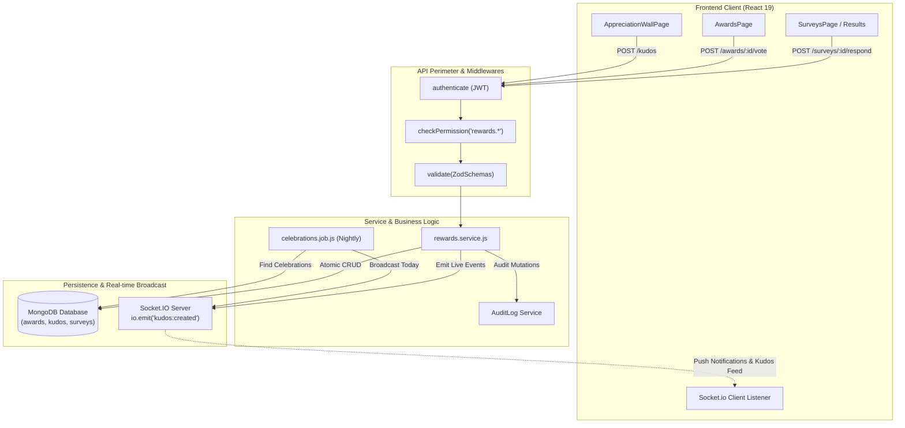
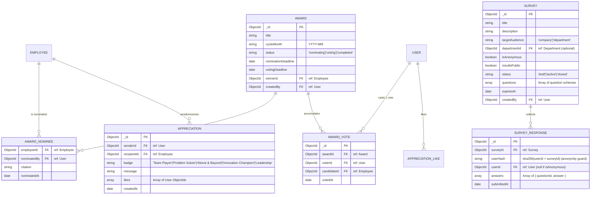
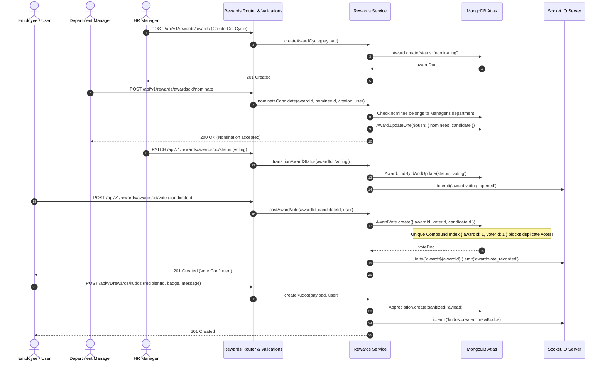

# Architecture & Technical Plan: Module M20 — Rewards, Celebrations & Surveys

**Module ID:** M20  
**Module Name:** Rewards, Celebrations & Surveys  
**Phase:** Phase 4 — Engagement & Polish (P3 Scope)  
**Spec Directory:** `.specify/specs/25-rewards-celebrations-surveys/`  
**Sources of Truth:**  
- `docs/TECH-SPEC.md`: Sections 3 (Folders), 4 (Database), 5 (API), 6 (PBAC), 8 (Request Lifecycle)  
- `docs/MODULES.md`: Section M20  
- `docs/BUILD-GUIDE.md`: Section 27 (Rows 20.1 to 20.5)  
- `.specify/specs/25-rewards-celebrations-surveys/spec.md`  

---

## 1. Architectural Blueprint & Request Lifecycle

Following `TECH-SPEC.md` Section 8, every incoming client request flows strictly through the 7-layer pipeline:

```
Client (React 19 / RTK Query)
   │
   ▼
1. Express Global Middleware (CORS, Helmet, RateLimiter)
   │
   ▼
2. `authenticate` (JWT verification & User population)
   │
   ▼
3. `checkPermission('rewards.<action>', 'Rewards')` (CASL PBAC evaluation)
   │
   ▼
4. `validate(schema)` (Zod runtime validation for body, query, and params)
   │
   ▼
5. Controller Layer (`rewards.controller.js` — pure I/O orchestration)
   │
   ▼
6. Service Layer (`rewards.service.js` — business logic, scoping, atomic transactions)
   │
   ├─► MongoDB (Mongoose models: Award, AwardVote, Appreciation, Survey, SurveyResponse)
   ├─► Redis / Socket.IO (Live broadcast: 'kudos:created', 'award:voted', 'celebration:today')
   └─► Centralized Audit Logging (`AuditLog.create`)
   │
   ▼
7. Response Envelope (`ApiResponse.success(res, 200, data, message, meta)`)
```

---

## 2. Directory Structure & File Inventory

All code is strictly plain JavaScript (`.js`, `.jsx`), using standard libraries and zero unapproved dependencies:

```
backend/
├── src/
│   ├── models/
│   │   ├── award.model.js               # Award cycles & candidate nominations
│   │   ├── awardVote.model.js           # Atomic single-vote persistence
│   │   ├── appreciation.model.js        # Peer kudos posts, badges & reactions
│   │   ├── survey.model.js              # Pulse surveys, polls, and questions
│   │   └── surveyResponse.model.js      # Individual and anonymous survey submissions
│   ├── modules/
│   │   └── rewards/
│   │       ├── rewards.validation.js    # Zod schemas for kudos, voting, and surveys
│   │       ├── rewards.service.js       # Business logic, PBAC scoping, Socket.io hooks
│   │       ├── rewards.controller.js    # Express controller handlers
│   │       └── rewards.routes.js        # Protected routes with middleware bindings
│   ├── jobs/
│   │   └── celebrations.job.js          # Scheduled daily birthday/anniversary greeting cron
│   └── seed/
│       └── m20.seed.js                  # Realistic demo data for kudos, awards, and surveys
frontend/
└── src/
    └── features/
        └── rewards/
            ├── rewardsApi.js            # RTK Query hooks with tag cache invalidation
            ├── pages/
                ├── AwardsPage.jsx              # EOTM cycles, nomination cards, and voting UI
                ├── AppreciationWallPage.jsx   # Live Kudos social feed with reaction triggers
                ├── CelebrationsWallPage.jsx    # Birthday & work anniversary milestones
                ├── SurveysPage.jsx             # Active and closed company pulse surveys
                ├── SurveyFillPage.jsx          # Interactive survey question answering
                └── SurveyResultsPage.jsx       # Survey analytics & native SVG rating charts
            └── components/
                ├── NominateModal.jsx           # Manager award candidate submission form
                ├── VotingCard.jsx              # Nominee citation card with one-click voting
                ├── GiveKudosModal.jsx          # Colleague selection with badge picker
                ├── KudosCard.jsx               # Feed post card with badge icon & like counter
                ├── CelebrationCard.jsx         # Birthday/Anniversary milestone card
                ├── SurveyBuilderModal.jsx      # Multi-question creator with anonymous toggle
                └── RatingBreakdownChart.jsx    # Pure SVG rating distribution visualizer
```

---

## 3. Architecture Diagrams (Mermaid Engine)

### Diagram 1: System Flow & Real-Time Pipeline


---

### Diagram 2: Entity-Relationship Diagram (ERD)


---

### Diagram 3: Main Sequence Diagram (EOTM Voting & Peer Kudos Workflow)


---

## 4. API Endpoints, PBAC Permissions & Scoping Contracts

To be registered in `backend/src/shared/permissions.js` under module `rewards`:

| Method & Route | Action / Permission | Subject | Allowed Scopes | Description & Defense |
| :--- | :--- | :--- | :--- | :--- |
| `POST /api/v1/rewards/awards` | `rewards.manage` | `Rewards` | `['all']` | Super Admin & HR Manager create monthly award cycles. |
| `GET /api/v1/rewards/awards` | `rewards.view` | `Rewards` | `['own', 'team', 'department', 'all']` | Fetch award cycles with nominees and active status. |
| `POST /api/v1/rewards/awards/:id/nominate` | `rewards.nominate` | `Rewards` | `['team', 'all']` | Dept Manager nominates team member with citation. |
| `POST /api/v1/rewards/awards/:id/vote` | `rewards.vote` | `Rewards` | `['own', 'all']` | Employees cast single vote for a nominee (HTTP 409 on duplicate). |
| `PATCH /api/v1/rewards/awards/:id/announce` | `rewards.manage` | `Rewards` | `['all']` | HR Manager announces winner, locking the cycle. |
| `POST /api/v1/rewards/kudos` | `rewards.kudos` | `Rewards` | `['own', 'all']` | Send peer appreciation with badge and message. |
| `GET /api/v1/rewards/kudos` | `rewards.view` | `Rewards` | `['own', 'team', 'department', 'all']` | Fetch paginated recognition feed. |
| `POST /api/v1/rewards/kudos/:id/like` | `rewards.kudos` | `Rewards` | `['own', 'all']` | Toggle like reaction on kudos card. |
| `GET /api/v1/rewards/celebrations/today` | `rewards.view` | `Rewards` | `['own', 'team', 'department', 'all']` | Fetch today's birthdays and work anniversaries. |
| `POST /api/v1/rewards/surveys` | `rewards.manage` | `Rewards` | `['department', 'all']` | Create pulse survey or poll with optional anonymity. |
| `GET /api/v1/rewards/surveys` | `rewards.view` | `Rewards` | `['own', 'team', 'department', 'all']` | Fetch active surveys targeted to user's scope. |
| `POST /api/v1/rewards/surveys/:id/respond` | `rewards.respond` | `Rewards` | `['own', 'all']` | Submit responses; strictly 1 submission per employee. |
| `GET /api/v1/rewards/surveys/:id/results` | `rewards.view` | `Rewards` | `['department', 'all']` | Aggregated response rates and question distributions. |

### Role Permissions Seed Mapping
- **Super Admin**: `all` on `rewards.view`, `rewards.nominate`, `rewards.vote`, `rewards.kudos`, `rewards.respond`, `rewards.manage`.
- **HR Manager**: `all` on `rewards.view`, `rewards.nominate`, `rewards.vote`, `rewards.kudos`, `rewards.respond`, `rewards.manage`.
- **Department Manager**: `team` on `rewards.nominate`, `all` on `rewards.view`, `rewards.vote`, `rewards.kudos`, `rewards.respond`.
- **Employee**: `own` on `rewards.vote`, `rewards.kudos`, `rewards.respond`, `rewards.view`.

---

## 5. Database Schema & Indexing Strategy

### 5.1 `Award` (`awards`)
- **Indexes**:
  - `{ cycleMonth: 1 }` (Unique cycle identifier: e.g., `'2026-10'`).
  - `{ status: 1 }` (Querying active nominating/voting cycles).

### 5.2 `AwardVote` (`awardvotes`)
- **Compound Unique Index**:
  - `{ awardId: 1, voterId: 1 }` — **Strict Invariant**: Enforces at the database engine level that no user can cast more than one vote in the same award cycle.
- **Auxiliary Index**:
  - `{ awardId: 1, candidateId: 1 }` (Tallying candidate vote counts).

### 5.3 `Appreciation` (`appreciations`)
- **Indexes**:
  - `{ createdAt: -1 }` (Chronological feed pagination).
  - `{ recipientId: 1, createdAt: -1 }` (Employee profile recognition tab).
  - `{ senderId: 1 }` (Activity tracking).

### 5.4 `Survey` (`surveys`)
- **Indexes**:
  - `{ status: 1, expiresAt: 1 }` (Finding active open surveys).
  - `{ targetAudience: 1, departmentId: 1 }` (Audience scoping).

### 5.5 `SurveyResponse` (`surveyresponses`)
- **Compound Unique Index**:
  - `{ surveyId: 1, userHash: 1 }` — **Anonymity & Idempotency Invariant**: `userHash` guarantees single submission per user without storing the employee's ID when `isAnonymous: true`.
- **Auxiliary Index**:
  - `{ surveyId: 1, submittedAt: -1 }`.
