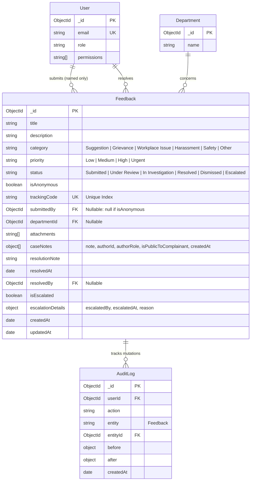
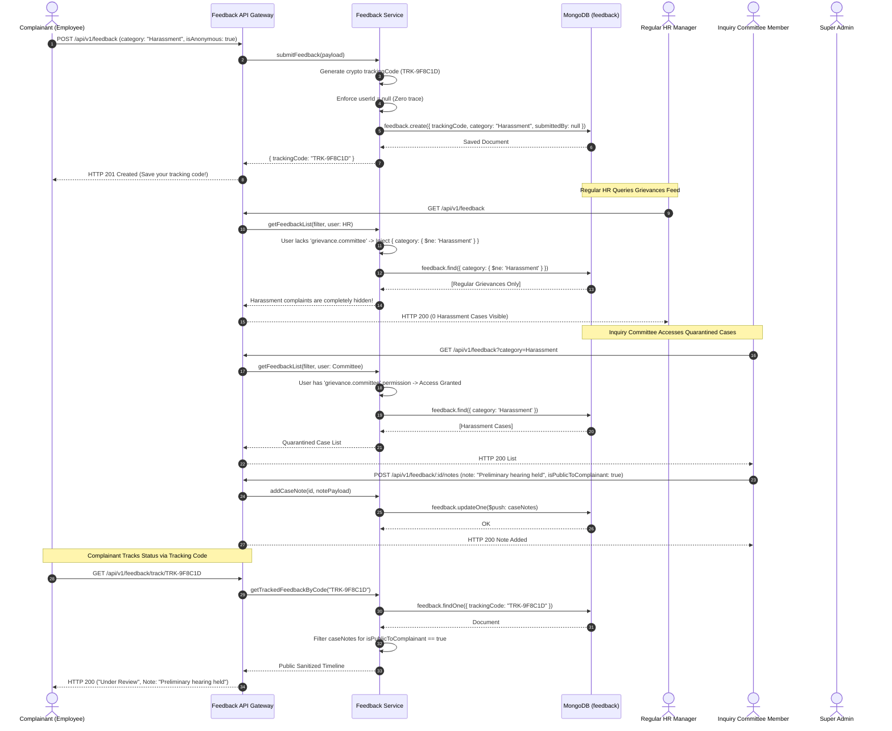

# Architectural Blueprint: M21 — Anonymous Feedback & Grievance

## 1. System Architecture & Request Lifecycle
Module M21 implements the confidential employee feedback and formal grievance tracking pipeline adhering to the locked 6-layer architecture from **TECH-SPEC.md Section 8**:

```
[React SPA / RTK Query] 
       │ HTTP / JSON
       ▼
[Express Route Layer] (`/api/v1/feedback`)
       │
       ▼
[Auth & Security Guard] (`authenticate`, `optionalAuthenticate` on tracking)
       │
       ▼
[Input Validation] (Zod schemas in `feedback.validation.js`)
       │
       ▼
[PBAC Middleware] (`checkPermission('feedback', ...)` with CASL ability rules)
       │
       ▼
[Controller Layer] (`feedback.controller.js` parses parameters & formats standard envelope)
       │
       ▼
[Service Domain Layer] (`feedback.service.js` enforces business logic, crypto tracking, and harassment segregation)
       │
       ▼
[Data Layer] (Mongoose `feedback.model.js` on MongoDB & AuditLog stream)
```

---

## 2. Exact Files to Create & Modify

### Backend Files
1. **Model**:
   - [`backend/src/models/feedback.model.js`](file:///c:/Users/hamih/OneDrive/Desktop/AtoZ%20Coder/Advanced%20MERN/HRM/backend/src/models/feedback.model.js)
     - Fields: `title`, `description`, `category` (enum: `Suggestion`, `Grievance`, `Workplace Issue`, `Harassment`, `Safety`, `Other`), `priority` (enum: `Low`, `Medium`, `High`, `Urgent`), `status` (enum: `Submitted`, `Under Review`, `In Investigation`, `Resolved`, `Dismissed`, `Escalated`), `isAnonymous` (boolean), `trackingCode` (unique indexed string, e.g. `TRK-A8F2C1`), `submittedBy` (ObjectId ref to User, `null` when `isAnonymous=true`), `departmentId` (ObjectId ref to Department, optional), `attachments` (array of URLs), `caseNotes` (array of subdocuments: `{ note, authorId, authorRole, isPublicToComplainant, createdAt }`), `resolutionNote`, `resolvedAt`, `resolvedBy`, `isEscalated` (boolean), `escalationDetails: { escalatedBy, escalatedAt, reason }`.
2. **Validation**:
   - [`backend/src/modules/feedback/feedback.validation.js`](file:///c:/Users/hamih/OneDrive/Desktop/AtoZ%20Coder/Advanced%20MERN/HRM/backend/src/modules/feedback/feedback.validation.js)
     - Schemas: `submitFeedbackSchema`, `updateFeedbackStatusSchema`, `addCaseNoteSchema`, `escalateFeedbackSchema`, `feedbackFilterSchema`.
3. **Service**:
   - [`backend/src/modules/feedback/feedback.service.js`](file:///c:/Users/hamih/OneDrive/Desktop/AtoZ%20Coder/Advanced%20MERN/HRM/backend/src/modules/feedback/feedback.service.js)
     - Core methods: `submitFeedback`, `getFeedbackList`, `getFeedbackById`, `getTrackedFeedbackByCode`, `updateStatus`, `addCaseNote`, `escalateFeedback`, `getGrievanceStats`.
     - Invariants: Automatically strips `submittedBy` if `isAnonymous: true`. Injects `{ category: { $ne: 'Harassment' } }` for any caller lacking `grievance.committee` permission.
4. **Controller**:
   - [`backend/src/modules/feedback/feedback.controller.js`](file:///c:/Users/hamih/OneDrive/Desktop/AtoZ%20Coder/Advanced%20MERN/HRM/backend/src/modules/feedback/feedback.controller.js)
     - Maps HTTP requests to service calls with uniform `{ success, data, message, meta }` envelope.
5. **Routes**:
   - [`backend/src/modules/feedback/feedback.routes.js`](file:///c:/Users/hamih/OneDrive/Desktop/AtoZ%20Coder/Advanced%20MERN/HRM/backend/src/modules/feedback/feedback.routes.js)
     - Mounted at `/api/v1/feedback`.
6. **Mounting & Permissions**:
   - Modify [`backend/src/app.js`](file:///c:/Users/hamih/OneDrive/Desktop/AtoZ%20Coder/Advanced%20MERN/HRM/backend/src/app.js) to mount `/api/v1/feedback`.
   - Update [`backend/src/shared/permissions.js`](file:///c:/Users/hamih/OneDrive/Desktop/AtoZ%20Coder/Advanced%20MERN/HRM/backend/src/shared/permissions.js) with 5 new permissions.
   - Update [`backend/src/seed/roles.seed.js`](file:///c:/Users/hamih/OneDrive/Desktop/AtoZ%20Coder/Advanced%20MERN/HRM/backend/src/seed/roles.seed.js) to seed roles.
   - Seed data: [`backend/src/seed/m21.seed.js`](file:///c:/Users/hamih/OneDrive/Desktop/AtoZ%20Coder/Advanced%20MERN/HRM/backend/src/seed/m21.seed.js).
   - Test suites: [`backend/tests/m20.rewards.test.js`](file:///c:/Users/hamih/OneDrive/Desktop/AtoZ%20Coder/Advanced%20MERN/HRM/backend/tests/m20.rewards.test.js) & [`backend/tests/m21.feedback.security.test.js`](file:///c:/Users/hamih/OneDrive/Desktop/AtoZ%20Coder/Advanced%20MERN/HRM/backend/tests/m21.feedback.security.test.js).

### Frontend Files
1. **API Slice**:
   - [`frontend/src/features/feedback/feedbackApi.js`](file:///c:/Users/hamih/OneDrive/Desktop/AtoZ%20Coder/Advanced%20MERN/HRM/frontend/src/features/feedback/feedbackApi.js) (RTK Query injected endpoints into `baseApi`).
   - Add `Feedback` tag type in [`frontend/src/lib/baseApi.js`](file:///c:/Users/hamih/OneDrive/Desktop/AtoZ%20Coder/Advanced%20MERN/HRM/frontend/src/lib/baseApi.js).
2. **Pages**:
   - [`frontend/src/features/feedback/pages/SubmitFeedbackPage.jsx`](file:///c:/Users/hamih/OneDrive/Desktop/AtoZ%20Coder/Advanced%20MERN/HRM/frontend/src/features/feedback/pages/SubmitFeedbackPage.jsx) (`/feedback/submit`)
   - [`frontend/src/features/feedback/pages/TrackFeedbackPage.jsx`](file:///c:/Users/hamih/OneDrive/Desktop/AtoZ%20Coder/Advanced%20MERN/HRM/frontend/src/features/feedback/pages/TrackFeedbackPage.jsx) (`/feedback/track`)
   - [`frontend/src/features/feedback/pages/GrievanceAdminPage.jsx`](file:///c:/Users/hamih/OneDrive/Desktop/AtoZ%20Coder/Advanced%20MERN/HRM/frontend/src/features/feedback/pages/GrievanceAdminPage.jsx) (`/feedback/admin`)
   - [`frontend/src/features/feedback/pages/CommitteeDashboardPage.jsx`](file:///c:/Users/hamih/OneDrive/Desktop/AtoZ%20Coder/Advanced%20MERN/HRM/frontend/src/features/feedback/pages/CommitteeDashboardPage.jsx) (`/feedback/committee`)
3. **Components**:
   - [`frontend/src/features/feedback/components/CaseDetailsDrawer.jsx`](file:///c:/Users/hamih/OneDrive/Desktop/AtoZ%20Coder/Advanced%20MERN/HRM/frontend/src/features/feedback/components/CaseDetailsDrawer.jsx)
   - [`frontend/src/features/feedback/components/CaseTimeline.jsx`](file:///c:/Users/hamih/OneDrive/Desktop/AtoZ%20Coder/Advanced%20MERN/HRM/frontend/src/features/feedback/components/CaseTimeline.jsx)
   - [`frontend/src/features/feedback/components/CaseNotesThread.jsx`](file:///c:/Users/hamih/OneDrive/Desktop/AtoZ%20Coder/Advanced%20MERN/HRM/frontend/src/features/feedback/components/CaseNotesThread.jsx)
   - [`frontend/src/features/feedback/components/EscalateModal.jsx`](file:///c:/Users/hamih/OneDrive/Desktop/AtoZ%20Coder/Advanced%20MERN/HRM/frontend/src/features/feedback/components/EscalateModal.jsx)
   - [`frontend/src/features/feedback/components/StatusChangeModal.jsx`](file:///c:/Users/hamih/OneDrive/Desktop/AtoZ%20Coder/Advanced%20MERN/HRM/frontend/src/features/feedback/components/StatusChangeModal.jsx)
4. **App Routing & Navigation**:
   - Register routes in [`frontend/src/App.jsx`](file:///c:/Users/hamih/OneDrive/Desktop/AtoZ%20Coder/Advanced%20MERN/HRM/frontend/src/App.jsx).
   - Add "Feedback & Grievances" section in [`frontend/src/components/layout/Sidebar.jsx`](file:///c:/Users/hamih/OneDrive/Desktop/AtoZ%20Coder/Advanced%20MERN/HRM/frontend/src/components/layout/Sidebar.jsx) with CASL `Can` checks.

---

## 3. Architecture Diagrams (Archify Engine)

### Diagram 1: System Flow & Request Pipeline
```mermaid
flowchart TD
    Client["Client / React App\n(Submit / Track / Admin)"] -->|POST / PATCH / GET| Route["Express Router\n(/api/v1/feedback)"]
    Route --> Auth{"Authentication\n& Session"}
    Auth -->|Public / Tracking| Validation["Zod Schema Validation\n(feedback.validation.js)"]
    Auth -->|Authenticated| PBAC{"CASL PBAC Guard\n(checkPermission)"}
    PBAC -->|Dept Manager (None)| Block403["HTTP 403 Forbidden\n(Manager Isolated)"]
    PBAC -->|Authorized| Validation
    Validation --> Controller["Feedback Controller\n(feedback.controller.js)"]
    Controller --> Service["Feedback Service Domain\n(feedback.service.js)"]
    Service --> Filter{"Check Harassment\nCategory"}
    Filter -->|Category == Harassment & Non-Committee| Redact["Quarantine Case\n(403 or Omitted)"]
    Filter -->|Authorized or Regular Case| DB[(MongoDB: feedback\ncollection)]
    Service --> Audit[(MongoDB: auditlogs\ncollection)]
    Service --> Notif["Notification Engine\n(Super Admin Escalations)"]
    DB --> Service
    Service --> Controller
    Controller --> Envelope["Unified Response\n{ success, data, message }"]
    Envelope --> Client
```

---

### Diagram 2: Entity Relationship Diagram (ERD)


---

### Diagram 3: Main Sequence Diagram (Harassment Complaint Quarantined & Handled by Committee)


---

## 4. Endpoint Specifications & PBAC Permissions Matrix

All endpoints mounted at `/api/v1/feedback`:

| HTTP Method | Route | Permission Required | Allowed Scopes | Description |
| :--- | :--- | :--- | :--- | :--- |
| `POST` | `/` | `feedback.submit` | `own`, `all` | Submit suggestion or grievance. If `isAnonymous: true`, `submittedBy` set to `null`. |
| `GET` | `/` | `feedback.manage` OR `grievance.committee` | `all` | List grievances. Harassment cases filtered out unless user has `grievance.committee` or is Super Admin. Dept Manager gets 403. |
| `GET` | `/my` | `feedback.submit` | `own` | List named grievances submitted by currently logged-in user. |
| `GET` | `/track/:code` | *Public / None* | `all` | Public lookup of grievance status by confidential tracking code. Internal notes redacted. |
| `GET` | `/:id` | `feedback.manage` OR `grievance.committee` | `all` | View detailed grievance. Harassment case yields 403 if user lacks `grievance.committee`. Dept Manager gets 403. |
| `PATCH` | `/:id/status` | `feedback.manage` OR `grievance.committee` | `all` | Update case status (`Submitted` -> `Under Review` -> `In Investigation` -> `Resolved` / `Dismissed`). |
| `POST` | `/:id/notes` | `feedback.manage` OR `grievance.committee` | `all` | Append investigation or resolution case note with public flag. |
| `PATCH` | `/:id/escalate` | `feedback.escalate` | `all` | Escalate unresolved case directly to Super Admin with reason. |
| `GET` | `/stats/summary`| `feedback.manage` OR `grievance.committee` | `all` | Summary counts by status and category for admin dashboards. |

---

## 5. Permissions Registered in `shared/permissions.js`

```javascript
{
  module: 'feedback',
  label: 'Anonymous Feedback & Grievance',
  subject: 'Feedback',
  description: 'Anonymous suggestions, formal grievance investigation, harassment committee channel, and case tracking.',
  actions: [
    {
      action: 'feedback.submit',
      label: 'Submit Feedback & Grievances',
      description: 'Submit open suggestions or grievances anonymously or by name.',
      allowedScopes: ['own', 'all'],
      defaultScope: 'own'
    },
    {
      action: 'feedback.manage',
      label: 'Manage General Grievances',
      description: 'Investigate, add notes, and resolve general grievances and suggestions.',
      allowedScopes: ['all'],
      defaultScope: 'all'
    },
    {
      action: 'grievance.committee',
      label: 'Inquiry Committee Access (Harassment)',
      description: 'Exclusive quarantined access to review, investigate, and resolve harassment complaints.',
      allowedScopes: ['all'],
      defaultScope: 'all'
    },
    {
      action: 'feedback.escalate',
      label: 'Escalate Grievance to Executive',
      description: 'Escalate complex or blocked grievances to the Super Admin.',
      allowedScopes: ['all'],
      defaultScope: 'all'
    }
  ]
}
```

### Role Matrix Seed Configuration
1. **Super Admin**: Assigned all actions (`feedback.submit`, `feedback.manage`, `grievance.committee`, `feedback.escalate`).
2. **HR Manager**: Assigned `feedback.submit`, `feedback.manage`, `feedback.escalate`. (No `grievance.committee` by default unless explicitly granted).
3. **Department Manager**: Assigned `feedback.submit` (`own` scope). **Zero administrative access** (`None` in FRD Section 11; receives 403 on `/feedback` admin endpoints).
4. **Employee**: Assigned `feedback.submit` (`own` scope). Can track via code or view own named submissions.

