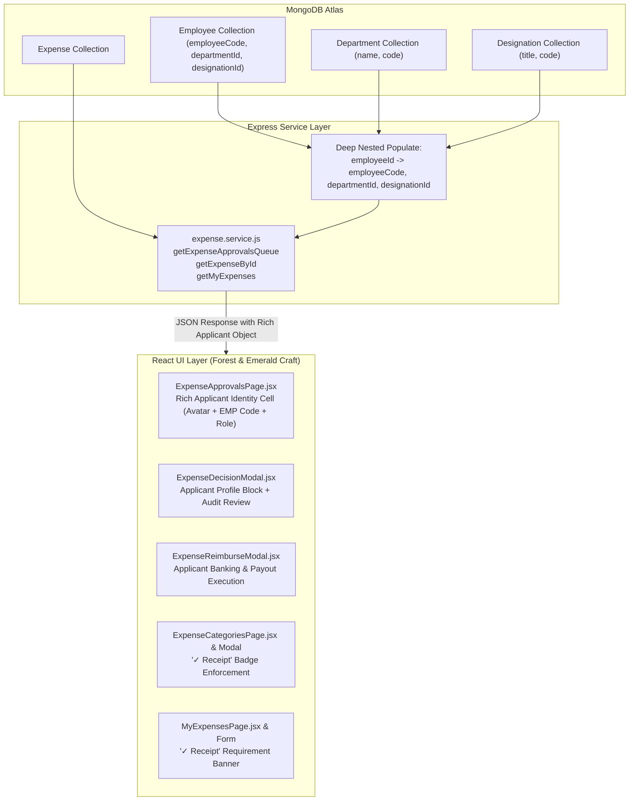

# Implementation Plan: 27-expenses-ui-craft-and-details

**Branch**: `27-expenses-ui-craft-and-details` | **Date**: 2026-11-08 | **Spec**: [`.specify/specs/27-expenses-ui-craft-and-details/spec.md`](file:///c:/Users/hamih/OneDrive/Desktop/AtoZ%20Coder/Advanced%20MERN/HRM/.specify/specs/27-expenses-ui-craft-and-details/spec.md)

---

## 1. Summary

This plan executes the technical and architectural overhaul of the **Expense Claims Module (M11)** in accordance with `DESIGN.md` (Forest & Emerald Craft) and `docs/UI-REFERENCE.md`.

### Key Technical Approaches:
1. **Backend Query Expansion**: Enhance Mongoose population in `expense.service.js` to deeply populate `employeeCode`, `departmentId` (`name`, `code`), and `designationId` (`title`, `code`) across approval queues, employee history, and review detail endpoints.
2. **Frontend Rich Identity Architecture**: Transform the "Applicant" presentation from raw unstructured strings into a dedicated, high-craft composite identity component displaying avatar initials, official name, monospace employee code badge, designation, and department cost-center.
3. **Strict Receipt Rule Normalization**: Enforce the universal UI rule: wherever a receipt requirement is indicated, write strictly **`Receipt`** with a leading checkmark icon (`✓ Receipt`), systematically purging all legacy or mixed-language text (`Raseed Lazmi`, `Receipts Mandated (Raseed Lazmi)`).
4. **Tabular Numerics & Zero-Slop Aesthetics**: Standardize all currency amounts (`PKR X,XXX.XX`), Claim IDs (`EXP-YYYYMM-XXXX`), and Employee Codes (`EMP-XXXX`) using `font-variant-numeric: tabular-nums` and `font-mono` on `#FFFFFF` (Light) and `#111D17` (Dark) surfaces.

---

## 2. Technical Context

- **Frontend Tech Stack**: React 18, Vite 6, Tailwind CSS, RTK Query, Lucide React icons, Sonner toasts.
- **Backend Tech Stack**: Node.js 22 (ESM), Express, Mongoose 8 (MongoDB Atlas), CASL PBAC guards.
- **Design Tokens**:
  - Light Canvas: `#F8FAFC`, Surface: `#FFFFFF`, Hairline Border: `#EAECF0`.
  - Dark Canvas: `#0A110D`, Surface: `#111D17`, Hairline Border: `#1A3125`.
  - Brand Master Accent: `#00C471` (Emerald).
  - Monospace Numerics: `font-mono tabular-nums`.
- **Financial Invariant**: Integer paisa storage (`1 PKR = 100 paisa`) maintained across all DB and API payloads; formatted cleanly via `(amount / 100).toLocaleString('en-PK')` on the client.

---

## 3. Architecture Blueprint & Data Flow



---

## 4. Phase-by-Phase Implementation Blueprint

### Phase 1: Backend Population Enhancement (`backend/src/modules/expenses/expense.service.js`)
- Update `getExpenseApprovalsQueue` (line ~408):
  ```javascript
  .populate({
    path: 'employeeId',
    select: 'name firstName lastName employeeCode email departmentId designationId avatar userId',
    populate: [
      { path: 'departmentId', select: 'name code' },
      { path: 'designationId', select: 'title code' }
    ]
  })
  ```
- Update `getExpenseById` (line ~344) with the identical deep population so detailed audit reviews receive complete applicant metadata.
- Update `getMyExpenses` (line ~320) to ensure consistent category and applicant details.

### Phase 2: Standardized 'Receipt' Enforcement Across Category & Form Components
- **`ExpenseCategoriesPage.jsx`**:
  - Update KPI card 3 title: `"Receipt Required"` (replace `"Receipts Mandated (Raseed Lazmi)"`).
  - Update table "Receipt Rule" badge:
    ```jsx
    {cat.requiresReceipt ? (
      <span className="inline-flex items-center gap-1.5 px-2.5 py-1 rounded-full text-[11px] font-semibold bg-emerald-50 dark:bg-emerald-950/40 text-emerald-700 dark:text-emerald-300 border border-emerald-200 dark:border-emerald-800/40">
        <Check className="w-3.5 h-3.5 text-emerald-600 dark:text-emerald-400" />
        Receipt
      </span>
    ) : (
      <span className="inline-flex items-center gap-1 px-2.5 py-1 rounded-full text-[11px] font-medium bg-slate-100 dark:bg-slate-800 text-slate-500 dark:text-slate-400 border border-slate-200 dark:border-slate-700">
        Optional
      </span>
    )}
    ```
- **`ExpenseCategoryModal.jsx`**:
  - Update toggle switch label from `"Mandatory Receipt Proof (Raseed Lazmi)"` to `"Receipt Required"` with a green check badge.
- **`ExpenseFormModal.jsx`**:
  - When selected category mandates a receipt, render `<span className="font-semibold text-emerald-700 dark:text-emerald-400 inline-flex items-center gap-1"><Check className="w-3 h-3" /> Receipt</span>` instead of `"Raseed Lazmi"`.
  - Update upload box label to `"Receipt Proof (Image or PDF) *"` with clean helper copy.

### Phase 3: Rich Applicant Identity in Approvals Queue (`ExpenseApprovalsPage.jsx`)
- Overhaul the `Applicant` table cell:
  - Generate initial-letter avatar badge: `(name || 'E').slice(0, 2).toUpperCase()`.
  - Render Employee Code in tabular monospace: e.g. `<span className="font-mono text-[10px] font-semibold px-1.5 py-0.5 rounded bg-slate-100 dark:bg-slate-800 text-slate-700 dark:text-slate-300">EMP-0012</span>`.
  - Render Designation title: `claim.employeeId?.designationId?.title || claim.employeeId?.designation || 'Staff'`.
  - Render Department badge: `claim.employeeId?.departmentId?.name`.
- Ensure Claim # (`font-mono font-semibold uppercase`), Claimed Amount, and Authorized Amount use `font-mono tabular-nums`.

### Phase 4: Decision & Reimbursement Modals Identity & Polish
- **`ExpenseDecisionModal.jsx`**:
  - Redesign Applicant Metadata Grid into an executive profile block with avatar, name, employee code, designation title, department name, and email.
  - Render receipt requirement indicator as `✓ Receipt`.
- **`ExpenseReimburseModal.jsx`**:
  - Enhance header summary card with applicant's full code, department, and banking reference.
  - Tabular monospace numbers for approved payout amount.

### Phase 5: MyExpenses & Reports Tabular Polish
- **`MyExpensesPage.jsx`**:
  - Standardize "Receipt" column to render `✓ Receipt` badge for claims with uploaded proof or mandatory rules.
  - Tabular monospace formatting on amounts and dates.
- **`ExpenseReportsPage.jsx`**:
  - Apply `font-mono tabular-nums` to KPI outlay totals and category breakdown amounts (`Total Incurred`, `Authorized Approved`, `Reimbursed Payout`, `Pending`).

---

## 5. File System Impact Map

| File Path | Role | Key Changes |
|-----------|------|-------------|
| `backend/src/modules/expenses/expense.service.js` | Service | Expand `.populate('employeeId', ...)` to include `employeeCode`, `departmentId`, `designationId`. |
| `frontend/src/features/expenses/pages/ExpenseApprovalsPage.jsx` | Page | Rich Applicant Identity cell (avatar + EMP code + designation + department), tabular numbers. |
| `frontend/src/features/expenses/pages/ExpenseCategoriesPage.jsx` | Page | Standardize `✓ Receipt` badge and KPI card ("Receipt Required"). |
| `frontend/src/features/expenses/components/ExpenseCategoryModal.jsx` | Modal | Replace `Raseed Lazmi` with `Receipt Required`. |
| `frontend/src/features/expenses/components/ExpenseFormModal.jsx` | Modal | Render `✓ Receipt` badge when category mandates proof. |
| `frontend/src/features/expenses/components/ExpenseDecisionModal.jsx` | Modal | Rich applicant profile card (ID, Dept, Designation, Email), `✓ Receipt` indicator. |
| `frontend/src/features/expenses/components/ExpenseReimburseModal.jsx` | Modal | Rich applicant metadata context during payout. |
| `frontend/src/features/expenses/pages/MyExpensesPage.jsx` | Page | Standardize receipt column & tabular numerics. |
| `frontend/src/features/expenses/pages/ExpenseReportsPage.jsx` | Page | Tabular numerics across KPI cards and budget breakdown. |

---

## 6. Verification & Quality Gates

1. **Syntax & Compile Check**:
   - `node -e "import('./backend/src/modules/expenses/expense.service.js')"` passes without import errors.
   - `npm run build --prefix frontend` builds cleanly with zero JSX/Vite errors.
2. **Visual Inspection**:
   - Verify `/expenses/approvals` displays applicant avatar, `EMP-XXXX`, designation, and department.
   - Verify `/expenses/categories` displays `✓ Receipt` and zero occurrences of `Raseed Lazmi`.
   - Verify dark and light mode rendering matches `DESIGN.md`.

