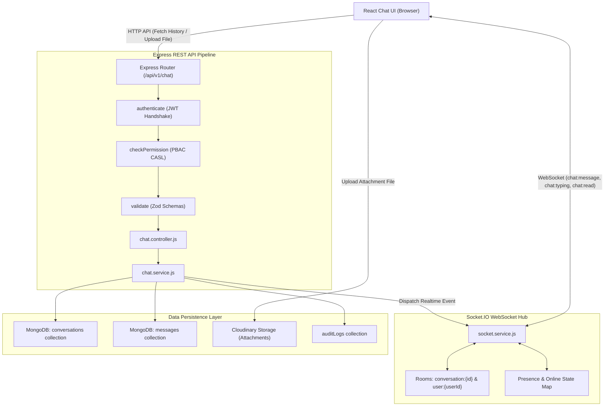
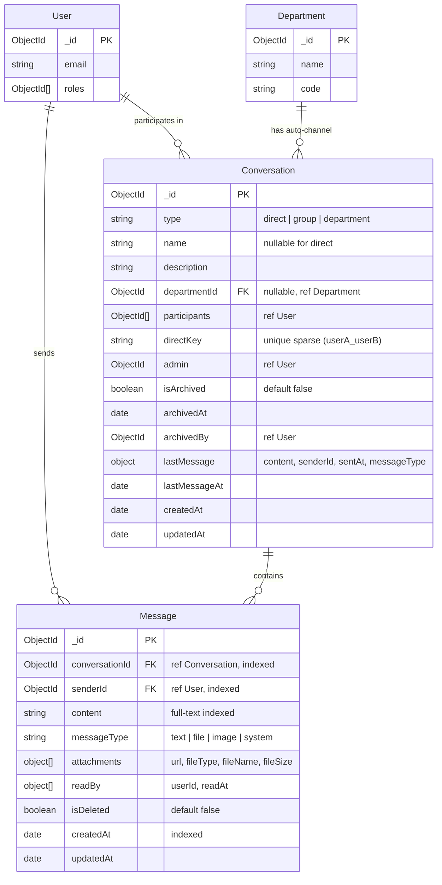
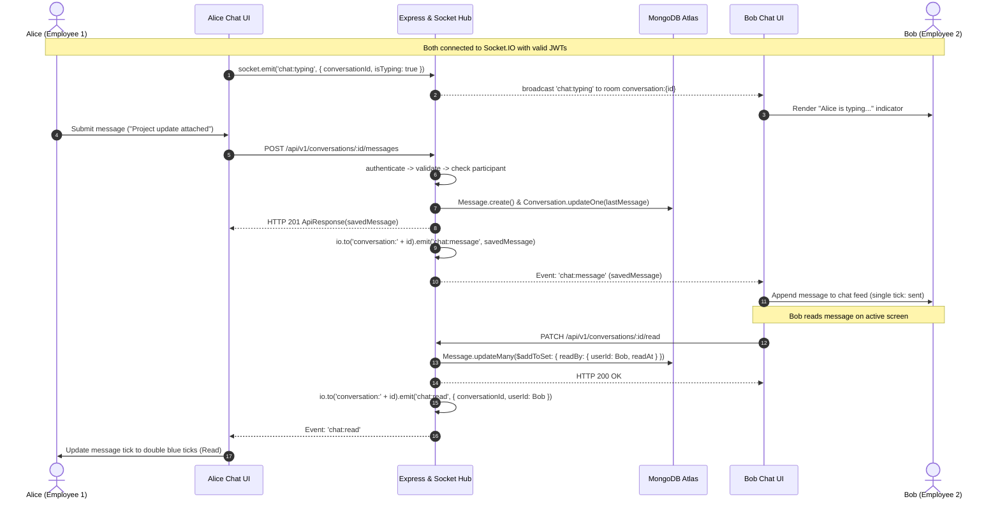

# Architecture Plan: Module M24 — Internal Chat

**Module ID:** `M24`  
**Module Name:** `Internal Chat`  
**Phase:** `Phase 4: Engagement & Polish`  
**Specification Directory:** `.specify/specs/27-internal-chat/`  
**Reference Standards:**
- `docs/TECH-SPEC.md`: Sections 3 (Folder Structure), 4 (Database Schemas), 5 (API Pipelines), 6 (Authentication & PBAC), 8 (Request Lifecycle)
- `docs/MODULES.md`: Section M24 (Internal Chat)
- `docs/BUILD-GUIDE.md`: Section 29 (Rows 24.1 to 24.7)

---

## 1. System Architecture & Component Structure

### 1.1 Backend Modules (`backend/src/`)
```
backend/src/
├── models/
│   ├── conversation.model.js       # Conversation schema (direct, group, department), indexes, directKey
│   └── message.model.js            # Message schema, attachments, read receipts, full-text search index
├── modules/
│   └── chat/
│       ├── chat.validation.js      # Zod validation schemas for conversation & message APIs
│       ├── chat.service.js         # Business logic: 1-to-1 directKey check, group management, department auto-sync, search
│       ├── chat.controller.js      # Express controllers parsing inputs & formatting standard ApiResponse envelopes
│       └── chat.routes.js          # Express route definitions protected by authenticate & checkPermission
├── services/
│   └── socket.service.js           # Extended Socket.IO hub: room join, chat:message, chat:typing, chat:read, presence tracking
└── shared/
    └── permissions.js              # Added chat:access, chat:create_group, chat:archive PBAC definitions
```

### 1.2 Frontend Features (`frontend/src/`)
```
frontend/src/
├── features/
│   └── chat/
│       ├── chatApi.js              # RTK Query API endpoints, cache tags, real-time cache updates
│       ├── hooks/
│       │   └── useChatSocket.js    # Dedicated hook for real-time chat events, active room sync & typing throttlers
│       ├── components/
│       │   ├── ConversationList.jsx # Left sidebar: active direct, group, department channels with search & unread badges
│       │   ├── ChatArea.jsx        # Active chat pane: header, presence indicator, message stream, typing indicator
│       │   ├── MessageBubble.jsx   # Message item: avatar, text, media preview, download button, read tick status
│       │   ├── MessageInput.jsx    # Input bar: text, file attachment picker, typing debounce emitter, send button
│       │   ├── NewChatModal.jsx    # Modal dialog to search colleagues and initiate 1-on-1 direct conversations
│       │   ├── NewGroupModal.jsx   # Modal dialog to create multi-user group channels with title & member picker
│       │   └── GroupInfoDrawer.jsx # Drawer: participant list, group details, add/remove member, archive channel button
│       └── pages/
│           └── ChatPage.jsx        # Unified responsive chat workspace with split view and mobile toggle
├── components/
│   └── layout/
│       └── Sidebar.jsx             # Chat navigation item with live unread counter
└── App.jsx                         # Route mount: /chat
```

---

## 2. Mermaid Architecture & Design Diagrams

### 2.1 Request & Real-time Flow Diagram


### 2.2 Entity-Relationship Diagram (ERD)


### 2.3 Main Sequence Diagram: Real-Time Message & Read Receipt Lifecycle


---

## 3. Database Schema Definitions & Index Guarantees

### 3.1 `Conversation` Model (`backend/src/models/conversation.model.js`)
- **Direct Chat Idempotency:**
  For `type: 'direct'`, `participants` consists of 2 users. We generate a deterministic `directKey` by sorting the two string ObjectIds:
  `directKey = [user1.toString(), user2.toString()].sort().join('_')`.
  A unique sparse index on `directKey` ensures that two users can NEVER create duplicate 1-on-1 conversation records even under rapid concurrent clicks.
- **Indexes:**
  ```javascript
  conversationSchema.index({ participants: 1 });
  conversationSchema.index({ directKey: 1 }, { unique: true, sparse: true });
  conversationSchema.index({ type: 1, departmentId: 1 });
  conversationSchema.index({ updatedAt: -1 });
  conversationSchema.index({ lastMessageAt: -1 });
  ```

### 3.2 `Message` Model (`backend/src/models/message.model.js`)
- **Full-Text Search:**
  A compound index on `{ conversationId: 1, createdAt: -1 }` provides fast inverted pagination for room streams.
  A text index on `{ content: 'text' }` powers the full-text search feature.
- **Indexes:**
  ```javascript
  messageSchema.index({ conversationId: 1, createdAt: -1 });
  messageSchema.index({ senderId: 1 });
  messageSchema.index({ content: 'text' });
  ```

---

## 4. REST API Endpoint Specifications & PBAC Permissions

| Method | Endpoint | Description | Permission (Subject: `Chat`) | Scope Filter |
|:---|:---|:---|:---|:---|
| `GET` | `/api/v1/conversations` | List user's active conversations (direct, group, department) | `chat.access` | `own` (participant) |
| `POST` | `/api/v1/conversations` | Create new direct or group conversation | `chat.access` / `chat.create_group` | `own` |
| `GET` | `/api/v1/conversations/departments/sync` | Ensure department channel exists & user is member | `chat.access` | `own` |
| `GET` | `/api/v1/conversations/:id` | Get conversation details & participant profiles | `chat.access` | Must be participant or Super Admin |
| `PATCH` | `/api/v1/conversations/:id/participants` | Add or remove participants in group conversation | `chat.create_group` | Admin of group or Super Admin |
| `PATCH` | `/api/v1/conversations/:id/archive` | Archive/lock channel into read-only state | `chat.archive` | Super Admin (`all`) |
| `GET` | `/api/v1/conversations/:id/messages` | Paginated message history (30 per page) | `chat.access` | Must be participant or Super Admin |
| `POST` | `/api/v1/conversations/:id/messages` | Send message (text/attachment) + emit socket event | `chat.access` | Must be participant; blocked if archived |
| `PATCH` | `/api/v1/conversations/:id/read` | Mark all unread messages in conversation as read | `chat.access` | Participant |
| `GET` | `/api/v1/messages/search?q=` | Scoped keyword search across user's conversations | `chat.access` | Only conversations where user is participant |
| `POST` | `/api/v1/chat/upload` | Upload attachment (image, pdf, docx $\le$ 10MB) | `chat.access` | `own` |

---

## 5. PBAC Definitions in `backend/src/shared/permissions.js`

Add to `MODULE_PERMISSIONS`:
```javascript
{
  module: 'chat',
  label: 'Internal Chat & Team Messaging',
  subject: 'Chat',
  description: 'Real-time peer-to-peer and group messaging, automated department channels, and communication moderation.',
  actions: [
    {
      action: 'chat.access',
      label: 'Access Internal Chat & Send Messages',
      description: 'Participate in 1-on-1 direct chats, group conversations, and department channels.',
      allowedScopes: ['own', 'all'],
      defaultScope: 'own'
    },
    {
      action: 'chat.create_group',
      label: 'Create & Manage Custom Groups',
      description: 'Create multi-user groups and manage group participants.',
      allowedScopes: ['own', 'all'],
      defaultScope: 'own'
    },
    {
      action: 'chat.archive',
      label: 'Archive & Moderate Channels',
      description: 'Lock or archive channels into read-only mode (Super Admin).',
      allowedScopes: ['all'],
      defaultScope: 'all'
    }
  ]
}
```

---

## 6. Seed Data Blueprint (`backend/src/seed/m24.seed.js`)

1. **Auto Department Channels:** Created for each existing department (e.g. Engineering, HR, Sales). All department employees automatically enrolled.
2. **Direct Chat:** Pre-seeded conversation between Super Admin and HR Manager with initial messages.
3. **Group Chat:** Pre-seeded group conversation ("Executive Committee" or "Project Phoenix") with 3 members and sample messages.
4. **Archived Channel:** Sample archived channel to test read-only enforcement.
