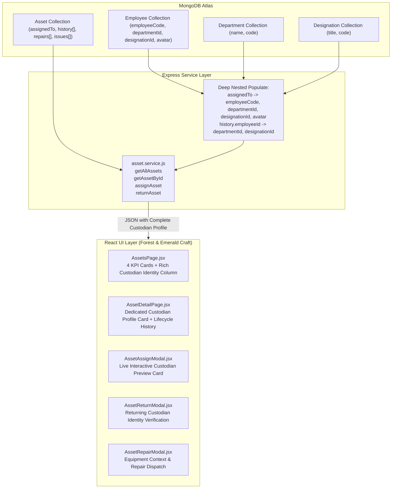

# Implementation Plan: 28-assets-module-ui-craft-and-details

**Branch**: `28-assets-module-ui-craft-and-details` | **Date**: 2026-11-08 | **Spec**: [`.specify/specs/28-assets-module-ui-craft-and-details/spec.md`](file:///c:/Users/hamih/OneDrive/Desktop/AtoZ%20Coder/Advanced%20MERN/HRM/.specify/specs/28-assets-module-ui-craft-and-details/spec.md)

---

## 1. Summary

This plan details the technical execution and UI/UX elevation of the **Corporate Asset Management & Inventory Module (M23)**, fully aligning it with `DESIGN.md` (Forest & Emerald Enterprise Craft) and `docs/BUILD-GUIDE.md` (Rows 23.1 to 23.6).

### Key Architectural Approaches:
1. **Backend Deep Population**: Update `asset.service.js` to deeply populate `assignedTo`, `history.employeeId`, `history.performedBy`, and `issues.reportedBy` with full employee identity fields: `name`, `firstName`, `lastName`, `employeeCode`, `email`, `phone`, `avatar`, `departmentId` (`name`, `code`), and `designationId` (`title`, `code`).
2. **Dedicated Custodian Profile Card**: Replace single-line plain text strings on `AssetDetailPage.jsx` with a dedicated, high-craft **Custodian Profile Card** showcasing the custodian's avatar, name, `EMP-XXXX` badge, designation, department, email, phone, assignment date, and handover condition.
3. **Interactive Custodian Picker**: In `AssetAssignModal.jsx`, implement a live **Employee Preview Card** that automatically renders as soon as an employee is selected from the dropdown, visually confirming the target recipient before custody transfer.
4. **Executive Inventory KPI Summary Cards**: Add 4 executive metric cards to `AssetsPage.jsx` (Total Assets, Assigned in Custody, Available in Store, and In Repair / Open Issues).
5. **Forest & Emerald Craft & Tabular Numerics**: Purge all legacy dark-slate styles (`#0F111A` and `#1E2235`), adopting pure `#FFFFFF` (Light) and `#111D17` (Dark) surfaces with hairline `#EAECF0` / `#1A3125` borders, vibrant `#00C471` emerald accents, and `font-mono tabular-nums` for Asset Tags, Serial numbers, and monetary figures.

---

## 2. Technical Context

- **Frontend Tech Stack**: React 18, Vite 6, Tailwind CSS, RTK Query, Lucide React icons, Sonner toasts.
- **Backend Tech Stack**: Node.js 22 (ESM), Express, Mongoose 8 (MongoDB Atlas), CASL PBAC guards.
- **Design Tokens**:
  - Light Canvas: `#F8FAFC`, Surface: `#FFFFFF`, Hairline Border: `#EAECF0`.
  - Dark Canvas: `#0A110D`, Surface: `#111D17`, Hairline Border: `#1A3125`.
  - Brand Master Accent: `#00C471` (Emerald).
  - Monospace Numerics: `font-mono tabular-nums`.
- **Financial Invariant**: Integer paisa storage (`1 PKR = 100 paisa`) maintained across purchaseCostPaisa and repairCostPaisa; formatted as `PKR X,XXX` on the client.

---

## 3. Architecture Blueprint & Data Flow



---

## 4. Phase-by-Phase Implementation Blueprint

### Phase 1: Backend Deep Population Enhancement (`backend/src/modules/assets/asset.service.js`)
- In `getAllAssets` (line ~145):
  ```javascript
  .populate({
    path: 'assignedTo',
    select: 'name firstName lastName employeeCode departmentId designationId email phone avatar status',
    populate: [
      { path: 'departmentId', select: 'name code' },
      { path: 'designationId', select: 'title code' }
    ]
  })
  .populate('history.performedBy', 'name email avatar')
  ```
- In `getAssetById` (line ~170):
  ```javascript
  .populate({
    path: 'assignedTo',
    select: 'name firstName lastName employeeCode departmentId designationId email phone avatar status',
    populate: [
      { path: 'departmentId', select: 'name code' },
      { path: 'designationId', select: 'title code' }
    ]
  })
  .populate('history.performedBy', 'name email avatar')
  .populate({
    path: 'history.employeeId',
    select: 'name firstName lastName employeeCode departmentId designationId avatar',
    populate: [
      { path: 'departmentId', select: 'name code' },
      { path: 'designationId', select: 'title code' }
    ]
  })
  .populate('issues.reportedBy', 'name employeeCode email avatar')
  ```

### Phase 2: Master Asset Registry & KPI Bar (`frontend/src/features/assets/pages/AssetsPage.jsx`)
- **4 Executive KPI Metrics Cards**:
  1. Total Assets: `<Laptop />` icon, count formatted in `font-mono`.
  2. Assigned in Custody: `<UserCheck />` icon, count of active assignments.
  3. Available in Store: `<CheckCircle2 />` icon, count of available equipment.
  4. In Repair / Open Issues: `<Wrench />` icon, count of under-repair / defective assets.
- **Rich Custodian Column in Table**:
  - Replace raw name/letter with a multi-layered identity lockup:
    - Avatar: Photo if available, or 2-letter monogram in subtle emerald/blue ring.
    - Name: Full name with hover transition.
    - Monospace ID: `<span className="font-mono text-[10px] px-1.5 py-0.5 rounded bg-slate-100 dark:bg-[#162820] text-slate-600 dark:text-slate-300 border border-slate-200 dark:border-[#1A3125]">{asset.assignedTo.employeeCode}</span>`
    - Department & Role: `departmentId.name` badge.
  - If unassigned: `<span className="inline-flex items-center gap-1 px-2.5 py-1 rounded-full text-[11px] font-medium bg-slate-100 dark:bg-[#162720] text-slate-500 border border-slate-200 dark:border-[#1A3125]">Available in Store</span>`
- **Forest & Emerald Refresh**:
  - Replace all `#0F111A` and `#1E2235` with `#111D17` and `#1A3125`.
  - Format purchase cost, warranty dates, serial numbers, and tags with `font-mono tabular-nums`.

### Phase 3: Comprehensive Asset Detail & Dedicated Custodian Profile Card (`frontend/src/features/assets/pages/AssetDetailPage.jsx`)
- **When Asset is Assigned (`status === 'assigned'`)**:
  - Render a dedicated **Custodian Profile Card**:
    - Left: Large Avatar (Photo or Monogram) with emerald online status ring.
    - Center: Full Name, `font-mono` `EMP-XXXX` badge, Official Designation (`designationId.title`), and Department badge (`departmentId.name`).
    - Right: Work Email link, Phone/Extension chip, Handover Date (`new Date(latestAssignEvent.date).toLocaleDateString()`), and Handover Condition badge (`Good`, `New`, etc.).
- **When Asset is Available (`status === 'available'`)**:
  - Render an **"Available in Central Store"** banner with a prominent `<UserCheck /> Assign Custodian` CTA.
- **Lifecycle History Timeline Upgrade**:
  - Render rich employee chips for both the custodian (`employeeId`) and authorizing administrator (`performedBy`) with timestamps and inspection notes.
- **Service & Repairs Tab**:
  - Monospace costs (`font-mono tabular-nums`), vendor name, status badge, resolution notes, and "Mark Completed" button.
- **Reported Issues Tab**:
  - Reporter profile lockup, issue type, severity badge (Critical, High, Medium, Low), and triage action.

### Phase 4: Interactive Custodian Picker in Assignment Modal (`frontend/src/features/assets/components/AssetAssignModal.jsx`)
- Maintain a local state `selectedEmployee` derived from the employee list.
- When an employee is chosen from the dropdown:
  - Dynamically display a **Live Employee Preview Card**:
    - Avatar monogram / photo
    - Full Name
    - `font-mono` `EMP-XXXX` badge
    - Department & Designation pill
    - Official Work Email
- Handover date, handover condition (`Brand New`, `Good Condition`, `Fair`), and handover notes textarea.
- Styled with `#111D17` (Dark) and `#FFFFFF` (Light), `#1A3125` borders.

### Phase 5: Polish Return, Repair, and Asset Form Modals
- **`AssetReturnModal.jsx`**:
  - Display returning custodian's identity card (Avatar, Name, ID, Department).
  - Return date, return condition (`Good`, `Fair`, `Damaged`, `Unusable`), and inspection notes.
- **`AssetRepairModal.jsx`**:
  - Asset tag and specs summary header.
  - Issue description, vendor name, estimated cost (PKR), expected return date.
- **`AssetFormModal.jsx`**:
  - Hardware specs, serial number, license key, purchase value in PKR, vendor, warranty expiry.

---

## 5. Verification & Testing Strategy

1. **Backend Verification**:
   - Run `node -e "import('./backend/src/modules/assets/asset.service.js')"` to verify zero syntax errors.
   - Verify that `getAllAssets` and `getAssetById` return populated `departmentId.name` and `designationId.title`.
2. **Frontend Production Build**:
   - Run `npm run build --prefix frontend` to guarantee 0 build or linting regressions.
3. **End-to-End Visual Verification**:
   - Verify `/assets` displays the 4 KPI cards and rich custodian badges.
   - Verify `/assets/:id` renders the full Custodian Profile Card when assigned.
   - Verify `AssetAssignModal` shows the live interactive employee preview upon selection.
   - Verify `AssetReturnModal` displays returning custodian details.

