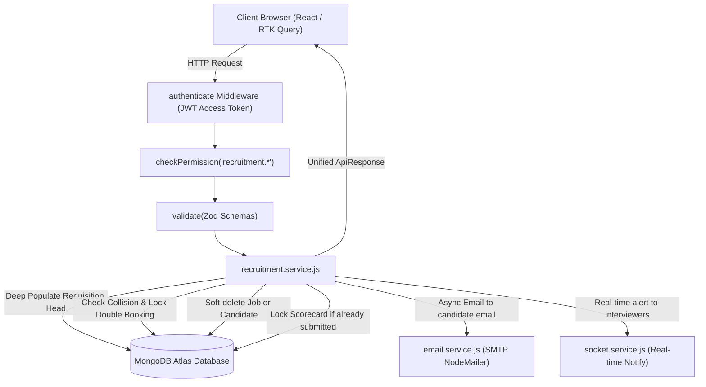
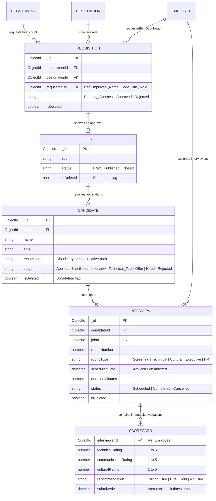
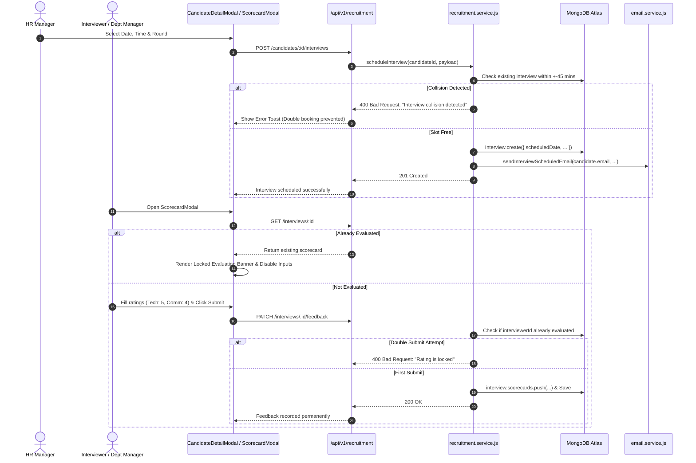

# Implementation Plan: Recruitment & ATS Functional & UI Enhancements

**Branch**: `feature/29-recruitment-ats-enhancements`  
**Date**: 2026-11-10  
**Spec Reference**: [`.specify/specs/29-recruitment-ats-enhancements/spec.md`](file:///c:/Users/hamih/OneDrive/Desktop/AtoZ%20Coder/Advanced%20MERN/HRM/.specify/specs/29-recruitment-ats-enhancements/spec.md)  
**Role & Guidelines**: Senior Architect & Ponytail Ladder (Native first, standard library, zero new packages).

---

## 1. Technical Context & Scope

- **Architecture**: MERN Stack (Node.js 22, Express, MongoDB Atlas, React 18, Vite, Redux Toolkit Query, Tailwind CSS, Lucide icons, Shadcn UI).
- **Core Domains**: Headcount Requisitions, Job Openings, Candidate Pipeline Kanban, Interview Scheduling, Interview Scorecards, Email Notifications.
- **Key Modules Affected**:
  - Backend: `backend/src/modules/recruitment/` (service, controller, routes, validation), `backend/src/services/email.service.js`.
  - Frontend: `frontend/src/features/recruitment/` (pages, components, RTK Query API slice).
- **Storage/DB**: MongoDB Atlas collections `requisitions`, `jobs`, `candidates`, `interviews`.
- **Quality Targets**: 100% test pass on Vitest, clean Vite build (`0 errors`), full responsiveness down to 390px.

---

## 2. Architecture & Data Flow Diagrams

### Diagram 1: Recruitment Request Lifecycle & Anti-Collision Flow


---

### Diagram 2: Entity Relationship Diagram (ERD) & Constraints


---

### Diagram 3: Interview Anti-Collision & Locked Feedback Sequence


---

## 3. Detailed Component & File Implementation Blueprint

### A. Backend Changes

#### 1. Requisition Requestor Attribution
- File: [`backend/src/modules/recruitment/recruitment.service.js`](file:///c:/Users/hamih/OneDrive/Desktop/AtoZ%20Coder/Advanced%20MERN/HRM/backend/src/modules/recruitment/recruitment.service.js)
- Enhance `getRequisitions`:
  ```javascript
  populate: [
    { path: 'departmentId', select: 'name code' },
    { path: 'designationId', select: 'title code grade' },
    {
      path: 'requestedBy',
      select: 'name employeeCode email designationId userId',
      populate: [
        { path: 'designationId', select: 'title' },
        { path: 'userId', select: 'roles', populate: { path: 'roles', select: 'name' } }
      ]
    },
    { path: 'decidedBy', select: 'email name' },
    { path: 'jobId', select: 'title slug status' }
  ]
  ```

#### 2. Closed Job Deletion & Publish Lockout
- In `recruitment.service.js`:
  - `updateJob(id, payload, actor)`:
    - If `existingJob.status === 'Closed'` and `payload.status === 'Published'`:
      - Throw `ApiError(400, 'Closed jobs cannot be republished. A new requisition or job must be initiated.')`.
  - Add `deleteJob(id, actor)`:
    - Verify `job = await Job.findOne({ _id: id, isDeleted: false })`.
    - If `!job`: throw 404.
    - If `job.status !== 'Closed'`:
      - Throw `ApiError(400, 'Only closed jobs can be deleted. Please close the job opening before deleting.')`.
    - Set `job.isDeleted = true; await job.save();`.
- In `recruitment.controller.js` & `recruitment.routes.js`:
  - Route: `DELETE /api/v1/recruitment/jobs/:id` protected by `checkPermission('recruitment.job.manage', 'Recruitment')`.

#### 3. Kanban Candidate Deletion
- In `recruitment.service.js`:
  - Add `deleteCandidate(id, actor)`:
    - Verify `candidate = await Candidate.findOne({ _id: id, isDeleted: false })`.
    - If `!candidate`: throw 404.
    - Set `candidate.isDeleted = true; await candidate.save();`.
    - Soft-delete associated interview records: `await Interview.updateMany({ candidateId: id }, { isDeleted: true });`.
- In `recruitment.controller.js` & `recruitment.routes.js`:
  - Route: `DELETE /api/v1/recruitment/candidates/:id` protected by `checkPermission('recruitment.candidate.manage', 'Recruitment')`.

#### 4. Anti-Collision Interview Scheduling
- In `recruitment.service.js`:
  - `scheduleInterview(candidateId, payload, actor)`:
    - Collision query:
      ```javascript
      const candidateConflict = await Interview.findOne({
        candidateId,
        status: { $in: ['Scheduled', 'Rescheduled'] },
        isDeleted: false,
        scheduledDate: {
          $gte: new Date(new Date(payload.scheduledDate).getTime() - 45 * 60 * 1000),
          $lte: new Date(new Date(payload.scheduledDate).getTime() + (payload.durationMinutes || 45) * 60 * 1000)
        }
      });
      if (candidateConflict) {
        throw new ApiError(400, 'Candidate already has an interview scheduled within this time window.');
      }
      ```
- In `backend/src/services/email.service.js`:
  - Add `sendInterviewScheduledEmail({ candidateName, candidateEmail, jobTitle, roundType, roundNumber, scheduledDate, durationMinutes, meetingLink })`.
  - Trigger inside `scheduleInterview` after DB save.

#### 5. Immutable Scorecard Submission
- In `recruitment.service.js`:
  - `submitScorecard(interviewId, scorecardData, actor)`:
    - Check if scorecard already exists for `interviewerEmpId`:
      ```javascript
      const alreadyEvaluated = interview.scorecards.some(
        (sc) => String(sc.interviewerId) === String(interviewerEmpId)
      );
      if (alreadyEvaluated) {
        throw new ApiError(400, 'Interview evaluation is locked. Submitted ratings cannot be modified.');
      }
      ```

---

### B. Frontend Changes

#### 1. RTK Query API Slice Additions
- File: [`frontend/src/features/recruitment/recruitmentApi.js`](file:///c:/Users/hamih/OneDrive/Desktop/AtoZ%20Coder/Advanced%20MERN/HRM/frontend/src/features/recruitment/recruitmentApi.js)
  - `deleteJob`: `mutation: (id) => ({ url: `/recruitment/jobs/${id}`, method: 'DELETE' }), invalidatesTags: ['Job']`
  - `deleteCandidate`: `mutation: (id) => ({ url: `/recruitment/candidates/${id}`, method: 'DELETE' }), invalidatesTags: ['Candidate', 'Job']`

#### 2. Job Openings & Headcount Requisitions View (`JobsPage.jsx`)
- File: [`frontend/src/features/recruitment/pages/JobsPage.jsx`](file:///c:/Users/hamih/OneDrive/Desktop/AtoZ%20Coder/Advanced%20MERN/HRM/frontend/src/features/recruitment/pages/JobsPage.jsx)
  - Add Refresh button with `RotateCw` spin animation on refetch.
  - On Job Card:
    - For `status === 'Closed'`: **Hide** the "Publish" button completely.
    - Render "Delete Job" action with trash icon and confirmation alert dialog.
  - On Requisition Card:
    - Render prominent Department Head badge:
      - Name: `{req.requestedBy?.name || 'Department Head'}`
      - ID: `{req.requestedBy?.employeeCode || 'EMP-XXXX'}`
      - Title: `{req.requestedBy?.designationId?.title || req.designationId?.title}`
      - Role: `{req.requestedBy?.userId?.roles?.[0]?.name || 'Department Manager'}`

#### 3. Candidate Pipeline Kanban Board (`CandidatePipelinePage.jsx`)
- File: [`frontend/src/features/recruitment/pages/CandidatePipelinePage.jsx`](file:///c:/Users/hamih/OneDrive/Desktop/AtoZ%20Coder/Advanced%20MERN/HRM/frontend/src/features/recruitment/pages/CandidatePipelinePage.jsx)
  - Add Refresh button with animated `RotateCw` in toolbar.
  - On each candidate Kanban card:
    - Add quick action dropdown or trash icon: "Delete Applicant" triggering `deleteCandidate` with confirmation.

#### 4. Candidate Detail Drawer & CV Viewer (`CandidateDetailModal.jsx`)
- File: [`frontend/src/features/recruitment/components/CandidateDetailModal.jsx`](file:///c:/Users/hamih/OneDrive/Desktop/AtoZ%20Coder/Advanced%20MERN/HRM/frontend/src/features/recruitment/components/CandidateDetailModal.jsx)
  - **CV Document Viewer**:
    - Build clean URL resolver:
      ```javascript
      const getCvUrl = () => {
        if (!candidate?.resumeUrl) return null;
        if (candidate.resumeUrl.startsWith('http')) return candidate.resumeUrl;
        const apiBase = import.meta.env.VITE_API_URL || 'http://localhost:5000';
        return `${apiBase.replace(/\/api\/v1\/?$/, '')}${candidate.resumeUrl.startsWith('/') ? '' : '/'}${candidate.resumeUrl}`;
      };
      ```
    - Clicking "View CV Document" opens `window.open(getCvUrl(), '_blank', 'noopener,noreferrer')`.
  - **Interview Schedule Transparency**:
    - Under "INTERVIEW ROUNDS", map through interviews and display scheduled round cards with date, time, mode, and assigned interviewers.
  - **Delete Candidate**:
    - Add red "Delete Candidate" button to the actions bar with confirmation dialog.

#### 5. Evaluation Modal & Locked Rating Indicator (`ScorecardModal.jsx`)
- File: [`frontend/src/features/recruitment/components/ScorecardModal.jsx`](file:///c:/Users/hamih/OneDrive/Desktop/AtoZ%20Coder/Advanced%20MERN/HRM/frontend/src/features/recruitment/components/ScorecardModal.jsx)
  - Inspect `interview.scorecards`. If the current user has already submitted:
    - Display alert box: *"Evaluation Completed: Candidate has already been evaluated with a rating of {rating}/5 ({recommendation}). Ratings are locked."*
    - Set all sliders/inputs to disabled.
    - Hide submit button and show only "Close".

#### 6. Anti-Collision Schedule Modal (`InterviewScheduleModal.jsx`)
- File: [`frontend/src/features/recruitment/components/InterviewScheduleModal.jsx`](file:///c:/Users/hamih/OneDrive/Desktop/AtoZ%20Coder/Advanced%20MERN/HRM/frontend/src/features/recruitment/components/InterviewScheduleModal.jsx)
  - Display existing scheduled interviews for this candidate at top of modal.
  - Prevent user from choosing conflicting time ranges with client-side notice.

---

## 4. Execution Slices & Verification Plan

1. **Slice 1 (Requisitions & Closed Jobs)**:
   - Deep populate `requestedBy` in service.
   - Guard against republishing closed jobs + add `deleteJob`.
   - Update `JobsPage.jsx` (requestor badge, hide publish on closed, delete button, refresh button).
2. **Slice 2 (Candidate Pipeline & CV Viewer)**:
   - Add `deleteCandidate` in service, controller, and routes.
   - Update `CandidatePipelinePage.jsx` and `CandidateDetailModal.jsx` (delete action, CV viewer fix, refresh button).
3. **Slice 3 (Interview Anti-Collision, Scorecard Lock & Candidate Email)**:
   - Implement collision prevention in `scheduleInterview`.
   - Add `sendInterviewScheduledEmail` in `email.service.js`.
   - Enforce scorecard immutability in `submitScorecard`.
   - Update `ScorecardModal.jsx` with locked rating banner.
4. **Slice 4 (Automated Testing & Multi-Role Verification)**:
   - Run Vitest recruitment tests covering all new constraints.
   - Verify zero build errors via `npm run build`.

