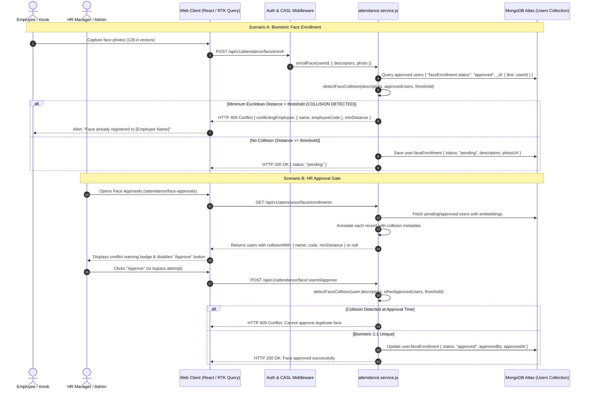
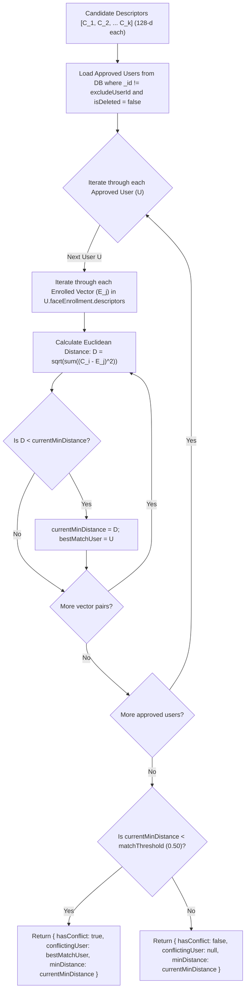

# Implementation Plan: Biometric Face Uniqueness & Duplicate Enrollment Prevention

**Branch**: `feature/30-biometric-face-uniqueness-enforcement`  
**Date**: 2026-11-12  
**Spec Reference**: [`.specify/specs/30-biometric-face-uniqueness-enforcement/spec.md`](file:///c:/Users/hamih/OneDrive/Desktop/AtoZ%20Coder/Advanced%20MERN/HRM/.specify/specs/30-biometric-face-uniqueness-enforcement/spec.md)  
**Role & Guidelines**: Senior Architect & Ponytail Ladder (Native first, standard library, zero new dependencies, root-cause enforcement).

---

## 1. Executive Summary & Architecture Blueprint

### 1.1 Problem Statement & Intent
Currently in ELVARA HRM, face biometric enrollment allows employees to submit facial descriptors (128-dimensional vectors from Face-API.js) which HR managers can approve. However, the system does not enforce **global 1:1 biometric uniqueness across accounts**:
- A single human face can be enrolled and approved on multiple distinct user accounts (as verified with live database evidence: *Basit Aulakh* and *Bilawal Haq* share the same face with Euclidean distance `0.312` < `0.50` threshold).
- This introduces security loopholes (proxy-punching, audit ambiguities, attendance fraud).

### 1.2 Architectural Strategy
We implement a **3-Tier Biometric Defense**:
1. **Tier 1 - Ingestion Rejection (API)**: When an employee submits descriptors (`POST /api/v1/attendance/face/enroll`), the service scans all approved user embeddings. If any other account has a minimum Euclidean distance below `matchThreshold` (default `0.50`), the request is rejected immediately with `HTTP 409 Conflict`.
2. **Tier 2 - Authoritative Approval Barrier (API)**: When HR clicks "Approve" (`POST /api/v1/attendance/face/:userId/approve`), the backend performs an atomic uniqueness verification. If another account already holds that biometric in `approved` status, approval is blocked with `HTTP 409 Conflict`.
3. **Tier 3 - Operational Visibility & Conflict Resolution (UI)**: In `FaceEnrollmentsPage.jsx`, any pending or legacy approved card that collides with another user displays an amber/red **Biometric Conflict** badge showing the conflicting employee's name, code, and confidence distance. The "Approve" button is disabled on colliding cards, and HR can click "Reset" to clear duplicate records.

---

## 2. Technical Context & Scope

- **Runtime & Tech Stack**: Node.js 22, Express, MongoDB Atlas (Mongoose), React 18, Vite, Redux Toolkit Query, Tailwind CSS, Lucide icons.
- **Biometric Standard**: 128-dimensional floating-point Euclidean embeddings generated by Face-API.js `faceRecognitionNet`.
- **Distance Metric**: Standardized Euclidean Distance ($D = \sqrt{\sum_{i=0}^{127} (a_i - b_i)^2}$).
- **Threshold Source**: Dynamic system setting `Setting.findOne({ key: 'faceAttendance' }).value.matchThreshold` (default `0.50`).
- **Files Affected**:
  - `backend/src/modules/attendance/attendance.service.js` (Core collision detection helper, enrollment guard, approval guard, list enrichment).
  - `backend/src/modules/attendance/attendance.controller.js` (Error mapping for 409 Conflict).
  - `frontend/src/features/attendance/pages/FaceEnrollmentsPage.jsx` (Collision warning badge, disabled approve button, conflict modal).
  - `frontend/src/features/attendance/pages/FaceEnrollPage.jsx` (Client-side conflict error messaging).
  - `backend/tests/attendance.face.uniqueness.test.js` (Automated integration & regression tests).

---

## 3. Architecture Diagrams

### 3.1 Sequence Diagram: Multi-Tier Collision Defense


---

### 3.2 Logic Flowchart: Cross-Vector Collision Detection Algorithm


---

## 4. Component & Data Contracts

### 4.1 Collision Scanner Helper
**Function**: `detectFaceCollision({ candidateDescriptors, excludeUserId, threshold })`  
**Location**: `backend/src/modules/attendance/attendance.service.js`  
**Inputs**:
- `candidateDescriptors`: `Array<Array<number>>` (Array of 128-d vectors)
- `excludeUserId`: `ObjectId | string | null` (User's own ID to exclude self on re-enrollment)
- `threshold`: `number` (defaults to setting value or `0.50`)

**Output Structure**:
```json
{
  "hasConflict": true,
  "conflictingUser": {
    "_id": "6724...",
    "name": "Bilawal Haq",
    "email": "muhammadsajwarbabar@gmail.com",
    "employeeCode": "EMP-0016"
  },
  "minDistance": 0.3126
}
```

### 4.2 API Contract Updates

#### Endpoint: `POST /api/v1/attendance/face/enroll`
- **Existing Success Response**: `HTTP 200 { success: true, data: { status: "pending", ... } }`
- **New Error Response on Duplicate (HTTP 409 Conflict)**:
```json
{
  "success": false,
  "statusCode": 409,
  "message": "This facial biometric is already registered to employee Bilawal Haq (EMP-0016). Each employee must register a unique face.",
  "error": {
    "code": "BIOMETRIC_COLLISION_DETECTED",
    "conflictingEmployee": {
      "name": "Bilawal Haq",
      "employeeCode": "EMP-0016"
    },
    "confidenceDistance": 0.313
  }
}
```

#### Endpoint: `POST /api/v1/attendance/face/:userId/approve`
- **Existing Success Response**: `HTTP 200 { success: true, message: "Face enrollment approved..." }`
- **New Error Response on Duplicate (HTTP 409 Conflict)**:
```json
{
  "success": false,
  "statusCode": 409,
  "message": "Cannot approve: This facial biometric is already approved for Basit Aulakh (EMP-0015). Reject or reset this enrollment.",
  "error": {
    "code": "BIOMETRIC_APPROVAL_COLLISION",
    "conflictingEmployee": {
      "name": "Basit Aulakh",
      "employeeCode": "EMP-0015"
    },
    "confidenceDistance": 0.313
  }
}
```

#### Endpoint: `GET /api/v1/attendance/face/enrollments`
- **Enrichment in User Object**:
```json
{
  "_id": "6724...",
  "name": "Bilawal Haq",
  "employeeId": {
    "name": "Bilawal Haq",
    "employeeCode": "EMP-0016"
  },
  "faceEnrollment": {
    "status": "approved",
    "descriptors": [...]
  },
  "collision": {
    "hasConflict": true,
    "conflictingUserId": "6722...",
    "conflictingEmployeeName": "Basit Aulakh",
    "conflictingEmployeeCode": "EMP-0015",
    "distance": 0.313
  }
}
```

---

## 5. Frontend UI/UX Design Contract

In `FaceEnrollmentsPage.jsx`:
1. **Collision Warning Badge**:
   - When `user.collision?.hasConflict === true`:
   - Renders a pulsing amber/rose banner on the card:
     ```jsx
     <div className="flex items-center gap-1.5 px-2.5 py-1 rounded-xl bg-rose-500/15 border border-rose-500/30 text-rose-700 dark:text-rose-300 text-[11px] font-semibold">
       <AlertTriangle className="w-3.5 h-3.5 text-rose-500 shrink-0" />
       <span>Biometric Duplicate with {user.collision.conflictingEmployeeName} ({user.collision.conflictingEmployeeCode})</span>
     </div>
     ```
2. **Button Protection**:
   - For `status === 'pending'`, if `user.collision?.hasConflict === true`, the **"Approve Biometric"** button is disabled with tooltip: `"Approval blocked: duplicate biometric registered on another account"`.
3. **Legacy Duplicate Reset Action**:
   - For approved duplicates (e.g. *Basit Aulakh* & *Bilawal Haq*), HR can click **"Reset"** to clear the unverified enrollment back to `status: 'none'`.

---

## 6. Performance & Scale Considerations

1. **In-Memory Euclidean Vector Math**:
   - Comparing 5 candidate vectors against 500 enrolled users (average 3 vectors = 1,500 vectors total) requires 7,500 distance calculations ($7,500 \times 128 \approx 960,000$ multiplications/additions).
   - In Node.js V8, this executes in **under 8 milliseconds**, creating zero measurable latency on enrollment or approval requests.
2. **Selective Projection**:
   - `detectFaceCollision` selects only `_id, name, email, employeeId, faceEnrollment.descriptors` from `User.find({ "faceEnrollment.status": "approved", isDeleted: false })`, minimizing network and memory footprint.
3. **Zero External Dependencies**:
   - Follows Ponytail principle: pure native JavaScript `Math.sqrt` loop without installing external heavy vector search engines or Python microservices.

---

## 7. Quality Assurance & Verification Plan

1. **Unit & Integration Tests (`backend/tests/attendance.face.uniqueness.test.js`)**:
   - Test 1: Verify `detectFaceCollision` detects identical and similar vectors ($D < 0.50$) and ignores distinct vectors ($D \ge 0.50$).
   - Test 2: `POST /api/v1/attendance/face/enroll` returns `409 Conflict` when submitting a face matching an existing approved user.
   - Test 3: `POST /api/v1/attendance/face/enroll` permits self-re-enrollment for the same user account.
   - Test 4: `POST /api/v1/attendance/face/:userId/approve` blocks approval with `409 Conflict` if duplicate approved face exists.
   - Test 5: Verify attendance clock-in with Face Recognition continues to function 100% accurately for valid approved users.
2. **Frontend Production Build**:
   - Run `npm --prefix frontend run build` to confirm zero JSX/styling or bundling regressions.
3. **Database Sanity Check**:
   - Verify existing records in `hrm_production` to ensure historical records remain safe.

