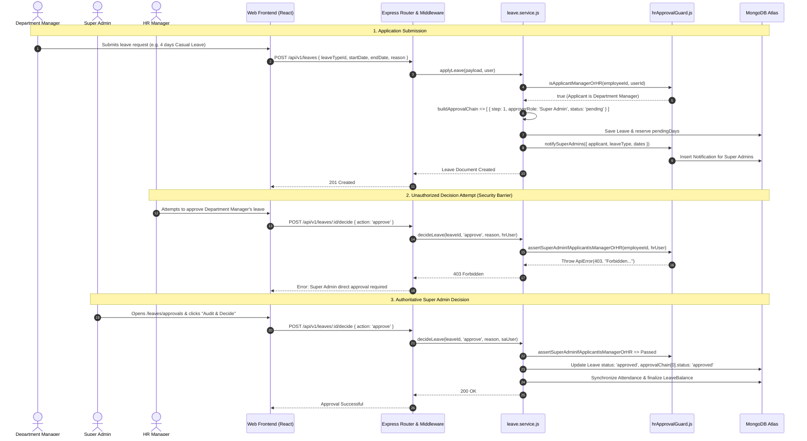

# Implementation Plan: Direct Single-Tier Super Admin Leave Approval for Department Managers

**Branch**: `31-dept-manager-leave-approval-super-admin-direct`  
**Date**: 2026-11-12  
**Spec Reference**: [`.specify/specs/31-dept-manager-leave-approval-super-admin-direct/spec.md`](file:///c:/Users/hamih/OneDrive/Desktop/AtoZ%20Coder/Advanced%20MERN/HRM/.specify/specs/31-dept-manager-leave-approval-super-admin-direct/spec.md)  
**Role & Guidelines**: Senior Architect & Ponytail Ladder (Native first, standard library, zero new dependencies, root-cause enforcement, no AI slop, English only).

---

## 1. Executive Summary & Architecture Blueprint

### 1.1 Problem Statement & Intent
In the existing leave workflow, Department Managers were processed under the standard employee hierarchy: their leaves required Line Manager review (Step 1) and HR review (Step 2), escalating to Super Admin only if duration exceeded 5 days. 
However, in an enterprise organization, Department Managers represent key functional leaders. Having peers or subordinate line managers evaluate their leaves creates organizational friction and conflict of interest. 

The requirement is to **enforce a Direct Single-Tier Chain (Super Admin only)** for Department Managers, mirroring the exact Executive Segregation-of-Duties (SOD) rules already active for HR Managers:
- When a Department Manager applies for leave, the chain is constructed with **exactly 1 step**: `approverRole: 'Super Admin'`.
- Real-time in-app and database notifications are immediately dispatched to **all active Super Admins**.
- An authoritative backend guard (`assertSuperAdminIfApplicantIsManagerOrHR`) rejects any decision attempts by HR or peer managers with **HTTP 403 Forbidden**.
- The regular employee workflow remains **100% untouched and unchanged**.
- UI reflects the `Step 1: Super Admin` tier with appropriate role-based action controls.

---

## 2. Technical Context & Scope

- **Runtime & Stack**: Node.js 22, Express, MongoDB (Mongoose), React 18, Vite, Redux Toolkit Query, Tailwind CSS, Lucide React.
- **Affected Backend Modules**:
  - `backend/src/utils/hrApprovalGuard.js`: Introduce `isUserDeptManager`, `isApplicantDeptManager`, `isApplicantManagerOrHR`, and `assertSuperAdminIfApplicantIsManagerOrHR`.
  - `backend/src/modules/leaves/leave.service.js`:
    - `buildApprovalChain`: Check for both HR and Department Manager roles to return `[ { step: 1, approverRole: 'Super Admin', approverId: null, status: 'pending' } ]`.
    - `applyLeave`: Trigger `notifySuperAdmins` when `step1.approverRole === 'Super Admin'`.
    - `decideLeave`: Call `assertSuperAdminIfApplicantIsManagerOrHR`.
    - `getPendingApprovals`: Authorize Super Admin to fetch Step 1 `Super Admin` requests, and filter them out of standard HR-only queries.
- **Affected Frontend Components**:
  - `frontend/src/features/leaves/pages/LeaveApprovalsPage.jsx`: Role-aware action protection (`In Super Admin Phase` indicator when viewed by HR/Manager).
  - `frontend/src/features/dashboard/components/widgets/PendingList.jsx`: Ensure dashboard pending queue functions seamlessly for Super Admin review.
- **Testing**:
  - `backend/tests/leave.dept-manager-approval.test.js`: New Jest test suite verifying 1-tier chain, 403 authorization guard, notification dispatch, and regular employee regression protection.

---

## 3. Architecture Diagrams

### 3.1 Sequence Diagram: Department Manager Leave Application & Decision


---

## 4. Detailed Component Implementation Plan

### 4.1 Executive Guard Layer (`backend/src/utils/hrApprovalGuard.js`)
1. **Helper `isUserDeptManager(user)`**:
   - Inspects `user.roles` or `user.role` for match with `'Department Manager'`.
2. **Helper `isApplicantDeptManager(applicantEmployee, applicantUser)`**:
   - Checks user role and employee designation/role for `'Department Manager'`.
3. **Unified Helper `isApplicantManagerOrHR(applicantEmployee, applicantUser)`**:
   - Returns `true` if applicant is HR or Department Manager.
4. **Guard `assertSuperAdminIfApplicantIsManagerOrHR(applicantEmployee, actor, requestTypeName, applicantUser)`**:
   - If applicant is Department Manager or HR, verifies `isUserSuperAdmin(actor)`.
   - If not Super Admin, throws `ApiError(403, "Forbidden: Any ${requestTypeName} applied by Department Managers or HR personnel can only be approved or decided by the Super Admin.")`.

### 4.2 Leave Service Engine (`backend/src/modules/leaves/leave.service.js`)
1. **Approval Chain Construction (`buildApprovalChain`)**:
   - Replace standalone `isApplicantHR` with `isApplicantManagerOrHR`.
   - If applicant is Department Manager or HR:
     ```javascript
     return [
       {
         step: 1,
         approverRole: 'Super Admin',
         approverId: null,
         status: 'pending'
       }
     ];
     ```
   - For all regular employees, the multi-tier logic (Manager $\rightarrow$ HR $\rightarrow$ Super Admin if >5 days) remains 100% unchanged.
2. **Notification Dispatch (`applyLeave`)**:
   - Check `step1?.approverRole === 'Super Admin'`:
     ```javascript
     if (step1?.approverRole === 'Super Admin') {
       await notifySuperAdmins({
         type: 'leave',
         title: 'New Management Leave Application Awaiting Super Admin Review',
         body: `${employee.name} (${applicantRole}) applied for ${netDays} day(s) of ${leaveType.name} from ${startStr} to ${endStr}.`,
         link: '/leaves/approvals'
       });
     }
     ```
3. **Decision Enforcement (`decideLeave`)**:
   - Execute `assertSuperAdminIfApplicantIsManagerOrHR(leave.employeeId, user, 'leave application')`.
4. **Queue Query (`getPendingApprovals`)**:
   - For `Super Admin`: include `{ 'approvalChain.0.approverRole': 'Super Admin', 'approvalChain.0.status': 'pending' }`.
   - For `HR Manager`: exclude leaves where `approvalChain.0.approverRole === 'Super Admin'` so they do not see un-actionable Step 1 pending leaves in their operational queue.

### 4.3 Frontend Presentation (`frontend/src/features/leaves/pages/LeaveApprovalsPage.jsx`)
1. **Decision Chain Badge**:
   - Displays `Step 1: Super Admin` in amber badge.
2. **Action Controls**:
   - For Super Admin: Full `Audit & Decide` and `Reject` buttons.
   - For HR Manager / Department Manager viewing the list: Disable action buttons and display a status pill:
     `<span className="px-3 py-1 text-xs font-semibold rounded-xl bg-purple-50 text-purple-700 dark:bg-purple-950/40 dark:text-purple-300 border border-purple-200/80">Super Admin Review</span>`

---

## 5. Risk Assessment & Verification Plan

| Risk | Mitigation |
| :--- | :--- |
| **Regression in Regular Employee Leaves** | Automated test suite explicitly tests regular employee leave applications to confirm that Step 1 is Department Manager and Step 2 is HR Manager. |
| **Notification Failure on Missing Super Admins** | Guard queries `User.find({ roles: superAdminRoleId, status: 'active' })` with graceful error handling so leave creation never crashes if email service is down. |
| **Delegation Security Hole** | Delegates cannot inherit Super Admin authority unless explicitly delegated from a Super Admin user. |
| **Multi-role Users** | Department Manager role always takes precedence over basic Employee role in approval chain construction. |

---

## 6. Verification Checklist
- [ ] Backend test suite passes (`backend/tests/leave.dept-manager-approval.test.js`).
- [ ] Full existing test suite runs cleanly (`npm test` in backend).
- [ ] Frontend builds cleanly with zero errors (`npm run build` in frontend).
- [ ] Manual test: Login as Dept Manager, apply leave, verify 1-step Super Admin chain.
- [ ] Manual test: Verify Super Admin receives notification and can approve.
- [ ] Branch remains `31-dept-manager-leave-approval-super-admin-direct` (no merge to `main`).

