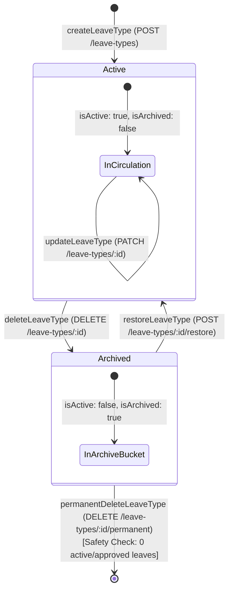
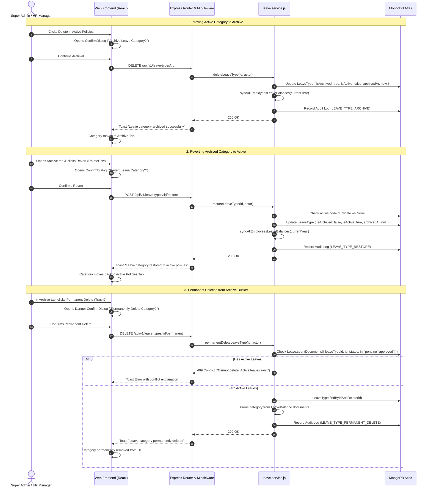

# Implementation Plan: Leave Types Archive Bucket & Lifecycle Management (Revert & Permanent Delete)

**Branch**: `feature/32-leave-types-archive-and-lifecycle-management`  
**Date**: 2026-11-13  
**Spec Reference**: [`.specify/specs/32-leave-types-archive-and-lifecycle-management/spec.md`](file:///c:/Users/hamih/OneDrive/Desktop/AtoZ%20Coder/Advanced%20MERN/HRM/.specify/specs/32-leave-types-archive-and-lifecycle-management/spec.md)  
**Role & Guidelines**: Senior Architect & Ponytail Ladder (Native first, standard library, zero new dependencies, root-cause enforcement, no AI slop, English only).

---

## 1. Executive Summary & Architecture Blueprint

### 1.1 Problem Statement & Intent
Previously, deleting a leave category on `/leaves/types` only executed a basic soft-disable (`isActive = false`) leaving the disabled item in the main roster with a disabled trash icon. There was no distinct **Archive** bucket to separate discontinued policies from operational policies, no self-service **Revert** capability to restore seasonal/archived categories, and no safe **Permanent Delete** mechanism to permanently purge obsolete categories while protecting referential integrity.

The objective is to establish a complete **Archive Bucket & Lifecycle Management** system for Leave Types:
1. **Active Policies vs Archive Bucket View Switcher**: Clean, responsive tabs in `LeaveTypesPage.jsx` with live record counters (`Active Policies (N)` and `Archive (M)`).
2. **Move to Archive on Delete**: Deleting from Active Policies prompts a confirmation modal, moves the category to the Archive bucket, sets `isArchived: true` and `isActive: false`, and updates employee quota allocations.
3. **Revert from Archive (`POST /api/v1/leave-types/:id/restore`)**: Prompts confirmation, reactivates the category (`isActive: true`, `isArchived: false`), checks duplicate code constraints, re-synchronizes employee balances, and returns the category to Active Policies.
4. **Permanent Delete from Archive (`DELETE /api/v1/leave-types/:id/permanent`)**: Prompts a high-gravity danger confirmation modal, validates that zero active/approved leave applications depend on this category (returns 409 Conflict if blocked), permanently erases the document from MongoDB, and prunes it from employee balances.
5. **Design System Adherence**: 100% adherence to `DESIGN.md` and `docs/UI-REFERENCE.md` (Forest & Emerald craft, 1px hairline borders, dual Table & Card Grid support, accessible `ConfirmDialog.jsx` modals, zero AI gradients).

---

## 2. Technical Context & Scope

- **Runtime & Stack**: Node.js 22, Express, MongoDB (Mongoose), React 18, Vite, Redux Toolkit Query, Tailwind CSS, Lucide React.
- **Affected Backend Modules**:
  - `backend/src/models/leaveType.model.js`: Add schema fields `isArchived: { type: Boolean, default: false }`, `archivedAt: { type: Date, default: null }`, and `archivedBy: { type: mongoose.Schema.Types.ObjectId, ref: 'User', default: null }` with compound index `{ isArchived: 1, isActive: 1 }`.
  - `backend/src/modules/leaves/leave.service.js`:
    - Update `getLeaveTypes`: Support `{ isArchived: true }` vs `{ isArchived: false, isActive: true }`. Default non-admin requests to active unarchived only.
    - Update `deleteLeaveType`: Set `isArchived: true`, `isActive: false`, `archivedAt`, `archivedBy`, and sync employee balances.
    - Add `restoreLeaveType`: Check duplicate code conflicts among active categories, set `isArchived: false`, `isActive: true`, sync balances, and log `LEAVE_TYPE_RESTORE`.
    - Add `permanentDeleteLeaveType`: Verify no active or approved leaves (`status: { $in: ['pending', 'approved'] }`), delete document, prune employee balances, and log `LEAVE_TYPE_PERMANENT_DELETE`.
  - `backend/src/modules/leaves/leave.controller.js`: Implement `restoreLeaveType` and `permanentDeleteLeaveType` controllers.
  - `backend/src/modules/leaves/leaveType.routes.js`: Expose `POST /:id/restore` and `DELETE /:id/permanent` protected by `checkPermission('leave.settings', 'all')`.
- **Affected Frontend Modules**:
  - `frontend/src/features/leaves/leavesApi.js`: Add RTK Query mutations `restoreLeaveType` and `permanentDeleteLeaveType`.
  - `frontend/src/features/leaves/pages/LeaveTypesPage.jsx`:
    - Add Active Policies / Archive view switcher with live badge counts.
    - Table view & Card Grid view support for both Active and Archive modes.
    - Add informative amber archive banner in Archive view.
    - Integrate confirmation modals for Archive, Revert, and Permanent Delete actions using `ConfirmDialog.jsx`.
- **Testing**:
  - `backend/tests/leave.archive-lifecycle.test.js`: Vitest test suite covering Archive, Revert, Duplicate Code Conflict, Blocked Permanent Delete, and Clean Permanent Delete.

---

## 3. Architecture Diagrams

### 3.1 State Machine: Leave Type Lifecycle


### 3.2 Sequence Diagram: Archive, Revert & Permanent Delete


---

## 4. Component & File Modification Plan

### 4.1 Backend Schema & Persistence Layer
- **`backend/src/models/leaveType.model.js`**:
  ```javascript
  isArchived: {
    type: Boolean,
    default: false
  },
  archivedAt: {
    type: Date,
    default: null
  },
  archivedBy: {
    type: mongoose.Schema.Types.ObjectId,
    ref: 'User',
    default: null
  }
  ```
  Add index: `leaveTypeSchema.index({ isArchived: 1, isActive: 1 });`

### 4.2 Backend Business Logic (`backend/src/modules/leaves/leave.service.js`)
1. **`getLeaveTypes(filter = {}, user = null)`**:
   - If `filter.archived === 'true'`: search `{ isArchived: true }`.
   - If `filter.archived === 'false'` or `filter.activeOnly === 'true'`: search `{ isArchived: false, isActive: true }`.
   - If user is not admin/HR: always enforce `{ isArchived: false, isActive: true }`.
2. **`deleteLeaveType(id, actor)`**:
   - Soft-archive: `leaveType.isArchived = true; leaveType.isActive = false; leaveType.archivedAt = new Date(); leaveType.archivedBy = actor?._id;`
   - Call `syncAllEmployeesLeaveBalances(currentYear)`.
   - Record audit log: `LEAVE_TYPE_ARCHIVE`.
3. **`restoreLeaveType(id, actor)`**:
   - Find category by id. Throw 404 if missing.
   - Assert `leaveType.isArchived === true`.
   - Check if an active unarchived category with same `code` exists. If duplicate found, throw 409 Conflict.
   - Set `leaveType.isArchived = false; leaveType.isActive = true; leaveType.archivedAt = null; leaveType.archivedBy = null;`
   - Save and call `syncAllEmployeesLeaveBalances(currentYear)`.
   - Record audit log: `LEAVE_TYPE_RESTORE`.
4. **`permanentDeleteLeaveType(id, actor)`**:
   - Find category by id.
   - Check blocking records: `const activeCount = await Leave.countDocuments({ leaveTypeId: id, status: { $in: ['pending', 'approved'] } });`
   - If `activeCount > 0`, throw `ApiError(409, "Cannot permanently delete '${leaveType.name}': There are ${activeCount} active or approved leave application(s) linked to this category.")`.
   - Delete document: `await LeaveType.findByIdAndDelete(id);`
   - Prune from employee `LeaveBalance`: remove category balance object where `leaveType: id`.
   - Record audit log: `LEAVE_TYPE_PERMANENT_DELETE`.

### 4.3 Backend API Routes & Validation
- **`backend/src/modules/leaves/leave.controller.js`**:
  - `restoreLeaveType` controller calling `leaveService.restoreLeaveType(req.params.id, req.user)`.
  - `permanentDeleteLeaveType` controller calling `leaveService.permanentDeleteLeaveType(req.params.id, req.user)`.
- **`backend/src/modules/leaves/leaveType.routes.js`**:
  - `POST /:id/restore`: `checkPermission('leave.settings', 'all')`, `validate(leaveTypeIdParamSchema)`, `leaveController.restoreLeaveType`.
  - `DELETE /:id/permanent`: `checkPermission('leave.settings', 'all')`, `validate(leaveTypeIdParamSchema)`, `leaveController.permanentDeleteLeaveType`.

### 4.4 Frontend Redux Toolkit Query API (`frontend/src/features/leaves/leavesApi.js`)
- Add mutations:
  - `restoreLeaveType: builder.mutation({ query: (id) => ({ url: `/leave-types/${id}/restore`, method: 'POST' }), invalidatesTags: [{ type: 'LeaveType', id: 'LIST' }, 'Leave'] })`
  - `permanentDeleteLeaveType: builder.mutation({ query: (id) => ({ url: `/leave-types/${id}/permanent`, method: 'DELETE' }), invalidatesTags: [{ type: 'LeaveType', id: 'LIST' }, 'Leave'] })`

### 4.5 Frontend Master Page (`frontend/src/features/leaves/pages/LeaveTypesPage.jsx`)
- State additions:
  - `activeTab`: `'active'` | `'archived'`.
  - `archiveTarget`: category to move to archive.
  - `revertTarget`: category to revert to active.
  - `permanentDeleteTarget`: category to permanently purge.
- Top View Switcher Tabs:
  - **Active Policies (`activeCount`)** & **Archive (`archivedCount`)** styled with `bg-emerald-600` / `bg-[#00C471]`.
- Action Buttons in Active Policies:
  - **Edit** & **Archive** (`Trash2` with title "Archive Category").
- Action Buttons in Archive Tab:
  - **Revert** (`RotateCcw` in emerald) & **Permanent Delete** (`Trash2` in rose).
- Informational Banner in Archive Tab.
- 3 Dedicated `ConfirmDialog` instances:
  - Archive Category modal
  - Revert Category modal
  - Permanent Delete danger modal

---

## 5. Verification Plan

1. **Unit & Integration Tests**:
   - Run `backend/tests/leave.archive-lifecycle.test.js`:
     - Test 1: Moving category to archive updates `isArchived: true` and syncs balances.
     - Test 2: Employees cannot see archived category in `getLeaveTypes` active list.
     - Test 3: Reverting category reactivates it, syncs balances, and makes it available again.
     - Test 4: Reverting rejects duplicate codes with 409.
     - Test 5: Permanent delete fails with 409 if approved leaves exist.
     - Test 6: Permanent delete succeeds if no active leaves exist, and prunes from balances.
2. **Frontend Build Verification**:
   - Run `npm --prefix frontend run build` to confirm 0 compilation or lint errors.
3. **Existing Test Suite Verification**:
   - Run `backend/tests/leave.quota-sync.test.js` to ensure zero regressions in previous quota synchronization logic.

