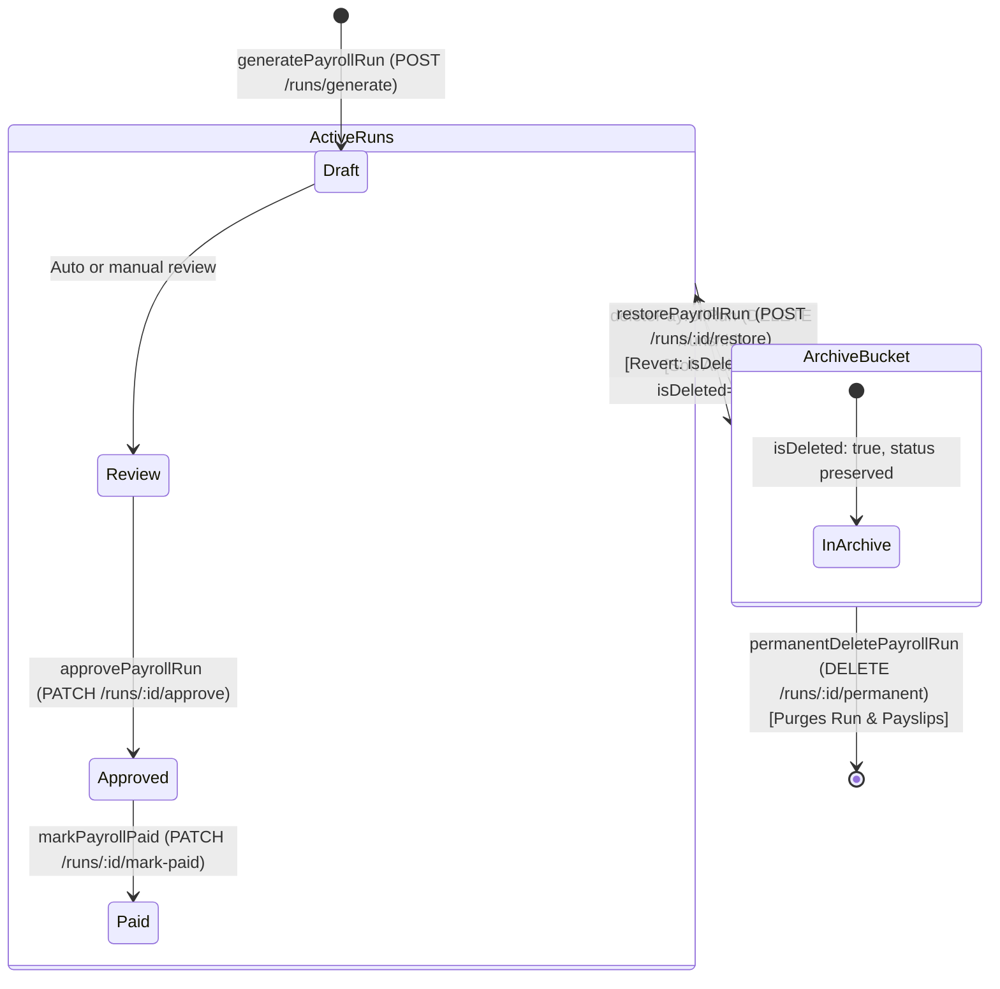
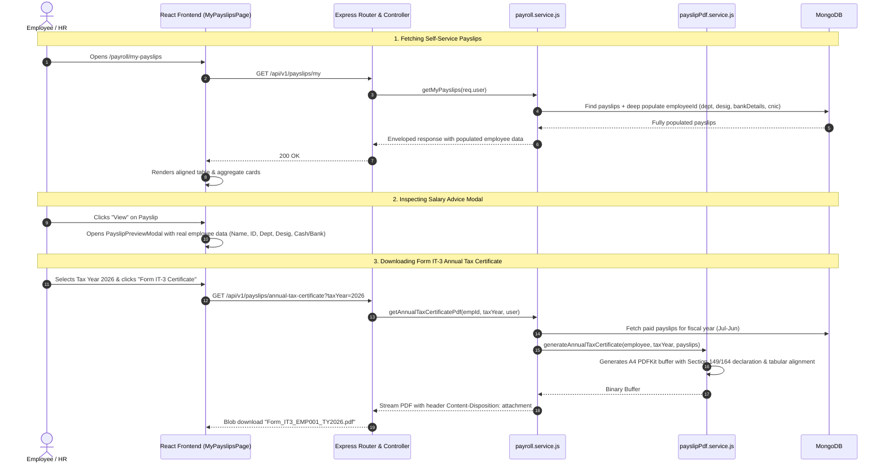

# Implementation Plan: Payroll Module UI Craft & Lifecycle Management (My Payslips, Form IT-3, Payroll Runs, Archive Bucket & Detail View)

**Branch**: `feature/33-payroll-ui-craft-and-lifecycle-management`  
**Date**: 2026-11-13  
**Spec Reference**: [`.specify/specs/33-payroll-ui-craft-and-lifecycle-management/spec.md`](file:///c:/Users/hamih/OneDrive/Desktop/AtoZ%20Coder/Advanced%20MERN/HRM/.specify/specs/33-payroll-ui-craft-and-lifecycle-management/spec.md)  
**Role & Guidelines**: Senior Architect & Ponytail Ladder (Native first, standard library, zero new dependencies, root-cause bug fixing, no AI slop, English only).

---

## 1. Executive Summary & Architecture Blueprint

### 1.1 Problem Statement & User Intent
The user requested an end-to-end upgrade of the **Payroll Module** following [`DESIGN.md`](file:///c:/Users/hamih/OneDrive/Desktop/AtoZ%20Coder/Advanced%20MERN/HRM/DESIGN.md), [`docs/UI-REFERENCE.md`](file:///c:/Users/hamih/OneDrive/Desktop/AtoZ%20Coder/Advanced%20MERN/HRM/docs/UI-REFERENCE.md), and system docs:
1. **My Payslips Page (`/payroll/my-payslips`)**:
   - Fix control alignments: The Tax Year select picker and **Form IT-3 Certificate** download button must align perfectly with the header.
   - High-density table: Hairline 1px borders, tabular monospace monetary values, and aligned action triggers.
2. **Form IT-3 Certificate (PDF & UI)**:
   - UI selector and single-click download with operational loading states.
   - Flawless PDF layout (`payslipPdf.service.js`) with exact statutory wording (Section 149/164 of the Income Tax Ordinance, 2001), 40pt padding, zero text clipping, and accurate Pakistani Rupee `numberToWords` text.
3. **Salary Slip View (`PayslipPreviewModal.jsx`)**:
   - Pull full employee details from the database without fallback text (`Employee`, `N/A`, `Staff`, `General`, `••••5678`).
   - Root-cause fix: `getMyPayslips` and `getPayrollRunById` queries in `payroll.service.js` must populate `employeeId` with `name`, `employeeCode`, `designationId`, `departmentId`, `cnic`, and `bankDetails`.
   - Default payment method: Set to **Cash** when unspecified. When Cash is active, suppress fictitious IBAN numbers and show "Cash in Hand".
   - PDF Download: 100% working generation of individual salary advices.
4. **Monthly Payroll Runs (`/payroll/runs`) & Archive Lifecycle**:
   - Establish **Active Runs** vs **Archive Bucket** tab switcher with live counters.
   - Deleting a payroll run moves it into the Archive bucket (`isDeleted: true, deletedAt, deletedBy`).
   - Archive tab provides **Revert** (`POST /api/v1/payroll/runs/:id/restore`) and **Permanent Delete** (`DELETE /api/v1/payroll/runs/:id/permanent`).
   - Replace all `window.confirm` dialogs with styled `ConfirmDialog.jsx` instances.
5. **Payroll Run Detail View (`/payroll/runs/:id`)**:
   - Linear/Elvara craft redesign with 4-stage stepper, 6 KPI metric widgets, and an itemized payslip table with avatar initials and tabular numbers.

---

## 2. Technical Context & Scope

- **Runtime & Stack**: Node.js 22, Express, MongoDB (Mongoose), React 18, Vite, Redux Toolkit Query, Tailwind CSS, Lucide React, PDFKit.
- **Affected Backend Modules**:
  - `backend/src/models/payrollRun.model.js`: Ensure indexes `{ isDeleted: 1, month: 1, year: 1 }` and `paymentMethod` defaults.
  - `backend/src/models/payslip.model.js`: Add `paymentMethod` (`cash` | `bank_transfer` | `cheque`, default: `cash`), ensure `isDeleted` index.
  - `backend/src/modules/payroll/payroll.service.js`:
    - `getMyPayslips`: Add deep population for `employeeId` (`departmentId`, `designationId`, `bankDetails`, `cnic`).
    - `getPayrollRunById`: Include `bankDetails` and `cnic` in `employeeId` population.
    - `getPayrollRuns`: Support query filter `archived=true` vs `archived=false` (default unarchived).
    - `deletePayrollRun`: Soft-archive run and child payslips (`isDeleted: true`).
    - `restorePayrollRun`: Reactivate archived run and child payslips with duplicate active code checks.
    - `permanentDeletePayrollRun`: Permanently delete run and child payslips after referential checks.
  - `backend/src/modules/payroll/payroll.controller.js`: Add `restorePayrollRun` and `permanentDeletePayrollRun` handlers.
  - `backend/src/modules/payroll/payroll.routes.js`: Register `POST /runs/:id/restore` and `DELETE /runs/:id/permanent` protected by `checkPermission('payroll.manage', 'all')`.
  - `backend/src/modules/payroll/payslipPdf.service.js`: Refine Form IT-3 and payslip PDF generation for flawless alignment, accurate wording, and Cash payment display.
- **Affected Frontend Modules**:
  - `frontend/src/features/payroll/payrollApi.js`: Add RTK Query mutations `restorePayrollRun` and `permanentDeletePayrollRun`.
  - `frontend/src/features/payroll/pages/MyPayslipsPage.jsx`: Redesign header, button alignments, metric cards, and table.
  - `frontend/src/features/payroll/components/PayslipPreviewModal.jsx`: Fully populated employee details, default Cash handling, working PDF download.
  - `frontend/src/features/payroll/pages/PayrollRunsPage.jsx`: Active vs Archive tab switcher, high-craft data table, and ConfirmDialog modals.
  - `frontend/src/features/payroll/pages/PayrollRunDetailPage.jsx`: 4-stage stepper, 6 KPI cards, and refined employee payslips table.
- **Testing**:
  - `backend/tests/payroll.archive-lifecycle.test.js`: Vitest integration test suite covering soft-archive, employee scoping, restoration, duplicate prevention, and permanent deletion.

---

## 3. Architecture Diagrams

### 3.1 State Machine: Payroll Run Lifecycle with Archive Bucket


### 3.2 Sequence Diagram: Payslip Preview & Form IT-3 Certificate


---

## 4. Database Contracts & API Specification

### 4.1 Schema Refinements

#### `PayrollRun` Schema:
```javascript
{
  month: { type: Number, required: true, min: 1, max: 12 },
  year: { type: Number, required: true },
  status: { type: String, enum: ['draft', 'review', 'approved', 'paid', 'cancelled'], default: 'draft', index: true },
  paymentMethod: { type: String, enum: ['cash', 'bank_transfer', 'cheque'], default: 'cash' },
  isDeleted: { type: Boolean, default: false, index: true },
  deletedAt: { type: Date, default: null },
  deletedBy: { type: mongoose.Schema.Types.ObjectId, ref: 'User', default: null }
}
```

#### `Payslip` Schema:
```javascript
{
  payrollRunId: { type: mongoose.Schema.Types.ObjectId, ref: 'PayrollRun', required: true, index: true },
  employeeId: { type: mongoose.Schema.Types.ObjectId, ref: 'Employee', required: true, index: true },
  month: { type: Number, required: true },
  year: { type: Number, required: true },
  paymentMethod: { type: String, enum: ['cash', 'bank_transfer', 'cheque'], default: 'cash' },
  isDeleted: { type: Boolean, default: false, index: true },
  deletedAt: { type: Date, default: null }
}
```

### 4.2 API Endpoint Contracts

| Method | Endpoint | Access Control | Purpose |
|---|---|---|---|
| `GET` | `/api/v1/payslips/my` | Authenticated Employee | Retrieves personal payslips with fully populated employee details |
| `GET` | `/api/v1/payslips/:id/pdf` | Employee (self) / Admin | Streams branded payslip PDF advice |
| `GET` | `/api/v1/payslips/annual-tax-certificate` | Employee (self) / Admin | Streams Form IT-3 annual tax certificate PDF |
| `GET` | `/api/v1/payroll/runs` | `payroll.view` | Retrieves paginated runs supporting `archived=true/false` filter |
| `GET` | `/api/v1/payroll/runs/:id` | `payroll.view` | Retrieves single run details with fully populated payslips |
| `DELETE` | `/api/v1/payroll/runs/:id` | `payroll.manage` | Soft-deletes payroll run and child payslips (moves to Archive) |
| `POST` | `/api/v1/payroll/runs/:id/restore` | `payroll.manage` | Reverts an archived payroll run back to active circulation |
| `DELETE` | `/api/v1/payroll/runs/:id/permanent` | `payroll.manage` (Super Admin) | Permanently deletes an archived payroll run and child records |

---

## 5. UI/UX Specifications (`DESIGN.md` & `docs/UI-REFERENCE.md`)

### 5.1 My Payslips Page (`MyPayslipsPage.jsx`)
- **PageHeader & Actions**:
  - Title: "My Salary Slips" with subtitle.
  - Action Bar: Perfectly aligned horizontally:
    - `RefreshButton`
    - Tax Year select dropdown: `px-3 py-2 bg-slate-50 dark:bg-slate-800 border border-slate-200 dark:border-slate-700 rounded-xl text-xs font-semibold text-slate-700 dark:text-slate-300 h-9`
    - Form IT-3 Certificate button: `inline-flex items-center gap-2 px-4 h-9 bg-[#00C471] hover:bg-[#049856] text-white rounded-xl text-xs font-semibold shadow-sm shadow-emerald-600/20 active:scale-[0.98]`
- **Aggregate KPI Metric Cards**:
  - 3 cards (`Total Net Take-Home`, `Average Monthly Salary`, `Total FBR Tax Contributed`).
  - Values formatted in `font-mono tabular-nums text-2xl font-bold`.
- **Table at the Bottom**:
  - Header: `bg-slate-50/75 dark:bg-[#0E1A14] text-[11px] font-semibold text-slate-500 uppercase tracking-wider py-3.5 px-6 border-b border-slate-200/80 dark:border-[#1A3125]`.
  - Cells:
    - Month pill with numeric month prefix and payment method tag (`Cash` / `Bank Transfer`).
    - Financial columns right-aligned `font-mono tabular-nums`.
    - Status pill with emerald dot.
    - Actions: `View` (styled icon button) and `PDF` (emerald icon button).

### 5.2 Salary Slip Preview Modal (`PayslipPreviewModal.jsx`)
- Header: "PAYSLIP ADVICE [Month Year]" with status pill and Ref `#XXXXXXXX`.
- Employee Information Grid:
  - Employee Name: Real database name.
  - Employee Code: Monospace tag.
  - Designation & Department: Populated titles.
  - Payment Mode: `Cash` (default) or `Bank Transfer`.
  - Bank Name / Account: If Cash $\rightarrow$ displays "Cash in Hand" and hides account number. If Bank Transfer $\rightarrow$ displays masked bank account.
- Itemized Ledgers:
  - Earnings column: Basic, Allowance, Overtime, Reimbursement.
  - Deductions column: FBR Tax, EOBI, PF, Late deductions.
- Net Salary Payable Card:
  - Emerald highlight card with `font-mono text-2xl font-bold text-emerald-600`.
- Actions:
  - Download PDF button (100% working via `/api/v1/payslips/:id/pdf`).
  - Print button (`window.print()`).
  - Close button.

### 5.3 Monthly Payroll Runs (`PayrollRunsPage.jsx`)
- **Active Runs vs Archive Bucket Tab Switcher**:
  - `Active Runs (count)`: Emerald active pill (`bg-[#00C471] text-white`).
  - `Archive Bucket (count)`: Amber active pill when selected (`bg-amber-600 text-white`).
- **Toolbar**:
  - Year select picker + Status select picker + Single search input + Generate Payroll Run CTA (`bg-[#00C471]`).
- **Data Table**:
  - Columns: `Payroll Period`, `Stage / Status`, `Headcount`, `Gross Pay`, `Tax Withheld`, `Net Disbursement`, `Actions`.
  - Active Tab Actions: `Details` (`Eye` in emerald) and `Archive` (`Trash2` in soft rose).
  - Archive Tab Actions: `Revert` (`RotateCcw` in emerald) and `Permanent Delete` (`Trash2` in rose).
- **Modals**:
  - 3 discrete `ConfirmDialog.jsx` instances for Archive, Revert, and Permanent Delete.

### 5.4 Payroll Run Detail Page (`PayrollRunDetailPage.jsx`)
- Header: Month/Year title, status pill, run ID subtitle, and aligned buttons (`Refresh`, `Export Bank Advice`, `Approve`, `Mark Paid`, `Delete Run`).
- Stepper: 4-stage visual progression with emerald completed checks.
- 6 Metric KPI Widgets: Monospace tabular numbers for Headcount, Gross, Tax, EOBI, Overtime, Net.
- Payslips Table: Search by employee name or code, avatar initials, department, right-aligned monetary values, and `Adjust` / `View Slip` buttons.

---

## 6. Implementation Stages & Phases

1. **Phase 1: Backend Population, Cash Defaults & Lifecycle Services**:
   - Update `getMyPayslips` and `getPayrollRunById` to populate full employee details.
   - Update `deletePayrollRun` to soft-delete (`isDeleted: true`).
   - Implement `restorePayrollRun` and `permanentDeletePayrollRun` in `payroll.service.js`.
   - Register routes in `payroll.routes.js` and controllers in `payroll.controller.js`.
2. **Phase 2: PDF Generator Perfection (`payslipPdf.service.js`)**:
   - Refine Form IT-3 Certificate PDF formatting, margin alignment, statutory citation, and currency words.
   - Refine Payslip PDF to respect Cash payment mode and real employee metadata.
3. **Phase 3: My Payslips Page & Salary Slip Preview Modal**:
   - Refine `MyPayslipsPage.jsx` layout, button alignments, and table styling.
   - Overhaul `PayslipPreviewModal.jsx` to render database employee fields and handle Cash defaults.
4. **Phase 4: Payroll Runs Dashboard & Archive Tab**:
   - Add RTK Query mutations to `payrollApi.js`.
   - Implement Active Runs vs Archive Bucket switcher in `PayrollRunsPage.jsx`.
   - Wire `ConfirmDialog` modals for Archive, Revert, and Permanent Delete.
5. **Phase 5: Payroll Run Detail View (`PayrollRunDetailPage.jsx`)**:
   - Redesign detail page stepper, KPI widgets, and employee payslips table.
   - Connect "View Slip" directly to updated `PayslipPreviewModal.jsx`.
6. **Phase 6: Verification & Testing**:
   - Vitest test suite (`payroll.archive-lifecycle.test.js`).
   - Frontend production build check (`npm --prefix frontend run build`).

